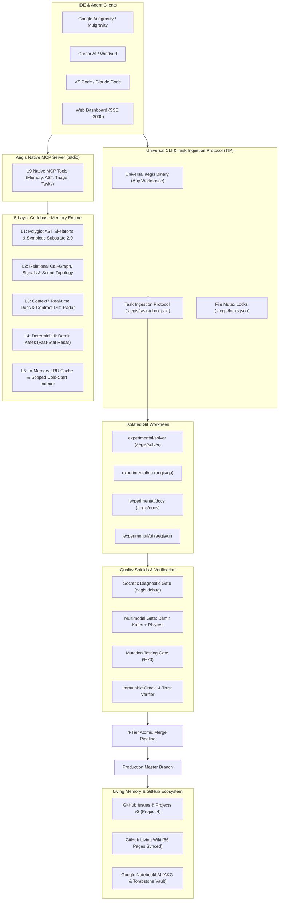
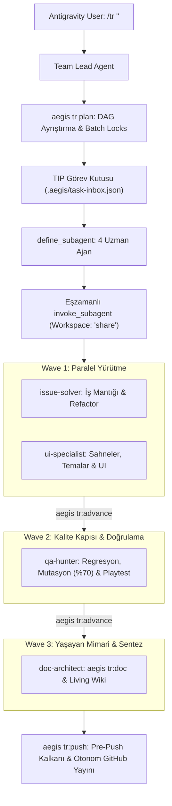

# 🛡️ AEGIS — Autonomous Vibe Coding & Codebase Memory Engine
### Google Antigravity, Mulgravity, Cursor, VS Code & Web İçin 5-Katmanlı Hafıza, TIP Protokolü ve Deterministik Güvenlik Motoru

[](https://github.com/frkntlr/aegis/actions)
[](https://opensource.org/licenses/MIT)
[](https://nodejs.org/)
[](https://www.typescriptlang.org/)
[](https://turbo.build/)
[-success.svg)](#-deterministik-demir-kafes-iron-cage)
[](#-yerel-model-context-protocol-mcp-sunucusu-40-araç)
[-brightgreen.svg)](#-hızlı-başlangıç-quick-start)
[](#-hızlı-başlangıç-quick-start)
[](https://github.com/frkntlr/aegis/wiki)

Aegis; yapay zeka modellerinin dikkatinin dağılması (**context bloat**), bağlam unutması (**context drop**), uydurma metod/kütüphane üretimi (**AI hallucination**), spagetti/ölü kod üretimi ve sonsuz kilitlenme (**infinite regression / stagnation**) problemlerini ortadan kaldıran yeni nesil otonom yazılım mühendisliği motorudur.

Geliştiricilere ve otonom AI ajanlarına (Google Antigravity, Mulgravity, Cursor, VS Code, Windsurf, Claude Code) **5-Katmanlı Kod Tabanı Hafızası**, **Evrensel CLI (`aegis`, `aegist`, `tw`, `tr`)**, **Çekme Tabanlı Görev Dağıtım Protokolü (TIP)**, **Rol Tabanlı Git Worktree İzolasyonu**, **Otomatik Bayat Kilit Budamalı (Stale-Lock Pruning) WorktreeLockManager**, **Dinamik Mesh & Atomik JSON Kalıcılığı (Atomics.wait)**, **40 Yerel Stdio MCP Aracı**, **Ayrık Godot UI AST Ayrıştırıcısı (GodotUiParser)**, **455+ Dosyada Demir Kafes Uyumlu Mimari Ayrıştırma**, **812 Testlik Doğrulama (86ms Turbo Replay)**, **Sokratik Teşhis Kapısı**, **Multimodal Kalite Kapısı (Playtest-Before-PR)** ve **56 Sayfalık Yaşayan GitHub Wiki Ekosistemi** sunar.

---

## 📑 İçindekiler

> 📚 **Modüler Mimari Kütüphanesi:** Projenin her temel başlığı için Demir Kafes standartlarında (< 300 satır) hazırlanan modüler dokümanlara [docs/README.md](docs/README.md) üzerinden erişebilirsiniz.


- [🌟 Neden Aegis? (Çözülen Temel Problemler)](#-neden-aegis-çözülen-temel-problemler)
- [🏛️ Sistem Mimarisi & Akış Şeması](#️-sistem-mimarisi--akış-şeması)
- [🧠 5-Katmanlı Kod Tabanı Hafıza Motoru](#-5-katmanlı-kod-tabanı-hafıza-motoru)
- [📥 Çekme Tabanlı Görev Dağıtım Protokolü (TIP)](#-çekme-tabanlı-görev-dağıtım-protokolü-tip)
- [🔌 Yerel Model Context Protocol (MCP) Sunucusu (40 Araç)](#-yerel-model-context-protocol-mcp-sunucusu-40-araç)
- [🎮 Godot 4.x Oyun Motoru Köprüsü (`@aegis/godot-bridge`)](#-godot-4x-oyun-motoru-köprüsü-aegisgodot-bridge)
- [🛡️ Deterministik Demir Kafes (Iron Cage)](#️-deterministik-demir-kafes-iron-cage)
- [👥 Rol Tabanlı Git Worktrees & Çakışmasız Kilitleme](#-rol-tabanlı-git-worktrees--çakışmasız-kilitleme)
- [🩺 Sokratik Teşhis & Kanıt Tabanlı Anti-Halüsinasyon](#-sokratik-teşhis--kanıt-tabanlı-anti-halüsinasyon)
- [📡 Gerçek Zamanlı SSE Web Komuta Merkezi (`localhost:3000`)](#-gerçek-zamanlı-sse-web-komuta-merkezi-localhost3000)
- [🌐 Yaşayan GitHub, RFC (44 Adet) & NotebookLM Döngüsü](#-yaşayan-github-rfc-34-adet--notebooklm-döngüsü)
- [📦 Monorepo Paket Dağılımı (14 Paket)](#-monorepo-paket-dağılımı-14-paket)
- [🚀 Hızlı Başlangıç (Quick Start)](#-hızlı-başlangıç-quick-start)
- [⚡ Alt Komut Keşfi, Tab-Completion & Slash Komutları](#-alt-komut-keşfi-tab-completion--antigravity-slash-komutları)
- [💻 Kapsamlı Evrensel CLI Komut Referansı](#-kapsamlı-evrensel-cli-komut-referansı)
- [⚙️ IDE & MCP İstemci Yapılandırması](#️-ide--mcp-istemci-yapılandırması)
- [⚖️ Ajan Anayasası & Katkı Kuralları](#️-ajan-anayasası--katkı-kuralları)
- [📜 Lisans](#-lisans)

---

## 🌟 Neden Aegis? (Çözülen Temel Problemler)

| Klasik Vibe Coding / AI Kodlama Problemi | Aegis'in Getirdiği Çözüm Mekanizması | Sağlanan Fayda |
| :--- | :--- | :--- |
| **Context Bloat & Token İsrafı:** Modeller tüm dosyaları okur, 50.000 satır için token limitini tüketir ve dikkati dağılır. | **Cerrahi Çok Dilli AST İskeletleme (`@aegis/ast-skeleton`):** Fonksiyon gövdelerini gizleyip sadece tip, arayüz ve imzaları sunar. | **%67 - %95 Token Tasarrufu** ve odaklanmış cerrahi bağlam. |
| **Geçişli Tip Şişmesi & Versiyon Kayması:** Kütüphanelerin derin tipleri bağlamı patlatır; lockfile güncellendiğinde ajan bayat sözleşmelerle kod yazar. | **Symbiotic Substrate 2.0 & Contract Drift Radar (`aegis deps:drift`):** Bounded Depth, Nominal Opaque Stubbing (`__opaque`) ve streaming $O(1)$ lockfile hashi. | **%90 - %95 Ekstra Tasarruf**, proaktif kırıcı değişiklik tespiti ve sıfır sahte alarm. |
| **İtme Tabanlı Görev Karmaşası:** Ajanlar ne yapacağını bilemez, yanlış dosyalara girer veya aynı görevi mükerrer üstlenir. | **Task Ingestion Protocol (TIP) & Staged Task Bridge (`.aegis/task-inbox.json`):** Çekme tabanlı atomik görev kuyruğu (`task:inject`, `task:pull`). | **Sıfır Çakışma**, rol bazlı cerrahi prompt ve izole yürütme. |
| **Yapay Zeka Halüsinasyonu:** Var olmayan fonksiyonları veya eski kütüphane API'lerini uydurur. | **Context7 Canlı Kütüphane Dokümantasyonu & Godot ClassDB Oracle:** Doğrulanmış resmi API referanslarını anlık enjekte eder. | **Sıfır Uydurma API**, gerçekçi ve çalışan kod üretimi. |
| **Spagetti Kod & Monolitik Şişkinlik:** Modeller tek fonksiyona 200 satır yazar, kurallara sadece prompt düzeyinde uyar. | **Deterministik Demir Kafes (`@aegis/iron-cage`):** 40 satır/fonksiyon, 300 satır/dosya ve Fast-Stat Cache Radarı (RFC-032). | **Temiz Mimari Garantisi**, ihlalde commit anında reddedilir; 0 ms önbellek denetimi. |
| **Ajanların Birbirinin Kodunu Ezmesi:** Paralel çalışan pencereler veya kardeş ajanlar aynı dosyaları değiştirir. | **Rol Tabanlı Git Worktrees & Çakışmasız Kalıcı Dosya Kilitleri (`.aegis/locks.json`):** İzole dallar ve mutex koruması. | **Sıfır Git Merge Çakışması**, temiz paralel geliştirme. |
| **Rastgele Deneme-Yanılma & Stagnation:** Ajan aynı hatayı 10 kez dener, yığın izini okumadan tahmin yürütür. | **Sokratik Teşhis Kapısı (`aegis debug`) & 3 Fazlı Diyalog Motoru:** Yığın izi ayrıştırma, kök neden triangülasyonu ve hipotez doğrulama. | **Kanıt Tabanlı Çözüm**, sıfır tahmin ve anında doğru reçete. |
| **Bozuk Kodun Ana Dala Karışması:** Kod derlenir ama çalışma zamanında sahne veya oyun çöker. | **Multimodal Kalite Kapısı (`aegis verify:task`):** Demir Kafes AST denetimi ve Headless Playtesting (Playtest-Before-PR). | **%100 Çalışma Garantisi**, çöken veya hatalı PR açılamaz. |
| **Güvenilmez Ajan Beyanları:** Ajan "Testler geçti" der ama aslında test dosyasını silmiş ya da `expect(true).toBe(true)` yazmıştır. | **Immutable Oracle (`@aegis/trust-verifier`) & Mutasyon Test Kapısı (%70 Barajı):** Test tahrifini engeller, zayıf testleri eler. | **%100 Güvenilir Doğrulama**, hileli veya sahte testler engellenir. |
| **Oturum Kopması & Manuel Çerez Hamallığı:** NotebookLM oturumu düştüğünde sistem sessizce kilitlenir veya manuel token ister. | **Ambient Harvester, Hesap Değiştirme (`aegis nlm:switch`) & Tri-State Protokolü:** Sıfır-tıklama CDP/DPAPI keşfi ve interaktif Antigravity modalı. | **Sıfır Kesinti**, tek tıkla oturum yenileme ve sıfır sessiz düşüş. |
| **CLI Başlangıç Gecikmesi & Yavaş Komutlar:** Monolitik statik importlar CLI başlatma süresini uzatır, hızlı görev akışını aksatır. | **Dinamik Lazy Loading & Persistent Manifest Önbelleği:** 22 komut dinamik import'a geçirildi; manifest ve git index mtime ile taranır. | **~103ms Cold-Start (2.6x Hızlanma)** ve **<2ms** dosya adayı keşfi. |
| **Çok Ajanlı Görev Karmaşası & Kilit Yarışları:** Paralel ajanlar için görev planlamak uzun komutlar ve manuel kilit koordinasyonu gerektirir. | **Antigravity Otonom Multi-Agent Koordinatörü (`tr` / `tw`), Atomic Batch Locks & RTK Compact:** `tr` ve `tw` evrensel %100 eşdeğerliği, alt ajanların (`issue-solver`, `qa-hunter`, `ui-specialist`, `doc-architect`) otomatik tanımlanıp eşzamanlı çalıştırılması, tek geçişte `acquireBatchLocks()` ve `--compact` bayrağı. | **Tek Komutla Otonom Orkestrasyon**, sıfır kilit yarışması ve **%85-92 Token Tasarrufu**. |
| **Çok Ajanlı Durum Yarışları (Mesh Concurrency):** Eşzamanlı çalışan alt ajanlar ortak mesh veya durum dosyalarına yazarken veri çakışmasına düşer. | **Dynamic Teamwork Mesh Store & Atomic JSON Persistence (`teamwork-mesh-store.ts`):** Benzersiz geçici dosya (`.tmp-<ts>-<rand>`), `fs.renameSync` ve 3 denemeli `Atomics.wait` senkron geri çekilme (backoff). | **Sıfır Yarış Durumu (Zero-Race Condition)**, <0.06ms bellek-içi mtime önbelleği. |
| **Yetim Kilitler & Depo Kilitlenmesi (Deadlock):** Çöken veya durdurulan alt ajan süreçleri arkalarında bayat dosya kilidi bırakarak diğer ajanları dondurur. | **Worktree Lock Manager & Stale-Lock Pruning (`worktree-lock-manager.ts`):** `isPidAlive` ile ölü PID denetimi (`process.kill(pid, 0)`), 30 dk TTL zaman aşımı ve `.corrupt` karantina koruması. | **Sıfır Kilitlenme**, kendi kendini onaran kalıcı kilit yönetimi. |
| **Monolitik Godot Sahne Denetimi:** Godot `.tscn` sahneleri ve GDScript kontrolcüleri ayrıştırılırken linter mantığıyla iç içe geçip şişer. | **Ayrık Godot UI AST Ayrıştırıcısı (`GodotUiParser`):** Sahne düğüm hiyerarşisi, konteyner özellikleri ve sinyal bağlantılarını linter'dan bağımsız ayrıştırır. | **Hızlı AST Analizi**, <100 satır bağımsız ayrıştırıcı, sıfır binary bağımlılığı. |
| **Subagent İstem Şişmesi & Yavaş Testler:** Subagent'lara verilen uzun ve laf kalabalığı istemler gecikmeyi artırır; yavaş testler geliştirme döngüsünü aksatır. | **Ultra-Yalın Mikro-İstemler (<160 Token) & Turbo Build Cache:** Cerrahi sembol çapaları (`ANCHORS`), sözleşmeler (`CONTRACT`) ve 14 pakette 812 test. | **%92 Token Tasarrufu**, 35 saniyede 812 test, **86ms** Full Turbo tekrarı. |

---

## 🏛️ Sistem Mimarisi & Akış Şeması

Aegis; geliştiricinin, IDE'nin veya otonom ajanların taleplerini merkezi orkestratörden geçirerek izole ortamlarda, fiziksel güvenlik kapılarıyla denetler:



---

## 🧠 5-Katmanlı Kod Tabanı Hafıza Motoru

Aegis'in kalbinde, kod tabanını anlık ve cerrahi olarak anlamlandıran **5-Katmanlı Hafıza Motoru (`@aegis/ast-skeleton`)** yer alır:

```
┌─────────────────────────────────────────────────────────────────┐
│ Layer 5: In-Memory LRU Buffer, Watcher & Scoped Cold-Start      │
├─────────────────────────────────────────────────────────────────┤
│ Layer 4: Deterministik Demir Kafes Rules & Fast-Stat Radar      │
├─────────────────────────────────────────────────────────────────┤
│ Layer 3: Context7 Ground Truth & Contract Drift Radar (deps)    │
├─────────────────────────────────────────────────────────────────┤
│ Layer 2: Relational Call-Graph, Signals & Scene Topology        │
├─────────────────────────────────────────────────────────────────┤
│ Layer 1: Polyglot AST Skeletons & Symbiotic Substrate 2.0       │
└─────────────────────────────────────────────────────────────────┘
```

1. **Katman 1 — Çok Dilli AST İskeletleme & Symbiotic Substrate 2.0:** TypeScript, JavaScript, Python, GDScript, Rust, C, C++, Go ve Godot `.tscn` sahnelerini ayrıştırır. Fonksiyon gövdelerini gizleyerek sınıfların, metodların ve tip tanımlarının iskeletini çıkarır (**%67-95 token tasarrufu**). **TransitiveTypeClosure** ile 1. derece somut imzaları korurken 2.+ derece geçişli tipleri nominal tek satırlık markalı stübler (`__opaque`) olarak katlar; barrel re-export zincirlerini çözer ve global tipleri (`Buffer`, `URL`, `AbortSignal`) korur. 50 satırlık devre kesici ile bağlam taşmalarını fiziksel olarak engeller.
2. **Katman 2 — İlişkisel Çağrı Çizgesi & Etki Alanı (Blast Radius):** Hangi fonksiyonun kimi çağırdığını, hangi GDScript sinyalinin hangi düğüme bağlı olduğunu ve bir değişikliğin patlama yarıçapını (`blastRadius`) anında haritalandırır (`aegis trace`, `aegis graph:scan`).
3. **Katman 3 — Context7 Dokümantasyonu & Contract Drift Radar (`aegis deps:drift`):** Godot, React, TypeScript, Fastify gibi kütüphanelerin resmi güncel belgelerini hafızaya bağlar. **Contract Drift Radar** ile `package-lock.json`, `yarn.lock`, `project.godot` vb. kilit dosyalarını $O(1)$ akış tamponu ve `CrlfNormalizerStream` ile satır sonu (`\r\n` vs `\n`) farklarından bağımsız deterministik SHA-256 ile tarar; kaldırılan metot veya imza kaymalarını kod yazılmadan önce proaktif tespit eder. `metadata.lock` ile izole ekosistem geçersiz kılma sağlar.
4. **Katman 4 — Deterministik Demir Kafes & Fast-Stat Radar:** Değiştirilen dosyanın kalan satır bütçesini (Maks. 300) ve fonksiyon bütçesini (Maks. 40) anlık hesaplar. **Fast-Stat Cache Radarı (RFC-032)** ile dosya boyutu ve mtime değişmeyen dosyalar 0 milisaniyede önbellekten doğrulanır.
5. **Katman 5 — Bellek İçi Önbellek, Canlı İzleyici & Soğuk Başlangıç:** `aegis memory:watch` arka planda çalışarak dosya değişikliklerini sıfır gecikmeyle AST hafızasına yansıtır. `aegis memory:cold-start` worktree dizinlerini izole ederek (RFC-026) tüm depoyu paralel tarar.

---

## 📥 Çekme Tabanlı Görev Dağıtım Protokolü (TIP)

Aegis, ajanların görevleri rastgele seçmesini önlemek için deterministik **Task Ingestion Protocol (TIP)** uygular:

1. **Cerrahi Prompt Sahneleme (`aegis task:inject <id> [agent]`):** İlgili issue için AST iskeletleri, Context7 kütüphane dokümantasyonu ve Demir Kafes sınırları derlenir; `.aegis/task-inbox.json` içine sahnelenir.
2. **Atomik Görev Çekme (`aegis task:pull [agent]` / MCP `task_inbox_pull`):** Ajan rolüne (`solver`, `qa`, `docs`, `ui`) uygun sıradaki görevi tekil olarak çeker.
3. **Kalıcı Dosya Kilitleri (`.aegis/locks.json`):** Görev üzerinde çalışılacak hedef dosyaları kilitler (`lock:<dosya>`).
4. **Güvenli Teslim (`aegis task:release <id> [status]`):** İşlem bittiğinde dosya kilitleri serbest bırakılır ve durum güncellenir.

### 🤝 Antigravity Dynamic Teamwork Mesh & Çoklu Ajan Koordinatörü (`tr` / `tw`)

> [!IMPORTANT]
> **Evrensel %100 Eşdeğerlik (Universal Parity):** `tr`, `tw` ve `teamwork` komutları için birinci sınıf (*first-class*) evrensel takma addır ve tüm 22 alt komutta, bayraklarda (`--compact`, `--json`, `--dry-run`, `--scale`) ve MCP eşdeğerlerinde **%100 özellik eşdeğerliğine (100% feature parity)** sahiptir (`tr` ≡ `tw` ≡ `teamwork`).
> 
> **/tr ve /tw Otonom Çoklu Ajan Koordinatörüdür:** Kullanıcı `/tr "<hedef>"` veya `/tw "<hedef>"` komutunu tetiklediğinde, ana ajan tek bir ajan olarak çalışmak yerine derhal **Team Lead** rolünü üstlenir; gerekli uzman alt ajanları (`issue-solver`, `qa-hunter`, `ui-specialist`, `doc-architect`) dinamik olarak tanımlar (`define_subagent`) ve eşzamanlı (*concurrent*) olarak tetikler (`invoke_subagent`).

#### 🤖 Otonom Çoklu Ajan Orkestrasyon Döngüsü



1. **Liderlik & Hedef Ayrıştırma (Plan & Stage):** `aegis tr "<hedef>"` (veya `aegis tw "<hedef>"`) komutu hedefi otomatik olarak faz dalgalarına (DAG) ayırır, dosyaları semantik analizle (`FastSemanticAnalyzer`, <2ms) eşler, dosya kilitlerini tek geçişte atomik alır (`acquireBatchLocks`) ve TIP kutusuna (`.aegis/task-inbox.json`) sahneler.
2. **Canlı Görev Matrisi (Live Task Matrix):** Çalışacak alt ajan izlekleri, hedef dosyalar, kilitler ve modeller sohbet paneline anlık markdown tablosu olarak basılır (`aegis tr:matrix`).
3. **Alt Ajan Tanımlama ve Eşzamanlı Tetikleme (Define & Concurrently Invoke):**
   - Roller sistemde kayıtlı değilse dinamik olarak tanımlanır (`define_subagent`).
   - Her bağımsız izlek için `invoke_subagent` eşzamanlı olarak çağrılır (`Workspace: 'share'` ve hibrit `pro`/`flash` modelleriyle).
4. **3-Fazlı Dinamik Dalga Yürütmesi (Execution Waves):**
   - **Wave 1 (Parallel Execution Wave ⚡):** Bağımsız kod çözücüler (`issue-solver`) ve UI uzmanları (`ui-specialist`) çakışmasız dosya kilitleriyle eşzamanlı çalıştırılır; anlık faaliyet ve dışa aktarılan arayüzleri meshe bildirir (`aegis tr:post`, `aegis tr:peers`).
   - **Wave 2 (Verification Gate Wave 🔒):** Wave 1 tamamlandığında `qa-hunter` devreye girer; regresyon birim testleri, mutasyon analizi (%70 barajı), Headless Godot playtest ve Sokratik triyajı icra eder (`aegis tr:advance` ile pürüzsüz dalga geçişi).
   - **Wave 3 (Living Architecture & Synthesis Wave 🏛️):** Doğrulama tamamlandığında `doc-architect` yaşayan mimari sentezini (`aegis tr:doc` / `aegis tr:synthesize`) koşturur; Mermaid topolojisi, performans metrikleri ve ADR kararlarını üretip Wiki/dokümantasyona işler.
5. **Kapanış, Kalite Kalkanı & Otonom Push:** Alt ajanlar `[ROLE_COMPLETE: <role>]` ile tamamlanmayı bildirir. Demir Kafes (`aegis cage:check`) ve test kalkanı sonrası değişiklikler `aegis tr:push` (veya `aegis tw:push`) ile GitHub'a otonom commit ve push edilir.

#### 🔄 Evrensel %100 Komut Eşdeğerliği Tablosu (`tr` ⟷ `tw` ⟷ `teamwork`)

| `tr` Komutu | `tw` / `teamwork` Komutu | Görev ve İşlev | MCP Eşdeğeri |
| :--- | :--- | :--- | :--- |
| `aegis tr "<obj>"` | `aegis tw "<obj>"` | Doğrudan hedef planlama, DAG ayrıştırma ve atomik TIP sahneleme | `teamwork_plan` |
| `aegis tr:status` | `aegis tw:status` | Aktif alt ajan durumlarını, modellerini ve kilitli dosyalarını izleme | `teamwork_status` |
| `aegis tr:plan "<obj>"` | `aegis tw:plan "<obj>"` | Hedefi izlek dalgalarına bölme ve mutex kilitlerini atomik alma | `teamwork_plan` |
| `aegis tr:waves [obj]` | `aegis tw:waves [obj]` | 3-fazlı paralel yürütme dalgalarını ve brifingini hesaplama (`-c` destekli) | `teamwork_waves` |
| `aegis tr:peers` | `aegis tw:peers` | Kardeş alt ajan telemetrisi, canlı kilitler ve aktif kontratlar (`-c` tel formatı) | `teamwork_peers` |
| `aegis tr:radar` / `tr:conflicts` | `aegis tw:radar` / `tw:conflicts` | Aktif dosya çakışmalarını ve yarış durumlarını anlık tespit eden çakışma radarı | `teamwork_conflicts` |
| `aegis tr:doc [id]` / `tr:synthesize` | `aegis tw:doc [id]` / `tw:synthesize` | İnsan odaklı yaşayan mimari sentez raporu, Mermaid topolojisi ve ADR üretimi | `teamwork_doc_synthesize` |
| `aegis tr:advance [id]` | `aegis tw:advance [id]` | Aktif yürütme dalgasını sonraki faz dalgasına pürüzsüz dinamik ilerletme | - |
| `aegis tr:scale "<obj>"` | `aegis tw:scale "<obj>"` | 12+ subagent'a kadar %100 çakışmasız dosya kilit garantili mikro-bölümleme | `teamwork_scale` |
| `aegis tr:batch [id]` | `aegis tw:batch [id]` | Eşzamanlı çalıştırma dalga paketlerini listeleme | - |
| `aegis tr:post "<act>"` | `aegis tw:post "<act>"` | Ajan faaliyetini, değiştirilen dosyaları (`--files`) ve kontratları meshe yazma | `teamwork_mesh_post` |
| `aegis tr:broadcast "<msg>"` | `aegis tw:broadcast "<msg>"` | Kardeş alt ajanlara canlı koordinasyon ve kilometre taşı yayını yapma | `teamwork_broadcast` |
| `aegis tr:mesh [clear]` | `aegis tw:mesh [clear]` | Dinamik teamwork mesh durumunu görüntüleme veya temizleme (`-c` destekli) | `teamwork_mesh_read` |
| `aegis tr:compact [obj]` | `aegis tw:compact [obj]` | Tamamlananları arşivleme ve %85 token tasarruflu brifing üretme | `teamwork_compact` |
| `aegis tr:dag [obj]` | `aegis tw:dag [obj]` | Çok ajanlı yürütmenin bağımlılık DAG'ını terminalde ASCII olarak çizme | `teamwork_dag` |
| `aegis tr:matrix [obj]` | `aegis tw:matrix [obj]` | Alt ajan canlı yürütme ve kilit matrisini raporlama | - |
| `aegis tr:analyze "<obj>"` | `aegis tw:analyze "<obj>"` | Persistent disk önbelleğiyle (<2ms) hedef dosyaları semantik puanlama | `teamwork_analyze` |
| `aegis tr:setup [dir]` | `aegis tw:setup [dir]` | Antigravity ajan manifestosunu (`.aegis/subagents.json`) dışa aktarma | - |
| `aegis tr:push` / `aegis push` | `aegis tw:push` / `aegis push` | Demir Kafes ön-push kalkanı, çalışma dizini commit'leme ve GitHub'a otonom push | - |
| `aegis tr:clear` | `aegis tw:clear` | TIP görev kutusunu ve aktif dosya mutex kilitlerini güvenle temizleme | - |
- **Güçlü Yürütme Bayrakları:**
  - `--compact` / `-c`: RTK ve AST skeleton sıkıştırmasıyla %85 token tasarruflu brifing oluşturur.
  - `--json` / `-j`: Otomasyon ve betikler için JSON formatında makine çıktısı sunar.
  - `--dry-run`: Dosya kilitlerini almadan sadece simülasyon ve plan doğrulaması yapar.
- **Performans & Atomik Kilit Mimarisi:**
  - `acquireBatchLocks()`: Tüm hedef dosya mutex'leri tek geçişte atomik olarak kazanılır, kısmi kilitlenme ve yarış durumları önlenir.
  - `FastSemanticAnalyzer`: Persistent disk caching (`.aegis/cache/fast-semantic-manifest.json` + `.git/index` mtime) ile aday dosya taraması <2ms'ye indirildi.
  - Dinamik Lazy Loading: 22 statik import dinamik hale getirilerek CLI cold-start süresi ~268ms'den ~103ms'ye (2.6x hızlanma) düşürüldü.
  - Dynamic Teamwork Mesh Store: .aegis/teamwork-mesh.json üzerinde geçici dosya yazımı, fs.renameSync ile atomik takas ve Atomics.wait tabanlı 3 denemeli geri çekilme ile çok ajanlı sıfır yarış durumu garantisi.
  - WorktreeLockManager & Otomatik Bayat Kilit Budama: process.kill(pid, 0) ile ölü PID temizliği, 30 dk TTL zaman aşımı denetimi ve bozuk JSON'ları .corrupt.<ts> olarak izole eden karantina mekanizması.
  - Ultra-Yalın Mikro-İstemler: compileUltraLeanPrompt ile <160 tokenlık cerrahi görev istemi, AST sembol çapaları (ANCHORS) ve sözleşme (CONTRACT) enjeksiyonu.

---

## 🔌 Yerel Model Context Protocol (MCP) Sunucusu (40 Araç)

Aegis, bağımsız bir işlem olarak JSON-RPC stdio protokolü üzerinden **Model Context Protocol (MCP)** sunucusu sağlar. Bu sayede Google Antigravity, Mulgravity, Cursor, Claude Code, VS Code veya Windsurf doğrudan bu araçları çağırabilir:

```bash
# Yerel MCP sunucusunu başlatma
aegis mcp
```

### Sunulan 40 Yerel MCP Aracı

#### 🧠 5-Katmanlı Hafıza & Kod İnceleme (8 Araç)
| MCP Aracı | Parametreler | Görev |
| :--- | :--- | :--- |
| `memory_query` | `symbol` (str), `worktreeId` (opt) | 5-Katmanlı hafızadan sembol tanımı, cerrahi dilim, çağıranlar, etki alanı ve token tasarrufunu döndürür. |
| `memory_stats` | `worktreeId` (opt) | İndekslenen dosya, sembol, kenar sayılarını ve toplam token tasarruf oranını raporlar. |
| `find_symbol` | `symbol` (str) | Sembolün dosya yolunu, satır aralığını ve cerrahi kod dilimini döndürür. |
| `trace_relational`| `target` (str) | Bir fonksiyonun çağıranlarını, çağırdıklarını, bağlı Godot sinyallerini ve sahnelerini çıkarır. |
| `ast_search` | `pattern` (str), `path` (opt) | `ast-grep` yapısal AST deseniyle kod araması yapar (regex değil, gerçek sözdizimi). |
| `ast_replace` | `pattern` (str), `rewrite` (str), `file` (str) | Hedef dosyada yapısal AST değiştirmesi uygular. |
| `skeleton_extract`| `filePath` (str) | Fonksiyon gövdelerini gizleyip sadece tip ve arayüz iskeletini çıkarır. |
| `budget_inspect` | `filePath` (str) | Demir Kafes satır ve fonksiyon bütçesi kota durumunu ve modülerleşme önerilerini inceler. |

#### 🛡️ Kalite Güvencesi & Sokratik Teşhis (5 Araç)
| MCP Aracı | Parametreler | Görev |
| :--- | :--- | :--- |
| `cage_check` | `dir` (opt) | Belirtilen dizini Demir Kafes (300/40/0 any) kurallarına ve Fast-Stat radarına göre denetler. |
| `triage` | `dir` (opt) | Kanıt Tabanlı Hata Tespiti çalıştırır; somut kanıtı olmayan varsayımsal bug'ları eler. |
| `socratic_diagnose`| `rawLog` (str) | Yığın izini ayrıştırıp Sokratik hipotezler ve önceliklendirilmiş tanı üretir. |
| `context7_query`| `library` (str), `topic` (str) | Resmi ve doğrulanmış kütüphane dokümantasyonunu ve imza bilgilerini getirir. |
| `rtk_compress` | `text` (str) | Terminal ve test loglarındaki ANSI kodlarını, gereksiz tekrarları %90 oranında temizleyip sıkıştırır. |

#### 📥 TIP Görev Protokolü & Worktree Kilitleri (6 Araç)
| MCP Aracı | Parametreler | Görev |
| :--- | :--- | :--- |
| `worktree_status` | Yok | Aktif worktree dallarını ve aktif dosya kilitlerini raporlar. |
| `task_list` | `status` (opt) | TIP kuyruğundaki görevleri listeler (ready, in_progress, blocked). |
| `task_claim` | `issueNumber` (num), `agentRole` (str) | Görevi ilgili ajan rolü adına üstlenir ve hedef dosya kilitlerini edinir. |
| `task_release` | `issueNumber`, `status`, `agentRole` | Görevi tamamlar/bırakır ve dosya kilitlerini serbest bırakır. |
| `task_inbox_pull` | `agentRole` (opt) | TIP kutusundan (`.aegis/task-inbox.json`) sıradaki sahnelenmiş görevi atomik çeker. |
| `lock_status` | Yok | Aktif dosya kilitleri matrisini ve kilidi tutan ajanları listeler. |

#### 🤝 Antigravity Teamwork & Dinamik Mesh (13 Araç)
| MCP Aracı | Parametreler | Görev |
| :--- | :--- | :--- |
| `teamwork_plan` | `objective` (str), `targetFiles` (opt) | Hedefi alt izleklere böler, mutex kilitlerini atomik alır ve TIP kutusuna sahneler. |
| `teamwork_status` | Yok | Aktif subagent durumlarını, modellerini ve kilitli dosyalarını izler. |
| `teamwork_dag` | `objective` (str), `targetFiles` (opt) | Görev bağımlılıklarının terminalde ASCII dalga grafiğini üretir. |
| `teamwork_compact`| `objective` (opt) | Tamamlanan görevleri arşivler ve %85 token tasarruflu Antigravity Compact brifingi üretir. |
| `teamwork_analyze`| `objective` (str), `files` (opt) | Persistent disk önbelleğiyle (<2ms) hedef dosyaları keşfeder ve semantik puanlar. |
| `teamwork_mesh_read`| `compact` (bool), `since` (opt) | Dinamik Teamwork Mesh durumunu, çalışan subagent'ları ve olayları okur (-c destekli). |
| `teamwork_mesh_post`| `agentId` (str), `status`, `activity`, `modifiedFiles`, `publishedContracts` | Ajan durumunu, değiştirilen dosyaları ve dışa aktarılan arayüzleri meshe yazar. |
| `teamwork_broadcast`| `fromAgent` (str), `message` (str), `type` (opt) | Kardeş ajanlara canlı kilometre taşı veya koordinasyon yayını yapar. |
| `teamwork_peers` | `compact` (bool) | Aktif dalgadaki kardeş ajanları, durumlarını ve kilitlerini listeler (%95 tel formatı). |
| `teamwork_waves` | `objective` (opt), `targetFiles` (opt), `compact` (bool) | 3-fazlı paralel çalıştırma dalgalarını ve eşzamanlı çalıştırma gruplarını hesaplar. |
| `teamwork_conflicts`| Yok | Canlı Çakışma Radarı; kardeş ajanlar arasındaki çakışan dosya tahsislerini anlık tespit eder. |
| `teamwork_scale` | `objective` (str), `maxAgents` (opt) | 12+ subagent'a kadar %100 çakışmasız dosya kilit garantili mikro-bölümleme planı sunar. |
| `teamwork_doc_synthesize`| `planId` (opt), `compact` (bool) | İnsan odaklı yaşayan mimari sentez raporu, Mermaid topolojisi, metrikler ve ADR derler. |

#### 🎮 Godot Substrate 3.0 Paketi (8 Araç)
| MCP Aracı | Parametreler | Görev |
| :--- | :--- | :--- |
| `aegis_godot_status` | Yok | Godot binary yolunu, sürümünü ve köprü bağlantı durumunu doğrular. |
| `aegis_godot_playtest` | `projectDir` (opt), `scenarioPath` (opt) | Headless veya interaktif otomatik Godot test senaryosunu yürütür. |
| `aegis_godot_inspect_ui` | `projectDir` (opt), `minTouchTarget` (opt) | 4 kanonik en-boy oranında (16:9, 21:9, 16:10, 9:16) sıfır-token duyarlı UI denetimi yapar. |
| `aegis_godot_tree` | `tscnPath` (str) | Çalışan oyundan veya `.tscn` dosyasından sahne düğüm ağacı hiyerarşisini çıkarır. |
| `aegis_godot_signals` | `className` (str) | ClassDB üzerinden Godot sınıflarının sinyal tanımlarını ve bağlantılarını listeler. |
| `aegis_godot_screenshot` | `outputPath` (opt) | Yüksek çözünürlüklü framebuffer ekran görüntüsü yakalayıp yerel PNG kaydeder. |
| `aegis_godot_validate` | `filePath` (str) | GDScript sözdizimini yerel derleyiciyle doğrular ve ClassDB API kullanımını denetler. |
| `aegis_godot_eval` | `expression` (str) | Yansıma (reflection) ile çalışan oyun örneğinde GDScript ifadesi değerlendirir. |

---

## 🎮 Godot 4.x Oyun Motoru Köprüsü (`@aegis/godot-bridge`)

Aegis, Godot 4.x tabanlı oyun ve simülasyon projeleri için derinlemesine özelleştirilmiş otonom mühendislik araçları içerir:

- 📖 **ClassDB Oracle (`aegis godot query <Class>`):** Godot 4 motorunun tüm yerleşik sınıflarını, metodlarını, sinyallerini ve özelliklerini içeren çevrimdışı ve canlı API referansı. Ajanların Godot 3 ile 4 sözdizimini karıştırmasını veya uydurma sinyaller yazmasını engeller.
- 🔌 **Çift Yönlü RPC Köprüsü (Port 4242):** Çalışan Godot editörü ve oyun örneği ile JSON-RPC üzerinden iletişim kurar.
- 📐 **Sıfır-Token BoundingBox UI Denetimi (`aegis godot inspect`):** UI bileşenlerinin (`Control`, `Container`, `Label`) koordinat ve taşma sınırlarını görsel token yakmadan matematiksel olarak denetler.
- 🧪 **Otomatik Headless Playtesting (`aegis godot playtest <scene>`):** Oyunu arka planda başlatır, input simülasyonlarını koşturur ve runtime çökmelerini raporlar.
- 🛡️ **Multimodal Kalite Kapısı (`aegis verify:task [file]`):** Demir Kafes AST uyumu ve Headless Playtesti tek adımda doğrulayarak Playtest-Before-PR garantisi sunar.
- 🛠️ **Otomatik Köprü Kurulumu (`aegis godot init`):** Projeye `addons/aegis_bridge/` eklentisini kurar, `project.godot` ayarlarını yapılandırır.
- 🔍 **GDScript Statik Doğrulama (`aegis godot validate <file>`):** Tip güvenliği, sinyal bağlantıları ve isimlendirme standartlarını AST düzeyinde denetler.
- 🧩 **Ayrık Godot UI AST Ayrıştırıcısı (`GodotUiParser`):** Godot 4 `.tscn` sahnelerini (`[node]`, `[connection]`) ve GDScript kontrolcü fonksiyonlarını (`func ...`) motor binary'si çalıştırmadan statik AST düzeyinde ayrıştıran, linter'dan tamamen bağımsızlaştırılmış modül (< 100 satır).

---

## 🛡️ Deterministik Demir Kafes (Iron Cage)

> [!IMPORTANT]
> Demir Kafes kuralları AI modellerine rica veya sistem istemi olarak sunulmaz; Git Hook'lar (`.githooks/pre-commit`, `.githooks/pre-push`) ve CLI denetleyicileri tarafından **deterministik fiziksel engel** olarak uygulanır.

1. **Maksimum 300 Satır / Dosya:** Dosyaların monolitik canavarlara dönüşmesi engellenir.
2. **Maksimum 40 Satır / Fonksiyon:** Fonksiyonlar tek bir sorumluluğa sahip olmak zorundadır.
3. **Maksimum 10 Cyclomatic Complexity:** İç içe `if/else`, döngü ve karmaşık mantıklar modülerleştirilmelidir.
4. **Fast-Stat Cache Radarı (RFC-032):** Dosya boyutu ve mtime değişmeyen dosyalar anlık önbellekten doğrulanır.
5. **Sadece Cerrahi Unified Diff:** Modellerin bir dosyayı baştan sona silip yeniden yazması (`full-file rewrite`) yasaktır.
6. **Ölü Kod Yasağı:** Projede çağrılmayan ölü export, gereksiz import ve atıl fonksiyonlar bırakılamaz.
7. **Anti-Hang STDIN Güvenliği:** Asılı kalan eski `npx ast-grep` kullanımı yasaktır; yerel `aegis ast:search` zorunludur.
8. **Monorepo Genelinde 455+ Dosya Uyum Doğrulaması:** 14 paketteki 455 kaynak dosyası taranmış, %100 tam uyum (`455 / 455 Compliant`), 0 `any` tipi ve 0 kota uyarısı ile mimari temizlik doğrulanmıştır.

```bash
# Projeyi Demir Kafes kurallarına göre denetleme
aegis cage:check packages
```

---

## 👥 Rol Tabanlı Git Worktrees & Çakışmasız Kilitleme

Aegis, `master` ve `main` dallarını doğrudan kod yazımına kapatır. Tüm çalışmalar izole Git worktree'lerinde ve zorunlu kimlik rozetleriyle yürütülür:

```
aegis/
├── packages/ (master dalı - korumalı ana çalışma alanı)
└── experimental/
    ├── solver/        # aegis/solver       -> 🛠️ [ISSUE SOLVER] AKTİF
    ├── qa/            # aegis/qa           -> 🎯 [QA HUNTER] AKTİF
    ├── docs/          # aegis/docs         -> 📚 [DOC ARCHITECT] AKTİF
    ├── ui/            # aegis/ui           -> 🎨 [UI SPECIALIST] AKTİF
    └── contributor/   # aegis/contributor  -> Dış katkıcı ve topluluk çalışma alanı
```

### Çakışmasız Kalıcı Dosya Kilitleri (`.aegis/locks.json`)
Bir ajan bir görev üstlendiğinde üzerinde çalışacağı dosyaları kilitler. Başka bir ajan bu dosyaları değiştirmeye çalıştığında kilit çakışması uyarısı alır ve işlem engellenir:
```bash
# Aktif worktree ve kilitleri görüntüleme
aegis status
aegis lock:status
```

### 4-Adımlı Atomik Merge Pipeline
İşi biten bir ajanın kodu ana dala aktarılırken 4 adım işletilir:
1. **Multimodal Kalite Doğrulaması:** `aegis verify:task` ile Demir Kafes kuralları, birim testler, mutasyon testi (%70 barajı) ve oyun motoru playtesti denetlenir.
2. **Rebase:** `git rebase master` ile güncel değişiklikler çekilir.
3. **Master Merge:** `git merge --ff-only` ile ana dala aktarılır.
4. **Sibling Reset:** Diğer kardeş worktree'ler güncel master durumuna veri kaybı olmadan (stash korumalı) eşitlenir.

```bash
# Solver ajanının kodunu master ile birleştirme
aegis merge solver master
```

---

## 🩺 Sokratik Teşhis & Kanıt Tabanlı Anti-Halüsinasyon

- 🩺 **Sokratik Kanıt Tabanlı Hata Ayıklama (`aegis debug [error|file]`):** Hata oluştuğunda kod yazmaya girişmeden önce yığın izi ayrıştırılır (`PolyglotStackTraceParser`), semptom sınıflandırılır ve hipotezler test edilir (`socratic_diagnose`).
- 🩺 **Evidence-Based Bug Triage (`aegis triage [dir]`):** Modelin "burada bug olabilir" şeklindeki varsayımsal halüsinasyonlarını engeller. Gerçekleştirilebilir bir test hatası veya AST düzeyinde somut kanıt yoksa bug raporu oluşturulmaz (RFC-024).
- ⚡ **RTK (Response Token Killer) (`aegis rtk:compress [file]`):** Devasa test loglarını, derleyici çıktılarını ve ANSI kodlarını analiz eder. Başarılı kısımları atıp sadece kritik stack trace ve başarısızlık noktalarını koruyarak **%90 prompt token tasarrufu** sağlar.
- 🔬 **Yapısal AST Arama & Değiştirme (`aegis ast:search`, `aegis ast:replace`):** Metin bazlı regex yerine sözdizimi ağacı (`ast-grep`) kullanarak güvenli refactoring sağlar.
- 🎯 **Cerrahi Sembol Dilimleme (`aegis find <symbol>`):** Büyük bir dosyadan sadece ilgili fonksiyonu, tip bağımlılıklarını ve çağıranlarını kesip çıkarır.
- 🛡️ **Immutable Oracle (`aegis audit <files>`):** Ajanın testi geçebilmek adına test dosyasını yumuşatmasını (`assert(true)`) veya silmesini statik analizle engeller.
- 🧪 **Mutation Testing Gate (`aegis mutate [file]`):** Koddaki mantık operatörlerini (`&&` -> `||`, `+` -> `-`) yapay olarak bozar; testlerin bu bozulmayı yakalama oranı **%70'in altındaysa** commit'i reddeder.

---

## 📡 Gerçek Zamanlı SSE Web Komuta Merkezi (`localhost:3000`)

Aegis, bağımsız bir web sunucusu ve Server-Sent Events (SSE) akışı ile canlı izleme ve komuta paneli sunar:

```bash
# Komuta merkezini başlatma
aegis dashboard 3000
```

- 🟢 **Canlı Mulgravity & IDE Oturumu Algılama:** Hangi ajanın hangi pencerede (Antigravity, Cursor, VS Code) aktif olduğunu `.aegis/sessions/` telemetrisiyle anlık gösterir.
- 🔒 **Dosya Kilitleri Matrisi:** Hangi dosyaların kilitli olduğunu gösterir; tek tıkla kilitleri serbest bırakma desteği sunar.
- 📊 **Metrikler & Token Sayaçları:** AST iskeletleme ve RTK ile sağlanan anlık token tasarruf yüzdelerini gösterir.
- 🕹️ **Tek Tıkla Komuta:** `auto` görev dağıtımı, `sync` GitHub eşitlemesi ve `merge` operasyonlarını tarayıcıdan tetikler.
- 📁 **Project Hub:** Birden fazla depo arasında tek tıkla geçiş desteği sunar.

---

## 🌐 Yaşayan GitHub, RFC (44 Adet) & NotebookLM Döngüsü

Aegis, statik dokümanların unutulması sorununu çözmek için yaşayan bir bellek köprüsü kurar:

1. **Doğal Dil Fikir Tespiti:** CLI üzerinden doğal dille fikir belirtildiğinde sistem bunu otomatik algılar.
2. **RFC Oluşturma & GitHub Discussions:** Fikir doğrudan kabul kriterlerine sahip bir RFC taslağına dönüştürülür ve GitHub Discussions (`Ideas` kategorisi) altında yayımlanır:
   ```bash
   aegis rfc:create "Godot Auto-Collision Shape Generator" "Fiziksel çarpışma sınırlarını otomatik çıkaran modül"
   ```
3. **Temiz Mimari Wiki Sentezi (`<repo>.wiki.git`):** Kabul edilen RFC'ler `aegis rfc:approve` veya `aegis wiki:clean` ile doğrudan 56 sayfalık yaşayan GitHub Wiki deposuna mimari spesifikasyon olarak dönüştürülür ve eşitlenir (`aegis wiki:sync`).
4. **Atomik Issue Bölümleme:** `aegis rfc:decompose <rfcId>` kabul kriterlerini parçalayarak bağımsız GitHub Issue'ları oluşturur ve TIP kuyruğuna sahneler.
5. **Google NotebookLM Araştırma Köprüsü:** `aegis nlm:research "<konu>"` ve `aegis nlm:query "<soru>"` komutları ile mimari konular NotebookLM üzerinde alıntılarla derinlemesine araştırılır ve proje Wiki'sine aktarılır.
6. **Otonom Bilgi Yönetimi (AKG) & Mezar Taşı Mahzeni (RFC-023):** 50-kaynak Quota Sentinel'i kotayı korur; `aegis nlm:prune` bayat kaynakları MFCS puanlamasıyla budar ve `.aegis/tombstones/` mahzenine arşivler. `aegis nlm:restore <id>` ile istenen kaynak anında geri yüklenir.
7. **Sıfır-Tıklama Ortam Hasatçısı & Hesap Değiştirme:** Sistem aktif CDP debug portlarını (9222-9229), Chromium DPAPI kasalarını (Chrome, Edge, Brave vb.) ve Firefox profillerini otomatik tarayarak oturumu çözer. `aegis nlm:switch` mevcut oturumu zaman damgasıyla yedekleyip yeni hesaba geçer.
8. **Tri-State Etkileşimli Yetkilendirme Protokolü:** Oturum süresi dolduğunda veya bağlantı kesildiğinde motor sessizce offline moda düşmez; Antigravity `ask_question` modalı açılarak geliştiricinin kararı doğrultusunda oturum yenilenir, çevrimdışı devam edilir veya görev iptal edilir.
9. **Meta-Reflex Geri Bildirim Protokolü:** Aegis motoru hakkındaki herhangi bir iyileştirme veya geri bildirim otonom olarak `frkntlr/aegis` reposuna RFC ve GitHub Discussion olarak yansıtılır.

---

## 📦 Monorepo Paket Dağılımı (14 Paket)

Aegis, modern **Turborepo** ve **TypeScript Project References** (`composite: true`) mimarisi üzerinde 14 modüler paketten oluşur:

```
aegis/
├── packages/
│   ├── core/
│   │   ├── ast-skeleton/        # 5-Katmanlı Hafıza, Çok Dilli AST İskeletleme, Symbiotic Substrate 2.0 & Watcher
│   │   ├── compound-checker/    # Kaskad Hata & Bileşik Regresyon Önleyici
│   │   ├── github-live/         # Canlı GitHub API, Context7 Köprüsü, Yaşayan Wiki Senkronizasyonu & NotebookLM
│   │   ├── iron-cage/           # Deterministik Demir Kafes (300/40), Fast-Stat Cache Radar & Triage Gate
│   │   ├── mcp-security/        # Ajan Rolü Bazlı MCP RBAC & Rate Limiting Güvenlik Katmanı
│   │   ├── orchestrator/        # Git Worktrees, Kilit Yöneticisi, Görev Dağıtıcı & Atomik Merge
│   │   ├── trust-verifier/      # Immutable Oracle (Test Tahrif Koruması) & Vacuous Test Denetçisi
│   │   └── watchdog/            # 3-Fazlı Adaptif Timeout, Devre Kesici & RTK Token Killer
│   ├── plugins/
│   │   ├── godot-bridge/        # Godot 4 Köprüsü, ClassDB Oracle, RPC (:4242), Playtesting & Doctool
│   │   └── telemetry-tester/    # Sıfır-Token BoundingBox UI Inspector & Mutasyon Test Kapısı
│   ├── dialogue-engine/         # Semptom Sınıflandırıcı, Sokratik Teşhis Motoru & Reçete Oluşturucu
│   ├── web-dashboard/           # SSE Tabanlı Gerçek Zamanlı Komuta Merkezi Web Paneli
│   ├── shared/                  # Ortak TypeScript Tipleri, IDE Arayüzleri ve Worktree Modelleri
│   └── cli/                     # Evrensel aegis Komut Satırı Aracı (50+ Komut) & 19 Araçlı MCP Sunucusu
├── .githooks/                   # Pre-commit & Pre-push Deterministik Doğrulama Kancaları (Turborepo Önbellekli)
├── docs/                        # Ajan Anayasası, Güvenlik Modeli ve RFC-001 - RFC-044 Arşivi
├── tsconfig.base.json           # Monorepo TypeScript Project References Temel Yapılandırması
└── turbo.json                   # Monorepo Pipeline ve Önbellek Yapılandırması
```

---

## 🚀 Hızlı Başlangıç (Quick Start)

### 1. Gereksinimler
- **Node.js:** `>= 20.0.0`
- **npm:** `>= 10.0.0`
- **Git:** `>= 2.30.0`

### 2. Klonlama ve Kurulum
```bash
git clone https://github.com/frkntlr/aegis.git
cd aegis
npm install
npm run build
```

### 3. Evrensel CLI Kullanımı
Aegis, projenin derlenmesiyle birlikte evrensel bir sistem binary'si haline gelir. Herhangi bir çalışma alanında (ana repo, worktree, Godot oyun dizini) `npm run` yazmadan doğrudan `aegis`, `aegist`, `tw` veya `tr` komutunu kullanabilirsiniz:
```bash
# Worktree'leri ve ortamı hazırlama
aegis init

# Durumu ve aktif kilitleri denetleme
aegis status
```

### 4. Komuta Merkezini Başlatma (Web Panel)
```bash
aegis dashboard 3000
```
Tarayıcınızda `http://localhost:3000` adresine giderek bağlı oturumları, kilitleri, görevleri ve telemetriyi anlık izleyebilirsiniz.

### 5. Kod Hafızasını İndeksleme ve İzleme
```bash
# Projeyi 5-Katmanlı Hafıza Motoruna tam indeksleme (Soğuk Başlangıç)
aegis memory:cold-start packages

# Değişiklikleri gerçek zamanlı izleyen artımlı watcher'ı başlatma
aegis memory:watch packages
```

---

## ⚡ Alt Komut Keşfi, Tab-Completion & Antigravity Slash Komutları

Aegis, 100'ü aşkın alt komutu kolayca keşfetmeniz ve terminalde yüksek hızda çalıştırmanız için yerleşik etkileşimli arama ve tab-tamamlama motoru sunar:

### 1. Anlık Alt Komut Arama (`aegis search` / `aegis help`)
Büyük komut havuzunda aradığınız aracı anahtar kelimeyle anında filtreleyin:
```bash
# Teamwork komutlarını listeleme
aegis search tw

# Demir Kafes ve doğrulama komutlarını arama
aegis search cage

# NotebookLM veya hafıza komutlarını filtreleme
aegis search memory
aegis search nlm

# Komut hakkında detaylı kullanım ve ipuçları
aegis help completion
```

### 2. PowerShell & Bash Tab-Completion (`aegis completion`)
PowerShell ve Bash için bağımsız yerel otomatik tamamlama:
```bash
# Tab tamamlama betiğini görüntüleme
aegis completion

# Tek adımda PowerShell profiline ($PROFILE) ve Antigravity bin betiğine kurma
aegis completion --install
```

> **İpucu:** Kurulum tamamlandıktan sonra PowerShell terminalinde `aegis <TAB>` veya `aegis tw<TAB>` tuşlayarak tüm komutları, alt araçları ve bayrakları (`-c`, `-j`, `--dry-run`) otomatik tamamlayabilirsiniz.

### 3. Antigravity Modüler Slash Komutları & Kardeş Beceriler (Skills)
Google Antigravity ve Mulgravity içinde doğrudan slash komutu olarak çağrılabilen modüler beceriler:
- `/tw "<hedef>"`: Antigravity Teamwork otonom çoklu ajan koordinatörü. Alt ajanları (`issue-solver`, `qa-hunter`, `ui-specialist`, `doc-architect`) akıllı Aegis araçlarıyla donatıp dinamik olarak tanımlar (`define_subagent`) ve eşzamanlı (`invoke_subagent`) olarak tetikler ([.agents/skills/tw/SKILL.md](.agents/skills/tw/SKILL.md)).
- `/aegis tw`: Evrensel CLI üzerinden tam yetenekli otonom çoklu ajan koordinasyon komutu.
- `/aegis-tw`: Hızlı Teamwork durumu ve görev inceleme takma adı ([.agents/skills/aegis-tw/SKILL.md](.agents/skills/aegis-tw/SKILL.md)).
- `/cage`: Anlık Demir Kafes (300 satır / 40 satır) denetimi ve proaktif kota radarı ([.agents/skills/cage/SKILL.md](.agents/skills/cage/SKILL.md)).
- `/aegis` veya `/aegist`: Evrensel motor komuta merkezi ve çok ajanlı orkestrasyon ([.agents/skills/aegis/SKILL.md](.agents/skills/aegis/SKILL.md)).

---

## 💻 Kapsamlı Evrensel CLI Komut Referansı

Aegis komut satırı arayüzü doğrudan `aegis <komut>`, `aegist <komut>`, `tw <komut>`, `tr <komut>` veya `npm run aegis -- <komut>` şeklinde kullanılabilir. `tr` ve `tw` komutları 22 alt komutun tamamında %100 özellik eşdeğerliğine sahiptir.

### 1. Temel Orkestrasyon & Görev Dağıtımı (TIP)
| Komut | Açıklama |
| :--- | :--- |
| `aegis init` | Rol tabanlı worktree'leri (`solver`, `qa`, `docs`, `ui`) ve IDE kural dosyalarını hazırlar. |
| `aegis status` | Aktif worktree'leri, bağlı IDE oturumlarını ve aktif dosya kilitlerini listeler. |
| `aegis auto` | Otonom görev dağıtım kuyruğunu tetikler. |
| `aegis update [--clean] [--pull]` | Dinamik sıfır-durum güncelleme, paketleri yeniden derleme ve PC çapında shim kurulumu. |
| `aegis version:status` | Upstream commit farkı, paket sürüm drifti ve kurulu global/yerel shim sağlık denetimi. |
| `aegis search <query>` | 100+ alt komutu anahtar kelimeye göre anlık filtreler (takma ad: `aegis help <query>`). |
| `aegis completion [--install]` | PowerShell ve Bash için tab-tamamlama betiği üretir veya profiline (`$PROFILE`) kurar. |
| `aegis tr "<obj>"` / `tw` | Doğrudan hedef çalıştırma, DAG izleklerine bölme ve atomik batch kilitlerle TIP sahneleme (`-c`, `-j`, `--dry-run`). |
| `aegis tr:waves [obj]` / `tw:waves` | 3-aşamalı paralel yürütme dalgalarını ve brifingini hesaplar (`-c` kompakt brifing). |
| `aegis tr:peers` / `tw:peers` | Aktif kardeş subagent'ların durumunu, kilitlerini ve kontratlarını listeler (`-c` tel formatı). |
| `aegis tr:radar` / `tw:radar` | Canlı dosya çakışma radarı; kardeş ajanlar arasındaki çakışan dosya tahsislerini anlık tespit eder (`tr:conflicts`). |
| `aegis tr:doc [id]` / `tw:doc` | İnsan odaklı mimari sentez raporu, Mermaid topolojisi ve ADR'leri derler (`-c` kompakt, `tr:synthesize`). |
| `aegis tr:advance` / `tw:advance` | Aktif yürütme dalgasını sonraki faz dalgasına pürüzsüzce ilerletir. |
| `aegis tr:scale "<obj>"` / `tw:scale` | 12+ subagent'a kadar %100 çakışmasız kilit garantili mikro-bölümleme planı oluşturur. |
| `aegis tr:batch [id]` / `tw:batch` | Eşzamanlı çalıştırma dalga paketlerini listeler. |
| `aegis tr:post "<act>"` / `tw:post` | Ajan faaliyetini, değiştirilen dosyaları ve kontratları dinamik meshe yazar. |
| `aegis tr:broadcast "<msg>"` / `tw:broadcast` | Kardeş subagent'lara anlık koordinasyon ve kilometre taşı yayını yapar. |
| `aegis tr:mesh [clear]` / `tw:mesh` | Dinamik gerçek zamanlı teamwork mesh durumunu görüntüler veya temizler (`-c` tel formatı). |
| `aegis tr:status` / `tw:status` | Aktif Antigravity subagent durumlarını, modellerini ve kilitli dosyalarını listeler (`teamwork`). |
| `aegis tr:plan "<obj>"` / `tw:plan` | Hedefi izlek dalgalarına böler ve mutex kilitlerini atomik olarak kazanır. |
| `aegis tr:compact [obj]` / `tw:compact` | Görev geçmişini ve logları RTK ile %85 sıkıştırıp brifing üretir ve tamamlananları arşivler. |
| `aegis tr:dag [obj]` / `tw:dag` | Çok ajanlı yürütmenin 3-fazlı bağımlılık DAG'ını terminalde ASCII olarak çizer. |
| `aegis tr:matrix [obj]` / `tw:matrix` | Subagent canlı yürütme ve kilit matrisini raporlar. |
| `aegis tr:analyze "<obj>"` / `tw:analyze` | Persistent disk önbelleğiyle (<2ms) hedef dosyaları semantik puanlar. |
| `aegis tr:clear` / `tw:clear` | TIP görev kutusunu ve aktif dosya mutex kilitlerini güvenle temizler. |
| `aegis tr:setup [dir]` / `tw:setup` | Antigravity ajan manifestosunu (`.aegis/subagents.json`) dışa aktarır. |
| `aegis tr:push` / `tw:push` | Demir Kafes ön-push kalkanı, çalışma dizini commit'leme ve GitHub'a otonom push (`aegis push`). |
| `aegis task:list [status]` | TIP görev kuyruğundaki görevleri listeler (ready, in_progress, blocked). |
| `aegis task:claim <id> [agent]` | Görevi ajan rolü adına üstlenir ve hedef dosya kilitlerini edinir. |
| `aegis task:release <id> [status]` | Görevi tamamlar/bırakır ve dosya kilitlerini çözer. |
| `aegis task:inject <id> [agent]` | Cerrahi prompt derleyip görevi TIP kutusuna (`.aegis/task-inbox.json`) sahneler. |
| `aegis task:pull [agent]` | Ajanın sıradaki sahnelenmiş görevini TIP kutusundan atomik olarak çeker. |
| `aegis task:verify [file]` | Multimodal Kalite Kapısını (Demir Kafes + Godot Playtest) çalıştırır. |
| `aegis lock:status` | Aktif dosya mutex kilitleri matrisini görüntüler. |
| `aegis prompt [role] [id]` | Görev için cerrahi AST iskeleti ve anayasa kurallarıyla önbellek dostu prompt derler. |
| `aegis contribute <issue> [agent]` | Katkıcı için izole worktree, hedef dosya kilitleri ve cerrahi prompt oluşturur. |
| `aegis merge <role> [branch]` | Çok katmanlı atomik merge pipeline (FF -> Rebase-FF -> Merge Commit) & dinamik kardeş senkronizasyonu çalıştırır. |
| `aegis branch:sync [agent\|--all]` | Worktree dallarını master ile veri kaybı olmadan (stash korumalı) senkronize eder. |
| `aegis dashboard [port]` | SSE destekli Web Komuta Merkezi'ni başlatır (varsayılan: 3000). |
| `aegis ide:list` | Desteklenen IDE'leri ve Multi-Agent yetenek matrisini listeler. |
| `aegis ide:sync` | MCP sunucularını ve becerilerini tüm IDE profillerine eşitler. |
| `aegis loop:status` | Devre kesici (Circuit Breaker) sayaçlarını ve kilitlenen görevleri gösterir. |
| `aegis loop:reset [num]` | Devre kesici sayaçlarını sıfırlar ve durdurulan görevleri çözer. |

### 2. 5-Katmanlı Kod Tabanı Hafızası
| Komut | Açıklama |
| :--- | :--- |
| `aegis memory:query <sym> [wt]` | Sembolün AST dilimini, çağıranlarını, etki alanını ve Demir Kafes kota durumunu sorgular. |
| `aegis memory:stats [worktree]` | Kod tabanı hafıza boyutunu, sembol sayısını ve token tasarrufunu raporlar. |
| `aegis memory:refresh [dir]` | Hafıza önbelleğini belirtilen dizinden artımlı olarak yeniler. |
| `aegis memory:cold-start [dir]` | Hedef dizini baştan sona tam indeksleyip soğuk başlangıç önbelleği hazırlar (RFC-026). |
| `aegis memory:watch [dir] [wt]` | Dosya sistemini arka planda izleyerek hafızayı anlık günceller. |
| `aegis memory:prune [worktree]` | Silinen dosyalara ait eski hafıza kayıtlarını temizler. |
| `aegis memory:verify [worktree]` | Hafıza önbelleğinin diskteki gerçek dosyalarla tutarlılığını doğrular. |
| `aegis deps:drift` | Symbiotic Substrate 2.0 Sözleşme Kayması Radarı ile lockfile bütünlüğünü denetler. |

### 3. Cerrahi AST, Sokratik Teşhis & Token Tasarrufu
| Komut | Açıklama |
| :--- | :--- |
| `aegis debug [error\|file]` | Sokratik kanıt tabanlı etkileşimli hata ayıklama oturumu başlatır. |
| `aegis find <symbol>` | Hızlı AST sembol araması yapar ve cerrahi kod dilimini sunar. |
| `aegis triage [dir]` | Kanıt Tabanlı Hata Tespiti çalıştırır (varsayımsal/sahte bug'ları eler, RFC-024). |
| `aegis trace <target>` | Fonksiyonu çağıranları, çağırdıklarını, bağlı sinyal ve sahneleri haritalandırır. |
| `aegis graph:scan [dir]` | Projenin ilişkisel bağımlılık ve çağrı çizgesini oluşturur. |
| `aegis ast:search <pat> [dir]` | `ast-grep` ile yapısal AST deseni araması yapar (STDIN hang yapmaz). |
| `aegis ast:replace <p> <r> <f>` | Hedef dosyada yapısal AST değiştirmesi uygular. |
| `aegis rtk:compress [file]` | RTK Token Killer ile terminal veya test çıktısını %90 sıkıştırır. |
| `aegis context7:query <lib> <top>` | Context7 üzerinden resmi kütüphane dokümantasyonunu sorgular. |

### 4. Demir Kafes, Kalite Kapıları & Doğrulama
| Komut | Açıklama |
| :--- | :--- |
| `aegis cage:check [dir]` | Tüm proje kodunu Demir Kafes (300/40) ve Fast-Stat radarıyla anında denetler. |
| `aegis verify <filepath>` | Tek bir dosyanın Demir Kafes kurallarına uyumunu test eder. |
| `aegis verify:task [file]` | Multimodal Kalite Kapısını (Demir Kafes + Godot Headless Playtest) çalıştırır. |
| `aegis skeleton <filepath>` | Tek dosyanın AST iskelet haritasını ve token tasarrufunu çıkarır. |
| `aegis skeleton:scan [dir]` | Projeyi tarayıp global AST iskelet token tasarrufunu hesaplar. |
| `aegis diff <diff>` | Cerrahi Unified Diff formatını ve satır bütçesini doğrular. |
| `aegis audit <files>` | Immutable Oracle güven ve test tahrif denetimini koşturur. |
| `aegis estimate <files> <tests>` | Değişiklik yarıçapına göre dinamik test çalıştırma süresi tahmin eder. |
| `aegis mutate [filepath]` | Mutasyon testi kapısını çalıştırır (%70 yakalama barajı). |
| `aegis inspect` | Sıfır-token BoundingBox UI düzen denetimini koşturur. |

### 5. Godot 4.x Oyun Motoru Köprüsü
| Komut | Açıklama |
| :--- | :--- |
| `aegis godot init` | Godot projesine `addons/aegis_bridge/` eklentisini kurar. |
| `aegis godot status` | Godot editörü, köprü eklentisi ve RPC bağlantı durumunu raporlar. |
| `aegis godot query <Class>` | Godot ClassDB Oracle üzerinden sınıfın metod, sinyal ve özelliklerini sorgular. |
| `aegis godot validate <file>` | GDScript dosyasını sözdizimi, tip güvenliği ve stil açısından doğrular. |
| `aegis godot inspect` | Godot sahne ağacını ve UI kontrol düğümlerini sıfır-token ile denetler. |
| `aegis godot run <scene>` | Belirtilen sahneyi Godot motorunda çalıştırır. |
| `aegis godot doctool` | Godot motor dokümantasyonunu günceller ve senkronize eder. |
| `aegis godot playtest <scene>` | Sahneyi headless modda başlatıp otomatik playtest senaryolarını koşturur. |

### 6. GitHub, RFC, Yaşayan Wiki & NotebookLM
| Komut | Açıklama |
| :--- | :--- |
| `aegis rfc:create "<t>" [desc]` | Mimari RFC taslağı oluşturur ve GitHub Discussions üzerinde yayımlar. |
| `aegis rfc:triage "<title>" [b]` | Discussion başlığını parse edip kabul kriterlerine dönüştürür. |
| `aegis rfc:approve <rfcId>` | Kabul edilen RFC'den clean-room Wiki sayfası sentezler. |
| `aegis rfc:decompose <rfcId>` | RFC kabul kriterlerini atomik GitHub Issue'larına parçalar. |
| `aegis rfc:pipeline "<t>" [d]` | Uçtan uca RFC oluşturma, Discussion açma, Issue ayrıştırma, Wiki/README eşitleme ve TIP sahneleme. |
| `aegis doc:sync` | Tüm RFC'leri yaşayan GitHub Wiki'ye aktarır, dinamik RFC-Index tablosu derler ve README'yi eşitler. |
| `aegis wiki:sync` | Yaşayan hafızayı doğrudan `<repo>.wiki.git` deposuyla senkronize eder (RFC-029/030). |
| `aegis wiki:status` | Uzak Wiki bağlantısını, sayfa sayısını ve önbellek tutarlılığını doğrular. |
| `aegis wiki:list` / `wiki:show` | GitHub Wiki sayfalarını listeler veya içeriğini görüntüler. |
| `aegis wiki:seed` | Kapsamlı 13 sayfalık çekirdek mimariyi yerel Wiki önbelleğine tohumlar. |
| `aegis wiki:clean [rfcId]` | Standart dışı Wiki sayfalarını temizleyip autoritative mimariyi sentezler. |
| `aegis project:list` / `sync` | GitHub Projects v2 panolarını listeler ve görevleri sütunlara eşitler. |
| `aegis gh:status` / `gh:sync` | Canlı GitHub kimlik, kota ve açık issue durumunu eşitler. |
| `aegis nlm:auth [args]` | Google NotebookLM oturumunu denetler ve yeniler (`--browser`, `--paste`, `--status`). |
| `aegis nlm:switch [args]` | Aktif Google hesabını güvenle yedekleyip ortam/tarayıcı üzerinden değiştirir. |
| `aegis nlm:query "<q>"` | Proje bilgi tabanını Google NotebookLM üzerinden alıntılarla sorgular. |
| `aegis nlm:research "<t>"` | NotebookLM ile derin mimari araştırma yapar ve Wiki'ye aktarır. |
| `aegis nlm:prune [--dry-run]` | Eski/geçersiz kaynakları MFCS güven skoruyla otonom budar ve mezar taşı mahzenine arşivler. |
| `aegis nlm:restore <id>` | Arşivlenmiş bir kaynağı yerel mahzenden NotebookLM'e geri yükler. |

### 7. Model Context Protocol Sunucusu
| Komut | Açıklama |
| :--- | :--- |
| `aegis mcp` | IDE'lerin bağlanabilmesi için yerel stdio JSON-RPC 43 araçlı yüksek hızlı MCP sunucusunu başlatır. |

---

## ⚙️ IDE & MCP İstemci Yapılandırması

Aegis'i kullandığınız geliştirme ortamına veya otonom ajana bağlamak son derece basittir:

### Google Antigravity (`.gemini/config/mcp_config.json`)
```json
{
  "mcpServers": {
    "aegis": {
      "command": "aegis",
      "args": ["mcp"]
    }
  }
}
```

### Cursor AI (`.cursor/mcp.json`)
```json
{
  "mcpServers": {
    "aegis": {
      "command": "node",
      "args": ["packages/cli/dist/bin/aegis.js", "mcp"]
    }
  }
}
```

### Claude Desktop (`claude_desktop_config.json`)
```json
{
  "mcpServers": {
    "aegis": {
      "command": "node",
      "args": ["<PROJE_DIZINI>/packages/cli/dist/bin/aegis.js", "mcp"]
    }
  }
}
```

### Otomatik Senkronizasyon
Aegis CLI içindeki `aegis ide:sync` komutu tüm IDE konfigürasyonlarını otomatik olarak algılar ve uygun sözleşmelerle senkronize eder.

---

## ⚖️ Ajan Anayasası & Katkı Kuralları

Projeye katkı sunan insan geliştiriciler ve yapay zeka ajanları aşağıdaki değişmez anayasal kurallara uymakla yükümlüdür:

1. **`master`/`main` Dalına Doğrudan Commit Yasaktır:** Değişiklikler yalnızca `experimental/` altındaki izole worktree'lerde yapılabilir.
2. **Zorunlu Ajan Kimlik Rozetleri:**
   - `qa-hunter` -> `🎯 [QA HUNTER] AKTİF | Teşhis, Oynanış ve Görsel UI Denetçisi`
   - `issue-solver` -> `🛠️ [ISSUE SOLVER] AKTİF | İzole Çözücü ve Geliştirici`
   - `ui-specialist` -> `🎨 [UI SPECIALIST] AKTİF | Arayüz, Tema ve Görsel Cilalama Uzmanı`
   - `doc-architect` -> `📚 [DOC ARCHITECT] AKTİF | GitHub Dokümantasyon ve Proje Mimarı`
3. **40 Satır / 300 Satır Kuralı:** Hiçbir fonksiyon 40 satırı, hiçbir dosya 300 satırı aşamaz.
4. **Pre-commit ve Pre-push Kancaları:**
   - Adım 1: Deterministik Demir Kafes AST Doğrulaması (`cage:check`).
   - Adım 2: Monorepo Birim Testleri (`npm test`).
   - Adım 3: Mutasyon Testi Kapısı (`aegis mutate`, %70 barajı).
5. **Multimodal Kalite Kapısı (Playtest-Before-PR):** Oyun sahnelerinde runtime headless playtesti başarıyla geçmeden PR açılamaz.
6. **Sokratik Teşhis Kapısı:** Hata durumunda kod yazmaya başlamadan önce `aegis debug` ile yığın izi ve hipotezler doğrulanmalıdır.
7. **Anti-Hang & STDIN Güvenliği:** Asılı kalan paketler (`npx ast-grep`) yasaktır. Daima yerel `aegis ast:search` kullanılır.
8. **Headless Git Güvenliği:** Git uzak sunucu işlemleri terminal promptu bekletemez (`$env:GIT_TERMINAL_PROMPT=0`).
9. **Kesin Aşama Sınırları (Phase Boundary Gate):** Araştırma (NotebookLM) -> Mimari/Wiki Blueprint -> Issue Bölümleme -> İzole Worktree Kodu. Erken kod yazımı yasaktır.
10. **Aegis Meta-Reflex Protokolü:** Aegis motoru hakkındaki her geri bildirim otonom olarak `frkntlr/aegis` reposuna RFC ve GitHub Discussion olarak yansıtılır.

---

## 📜 Lisans

Bu proje [MIT Lisansı](LICENSE) kapsamında açık kaynak olarak geliştirilmekte ve dağıtılmaktadır. Topluluk katkılarına, yeni IDE entegrasyonlarına ve genişletmelere açıktır.
