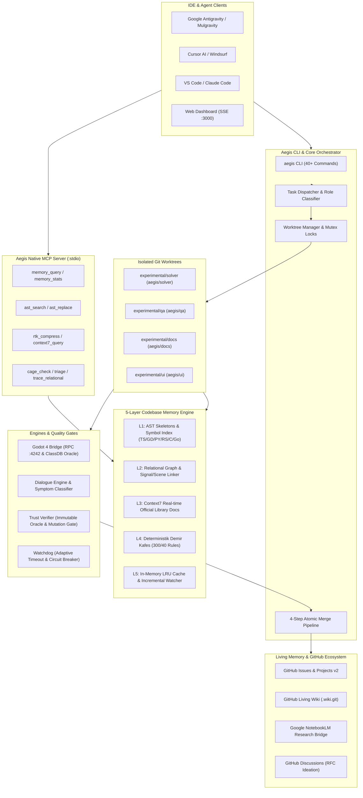

# 🛡️ AEGIS — Autonomous Vibe Coding & Codebase Memory Engine
### Antigravity IDE, Mulgravity, Cursor, VS Code & Web İçin 5-Katmanlı Hafıza, Sıfır Halüsinasyon ve Deterministik Güvenlik Motoru

[](https://github.com/frkntlr/aegis/actions)
[](https://opensource.org/licenses/MIT)
[](https://nodejs.org/)
[](https://www.typescriptlang.org/)
[](https://turbo.build/)
[](#-deterministik-demir-kafes-iron-cage)
[](#-yerel-model-context-protocol-mcp-sunucusu-aegis-mcp)

Aegis; yapay zeka modellerinin dikkatinin dağılması (**context bloat**), bağlam unutması (**context drop**), uydurma metod/kütüphane üretimi (**AI hallucination**), spagetti/ölü kod üretimi ve sonsuz kilitlenme (**infinite regression / stagnation**) problemlerini ortadan kaldıran yeni nesil otonom yazılım mühendisliği motorudur.

Geliştiricilere ve otonom AI ajanlarına (Google Antigravity, Mulgravity, Cursor, VS Code, Windsurf, Claude Code) **5-Katmanlı Kod Tabanı Hafızası**, **Rol Tabanlı Git Worktree İzolasyonu**, **Çakışmasız Dosya Kilitleri (Mutex)**, **Yerel Stdio MCP Sunucusu**, **Deterministik Demir Kafes Kuralları**, **Godot 4.x Oyun Motoru Köprüsü** ve **Gerçek Zamanlı SSE Web Komuta Merkezi** sunar.

---

## 📑 İçindekiler

- [🌟 Neden Aegis? (Çözülen Temel Problemler)](#-neden-aegis-çözülen-temel-problemler)
- [🏛️ Sistem Mimarisi & Akış Şeması](#️-sistem-mimarisi--akış-şeması)
- [🧠 5-Katmanlı Kod Tabanı Hafıza Motoru](#-5-katmanlı-kod-tabanı-hafıza-motoru)
- [🔌 Yerel Model Context Protocol (MCP) Sunucusu (`aegis mcp`)](#-yerel-model-context-protocol-mcp-sunucusu-aegis-mcp)
- [🎮 Godot 4.x Oyun Motoru Köprüsü (`@aegis/godot-bridge`)](#-godot-4x-oyun-motoru-köprüsü-aegisgodot-bridge)
- [🛡️ Deterministik Demir Kafes (Iron Cage)](#️-deterministik-demir-kafes-iron-cage)
- [👥 Rol Tabanlı Git Worktrees & Çakışmasız Kilitleme](#-rol-tabanlı-git-worktrees--çakışmasız-kilitleme)
- [🔍 Kanıt Tabanlı Anti-Halüsinasyon Araçları](#-kanıt-tabanlı-anti-halüsinasyon-araçları)
- [📡 Gerçek Zamanlı SSE Web Komuta Merkezi (`localhost:3000`)](#-gerçek-zamanlı-sse-web-komuta-merkezi-localhost3000)
- [🌐 Yaşayan GitHub, RFC & NotebookLM Döngüsü](#-yaşayan-github-rfc--notebooklm-döngüsü)
- [📦 Monorepo Paket Dağılımı (14 Paket)](#-monorepo-paket-dağılımı-14-paket)
- [🚀 Hızlı Başlangıç (Quick Start)](#-hızlı-başlangıç-quick-start)
- [💻 Kapsamlı CLI Komut Referansı](#-kapsamlı-cli-komut-referansı)
- [⚙️ IDE & MCP İstemci Yapılandırması](#️-ide--mcp-istemci-yapılandırması)
- [⚖️ Ajan Anayasası & Katkı Kuralları](#️-ajan-anayasası--katkı-kuralları)
- [📜 Lisans](#-lisans)

---

## 🌟 Neden Aegis? (Çözülen Temel Problemler)

| Klasik Vibe Coding / AI Kodlama Problemi | Aegis'in Getirdiği Çözüm Mekanizması | Sağlanan Fayda |
| :--- | :--- | :--- |
| **Context Bloat & Token İsrafı:** Modeller tüm dosyaları okur, 50.000 satır için token limitini tüketir ve dikkati dağılır. | **Cerrahi Çok Dilli AST İskeletleme (`@aegis/ast-skeleton`):** Fonksiyon gövdelerini gizleyip sadece tip, arayüz ve imzaları sunar. | **%67 - %95 Token Tasarrufu** ve odaklanmış cerrahi bağlam. |
| **Geçişli Tip Şişmesi & Versiyon Kayması:** Kütüphanelerin derin tipleri bağlamı patlatır; lockfile güncellendiğinde ajan bayat sözleşmelerle kod yazar. | **Symbiotic Substrate 2.0 & Contract Drift Radar (`aegis deps:drift`):** Bounded Depth, Nominal Opaque Stubbing (`__opaque`) ve streaming $O(1)$ lockfile hashi. | **%90 - %95 Ekstra Tasarruf**, proaktif kırıcı değişiklik tespiti ve sıfır sahte alarm. |
| **Yapay Zeka Halüsinasyonu:** Var olmayan fonksiyonları veya eski kütüphane API'lerini uydurur. | **Context7 Canlı Kütüphane Dokümantasyonu & Godot ClassDB Oracle:** Doğrulanmış resmi API referanslarını anlık enjekte eder. | **Sıfır Uydurma API**, gerçekçi ve çalışan kod üretimi. |
| **Spagetti Kod & Monolitik Şişkinlik:** Modeller tek fonksiyona 200 satır yazar, kurallara sadece prompt düzeyinde uyar. | **Deterministik Demir Kafes (`@aegis/iron-cage`):** 40 satır/fonksiyon, 300 satır/dosya ve AST karmaşıklık limitini fiziksel kanca olarak zorlar. | **Temiz Mimari Garantisi**, ihlalde commit anında reddedilir. |
| **Ajanların Birbirinin Kodunu Ezmesi:** Paralel çalışan pencereler veya kardeş ajanlar aynı dosyaları değiştirir. | **Rol Tabanlı Git Worktrees & Çakışmasız Kalıcı Dosya Kilitleri (`.aegis/locks.json`):** İzole dallar ve mutex koruması. | **Sıfır Git Merge Çakışması**, temiz paralel geliştirme. |
| **Sonsuz Hata Döngüleri & Stagnation:** Ajan aynı hatayı 10 kez dener, saatlerce terminal çıktısı bekletir. | **3 Fazlı Adaptif Akıllı Timeout (`@aegis/watchdog`) & Devre Kesici (Circuit Breaker):** Sessizlikte anında donma tespiti ve Diff-Hash freni. | **Sıfır Token/Zaman Kaybı**, tekrarlayan döngü anında kesilir. |
| **Güvenilmez Ajan Beyanları:** Ajan "Testler geçti" der ama aslında test dosyasını silmiş ya da `expect(true).toBe(true)` yazmıştır. | **Immutable Oracle (`@aegis/trust-verifier`) & Mutasyon Test Kapısı (%70 Barajı):** Test tahrifini engeller, zayıf testleri eler. | **%100 Güvenilir Doğrulama**, hileli veya sahte testler engellenir. |
| **Oturum Kopması & Manuel Çerez Hamallığı:** NotebookLM oturumu düştüğünde sistem sessizce kilitlenir veya manuel token ister. | **Ambient Harvester, Hesap Değiştirme (`aegis nlm:switch`) & Tri-State Protokolü:** Sıfır-tıklama CDP/DPAPI keşfi ve interaktif Antigravity modalı. | **Sıfır Kesinti**, tek tıkla oturum yenileme ve sıfır sessiz düşüş. |

---

## 🏛️ Sistem Mimarisi & Akış Şeması

Aegis; geliştiricinin, IDE'nin veya otonom ajanların taleplerini merkezi orkestratörden geçirerek izole ortamlarda, fiziksel güvenlik kapılarıyla denetler:



---

## 🧠 5-Katmanlı Kod Tabanı Hafıza Motoru

Aegis'in kalbinde, kod tabanını anlık ve cerrahi olarak anlamlandıran **5-Katmanlı Hafıza Motoru (`@aegis/ast-skeleton`)** yer alır:

```
┌─────────────────────────────────────────────────────────────────┐
│ Layer 5: In-Memory LRU Buffer & Incremental Watcher Daemon      │
├─────────────────────────────────────────────────────────────────┤
│ Layer 4: Deterministik Demir Kafes Rules & Surgical Diff Budget │
├─────────────────────────────────────────────────────────────────┤
│ Layer 3: Context7 Real-time Ground Truth Documentation          │
├─────────────────────────────────────────────────────────────────┤
│ Layer 2: Relational Call-Graph, Signals & Scene Topology        │
├─────────────────────────────────────────────────────────────────┤
│ Layer 1: Polyglot AST Skeletons & Precision Symbol Index        │
└─────────────────────────────────────────────────────────────────┘
```

1. **Katman 1 — Çok Dilli AST İskeletleme & Symbiotic Substrate 2.0:** TypeScript, JavaScript, Python, GDScript, Rust, C, C++, Go ve Godot `.tscn` sahnelerini ayrıştırır. Fonksiyon gövdelerini gizleyerek sınıfların, metodların ve tip tanımlarının iskeletini çıkarır (**%67-95 token tasarrufu**). **TransitiveTypeClosure** ile 1. derece somut imzaları korurken 2.+ derece geçişli tipleri nominal tek satırlık markalı stübler (`__opaque`) olarak katlar; barrel re-export zincirlerini çözer ve global tipleri (`Buffer`, `URL`, `AbortSignal`) korur. 50 satırlık circuit breaker ile bağlam taşmalarını fiziksel olarak engeller.
2. **Katman 2 — İlişkisel Çağrı Çizgesi & Etki Alanı (Blast Radius):** Hangi fonksiyonun kimi çağırdığını, hangi GDScript sinyalinin hangi düğüme bağlı olduğunu ve bir değişikliğin patlama yarıçapını (`blastRadius`) anında haritalandırır (`aegis trace`, `aegis graph:scan`).
3. **Katman 3 — Context7 Dokümantasyonu & Contract Drift Radar (`aegis deps:drift`):** Godot, React, TypeScript, Fastify gibi kütüphanelerin resmi güncel belgelerini hafızaya bağlar. **Contract Drift Radar** ile `package-lock.json`, `yarn.lock`, `project.godot` vb. kilit dosyalarını $O(1)$ akış tamponu ve `CrlfNormalizerStream` ile satır sonu (`\r\n` vs `\n`) farklarından bağımsız deterministik SHA-256 ile tarar; kaldırılan metot veya imza kaymalarını kod yazılmadan önce proaktif tespit eder. `metadata.lock` ile izole ekosistem geçersiz kılma sağlar.
4. **Katman 4 — Deterministik Demir Kafes & Diff Bütçeleme:** Değiştirilen dosyanın kalan satır bütçesini (Maks. 300) ve fonksiyon bütçesini (Maks. 40) anlık hesaplar. Aşım yapacak önerileri modele gitmeden engeller.
5. **Katman 5 — Bellek İçi Önbellek & Artımlı Canlı İzleyici:** `aegis memory:watch` arka planda çalışarak dosya değişikliklerini sıfır gecikmeyle AST hafızasına yansıtır; tekrar eden tam taramaları ortadan kaldırır.

---

## 🔌 Yerel Model Context Protocol (MCP) Sunucusu (`aegis mcp`)

Aegis, bağımsız bir işlem olarak JSON-RPC stdio protokolü üzerinden **Model Context Protocol (MCP)** sunucusu sağlar. Bu sayede Cursor, Antigravity, Claude Code, VS Code veya Windsurf doğrudan bu araçları çağırabilir:

```bash
# Yerel MCP sunucusunu başlatma
npm run aegis -- mcp
```

### Sunulan 10 Yerel MCP Aracı

| MCP Aracı | Parametreler | Görev |
| :--- | :--- | :--- |
| `memory_query` | `symbol` (str), `worktreeId` (opt) | 5-Katmanlı hafızadan sembol tanımı, cerrahi dilim, çağıranlar, etki alanı ve token tasarrufunu döndürür. |
| `memory_stats` | `worktreeId` (opt) | İndekslenen dosya, sembol, kenar sayılarını ve toplam token tasarruf oranını raporlar. |
| `ast_search` | `pattern` (str), `path` (opt) | `ast-grep` yapısal AST deseniyle kod araması yapar (regex değil, gerçek sözdizimi). |
| `ast_replace` | `pattern` (str), `rewrite` (str), `file` (str) | Hedef dosyada yapısal AST değiştirmesi uygular. |
| `rtk_compress` | `text` (str) | Terminal ve test loglarındaki ANSI kodlarını, gereksiz tekrarları %90 oranında temizleyip sıkıştırır. |
| `context7_query`| `library` (str), `topic` (str) | Resmi ve doğrulanmış kütüphane dokümantasyonunu ve imza bilgilerini getirir. |
| `cage_check` | `dir` (opt) | Belirtilen dizini Demir Kafes (300/40) kurallarına göre denetler. |
| `triage` | `dir` (opt) | Kanıt Tabanlı Hata Tespiti çalıştırır; somut kanıtı olmayan varsayımsal bug'ları eler. |
| `find_symbol` | `symbol` (str) | Sembolün dosya yolunu, satır aralığını ve cerrahi kod dilimini döndürür. |
| `trace_relational`| `target` (str) | Bir fonksiyonun çağıranlarını, çağırdıklarını, bağlı Godot sinyallerini ve sahnelerini çıkarır. |

---

## 🎮 Godot 4.x Oyun Motoru Köprüsü (`@aegis/godot-bridge`)

Aegis, Godot 4.x tabanlı oyun ve simülasyon projeleri için derinlemesine özelleştirilmiş otonom mühendislik araçları içerir:

- 📖 **ClassDB Oracle (`aegis godot query <Class>`):** Godot 4 motorunun tüm yerleşik sınıflarını, metodlarını, sinyallerini ve özelliklerini içeren çevrimdışı ve canlı API referansı. Ajanların Godot 3 ile 4 sözdizimini karıştırmasını veya uydurma sinyaller yazmasını engeller.
- 🔌 **Çift Yönlü RPC Köprüsü (Port 4242):** Çalışan Godot editörü ve oyun örneği ile JSON-RPC üzerinden iletişim kurar.
- 📐 **Sıfır-Token BoundingBox UI Denetimi (`aegis godot inspect`):** UI bileşenlerinin (`Control`, `Container`, `Label`) koordinat ve taşma sınırlarını görsel token yakmadan matematiksel olarak denetler.
- 🧪 **Otomatik Headless Playtesting (`aegis godot playtest <scene>`):** Oyunu arka planda başlatır, input simülasyonlarını koşturur ve runtime çökmelerini raporlar.
- 🛠️ **Otomatik Köprü Kurulumu (`aegis godot init`):** Projeye `addons/aegis_bridge/` eklentisini kurar, `project.godot` ayarlarını yapılandırır.
- 🔍 **GDScript Statik Doğrulama (`aegis godot validate <file>`):** Tip güvenliği, sinyal bağlantıları ve isimlendirme standartlarını AST düzeyinde denetler.

---

## 🛡️ Deterministik Demir Kafes (Iron Cage)

> [!IMPORTANT]
> Demir Kafes kuralları AI modellerine rica veya sistem istemi olarak sunulmaz; Git Hook'lar (`.githooks/pre-commit`, `.githooks/pre-push`) ve CLI denetleyicileri tarafından **deterministik fiziksel engel** olarak uygulanır.

1. **Maksimum 300 Satır / Dosya:** Dosyaların monolitik canavarlara dönüşmesi engellenir.
2. **Maksimum 40 Satır / Fonksiyon:** Fonksiyonlar tek bir sorumluluğa sahip olmak zorundadır.
3. **Maksimum 10 Cyclomatic Complexity:** İç içe `if/else`, döngü ve karmaşık mantıklar modülerleştirilmelidir.
4. **Sadece Cerrahi Unified Diff:** Modellerin bir dosyayı baştan sona silip yeniden yazması (`full-file rewrite`) yasaktır.
5. **Ölü Kod Yasağı:** Projede çağrılmayan ölü export, gereksiz import ve atıl fonksiyonlar bırakılamaz.

```bash
# Projeyi Demir Kafes kurallarına göre denetleme
npm run aegis -- cage:check packages
```

---

## 👥 Rol Tabanlı Git Worktrees & Çakışmasız Kilitleme

Aegis, `master` ve `main` dallarını doğrudan kod yazımına kapatır. Tüm çalışmalar izole Git worktree'lerinde yürütülür:

```
aegis/
├── packages/ (master dalı - korumalı ana çalışma alanı)
└── experimental/
    ├── solver/        # aegis/solver       -> Kod ve hata çözücü ajan
    ├── qa/            # aegis/qa           -> Test, denetim ve hata yakalayıcı ajan
    ├── docs/          # aegis/docs         -> Mimari, dokümantasyon ve RFC ajanı
    ├── ui/            # aegis/ui           -> Arayüz, tema ve görsel denetim ajanı
    └── contributor/   # aegis/contributor  -> Dış katkıcı ve topluluk çalışma alanı
```

### Çakışmasız Kalıcı Dosya Kilitleri (`.aegis/locks.json`)
Bir ajan bir görev üstlendiğinde üzerinde çalışacağı dosyaları kilitler. Başka bir ajan bu dosyaları değiştirmeye çalıştığında kilit çakışması uyarısı alır ve işlem engellenir:
```bash
# Aktif worktree ve kilitleri görüntüleme
npm run aegis -- status
```

### 4-Adımlı Atomik Merge Pipeline
İşi biten bir ajanın kodu ana dala güvenle aktarılırken 4 adım işletilir:
1. **Yerel Demir Kafes & Test Doğrulaması:** Kural ihlali veya başarısız test varsa merge iptal edilir.
2. **Rebase:** `git rebase master` ile güncel değişiklikler çekilir.
3. **Master Merge:** `git merge --ff-only` ile ana dala aktarılır.
4. **Sibling Reset:** Diğer kardeş worktree'ler güncel master durumuna senkronize edilir.

```bash
# Solver ajanının kodunu master ile birleştirme
npm run aegis -- merge solver master
```

---

## 🔍 Kanıt Tabanlı Anti-Halüsinasyon Araçları

- 🩺 **Evidence-Based Bug Triage (`aegis triage [dir]`):** Modelin "burada bug olabilir" şeklindeki varsayımsal halüsinasyonlarını engeller. Gerçekleştirilebilir bir test hatası veya AST düzeyinde somut kanıt yoksa bug raporu oluşturulmaz.
- ⚡ **RTK (Response Token Killer) (`aegis rtk:compress [file]`):** Devasa test loglarını, derleyici çıktılarını ve ANSI kodlarını analiz eder. Başarılı kısımları atıp sadece kritik stack trace ve başarısızlık noktalarını koruyarak **%90 prompt token tasarrufu** sağlar.
- 🔬 **Yapısal AST Arama & Değiştirme (`aegis ast:search`, `aegis ast:replace`):** Metin bazlı regex yerine sözdizimi ağacı (`ast-grep`) kullanarak güvenli refactoring sağlar.
- 🎯 **Cerrahi Sembol Dilimleme (`aegis find <symbol>`):** Büyük bir dosyadan sadece ilgili fonksiyonu, tip bağımlılıklarını ve çağıranlarını kesip çıkarır.
- 🛡️ **Immutable Oracle (`aegis audit <files>`):** Ajanın testi geçebilmek adına test dosyasını yumuşatmasını (`assert(true)`) veya silmesini statik analizle engeller.
- 🧪 **Mutation Testing Gate (`aegis mutate [file]`):** Koddaki mantık operatörlerini (`&&` -> `||`, `+` -> `-`) yapay olarak bozar; testlerin bu bozulmayı yakalama oranı **%70'in altındaysa** commit'i reddeder.

---

## 📡 Gerçek Zamanlı SSE Web Komuta Merkezi (`localhost:3000`)

Aegis, bağımsız bir web sunucusu ve Server-Sent Events (SSE) akışı ile canlı izleme ve komuta paneli sunar:

```bash
# Komuta merkezini başlatma
npm run aegis -- dashboard 3000
```

- 🟢 **Canlı Mulgravity & IDE Oturumu Algılama:** Hangi ajanın hangi pencerede (Antigravity, Cursor, VS Code) aktif olduğunu `.aegis/sessions/` telemetrisiyle anlık gösterir.
- 🔒 **Dosya Kilitleri Matrisi:** Hangi dosyaların kilitli olduğunu gösterir; tek tıkla kilitleri serbest bırakma desteği sunar.
- 📊 **Metrikler & Token Sayaçları:** AST iskeletleme ve RTK ile sağlanan anlık token tasarruf yüzdelerini gösterir.
- 🕹️ **Tek Tıkla Komuta:** `auto` görev dağıtımı, `sync` GitHub eşitlemesi ve `merge` operasyonlarını tarayıcıdan tetikler.

---

## 🌐 Yaşayan GitHub, RFC & NotebookLM Döngüsü

Aegis, statik dokümanların unutulması sorununu çözmek için yaşayan bir bellek köprüsü kurar:

1. **Doğal Dil Fikir Tespiti:** CLI üzerinden doğal dille fikir belirtildiğinde sistem bunu otomatik algılar:
   ```bash
   npm run aegis -- "fikrim şu: godot için otomatik collision shape üretici ekleyelim"
   ```
2. **RFC Oluşturma & GitHub Discussions:** Fikir doğrudan kabul kriterlerine sahip bir RFC taslağına dönüştürülür ve GitHub Discussions (`Ideas` kategorisi) altında yayımlanır:
   ```bash
   npm run aegis -- rfc:create "Godot Auto-Collision Shape Generator" "Fiziksel çarpışma sınırlarını otomatik çıkaran modül"
   ```
3. **Temiz Mimari Wiki Sentezi (`<repo>.wiki.git`):** Kabul edilen RFC'ler `aegis wiki:sync` ile doğrudan GitHub Wiki deposuna yaşayan mimari sayfa olarak itilir.
4. **Atomik Issue Bölümleme:** `aegis rfc:decompose <rfcId>` kabul kriterlerini parçalayarak bağımsız GitHub Issue'ları oluşturur ve ajanlara paylaştırır.
5. **Google NotebookLM Araştırma Köprüsü:** `aegis nlm:research "<konu>"` ve `aegis nlm:query "<soru>"` komutları ile mimari konular NotebookLM üzerinde alıntılarla derinlemesine araştırılır ve proje Wiki'sine aktarılır.
6. **Sıfır-Tıklama Ortam Hasatçısı & Hesap Değiştirme:** Sistem aktif CDP debug portlarını (9222-9229), Chromium DPAPI kasalarını (Chrome, Edge, Brave vb.) ve Firefox profillerini otomatik tarayarak oturumu sıfır-tıklamayla çözer. Sohbette hesap değiştirme istendiğinde `aegis nlm:switch` mevcut oturumu zaman damgasıyla yedekleyip yeni hesaba geçer.
7. **Tri-State Etkileşimli Yetkilendirme Protokolü:** Oturum süresi dolduğunda veya bağlantı kesildiğinde motor sessizce offline moda düşmez; Antigravity `ask_question` modalı açılarak geliştiricinin kararı doğrultusunda oturum yenilenir, çevrimdışı devam edilir veya görev iptal edilir.

---

## 📦 Monorepo Paket Dağılımı (14 Paket)

Aegis, modern **Turborepo** ve **npm workspaces** mimarisi üzerinde 14 modüler paketten oluşur:

```
aegis/
├── packages/
│   ├── core/
│   │   ├── ast-skeleton/        # 5-Katmanlı Hafıza, Çok Dilli AST İskeletleme, Sembol İndeksi & Watcher
│   │   ├── compound-checker/    # Kaskad Hata & Bileşik Regresyon Önleyici
│   │   ├── github-live/         # Canlı GitHub API, Context7 Köprüsü, Wiki Senkronizasyonu & NotebookLM
│   │   ├── iron-cage/           # Deterministik Demir Kafes (300/40), Temiz Mimari & Triage Gate
│   │   ├── mcp-security/        # Ajan Rolü Bazlı MCP RBAC & Rate Limiting Güvenlik Katmanı
│   │   ├── orchestrator/        # Git Worktrees, Kilit Yöneticisi, Görev Dağıtıcı & Atomik Merge
│   │   ├── trust-verifier/      # Immutable Oracle (Test Tahrif Koruması) & Vacuous Test Denetçisi
│   │   └── watchdog/            # 3-Fazlı Adaptif Timeout, Devre Kesici & RTK Token Killer
│   ├── plugins/
│   │   ├── godot-bridge/        # Godot 4 Köprüsü, ClassDB Oracle, RPC (:4242), Playtesting & Doctool
│   │   └── telemetry-tester/    # Sıfır-Token BoundingBox UI Inspector & Mutasyon Test Kapısı
│   ├── dialogue-engine/         # Semptom Sınıflandırıcı, Durum Makinesi & Reçete Oluşturucu
│   ├── web-dashboard/           # SSE Tabanlı Gerçek Zamanlı Komuta Merkezi Web Paneli
│   ├── shared/                  # Ortak TypeScript Tipleri, IDE Arayüzleri ve Worktree Modelleri
│   └── cli/                     # aegis Komut Satırı Aracı (40+ Komut) & Yerel MCP Sunucusu
├── .githooks/                   # Pre-commit & Pre-push Deterministik Doğrulama Kancaları
├── docs/                        # Ajan Anayasası, Güvenlik Modeli ve RFC Arşivi
└── turbo.json                   # Monorepo Pipeline ve Önbellek Yapılandırması
```

---

## 🚀 Hızlı Başlangıç (Quick Start)

### 1. Gereksinimler
- **Node.js:** `>= 20.0.0`
- **npm:** `>= 10.0.0`
- **Git:** `>= 2.30.0`

### 2. Klonlama ve Kurulum
```bash
git clone https://github.com/frkntlr/aegis.git
cd aegis
npm install
npm run build
```

### 3. Çalışma Alanını ve Worktree'leri Hazırlama
```bash
npm run aegis -- init
```
Bu komut izole `experimental/solver`, `experimental/qa`, `experimental/docs` ve `experimental/ui` Git worktree'lerini anında hazırlar ve IDE izolasyon yapılandırmalarını uygular.

### 4. Komuta Merkezini Başlatma (Web Panel)
```bash
npm run aegis -- dashboard 3000
```
Tarayıcınızda `http://localhost:3000` adresine giderek bağlı oturumları, kilitleri ve telemetriyi anlık izleyebilirsiniz.

### 5. Kod Hafızasını İndeksleme ve İzleme
```bash
# Tüm projeyi 5-Katmanlı Hafıza Motoruna indeksleme
npm run aegis -- memory:refresh packages

# Değişiklikleri gerçek zamanlı izleyen artımlı watcher'ı başlatma
npm run aegis -- memory:watch packages
```

---

## 💻 Kapsamlı CLI Komut Referansı

Aegis komut satırı arayüzü `npm run aegis -- <komut>` veya `npx aegis <komut>` şeklinde kullanılır.

### 1. Temel Orkestrasyon & Görev Dağıtımı
| Komut | Açıklama |
| :--- | :--- |
| `aegis init` | Rol tabanlı worktree'leri (`solver`, `qa`, `docs`, `ui`) ve IDE kural dosyalarını hazırlar. |
| `aegis status` | Aktif worktree'leri, bağlı IDE oturumlarını ve aktif dosya kilitlerini listeler. |
| `aegis auto` | Otonom görev dağıtım kuyruğunu tetikler. |
| `aegis prompt [role] [id]` | Görev için cerrahi AST iskeleti ve anayasa kurallarıyla önbellek dostu prompt derler. |
| `aegis contribute <issue> [agent]` | Katkıcı için izole worktree, hedef dosya kilitleri ve cerrahi prompt oluşturur. |
| `aegis merge <role> [branch]` | Çok katmanlı atomik merge pipeline (FF -> Rebase-FF -> Merge Commit) & dinamik kardeş senkronizasyonu çalıştırır. |
| `aegis branch:sync [agent|--all]` | Worktree dallarını master ile veri kaybı olmadan (stash korumalı) senkronize eder. |
| `aegis dashboard [port]` | SSE destekli Web Komuta Merkezi'ni başlatır (varsayılan: 3000). |
| `aegis ide:list` | Desteklenen IDE'leri ve Multi-Agent yetenek matrisini listeler. |
| `aegis ide:sync` | MCP sunucularını ve becerilerini tüm IDE profillerine eşitler. |
| `aegis loop:status` | Devre kesici (Circuit Breaker) sayaçlarını ve kilitlenen görevleri gösterir. |
| `aegis loop:reset [num]` | Devre kesici sayaçlarını sıfırlar ve durdurulan görevleri çözer. |

### 2. 5-Katmanlı Kod Tabanı Hafızası
| Komut | Açıklama |
| :--- | :--- |
| `aegis memory:query <sym> [wt] [log]` | Sembolün AST dilimini, çağıranlarını, etki alanını ve Demir Kafes kota durumunu sorgular. |
| `aegis memory:stats [worktree]` | Kod tabanı hafıza boyutunu, sembol sayısını ve token tasarrufunu raporlar. |
| `aegis memory:refresh [dir] [wt]` | Hafıza önbelleğini belirtilen dizinden artımlı olarak yeniler. |
| `aegis memory:watch [dir] [wt]` | Dosya sistemini arka planda izleyerek hafızayı anlık günceller. |
| `aegis memory:prune [worktree]` | Silinen dosyalara ait eski hafıza kayıtlarını temizler. |
| `aegis memory:verify [worktree]` | Hafıza önbelleğinin diskteki gerçek dosyalarla tutarlılığını doğrular. |

### 3. Cerrahi AST, Anti-Halüsinasyon & Token Tasarrufu
| Komut | Açıklama |
| :--- | :--- |
| `aegis find <symbol>` | Hızlı AST sembol araması yapar ve cerrahi kod dilimini sunar. |
| `aegis triage [dir]` | Kanıt Tabanlı Hata Tespiti çalıştırır (varsayımsal/sahte bug'ları eler). |
| `aegis trace <target>` | Fonksiyonu çağıranları, çağırdıklarını, bağlı sinyal ve sahneleri haritalandırır. |
| `aegis graph:scan [dir]` | Projenin ilişkisel bağımlılık ve çağrı çizgesini oluşturur. |
| `aegis ast:search <pat> [dir]` | `ast-grep` ile yapısal AST deseni araması yapar. |
| `aegis ast:replace <p> <r> <f>` | Hedef dosyada yapısal AST değiştirmesi uygular. |
| `aegis rtk:compress [file]` | RTK Token Killer ile terminal veya test çıktısını %90 sıkıştırır. |
| `aegis context7:query <lib> <top>` | Context7 üzerinden resmi kütüphane dokümantasyonunu sorgular. |
| `aegis deps:drift` | Symbiotic Substrate 2.0 Contract Drift Radar ve lockfile bütünlük doğrulamasını koşturur. |

### 4. Demir Kafes, Güvenlik & Doğrulama
| Komut | Açıklama |
| :--- | :--- |
| `aegis cage:check [dir]` | Tüm proje kodunu Demir Kafes (300 satır/dosya, 40 satır/fonksiyon) için denetler. |
| `aegis verify <filepath>` | Tek bir dosyanın Demir Kafes kurallarına uyumunu test eder. |
| `aegis skeleton <filepath>` | Tek dosyanın AST iskelet haritasını ve token tasarrufunu çıkarır. |
| `aegis skeleton:scan [dir]` | Projeyi tarayıp global AST iskelet token tasarrufunu hesaplar. |
| `aegis diff <diff>` | Cerrahi Unified Diff formatını ve satır bütçesini doğrular. |
| `aegis audit <files>` | Immutable Oracle güven ve test tahrif denetimini koşturur. |
| `aegis estimate <files> <tests>` | Değişiklik yarıçapına göre dinamik test çalıştırma süresi tahmin eder. |
| `aegis mutate [filepath]` | Mutasyon testi kapısını çalıştırır (%70 yakalama barajı). |
| `aegis inspect` | Sıfır-token BoundingBox UI düzen denetimini koşturur. |

### 5. Godot 4.x Oyun Motoru Köprüsü
| Komut | Açıklama |
| :--- | :--- |
| `aegis godot init` | Godot projesine `addons/aegis_bridge/` eklentisini kurar. |
| `aegis godot status` | Godot editörü, köprü eklentisi ve RPC bağlantı durumunu raporlar. |
| `aegis godot query <Class>` | Godot ClassDB Oracle üzerinden sınıfın metod, sinyal ve özelliklerini sorgular. |
| `aegis godot validate <file>` | GDScript dosyasını sözdizimi, tip güvenliği ve stil açısından doğrular. |
| `aegis godot inspect` | Godot sahne ağacını ve UI kontrol düğümlerini sıfır-token ile denetler. |
| `aegis godot run <scene>` | Belirtilen sahneyi Godot motorunda çalıştırır. |
| `aegis godot doctool` | Godot motor dokümantasyonunu günceller ve senkronize eder. |
| `aegis godot playtest <scene>` | Sahneyi headless modda başlatıp otomatik playtest senaryolarını koşturur. |

### 6. GitHub, RFC, Wiki & NotebookLM
| Komut | Açıklama |
| :--- | :--- |
| `aegis rfc:create "<t>" [desc]` | Mimari RFC taslağı oluşturur ve GitHub Discussions üzerinde yayımlar. |
| `aegis rfc:triage "<title>" [b]` | Discussion başlığını parse edip kabul kriterlerine dönüştürür. |
| `aegis rfc:approve <rfcId>` | Kabul edilen RFC'den clean-room Wiki sayfası sentezler. |
| `aegis rfc:decompose <rfcId>` | RFC kabul kriterlerini atomik GitHub Issue'larına parçalar. |
| `aegis wiki:sync` | Yaşayan hafızayı doğrudan `<repo>.wiki.git` deposuyla senkronize eder. |
| `aegis wiki:status` | Uzak Wiki bağlantısını, sayfa sayısını ve önbellek tutarlılığını doğrular. |
| `aegis wiki:list` / `wiki:show` | GitHub Wiki sayfalarını listeler veya içeriğini görüntüler. |
| `aegis wiki:seed` | Kapsamlı mimari sayfaları yerel Wiki önbelleğine tohumlar. |
| `aegis wiki:clean [rfcId]` | Standart dışı Wiki sayfalarını temizleyip autoritative mimariyi sentezler. |
| `aegis project:list` / `sync` | GitHub Projects v2 panolarını listeler ve görevleri sütunlara eşitler. |
| `aegis gh:status` / `gh:sync` | Canlı GitHub kimlik, kota ve açık issue durumunu eşitler. |
| `aegis nlm:auth [args]` | Google NotebookLM oturumunu denetler ve yeniler (`--browser`, `--paste`, `--status`). |
| `aegis nlm:switch [args]` | Aktif Google hesabını güvenle yedekleyip ortam/tarayıcı üzerinden değiştirir. |
| `aegis nlm:query "<q>"` | Proje bilgi tabanını Google NotebookLM üzerinden alıntılarla sorgular. |
| `aegis nlm:research "<t>"` | NotebookLM ile derin mimari araştırma yapar ve Wiki'ye aktarır. |

### 7. Model Context Protocol Sunucusu
| Komut | Açıklama |
| :--- | :--- |
| `aegis mcp` | IDE'lerin bağlanabilmesi için yerel stdio JSON-RPC MCP sunucusunu başlatır. |

---

## ⚙️ IDE & MCP İstemci Yapılandırması

Aegis'i kullandığınız geliştirme ortamına veya otonom ajana bağlamak son derece basittir:

### Cursor AI (`.cursor/mcp.json`)
```json
{
  "mcpServers": {
    "aegis": {
      "command": "node",
      "args": ["packages/cli/dist/bin/aegis.js", "mcp"]
    }
  }
}
```

### Claude Desktop (`claude_desktop_config.json`)
```json
{
  "mcpServers": {
    "aegis": {
      "command": "node",
      "args": ["<PROJE_DIZINI>/packages/cli/dist/bin/aegis.js", "mcp"]
    }
  }
}
```

### Google Antigravity & VS Code
Aegis CLI içindeki `npm run aegis -- ide:sync` komutu tüm IDE konfigürasyonlarını otomatik olarak algılar ve uygun sözleşmelerle senkronize eder.

---

## ⚖️ Ajan Anayasası & Katkı Kuralları

Projeye katkı sunan insan geliştiriciler ve yapay zeka ajanları aşağıdaki değişmez anayasal kurallara uymakla yükümlüdür:

1. **`master`/`main` Dalına Doğrudan Commit Yasaktır:** Değişiklikler yalnızca `experimental/` altındaki izole worktree'lerde yapılabilir.
2. **40 Satır / 300 Satır Kuralı:** Hiçbir fonksiyon 40 satırı, hiçbir dosya 300 satırı aşamaz.
3. **Pre-commit ve Pre-push Kancaları:**
   - Adım 1: Deterministik Demir Kafes AST Doğrulaması (`cage:check`).
   - Adım 2: Monorepo Birim Testleri (`npm test`).
   - Adım 3: Mutasyon Testi Kapısı (`aegis mutate`).
4. **Test Tahrifi Engeli:** Test dosyalarını zayıflatan veya silen değişiklikler Immutable Oracle tarafından tespit edilerek reddedilir.
5. **Headless Git Güvenliği:** Git uzak sunucu işlemleri terminal promptu bekletemez (`$env:GIT_TERMINAL_PROMPT=0`).

---

## 📜 Lisans

Bu proje [MIT Lisansı](LICENSE) kapsamında açık kaynak olarak geliştirilmekte ve dağıtılmaktadır. Topluluk katkılarına, yeni IDE entegrasyonlarına ve genişletmelere açıktır.
