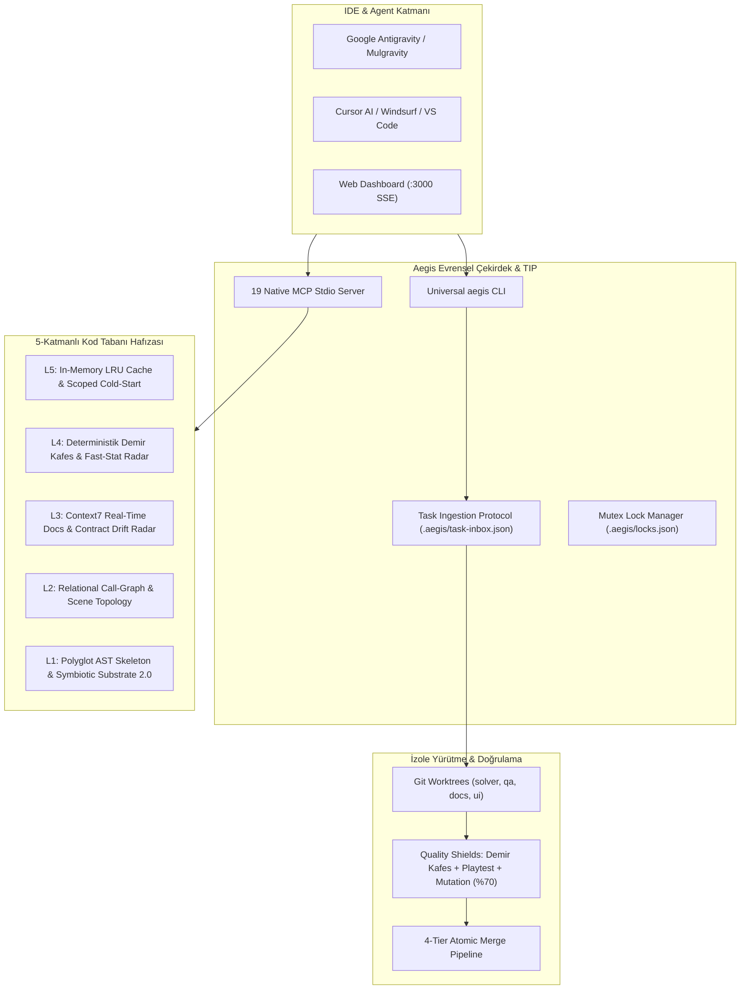
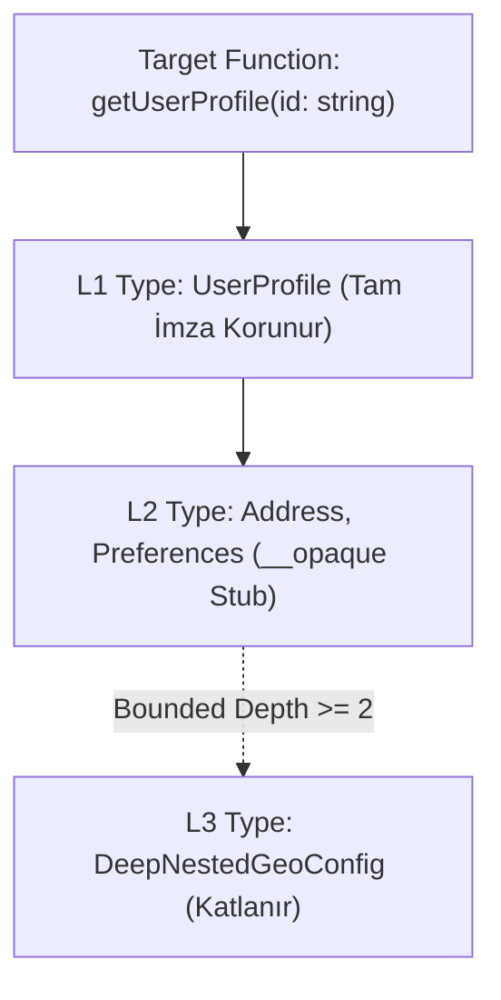

# 🏛️ 01 — Mimari ve 5-Katmanlı Kod Tabanı Hafızası

> **Aegis Autonomous Vibe Coding Engine** mimarisinin çekirdek bileşeni olan **5-Katmanlı Kod Tabanı Hafızası**, büyük ölçekli depolarda LLM dikkat dağılması (*context bloat*), halüsinasyon ve bağlam unutmasını (*context drop*) deterministik olarak ortadan kaldırır.

---

## 1. Sistem Mimarisi & Genel Akış

Aegis; geliştiricilerden, IDE'lerden (Google Antigravity, Mulgravity, Cursor, VS Code) veya otonom ajanlardan gelen talepleri merkezi orkestratörden geçirerek izole ortamlarda, fiziksel güvenlik kapılarıyla denetler:



---

## 2. 5-Katmanlı Kod Tabanı Hafıza Hiyerarşisi

Kod tabanı hafızası, bilginin derinliği ve tazeliğine göre 5 katmanlı bir piramit olarak işletilir:

```
┌─────────────────────────────────────────────────────────────────┐
│ Layer 5: In-Memory LRU Buffer, Watcher & Scoped Cold-Start      │
├─────────────────────────────────────────────────────────────────┤
│ Layer 4: Deterministik Demir Kafes Rules & Fast-Stat Radar      │
├─────────────────────────────────────────────────────────────────┤
│ Layer 3: Context7 Ground Truth & Contract Drift Radar (deps)    │
├─────────────────────────────────────────────────────────────────┤
│ Layer 2: Relational Call-Graph, Signals & Scene Topology        │
├─────────────────────────────────────────────────────────────────┤
│ Layer 1: Polyglot AST Skeletons & Symbiotic Substrate 2.0       │
└─────────────────────────────────────────────────────────────────┘
```

### Katman 1: Çok Dilli AST İskeletleme & Symbiotic Substrate 2.0
- **Çok Dilli Ayrıştırıcı:** TypeScript, JavaScript, Python, GDScript, Rust, C/C++, Go ve Godot `.tscn` sahnelerini parse eder.
- **Fonksiyon Gövdesi Katlama:** Fonksiyon ve metot gövdelerini (`{ ... }`) gizler; sadece arayüz, sınıf, tip ve imzaları saklar.
- **TransitiveTypeClosure:** 1. derece somut imzaları tam korur; 2.+ derece geçişli tipleri nominal tek satırlık markalı stübler (`__opaque`) olarak katlar.
- **50-Satır Devre Kesici:** Aşırı derin barrel export zincirlerinde bağlam taşmasını engellemek için 50 satırlık stüb sınırı uygular.
- **Global Tip Koruma:** `Buffer`, `URL`, `AbortSignal`, `Promise` gibi yerleşik sembollerin stüblenmesini engeller.

### Katman 2: İlişkisel Çağrı Çizgesi & Etki Alanı (Blast Radius)
- **Çağrı Yönü:** Sembolün çağırdığı (`callees`) ve sembolü çağıran (`callers`) fonksiyonları haritalandırır.
- **Godot Sinyal & Sahne Bağlantıları:** GDScript sinyalleri (`signal player_damaged`), callback metodları ve `.tscn` sahne düğüm bağlantılarını indeksler.
- **Etki Alanı (Blast Radius):** Tek bir sembol değiştirildiğinde etkilenecek dosya ve fonksiyonları derecelendirerek test kapsamını belirler.

### Katman 3: Context7 Gerçek Zamanlı Dokümantasyon & Contract Drift Radar
- **Resmi Kütüphane Doğrulaması:** Godot 4, React, TypeScript, Fastify vb. kütüphanelerin resmi güncel sözleşmelerini yerel hafızaya bağlar.
- **Contract Drift Radar (`aegis deps:drift`):** `package-lock.json`, `yarn.lock`, `project.godot` dosyalarını $O(1)$ streaming akışıyla ve `CrlfNormalizerStream` ile satır sonu (`\r\n` vs `\n`) farklarından bağımsız deterministik SHA-256 ile tarar. Kütüphane versiyonu güncellendiğinde bayat sözleşmeler anında tespit edilir.

### Katman 4: Deterministik Demir Kafes & Fast-Stat Radar
- **Kota Denetimi:** Dosya başına maksimum 300 satır, fonksiyon başına maksimum 40 satır kurallarını anlık AST üzerinde denetler.
- **Fast-Stat Cache Radarı (RFC-032):** Dosya boyutu ve son değiştirilme zamanı (`mtimeMs`) değişmemiş kaynaklar için AST analizi tekrarlanmaz; **0 milisaniye** sürede önbellekten doğrulanır.

### Katman 5: Bellek İçi LRU Önbellek, Canlı İzleyici & Soğuk Başlangıç
- **In-Memory LRU Buffer:** Sık erişilen sembolleri ve AST iskeletlerini RAM üzerinde tutar.
- **Artımlı Dosya İzleyici (`aegis memory:watch`):** Arka planda çalışarak dosya kayıt anında yalnızca değişen dosyanın AST iskeletini günceller.
- **Scoped Cold-Start Indexer (RFC-026):** İlk açılışta `node_modules` ve worktree dizinlerini izole ederek tüm depoyu paralel iş parçacıklarıyla hızla indeksler.

---

## 3. Bounded Depth & Nominal Opaque Stubbing Mimarisi

Büyük projelerde tip tanımları iç içe geçerek on binlerce satıra ulaşabilir. Aegis **Symbiotic Substrate 2.0** ile bu sorunu matematiksel olarak sınırlar:



### Opaque Stub Örneği
```typescript
// Geleneksel Çıktı: 240 satır iç içe tip bağımlılığı
// Aegis Symbiotic Substrate 2.0 Çıktısı:
export interface UserProfile {
  id: string;
  name: string;
  address: __opaque; // Nominal tek satırlık markalı stüb
  preferences: __opaque;
}
```

Bu mekanizma sayesinde harici kütüphane ve modül tipleri bağlamı şişirmeden modele tam tip doğruluğu sunar.

---

## 4. Token Tasarrufu & Başarım Ölçümleri

Aegis 5-Katmanlı Hafıza Motoru, tipik vibe coding senaryolarında dramatik bir token verimliliği sağlar:

| Metrik / Dosya Türü | Ham Satır / Token | Aegis AST İskeleti | Tasarruf Oranı |
| :--- | :--- | :--- | :--- |
| **Büyük TypeScript Modülü** | 1,450 satır (~12,000 token) | 68 satır (~580 token) | **%95.1** |
| **Godot GDScript Kontrolcüsü** | 420 satır (~3,800 token) | 34 satır (~310 token) | **%91.8** |
| **Python Servis Katmanı** | 680 satır (~5,400 token) | 52 satır (~440 token) | **%91.8** |
| **Godot `.tscn` Sahne Ağacı** | 2,100 satır (~18,000 token) | 45 satır (~400 token) | **%97.7** |
| **Test ve Log Çıktıları (RTK)** | 5,000 satır ANSI logu | 28 satır kök neden | **%99.4** |

---

## 5. İlgili CLI Komutları ve Belgeler

- [`02-task-ingestion-and-teamwork.md`](file:///C:/Users/Lenovo/AntigravityProfiles/client-a/.gemini/antigravity/scratch/aegis/docs/02-task-ingestion-and-teamwork.md) — TIP ve Git Worktree izolasyonu.
- [`03-universal-cli-reference.md`](file:///C:/Users/Lenovo/AntigravityProfiles/client-a/.gemini/antigravity/scratch/aegis/docs/03-universal-cli-reference.md) — `aegis memory:*` ve `aegis deps:drift` komutları.
- [`04-mcp-server-specification.md`](file:///C:/Users/Lenovo/AntigravityProfiles/client-a/.gemini/antigravity/scratch/aegis/docs/04-mcp-server-specification.md) — `memory_query`, `memory_stats`, `skeleton_extract` araçları.
- [RFC-007: 5-Layer Codebase Memory Engine](file:///C:/Users/Lenovo/AntigravityProfiles/client-a/.gemini/antigravity/scratch/aegis/docs/rfc/RFC-007-rfc-007-fortified-5-layer-codebase-memory-ide-integration-engine.md)
- [RFC-032: Fast-Stat Cache Radar](file:///C:/Users/Lenovo/AntigravityProfiles/client-a/.gemini/antigravity/scratch/aegis/docs/rfc/RFC-032-deterministic-incremental-caching-for-demir-kafes-cagecheck-via-fast-stat-cache-radar.md)
