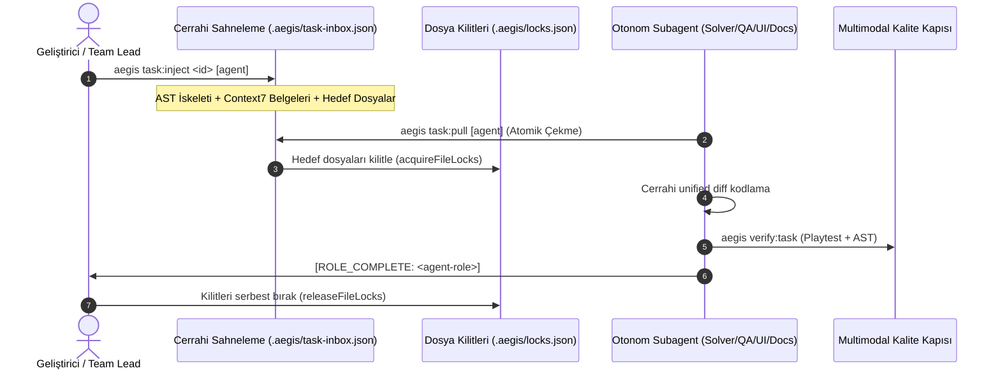
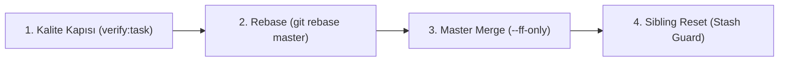

# 📥 02 — Görev Dağıtımı (TIP) ve Çoklu Ajan Takım Çalışması

> Aegis **Task Ingestion Protocol (TIP)** ve **Native Teamwork Engine**, paralel çalışan otonom yapay zeka ajanlarının birbirlerinin kodunu ezmesini, merge çakışmalarını ve mükerrer görev üstlenmelerini deterministik olarak önler.

---

## 1. Task Ingestion Protocol (TIP) Nedir?

Geleneksel itme tabanlı (*push-based*) görev atamalarında modeller rastgele dosyalara müdahale eder veya aynı issue üzerine eşzamanlı atılır. Aegis, çekme tabanlı (*pull-based*) deterministik bir boru hattı uygular:



### TIP Aşamaları
1. **Cerrahi Prompt Sahneleme (`aegis task:inject <id> [agent]`):** İlgili issue için AST iskeletleri, Context7 kütüphane dokümantasyonu ve Demir Kafes sınırları derlenir; `.aegis/task-inbox.json` içine sahnelenir.
2. **Atomik Görev Çekme (`aegis task:pull [agent]` / MCP `task_inbox_pull`):** Ajan rolüne (`solver`, `qa`, `docs`, `ui`) uygun sıradaki görevi tekil olarak çeker.
3. **Kalıcı Dosya Kilitleri (`.aegis/locks.json`):** Görev üzerinde çalışılacak hedef dosyaları atomik mutex ile kilitler.
4. **Güvenli Teslim (`aegis task:release <id> [status]`):** Görev tamamlandığında kilitler serbest bırakılır ve durum güncellenir.

---

## 2. Rol Tabanlı Git Worktrees & Çalışma Alanı İzolasyonu

Aegis'te `master` ve `main` dallarına doğrudan commit atılması Git kancaları ile engellenmiştir. Tüm çalışmalar izole Git worktree'lerinde yürütülür:

```
aegis/
├── packages/ (master dalı - korumalı ana depo)
└── experimental/
    ├── solver/        # aegis/solver       -> 🛠️ [ISSUE SOLVER] AKTİF
    ├── qa/            # aegis/qa           -> 🎯 [QA HUNTER] AKTİF
    ├── docs/          # aegis/docs         -> 📚 [DOC ARCHITECT] AKTİF
    ├── ui/            # aegis/ui           -> 🎨 [UI SPECIALIST] AKTİF
    └── contributor/   # aegis/contributor  -> Dış katkıcı çalışma alanı
```

### Worktree İzolasyonunun Avantajları
- Her ajan kendi dalında izole çalışır; tamamlanmamış ara denemeler ana repoyu kirletmez.
- `aegis branch:sync` komutu tüm worktree'leri veri kaybı olmadan (*stash-guarded*) güncel master durumuna eşitler.

---

## 3. Çakışmasız Dosya Kilitleri (Mutex — `.aegis/locks.json`)

Birden fazla ajanın aynı dosyaya eşzamanlı yazarak merge çakışması oluşturmasını engellemek için dosya bazlı mutex mekanizması işletilir:

```json
{
  "packages/core/orchestrator/src/teamwork-coordinator.ts": "issue-solver",
  "docs/02-task-ingestion-and-teamwork.md": "doc-architect"
}
```

### Atomik Kilitleme Protokolü
- **İşletim Sistemi Düzeyinde Kilit:** Dosya değişikliklerinden önce geçici dosya yazımı (`.aegis/locks.json.tmp.<pid>.<time>`) ve atomik dosya adı değiştirme (*atomic rename/swap*) kullanılır.
- **Çakışma Reddi:** Eğer bir dosya başka bir ajan tarafından tutuluyorsa, kilitleme isteği derhal `{ success: false, conflictingFiles: [...] }` hatasıyla reddedilir.
- **Canlı Durum Denetimi:** `aegis lock:status` komutu aktif kilitleri ve sahiplerini listeler.

---

## 4. Antigravity Subagent Teamwork Protokolü

Aegis, monolitik tek model yaklaşımı yerine hibrit model tahsisine dayalı 4 uzman ajan rolü tanımlar:

| Ajan Rolü | Kimlik Rozeti | Odak Kapsamı | Varsayılan Model | Çalışma Modu |
| :--- | :--- | :--- | :---: | :---: |
| **issue-solver** | `🛠️ [ISSUE SOLVER] AKTİF` | İş mantığı, çekirdek algoritmalar, hata onarımı, refactoring | `inherit` (Pro) | `share` / worktree |
| **qa-hunter** | `🎯 [QA HUNTER] AKTİF` | Kanıt tabanlı triyaj, birim testler, mutasyon testi, Godot playtest | `inherit` (Pro) | `share` / worktree |
| **ui-specialist** | `🎨 [UI SPECIALIST] AKTİF` | Godot sahneleri (`.tscn`), Temalar (`.tres`), responsive anchorlar | `inherit` (Pro) | `share` / worktree |
| **doc-architect** | `📚 [DOC ARCHITECT] AKTİF` | GitHub Yaşayan Wiki, RFC karar kayıtları, modüler belgeler | `flash` | `share` / worktree |

### Hibrit Model Tahsisinin Faydaları
- **Maliyet ve Hız:** Dokümantasyon ve Wiki senkronizasyonu yüksek verimli `flash` modelleriyle yapılarak token maliyetinde **%70 tasarruf** sağlanır.
- **Derin Muhakeme:** Kritik AST dönüşümleri ve mutasyon testleri yüksek akıl yürütme seviyesine sahip `pro` modellerine emanet edilir.
- **Reaktif Uyandırma:** Ajanlar arka plan işlerini sürekli sorgulamaz (*zero busy-wait*); mesaj bildirimleriyle reaktif olarak uyanır.

---

## 5. 4-Aşamalı Atomik Merge Pipeline

İşi biten bir ajanın kodu ana depoya aktarılırken deterministik 4 adım işletilir:



1. **Multimodal Kalite Doğrulaması:** `aegis verify:task` ile Demir Kafes kuralları, birim testler, mutasyon testi (%70 barajı) ve oyun motoru playtesti doğrulanır.
2. **Rebase:** `git rebase master` ile güncel değişiklikler çekilir.
3. **Master Merge:** `git merge --ff-only` ile ana dala aktarılır.
4. **Sibling Reset:** Diğer kardeş worktree'ler güncel master durumuna veri kaybı olmadan (*stash-guarded*) eşitlenir.

```bash
# Solver ajanının kodunu master ile birleştirme
aegis merge solver master
```

---

## 6. İlgili Belgeler

- [`01-architecture-and-memory.md`](file:///C:/Users/Lenovo/AntigravityProfiles/client-a/.gemini/antigravity/scratch/aegis/docs/01-architecture-and-memory.md) — 5-Katmanlı Kod Tabanı Hafızası.
- [`03-universal-cli-reference.md`](file:///C:/Users/Lenovo/AntigravityProfiles/client-a/.gemini/antigravity/scratch/aegis/docs/03-universal-cli-reference.md) — CLI komut kataloğu.
- [`06-diagnostics-and-quality-gates.md`](file:///C:/Users/Lenovo/AntigravityProfiles/client-a/.gemini/antigravity/scratch/aegis/docs/06-diagnostics-and-quality-gates.md) — Kalite kapıları ve devre kesici.
- [TEAMWORK.md](file:///C:/Users/Lenovo/AntigravityProfiles/client-a/.gemini/antigravity/scratch/aegis/docs/TEAMWORK.md) — Orijinal takım çalışması mimarisi.
- [RFC-034: Google Antigravity Bidirectional Task Bridge](file:///C:/Users/Lenovo/AntigravityProfiles/client-a/.gemini/antigravity/scratch/aegis/docs/rfc/RFC-034-google-antigravity-bidirectional-orchestration-and-task-bridge.md)
