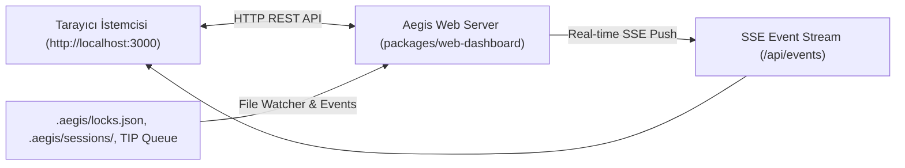

# 💻 03 — Evrensel CLI Komut Referansı ve Web Komuta Merkezi

> Aegis; monorepo derlemesiyle birlikte sistem genelinde çalışan evrensel bir ikiliye (`aegis`, `aegist`) dönüşür. Herhangi bir alt dizinde veya çalışma alanında doğrudan çağrılabilir.

---

## 1. Evrensel CLI Mimarisi

Aegis CLI, `packages/cli` altında TypeScript ile geliştirilmiş, 50'den fazla komutu ve yerel stdio MCP sunucusunu barındıran orkestrasyon merkezidir. Komutlar şu şekillerde çalıştırılabilir:

```bash
# Sistem genelinde evrensel ikili
aegis <komut> [argümanlar]
aegist <komut> [argümanlar]
tw <komut> [argümanlar]
tr <komut> [argümanlar]

# Monorepo içinden çalıştırma
npm run aegis -- <komut> [argümanlar]
```

---

## 2. Temel Komut Grupları Kataloğu

### 2.1. Temel Orkestrasyon & Görev Dağıtımı (TIP)

| Komut | Parametreler | Açıklama |
| :--- | :--- | :--- |
| `aegis init` | Yok | Rol tabanlı worktree'leri (`solver`, `qa`, `docs`, `ui`) ve IDE kural dosyalarını hazırlar. |
| `aegis status` | Yok | Aktif worktree'leri, bağlı IDE oturumlarını ve aktif dosya mutex kilitlerini listeler. |
| `aegis auto` | Yok | Otonom görev dağıtım kuyruğunu (TIP) tetikler. |
| `aegis update` | `[--clean] [--pull] [--bump <type>]` | Monorepo paket sürümlerini otomatik yükseltir (patch/minor/major), yeniden derler ve PC çapında kurar. |
| `aegis version:status` | `[flag]` | Versiyon seviye teşhisi, origin/master drifti, git etiketleri ve güncelleme uygunluk raporu. |
| `aegis task:list` | `[status]` | TIP görev kuyruğundaki görevleri listeler (`ready`, `in_progress`, `blocked`). |
| `aegis task:claim` | `<id> [agent]` | Görevi ajan rolü adına üstlenir ve hedef dosya kilitlerini edinir. |
| `aegis task:release`| `<id> [status]` | Görevi tamamlar/bırakır ve dosya kilitlerini çözer. |
| `aegis task:inject` | `<id> [agent]` | Cerrahi prompt derleyip görevi TIP kutusuna (`.aegis/task-inbox.json`) sahneler. |
| `aegis task:pull` | `[agent]` | Ajanın sıradaki sahnelenmiş görevini TIP kutusundan atomik olarak çeker. |
| `aegis task:verify` | `[file]` | Multimodal Kalite Kapısını (Demir Kafes + Godot Playtest) çalıştırır. |
| `aegis lock:status` | Yok | Aktif dosya mutex kilitleri matrisini görüntüler. |
| `aegis prompt` | `[role] [id]` | Görev için cerrahi AST iskeleti ve anayasa kurallarıyla optimize prompt derler. |
| `aegis contribute` | `<issue> [agent]` | Dış katkıcı için izole worktree, hedef dosya kilitleri ve cerrahi prompt oluşturur. |
| `aegis merge` | `<role> [branch]` | 4-aşamalı atomik merge pipeline ve dinamik kardeş worktree senkronizasyonu çalıştırır. |
| `aegis branch:sync`| `[agent\|--all]` | Worktree dallarını master ile veri kaybı olmadan (stash korumalı) senkronize eder. |
| `aegis tr "<obj>"` / `tw` | `<obj> [-c]` | Doğrudan hedef planlama, DAG ayrıştırma ve atomik batch kilitlerle TIP sahneleme. |
| `aegis tr:waves` / `tw:waves` | `[obj] [-c]` | 3-fazlı paralel yürütme dalgalarını ve brifingini hesaplar (`-c` kompakt). |
| `aegis tr:peers` / `tw:peers` | `[-c]` | Aktif kardeş subagent'ların durumunu, kilitlerini ve kontratlarını listeler. |
| `aegis tr:radar` / `tw:radar` | Yok | Canlı dosya çakışma radarı (`tr:conflicts`). |
| `aegis tr:report` / `tw:report` | `[id] [-c] [-s]` | <10ms'de yüksek sinyalli zemin-gerçeklik yürütme raporu üretir (`-c` <120 token, `-s` kaydet). |
| `aegis tr:doc` / `tw:doc` | `[id] [-c]` | Yaşayan mimari sentez raporu, Mermaid topolojisi ve kalite metrikleri derler (`tr:synthesize`). |
| `aegis tr:advance` / `tw:advance` | `[id]` | Aktif yürütme dalgasını sonraki faz dalgasına pürüzsüzce ilerletir. |
| `aegis tr:scale` / `tw:scale` | `"<obj>" [-n]` | 12+ subagent'a kadar %100 çakışmasız mikro-bölümleme planı oluşturur. |
| `aegis tr:push` / `tw:push` | `[--dry-run]` | Demir Kafes kalkanı, çalışma dizini commit'leme ve GitHub'a otonom push. |

### 2.2. 5-Katmanlı Kod Tabanı Hafızası & Bağımlılıklar

| Komut | Parametreler | Açıklama |
| :--- | :--- | :--- |
| `aegis memory:query` | `<sym> [wt]` | Sembolün AST dilimini, çağıranlarını, etki alanını ve bütçe kotasını sorgular. |
| `aegis memory:stats` | `[worktree]` | Kod tabanı hafıza boyutunu, sembol sayısını ve token tasarrufunu raporlar. |
| `aegis memory:cold-start` | `[dir]` | Hedef dizini baştan sona tam indeksleyip soğuk başlangıç önbelleği hazırlar. |
| `aegis memory:watch` | `[dir] [wt]` | Dosya sistemini arka planda izleyerek hafızayı anlık günceller. |
| `aegis memory:refresh` | `[dir]` | Hafıza önbelleğini belirtilen dizinden artımlı olarak yeniler. |
| `aegis memory:prune` | `[worktree]` | Silinen dosyalara ait eski hafıza kayıtlarını temizler. |
| `aegis deps:drift` | Yok | Symbiotic Substrate 2.0 Sözleşme Kayması Radarı ile lockfile bütünlüğünü denetler. |

### 2.3. Cerrahi AST Arama, Sokratik Teşhis & Token Optimizasyonu

| Komut | Parametreler | Açıklama |
| :--- | :--- | :--- |
| `aegis debug` | `[error\|file]` | Sokratik kanıt tabanlı etkileşimli hata ayıklama oturumu başlatır. |
| `aegis find` | `<symbol>` | Hızlı AST sembol araması yapar ve cerrahi kod dilimini sunar. |
| `aegis triage` | `[dir]` | Kanıt Tabanlı Hata Tespiti çalıştırır (varsayımsal/sahte bug'ları eler). |
| `aegis trace` | `<target>` | Fonksiyonu çağıranları, çağırdıklarını, bağlı sinyal ve sahneleri haritalandırır. |
| `aegis graph:scan` | `[dir]` | Projenin ilişkisel bağımlılık ve çağrı çizgesini oluşturur. |
| `aegis ast:search` | `<pat> [dir]` | `ast-grep` ile yapısal AST deseni araması yapar (STDIN hang yapmaz). |
| `aegis ast:replace` | `<p> <r> <f>` | Hedef dosyada yapısal AST değiştirmesi uygular. |
| `aegis rtk:compress`| `[file]` | RTK Token Killer ile terminal veya test çıktısını %90 sıkıştırır. |
| `aegis context7:query` | `<lib> <topic>` | Context7 üzerinden resmi kütüphane dokümantasyonunu sorgular. |

### 2.4. Demir Kafes & Kalite Kapıları

| Komut | Parametreler | Açıklama |
| :--- | :--- | :--- |
| `aegis cage:check` | `[dir]` | Projeyi Demir Kafes (300/40) ve Fast-Stat radarıyla anında denetler. |
| `aegis ci:audit` | Yok | 10 GitHub Actions CI kapısını yerelde deterministik doğrular (takma ad: `aegis ci:check`). |
| `aegis test` | `[target] [--offline] [--bail] [--json] [--soft] [--timeout=<ms>]` | Resilient test koşucusu; süreç bekçisi, adaptif zaman aşımı ve otomatik triyajla testleri koşturur. |
| `aegis test:offline` | `[target] [--bail] [--json] [--soft] [--timeout=<ms>]` | RFC-050 çevrimdışı test kalkanıyla (Node.js network mock shim) izole ve kesintisiz test çalıştırır. |
| `aegis verify` | `<filepath>` | Tek bir dosyanın Demir Kafes kurallarına uyumunu test eder. |
| `aegis verify:task` | `[file]` | Multimodal Kalite Kapısını (Demir Kafes + Godot Playtest) çalıştırır. |
| `aegis skeleton` | `<filepath>` | Dosyanın AST iskelet haritasını ve token tasarrufunu çıkarır. |
| `aegis diff` | `<diff>` | Cerrahi Unified Diff formatını ve satır bütçesini doğrular. |
| `aegis audit` | `<files>` | Immutable Oracle güven ve test tahrif denetimini koşturur. |
| `aegis mutate` | `[filepath]` | Mutasyon testi kapısını çalıştırır (%70 yakalama barajı). |
| `aegis loop:status` | Yok | Devre kesici (Circuit Breaker) sayaçlarını ve kilitlenen görevleri gösterir. |
| `aegis loop:reset` | `[num]` | Devre kesici sayaçlarını sıfırlar ve durdurulan görevleri çözer. |

### 2.5. GitHub, RFC, Yaşayan Wiki & NotebookLM

| Komut | Parametreler | Açıklama |
| :--- | :--- | :--- |
| `aegis rfc:create` | `"<title>" [desc]` | Mimari RFC taslağı oluşturur ve GitHub Discussions üzerinde yayımlar. |
| `aegis rfc:approve` | `<rfcId>` | Kabul edilen RFC'den clean-room Wiki sayfası sentezler. |
| `aegis rfc:decompose` | `<rfcId>` | RFC kabul kriterlerini atomik GitHub Issue'larına parçalar. |
| `aegis wiki:sync` | Yok | Yaşayan hafızayı doğrudan `<repo>.wiki.git` deposuyla senkronize eder. |
| `aegis wiki:status` | Yok | Uzak Wiki bağlantısını, sayfa sayısını ve önbellek tutarlılığını doğrular. |
| `aegis gh:status` | Yok | Canlı GitHub kimlik, kota ve açık issue durumunu eşitler. |
| `aegis nlm:switch` | `[args]` | Aktif Google hesabını yedekleyip ortam/tarayıcı üzerinden değiştirir. |
| `aegis nlm:query` | `"<question>"` | Proje bilgi tabanını Google NotebookLM üzerinden alıntılarla sorgular. |
| `aegis nlm:prune` | `[--dry-run]` | Eski kaynakları MFCS güven skoruyla budar ve mezar taşı mahzenine arşivler. |
| `aegis nlm:restore` | `<id>` | Arşivlenmiş bir kaynağı yerel mahzenden NotebookLM'e geri yükler. |

---

## 3. Web Komuta Merkezi Dashboard (`localhost:3000`)

Aegis, bağımsız bir HTTP sunucusu ve Server-Sent Events (SSE) akışıyla gerçek zamanlı bir izleme ve yönetim paneli sunar:

```bash
# Komuta merkezini başlatma
aegis dashboard 3000
```



### Dashboard Temel Yetenekleri
- **Canlı Mulgravity & IDE Algılama:** Hangi ajanın hangi IDE penceresinde (Antigravity, Cursor, VS Code) aktif olduğunu `.aegis/sessions/` telemetrisiyle gösterir.
- **Dosya Kilitleri Matrisi:** Hangi dosyaların kilitli olduğunu gösterir; tek tıkla kilitleri serbest bırakma olanağı sağlar.
- **Metrikler & Token Sayaçları:** AST iskeletleme ve RTK ile sağlanan anlık token tasarruf yüzdelerini gösterir.
- **Tek Tıkla Komuta:** `auto` görev dağıtımı, `sync` GitHub senkronizasyonu ve `merge` operasyonlarını tarayıcı arayüzünden tetikler.

---

## 4. İlgili Belgeler

- [`02-task-ingestion-and-teamwork.md`](file:///C:/Users/Lenovo/AntigravityProfiles/client-a/.gemini/antigravity/scratch/aegis/docs/02-task-ingestion-and-teamwork.md) — TIP ve Git Worktrees.
- [`04-mcp-server-specification.md`](file:///C:/Users/Lenovo/AntigravityProfiles/client-a/.gemini/antigravity/scratch/aegis/docs/04-mcp-server-specification.md) — 19 MCP aracı referansı.
- [`05-godot-bridge-and-ui.md`](file:///C:/Users/Lenovo/AntigravityProfiles/client-a/.gemini/antigravity/scratch/aegis/docs/05-godot-bridge-and-ui.md) — `aegis godot *` komutları.
- [`06-diagnostics-and-quality-gates.md`](file:///C:/Users/Lenovo/AntigravityProfiles/client-a/.gemini/antigravity/scratch/aegis/docs/06-diagnostics-and-quality-gates.md) — Doğrulama ve Sokratik teşhis.
