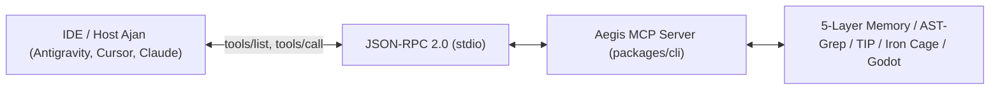

# 🔌 04 — Yerel Model Context Protocol (MCP) Sunucu Spesifikasyonu

> Aegis, standart **Model Context Protocol (MCP)** JSON-RPC spesifikasyonunu yerel `stdio` üzerinden uygulayarak IDE'lerin ve otonom yapay zeka ajanlarının (Google Antigravity, Mulgravity, Cursor, VS Code, Claude Desktop) kod tabanıyla doğrudan ve cerrahi etkileşime girmesini sağlar.

---

## 1. MCP Sunucu Mimarisi & Başlatma

Sunucu, bağımsız bir alt süreç (*child process*) olarak çalışır ve standart girdi/çıktı (`stdio`) üzerinden JSON-RPC 2.0 mesajları alır:

```bash
# Yerel MCP sunucusunu başlatma
aegis mcp
```



### IDE Yapılandırma Örnekleri

#### Google Antigravity (`.gemini/config/mcp_config.json`)
```json
{
  "mcpServers": {
    "aegis": {
      "command": "aegis",
      "args": ["mcp"]
    }
  }
}
```

#### Cursor AI (`.cursor/mcp.json`)
```json
{
  "mcpServers": {
    "aegis": {
      "command": "node",
      "args": ["packages/cli/dist/bin/aegis.js", "mcp"]
    }
  }
}
```

---

## 2. 19 Çekirdek Yerel MCP Aracının Detaylı Kataloğu

### 2.1. Kod Tabanı Hafızası ve AST Araçları

#### `memory_query`
- **Açıklama:** 5-Katmanlı hafızadan sembolün AST dilimini, çağıranlarını, etki alanını ve bütçe kotasını sorgular.
- **Parametreler:**
  - `symbol` (string, zorunlu): Sorgulanacak fonksiyon, sınıf veya arayüz adı.
  - `worktreeId` (string, opsiyonel): Hedef worktree kimliği (varsayılan: `'default'`).
- **Dönüş Tipi:** `{ found: boolean, symbol: string, filePath: string, slice: string, callers: string[], blastRadius: number, tokenSavingsPercent: number }`

#### `memory_stats`
- **Açıklama:** Hafıza motorunun indekslediği dosya, sembol ve çağrı grafiği kenar sayılarını raporlar.
- **Parametreler:** `worktreeId` (string, opsiyonel).
- **Dönüş Tipi:** `{ totalFiles: number, totalSymbols: number, totalEdges: number, tokenSavingsPercent: number }`

#### `find_symbol`
- **Açıklama:** Sembolün dosya yolunu, satır aralığını ve cerrahi kod dilimini döndürür.
- **Parametreler:** `symbol` (string, zorunlu).
- **Dönüş Tipi:** `{ found: boolean, symbol: string, filePath: string, slice: string, tokenSavingsPercent: number }`

#### `trace_relational`
- **Açıklama:** Fonksiyonun çağıranlarını, çağırdıklarını, bağlı Godot sinyallerini ve sahnelerini çıkarır.
- **Parametreler:** `target` (string, zorunlu).
- **Dönüş Tipi:** `{ target: string, callers: string[], callees: string[], blastRadius: number, signals: string[], scenes: string[] }`

#### `ast_search`
- **Açıklama:** Yapısal `ast-grep` deseniyle kod araması yapar (regex değil, sözdizimi ağacı).
- **Parametreler:** `pattern` (string, zorunlu), `path` (string, opsiyonel).
- **Dönüş Tipi:** `{ count: number, matches: Array<{ file: string, line: number, text: string }> }`

#### `ast_replace`
- **Açıklama:** Yapısal AST metavaryablları kullanarak hedef dosyada güvenli refactoring yapar.
- **Parametreler:** `pattern` (string, zorunlu), `rewrite` (string, zorunlu), `file` (string, zorunlu).
- **Dönüş Tipi:** `{ success: boolean, modifiedLines: number, diff: string }`

#### `skeleton_extract`
- **Açıklama:** Dosyadaki fonksiyon gövdelerini gizleyip sadece tip ve arayüz iskeletini çıkarır.
- **Parametreler:** `filePath` (string, zorunlu).
- **Dönüş Tipi:** `{ filePath: string, skeleton: string, tokenSavingsPercent: number, originalLength: number, skeletonLength: number }`

---

### 2.2. Demir Kafes ve Teşhis Araçları

#### `budget_inspect`
- **Açıklama:** Dosyanın Demir Kafes satır bütçesini (maks 300) ve modülerleşme önerisini raporlar.
- **Parametreler:** `filePath` (string, zorunlu).
- **Dönüş Tipi:** `{ filePath: string, fileLines: number, maxFileLines: 300, fileQuotaRemaining: number, status: 'SAFE' | 'WARNING' | 'CRITICAL_QUOTA', mustDecompose: boolean, advice: string }`

#### `cage_check`
- **Açıklama:** Hedef dizindeki tüm dosyaları Demir Kafes (300/40) kurallarına göre denetler.
- **Parametreler:** `dir` (string, opsiyonel, varsayılan: `'packages'`).
- **Dönüş Tipi:** `{ total: number, compliant: number, percent: number }`

#### `triage`
- **Açıklama:** Kanıt Tabanlı Hata Tespiti çalıştırır; somut kanıtı olmayan varsayımsal bug'ları eler.
- **Parametreler:** `dir` (string, opsiyonel).
- **Dönüş Tipi:** `{ evaluatedFiles: number, verifiedIssues: Issue[], discardedHallucinations: number }`

#### `socratic_diagnose`
- **Açıklama:** Yığın izini ayrıştırıp Sokratik hipotezler ve önceliklendirilmiş tanı seçenekleri üretir.
- **Parametreler:** `rawLog` (string, zorunlu), `callSiteCode` (string, opt), `library` (string, opt), `symbol` (string, opt).
- **Dönüş Tipi:** `{ category: string, evidence: StackFrame[], clarificationOptions: Option[] }`

#### `context7_query`
- **Açıklama:** Doğrulanmış kütüphane dokümantasyonunu ve imza bilgilerini getirir.
- **Parametreler:** `library` (string, zorunlu), `topic` (string, zorunlu).
- **Dönüş Tipi:** `{ library: string, topic: string, content: string, signatures: string[] }`

#### `rtk_compress`
- **Açıklama:** Terminal ve test loglarındaki ANSI kodlarını ve gereksiz tekrarları %90 temizler.
- **Parametreler:** `text` (string, zorunlu).
- **Dönüş Tipi:** `{ savings: number, text: string }`

---

### 2.3. TIP Görev Yönetimi & Kilit Araçları

#### `worktree_status`
- **Açıklama:** Aktif Git worktree dallarını ve aktif dosya mutex kilitlerini listeler.
- **Parametreler:** Yok.
- **Dönüş Tipi:** `{ worktrees: Worktree[], lockedFiles: Record<string, string>, activeCount: number }`

#### `task_list`
- **Açıklama:** TIP kuyruğundaki görevleri listeler.
- **Parametreler:** `status` (string, opsiyonel: `'ready'` | `'in_progress'` | `'blocked'`).
- **Dönüş Tipi:** `{ tasks: Task[] }`

#### `task_claim`
- **Açıklama:** Görevi ilgili ajan adına üstlenir ve hedef dosyaların mutex kilitlerini alır.
- **Parametreler:** `issueNumber` (number, zorunlu), `agentRole` (string, zorunlu).
- **Dönüş Tipi:** `{ success: boolean, claimedBy: string, lockedFiles: string[] }`

#### `task_release`
- **Açıklama:** Görevi tamamlar veya bırakır; dosya kilitlerini serbest bırakır.
- **Parametreler:** `issueNumber` (number, zorunlu), `status` (string, zorunlu), `agentRole` (string, zorunlu).
- **Dönüş Tipi:** `{ success: boolean, releasedFiles: string[] }`

#### `task_inbox_pull`
- **Açıklama:** TIP kutusundan (`.aegis/task-inbox.json`) sıradaki görevi atomik çeker.
- **Parametreler:** `agentRole` (string, opsiyonel).
- **Dönüş Tipi:** `{ hasTask: boolean, task?: StagedTaskPayload }`

#### `lock_status`
- **Açıklama:** Aktif dosya kilitleri matrisini ve kilidi tutan ajan rollerini döndürür.
- **Parametreler:** Yok.
- **Dönüş Tipi:** `{ locks: Record<string, string>, totalLocks: number }`

---

## 3. Ek Teamwork ve Godot MCP Araçları

Standart 19 araca ek olarak, çoklu ajan koordinasyonu ve Godot motoru için özelleşmiş araçlar mevcuttur:

| Araç Adı | Alan | Parametreler | Açıklama |
| :--- | :--- | :--- | :--- |
| `teamwork_plan` | Teamwork | `objective` (str), `targetFiles` (str[]) | Antigravity takım planı oluşturur ve görevleri sahneler. |
| `teamwork_status` | Teamwork | Yok | Ajanların canlı görev durumunu ve kilitlerini raporlar. |
| `teamwork_compact` | Teamwork | `objective` (str) | Tamamlanan görevleri arşivler ve brifing sunar. |
| `teamwork_dag` | Teamwork | `objective` (str), `targetFiles` (str[]) | Görev bağımlılık çizgesini (DAG) görselleştirir. |
| `aegis_godot_status` | Godot | Yok | Godot editör ve RPC köprüsü canlılık durumunu döner. |
| `aegis_godot_playtest`| Godot | `scene` (str, req) | Sahneyi headless çalıştırıp otomatik test eder. |
| `aegis_godot_inspect_ui`| Godot | `scene` (str, req) | UI ağacını ve taşmaları sıfır token ile inceler. |

---

## 4. İlgili Belgeler

- [`01-architecture-and-memory.md`](file:///C:/Users/Lenovo/AntigravityProfiles/client-a/.gemini/antigravity/scratch/aegis/docs/01-architecture-and-memory.md) — 5-Katmanlı Hafıza Motoru.
- [`02-task-ingestion-and-teamwork.md`](file:///C:/Users/Lenovo/AntigravityProfiles/client-a/.gemini/antigravity/scratch/aegis/docs/02-task-ingestion-and-teamwork.md) — TIP ve Mutex kilitleri.
- [`05-godot-bridge-and-ui.md`](file:///C:/Users/Lenovo/AntigravityProfiles/client-a/.gemini/antigravity/scratch/aegis/docs/05-godot-bridge-and-ui.md) — Godot köprü araçları.
