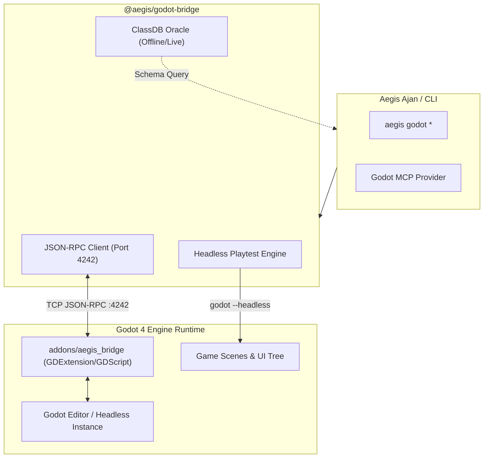

# 🎮 05 — Godot 4 Köprüsü ve UI Mimarisi

> Aegis; Godot 4.x (Godot 4.3 – 4.7+) oyun projeleri için özel olarak geliştirilmiş **`@aegis/godot-bridge`** paketi ile headless playtesting, ClassDB API referansı ve deterministik UI mimari standartları sunar.

---

## 1. `@aegis/godot-bridge` Mimarisi

Aegis ile Godot 4 motoru arasındaki entegrasyon çift yönlü JSON-RPC protokolü üzerinden sağlanır:



### 1.1. ClassDB Canlı Oracle
- **Sorun:** LLM'ler Godot 3 ile Godot 4 sözdizimini karıştırır veya uydurma sinyaller (`yield` vs `await`, `set_position` vs doğrudan property) yazar.
- **Çözüm:** Godot 4 yerleşik sınıflarını, sinyallerini ve özelliklerini içeren resmi ClassDB veri tabanını anlık sorgular:
  ```bash
  aegis godot query CharacterBody2D
  ```

### 1.2. Headless Otomatik Playtesting
- Değiştirilen sahneleri ekran kartı ve pencere açmadan (`--headless`) simüle eder.
- Çökme (*crash*), bellek sızıntısı ve GDScript çalışma zamanı hatalarını saniyeler içinde raporlar:
  ```bash
  aegis godot playtest res://scenes/player.tscn
  ```

---

## 2. Godot 4 UI Mimarisi & Demir Kafes Kuralları

Tüm Godot UI sahneleri, temaları ve GDScript kontrolcüleri 5 temel mimari kurala uymak zorundadır:

```
┌─────────────────────────────────────────────────────────────┐
│ 1. Container-First: Sıfır manuel piksel koordinatı          │
├─────────────────────────────────────────────────────────────┤
│ 2. Responsive Root: anchors_preset = 15 (Full Rect)         │
├─────────────────────────────────────────────────────────────┤
│ 3. Dokunma Hedefi: custom_minimum_size >= Vector2(44, 44)   │
├─────────────────────────────────────────────────────────────┤
│ 4. Decoupled Kontrolcüler: %NodeName ve typed signals       │
├─────────────────────────────────────────────────────────────┤
│ 5. Girdi Hijyeni: mouse_filter = 2 (Ignore)                 │
└─────────────────────────────────────────────────────────────┘
```

1. **Container-First Düzen:** Tüm etkileşimli öğeler esnek kapsayıcılara (`MarginContainer`, `VBoxContainer`, `HBoxContainer`, `GridContainer`) yerleştirilmelidir. Kapsayıcı çocuklarına asla manuel piksel (`position`, `offset_*`) verilmez.
2. **Responsive Kök Çapa (Root Anchors):** Tam ekran kök düğümler (`Control`, `CanvasLayer`) mutlaka `anchors_preset = 15` (Full Rect) ve `grow_horizontal = 2, grow_vertical = 2` taşımalıdır.
3. **Erişilebilir Dokunma Hedefleri:** Düğmeler ve etkileşimli kontroller en az 44x44px dokunma alanına (`custom_minimum_size = Vector2(44, 44)`) sahip olmalıdır.
4. **Bağımsız Kontrolcüler (Decoupled Controllers):** GDScript sunum katmanı düğümleri benzersiz adlarla (`%NodeName`) sorgulamalı; doğrudan iş mantığını mutasyona uğratmak yerine tipli sinyaller (`signal confirmed(payload: Dictionary)`) yaymalıdır.
5. **Sıfır-Takılma Girdi Hijyeni:** Dekoratif panellerde, etiketlerde ve layout kapsayıcılarında `mouse_filter = 2` (Ignore) tanımlanarak fare ışın taraması (*raycast*) yükü sıfırlanmalıdır.

---

## 3. Statik UI Linter (`aegis godot ui:lint`)

Aegis, `.tscn` sahnelerini parse ederek UI anti-pattern'lerini commit öncesinde yakalar:

| Kural Kodu | Seviye | Açıklama | Düzeltme Önerisi |
| :--- | :---: | :--- | :--- |
| `ROOT_CONTROL_RESPONSIVENESS` | Uyarı | Kök Control `anchors_preset` eksik | `anchors_preset = 15` & `grow_* = 2` ata |
| `CONTAINER_CHILD_CONFLICT` | Uyarı | Kapsayıcı çocuğunda manuel koordinat var | Manuel koordinatları kaldır, `size_flags` kullan |
| `CONTAINER_LAYOUT_MODE` | Uyarı | Manuel layout mode belirtilmiş | `layout_mode = 2` (Container Sizing) yap |
| `TOUCH_TARGET_SIZE` | Uyarı | Düğme 44x44px'den küçük | `custom_minimum_size` değerini >= 44x44 yap |
| `ACCESSIBILITY_METADATA` | Bilgi | Erişilebilirlik metni veya tooltip eksik | `tooltip_text` veya `accessibility_name` ekle |
| `DANGLING_SIGNAL_NODE` | Hata | Sinyal var olmayan bir düğüme bağlı | Sahne ağacındaki düğüm yolunu kontrol et |
| `SCRIPT_METHOD_MISSING` | Hata | Bağlanan metot GDScript'te mevcut değil | Script içine `func method():` gövdesini ekle |

---

## 4. Hızlı UI İskeletleme Motoru (`aegis godot ui:scaffold`)

Demir Kafes kurallarına %100 uyumlu hazır sahneler ve kontrolcüler üretir:

```bash
aegis godot ui:scaffold <type> <name> [outDir]
```

### Desteklenen İskelet Tipleri
- **`menu`:** Arka plan, başlık, Başlat/Seçenekler/Çıkış düğmeleri ve tipli sinyaller içeren tam ekran menü.
- **`hud`:** Ekran köşelerine kenetlenmiş sağlık çubuğu (`ProgressBar`) ve skor alanı.
- **`dialog`:** Karartmalı arka plan, Başlık, Mesaj ve Onay/İptal düğmeleri olan modal pencere.
- **`settings`:** Ses kaydırıcıları, Video kontrolleri ve AccessKit erişilebilirlik ayarları içeren sekmeli arayüz.
- **`inventory`:** `GridContainer` tabanlı esnek envanter ızgarası.
- **`virtual_list`:** 10.000+ öğede dahi 120 FPS sabit kalan sanal geri dönüşüm listesi (*virtual recycler*).
- **`theme`:** Tüm durumlara (`normal`, `hover`, `pressed`, `disabled`, `focus`) sahip `StyleBoxFlat` teması.

---

## 5. Sıfır-Token BoundingBox UI Denetimi

Aegis, arayüz bileşenlerinin çakışma ve taşmalarını görsel screenshot modellerine göndermeden matematiksel olarak denetler:

```bash
aegis godot inspect [projectDir]
```

Sistem, 9 kritik ekran en-boy oranında (`16:9`, `21:9`, `16:10`, `4:3`, `9:16`, `9:18`, `9:19.5`, `9:20`, `3:4`) sahne düğümlerinin sınırlayıcı kutularını (*BoundingBox*) hesaplar ve metin taşmalarını 0 token maliyetiyle tespit eder.

---

## 6. İlgili Belgeler

- [`02-task-ingestion-and-teamwork.md`](file:///C:/Users/Lenovo/AntigravityProfiles/client-a/.gemini/antigravity/scratch/aegis/docs/02-task-ingestion-and-teamwork.md) — Çoklu ajan görev döngüsü.
- [`04-mcp-server-specification.md`](file:///C:/Users/Lenovo/AntigravityProfiles/client-a/.gemini/antigravity/scratch/aegis/docs/04-mcp-server-specification.md) — Godot MCP araçları.
- [`06-diagnostics-and-quality-gates.md`](file:///C:/Users/Lenovo/AntigravityProfiles/client-a/.gemini/antigravity/scratch/aegis/docs/06-diagnostics-and-quality-gates.md) — Multimodal Kalite Kapısı.
- [GODOT_UI.md](file:///C:/Users/Lenovo/AntigravityProfiles/client-a/.gemini/antigravity/scratch/aegis/docs/GODOT_UI.md) — Orijinal Godot UI el kitabı.
- [RFC-002: Aegis Godot Bridge](file:///C:/Users/Lenovo/AntigravityProfiles/client-a/.gemini/antigravity/scratch/aegis/docs/rfc/RFC-002-aegis-godot-bridge.md)
- [RFC-038: Godot 4 UI Teamwork Scaffolding](file:///C:/Users/Lenovo/AntigravityProfiles/client-a/.gemini/antigravity/scratch/aegis/docs/rfc/RFC-038-rfc-011-godot-4-ui-teamwork-scaffolding-static-linter-and-mutual-exclusion-lock-allocation.md)
