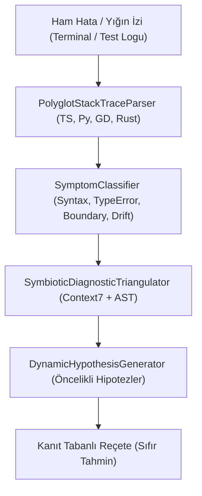
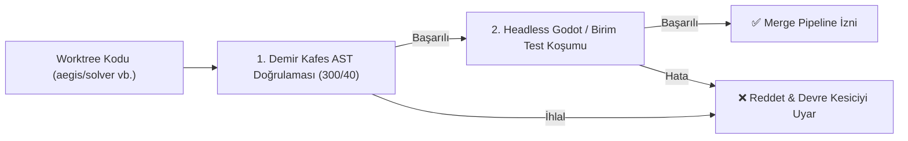

# 🩺 06 — Teşhis Motoru ve Kalite Kapıları

> Aegis; yapay zeka ajanlarının rastgele deneme-yanılma (*stagnation*), test tahrifatı (*test tampering*) ve varsayımsal hata uydurmalarını (**AI hallucination**) deterministik fiziksel kapılarla engeller.

---

## 1. Sokratik Teşhis Kapısı (`aegis debug`)

Geleneksel vibe coding ortamlarında bir hata çıktığında modeller yığın izini (*stack trace*) okumadan varsayımsal kodlar dener. Aegis, **Sokratik Kanıt Tabanlı Hata Ayıklama** protokolünü zorunlu kılar:



### 3-Fazlı Sokratik Diyalog Aşamaları
1. **Faz 1 — Yığın İzi Ayrıştırma:** Dosya yolu, satır numarası ve hata çağrı zinciri izole edilir.
2. **Faz 2 — Kök Neden Triangülasyonu:** Hata noktası, yerel AST iskeleti ve Context7 kütüphane sözleşmesiyle çapraz kontrol edilir.
3. **Faz 3 — Kanıt Tabanlı Reçete:** Modele rastgele kod yerine yalnızca doğrulanmış çözüm seçenekleri sunulur.

---

## 2. Kanıt Tabanlı Hata Tespiti (Evidence-Based Triage)

Modellerin "Burada potansiyel bir bug olabilir" diyerek gereksiz refactoring başlatmasını önlemek için **Evidence-Based Bug Triage (`aegis triage`)** uygulanır:

```bash
aegis triage packages
```

### Triyaj Kriterleri (RFC-024)
- **Somut Kanıt Zorunluluğu:** Başarısız olan bir birim test veya AST düzeyinde tespit edilen kesin kural ihlali yoksa bug raporu oluşturulamaz.
- **Sahte Alarm Eleme:** Varsayımsal tahminler otomatik filtrelenir; ajanların lüzumsuz iş yüküyle token yakması önlenir.

---

## 3. Multimodal Kalite Kapısı (`aegis verify:task`)

Aegis'te hiçbir kod, iki aşamalı multimodal doğrulamayı geçmeden ana dala merge edilemez:



- **Statik Denetim:** 40 satır fonksiyon, 300 satır dosya, Cyclomatic Complexity <= 10 ve ölü kod kuralları.
- **Dinamik Koşum:** Headless oyun motoru testi veya monorepo test süiti.

---

## 4. Immutable Oracle & Mutasyon Test Kapısı (%70 Barajı)

Ajanların testleri gevşeterek veya silerek hile yapmasını engellemek için iki katmanlı kalkan mevcuttur:

### 4.1. Immutable Oracle (`@aegis/trust-verifier`)
- Bir ajan testi geçebilmek adına `assert(true)` yazarsa, test dosyasını silerse veya beklentileri yumuşatırsa bu durum statik diff analiziyle anında yakalanır.
- Test tahrifatı tespit edilen ajanın yetkileri askıya alınır ve durum `[UNTRUSTED_AGENT]` olarak işaretlenir.

### 4.2. Mutasyon Testi Kapısı (`aegis mutate`)
- Koddaki mantıksal operatörler yapay olarak bozulur (`&&` yerine `||`, `+` yerine `-`, `>=` yerine `>`).
- Yazılan test süitinin bu yapay bozulmaları yakalama oranı **%70'in altındaysa** PR reddedilir:
  ```bash
  aegis mutate packages/core/orchestrator/src/task-manager.ts
  ```

---

## 4.3. Yerel CI/CD Pipeline Denetim Koşucusu (`aegis ci:audit` / `aegis ci:check`)

GitHub Actions CI/CD ortamında koşturulan tüm doğrulama kapıları, kod uzak depoya gönderilmeden önce yerel ortamda tek bir komutla deterministik olarak doğrulanır:

```bash
aegis ci:audit
# veya
aegis ci:check
```

### Denetlenen 10 GitHub Actions CI Kapısı
1. **Monorepo Build:** TypeScript derleme bütünlüğü (`npm run build`).
2. **Monorepo Typecheck:** Sıkı tip denetimi (`npm run typecheck`).
3. **Monorepo Lint:** Kod stili ve sözdizimi analizi (`npm run lint`).
4. **Topological Drift Radar (RFC-036):** Kilit dosyaları ve sözleşme kayması (`aegis deps:drift`).
5. **Deterministic Demir Kafes Audit:** Satır ve fonksiyon sınırları denetimi (`aegis cage:check`).
6. **Demir Kafes Doğrulaması:** Dosya seviyesi kurallar (`aegis verify`).
7. **Monorepo Unit Test Suite:** Paralel ve önbellekli test süiti (`npm test`).
8. **Zero-Token UI Inspection:** Arayüz düzen denetimi (`aegis inspect`).
9. **Godot Bridge & UI Verification:** Godot durumu ve sahne ağacı denetimi (`aegis godot status` & `inspect`).
10. **Mutation Testing Gate:** Değişiklik toleransı ve güvenilirlik barajı (`aegis mutate`, %70 barajı).

---

## 5. 3-Fazlı Adaptif Watchdog & Devre Kesici (Circuit Breaker)

Uzun süren işlemler veya sonsuz döngüye giren testler için akıllı izleme katmanı devrededir:

```
┌─────────────────────────────────────────────────────────────┐
│ 1. Pre-Execution Estimator: Değişiklik yarıçapı analizi    │
├─────────────────────────────────────────────────────────────┤
│ 2. Heartbeat Monitor: Çıktı aktıkça süreyi uzatma          │
├─────────────────────────────────────────────────────────────┤
│ 3. Smart Fallback: 60s sessizlikte kill + RTK log analizi  │
└─────────────────────────────────────────────────────────────┘
```

### Devre Kesici (Circuit Breaker)
Eğer bir görev aynı hatayı üst üste 3 kez üretirse veya sürekli aynı testte takılırsa devre kesici tetiklenir:
- Görev kilitlenir (`BLOCKED_CIRCUIT_BREAKER`).
- Gereksiz API jeton israfı durdurulur.
- Çözüm için `aegis loop:reset <id>` ile durum sıfırlanabilir.

---

## 6. İlgili Belgeler

- [`01-architecture-and-memory.md`](file:///C:/Users/Lenovo/AntigravityProfiles/client-a/.gemini/antigravity/scratch/aegis/docs/01-architecture-and-memory.md) — 5-Katmanlı Hafıza Motoru.
- [`02-task-ingestion-and-teamwork.md`](file:///C:/Users/Lenovo/AntigravityProfiles/client-a/.gemini/antigravity/scratch/aegis/docs/02-task-ingestion-and-teamwork.md) — TIP ve Merge Pipeline.
- [`04-mcp-server-specification.md`](file:///C:/Users/Lenovo/AntigravityProfiles/client-a/.gemini/antigravity/scratch/aegis/docs/04-mcp-server-specification.md) — `socratic_diagnose`, `triage`, `budget_inspect` araçları.
- [RFC-014: Socratic Evidence-Based Diagnostic Engine](file:///C:/Users/Lenovo/AntigravityProfiles/client-a/.gemini/antigravity/scratch/aegis/docs/rfc/RFC-014-socratic-evidence-based-diagnostic-dialogue-engine.md)
- [RFC-024: Next-Gen Evidence-Based Bug Triage Engine](file:///C:/Users/Lenovo/AntigravityProfiles/client-a/.gemini/antigravity/scratch/aegis/docs/rfc/RFC-024-next-gen-evidence-based-bug-triage-engine-incremental-caching-multi-core-parallelism-blast-radius-stratification.md)
