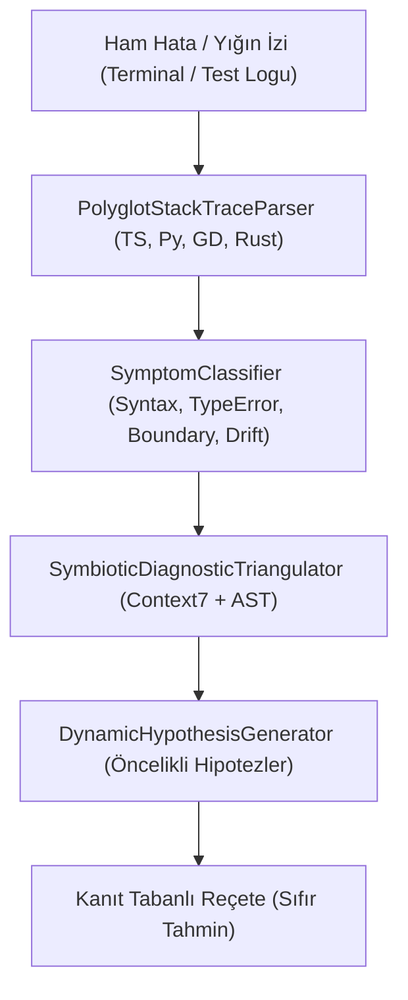
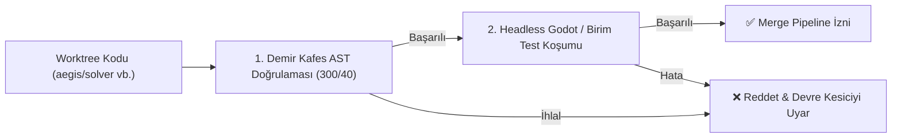
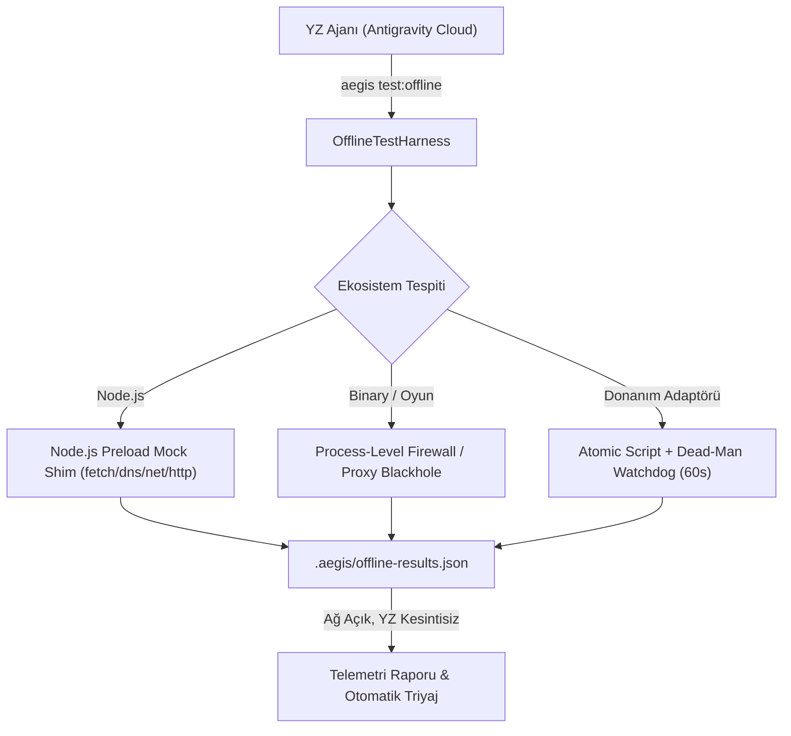

# 🩺 06 — Teşhis Motoru ve Kalite Kapıları

> Aegis; yapay zeka ajanlarının rastgele deneme-yanılma (*stagnation*), test tahrifatı (*test tampering*) ve varsayımsal hata uydurmalarını (**AI hallucination**) deterministik fiziksel kapılarla engeller.

---

## 1. Sokratik Teşhis Kapısı (`aegis debug`)

Geleneksel vibe coding ortamlarında bir hata çıktığında modeller yığın izini (*stack trace*) okumadan varsayımsal kodlar dener. Aegis, **Sokratik Kanıt Tabanlı Hata Ayıklama** protokolünü zorunlu kılar:



### 3-Fazlı Sokratik Diyalog Aşamaları
1. **Faz 1 — Yığın İzi Ayrıştırma:** Dosya yolu, satır numarası ve hata çağrı zinciri izole edilir.
2. **Faz 2 — Kök Neden Triangülasyonu:** Hata noktası, yerel AST iskeleti ve Context7 kütüphane sözleşmesiyle çapraz kontrol edilir.
3. **Faz 3 — Kanıt Tabanlı Reçete:** Modele rastgele kod yerine yalnızca doğrulanmış çözüm seçenekleri sunulur.

---

## 2. Kanıt Tabanlı Hata Tespiti (Evidence-Based Triage)

Modellerin "Burada potansiyel bir bug olabilir" diyerek gereksiz refactoring başlatmasını önlemek için **Evidence-Based Bug Triage (`aegis triage`)** uygulanır:

```bash
aegis triage packages
```

### Triyaj Kriterleri (RFC-024)
- **Somut Kanıt Zorunluluğu:** Başarısız olan bir birim test veya AST düzeyinde tespit edilen kesin kural ihlali yoksa bug raporu oluşturulamaz.
- **Sahte Alarm Eleme:** Varsayımsal tahminler otomatik filtrelenir; ajanların lüzumsuz iş yüküyle token yakması önlenir.

---

## 3. Multimodal Kalite Kapısı (`aegis verify:task`)

Aegis'te hiçbir kod, iki aşamalı multimodal doğrulamayı geçmeden ana dala merge edilemez:



- **Statik Denetim:** 40 satır fonksiyon, 300 satır dosya, Cyclomatic Complexity <= 10 ve ölü kod kuralları.
- **Dinamik Koşum:** Headless oyun motoru testi veya monorepo test süiti.

---

## 4. Immutable Oracle & Mutasyon Test Kapısı (%70 Barajı)

Ajanların testleri gevşeterek veya silerek hile yapmasını engellemek için iki katmanlı kalkan mevcuttur:

### 4.1. Immutable Oracle (`@aegis/trust-verifier`)
- Bir ajan testi geçebilmek adına `assert(true)` yazarsa, test dosyasını silerse veya beklentileri yumuşatırsa bu durum statik diff analiziyle anında yakalanır.
- Test tahrifatı tespit edilen ajanın yetkileri askıya alınır ve durum `[UNTRUSTED_AGENT]` olarak işaretlenir.

### 4.2. Mutasyon Testi Kapısı (`aegis mutate`)
- Koddaki mantıksal operatörler yapay olarak bozulur (`&&` yerine `||`, `+` yerine `-`, `>=` yerine `>`).
- Yazılan test süitinin bu yapay bozulmaları yakalama oranı **%70'in altındaysa** PR reddedilir:
  ```bash
  aegis mutate packages/core/orchestrator/src/task-manager.ts
  ```

---

## 4.3. Yerel CI/CD Pipeline Denetim Koşucusu (`aegis ci:audit` / `aegis ci:check`)

GitHub Actions CI/CD ortamında koşturulan tüm doğrulama kapıları, kod uzak depoya gönderilmeden önce yerel ortamda tek bir komutla deterministik olarak doğrulanır:

```bash
aegis ci:audit
# veya
aegis ci:check
```

### Denetlenen 10 GitHub Actions CI Kapısı
1. **Monorepo Build:** TypeScript derleme bütünlüğü (`npm run build`).
2. **Monorepo Typecheck:** Sıkı tip denetimi (`npm run typecheck`).
3. **Monorepo Lint:** Kod stili ve sözdizimi analizi (`npm run lint`).
4. **Topological Drift Radar (RFC-036):** Kilit dosyaları ve sözleşme kayması (`aegis deps:drift`).
5. **Deterministic Demir Kafes Audit:** Satır ve fonksiyon sınırları denetimi (`aegis cage:check`).
6. **Demir Kafes Doğrulaması:** Dosya seviyesi kurallar (`aegis verify`).
7. **Monorepo Unit Test Suite:** Paralel ve önbellekli test süiti (`npm test`).
8. **Zero-Token UI Inspection:** Arayüz düzen denetimi (`aegis inspect`).
9. **Godot Bridge & UI Verification:** Godot durumu ve sahne ağacı denetimi (`aegis godot status` & `inspect`).
10. **Mutation Testing Gate:** Değişiklik toleransı ve güvenilirlik barajı (`aegis mutate`, %70 barajı).

---

## 4.4. RFC-050 Otonom Çevrimdışı Test Kalkanı (`aegis test --offline` / `aegis test:offline`)

Bulut tabanlı yapay zeka ajanları (Google Antigravity, LLM API'leri) düşünme döngülerini sürdürmek için kesintisiz internete ihtiyaç duyar. Host bilgisayarın ağı kesilirse YZ'nin bağlantısı kopar, oturum çöker ve PC kalıcı olarak internetsiz kalır.

Aegis, **RFC-050 Çevrimdışı Test Kalkanı** ile host internetine dokunmadan test sürecini yalıtır:



### Node.js Preload Mock Shim (`nodejs-offline-shim.ts`)
Uygulama veya test kodunda tek bir satır değiştirmeden `NODE_OPTIONS` ortam değişkeniyle enjekte edilir:
- **`globalThis.fetch`:** `TypeError: fetch failed (cause: ECONNREFUSED 127.0.0.1:0)` fırlatır.
- **`node:dns`:** `dns.lookup` ve çözümleme metodlarını `ENOTFOUND` / `EAI_AGAIN` ile anında keser.
- **`node:net`:** `Socket.prototype.connect` seviyesinde TCP soket bağlantılarını `ECONNREFUSED` ile engeller.
- **`node:http` & `node:https`:** Tüm giden HTTP isteklerini ağa çıkmadan reddeder.

### Kullanım Komutları
```bash
# Bounded timeout ve süreç bekçisiyle test koşumu
aegis test packages/core/watchdog

# RFC-050 çevrimdışı kalkanı ile izole koşum
aegis test --offline
# veya
aegis test:offline packages/core/watchdog --soft --json
```

---

## 4.5. RFC-053 Anti-Spaghetti ve Mimari Sağlık Kapısı (`aegis arch:health` / `aegis arch:audit`)

Tekil dosya ve satır sınırlarını denetleyen `aegis cage:check` (300 satır/dosya, 40 satır/fonksiyon), geçmişte modüller arası bağımlılık grafiğini ve sınıf kohezyonunu göremediği için yapısal şişkinliği (*monolithic bloat*) tek başına engelleyememekteydi (`CageValidatorOptions.maxCyclomaticComplexity` tanımlı ancak uygulanmamış durumdaydı). **RFC-053**, `ArchitectureHealthAuditor` ve **Demir Kafes v2 Anti-Spaghetti Kuralları** ile bu boşluğu kapatır.

### Demir Kafes v2 Anti-Spaghetti Kuralları
- **`CYCLOMATIC_COMPLEXITY`:** Fonksiyon ve metotlardaki dallanma/karar karmaşıklığını (`if`, döngü, `switch/case`, `catch`, `?:`, `&&`, `||`, `??`) AST üzerinde sayar ve karmaşıklık sıcak noktalarını sınırlar.
- **`TS_004_MAX_PARAMS`:** Aşırı pozisyonel parametre alan imzaları (*parameter bloat*) tespit eder ve tiplenmiş *Options / Parameter Object* sözleşmelerine dönüştürülmesini ister.
- **`TS_005_GOD_CLASS`:** Çok fazla metot ve sorumluluk biriktiren *god class* yapılarını yakalar; RFC-012 **Facade + Delegasyon** kalıbıyla ayrıştırılmasını reçete eder.
- **`ARCH_001_HIGH_FAN_OUT`:** Bir modülün aşırı sayıda dış modülü import etmesini (*high fan-out* / yüksek dışa bağımlılık) tespit eder.
- **`ARCH_002_CIRCULAR_DEPENDENCY`:** Proje import grafiğindeki döngüsel bağımlılıkları yakalar; çalışma zamanı (`runtime`) döngülerini yalnızca tip (`type-only`) döngülerinden net biçimde ayırır.

### `ArchitectureHealthAuditor` Yetenekleri
- **0–100 Mimari Sağlık Skoru:** Döngüsel bağımlılıklar, siklomatik karmaşıklık sıcak noktaları, parametre şişkinliği, god class yoğunluğu ve yüksek fan-out üzerinden deterministik sağlık puanı üretir.
- **Runtime vs. Type-Only Döngü Ayrımı:** Gerçek çalışma zamanı yükleme riski taşıyan değer (`runtime`) import döngülerini `import type` döngülerinden ayrıştırarak önceliklendirir.
- **RFC-012 Ayrıştırma Reçeteleri:** Tespit edilen her ihlal için kör satır bölmesi yerine [RFC-012](./rfc/RFC-012-demir-kafes-autonomous-architectural-decomposition-anti-degradation-engine.md) uyumlu Guard Clause, Parameter Object, POP ve Facade/Delegasyon önerileri sunar.

### Sürekli Önleme İş Akışı (`cage:check` + `arch:health`)
```bash
# 1. Dosya ve fonksiyon seviyesi Demir Kafes denetimi
aegis cage:check

# 2. Proje geneli mimari sağlık ve bağımlılık grafiği denetimi
aegis arch:health
# veya takma adı:
aegis arch:audit

# 3. Katı CI / Pre-push kapısı (sıfır döngü, minimum skor ve JSON raporu)
aegis arch:health --strict --max-cycles=0 --min-score=85 --json
```

| Bayrak | Açıklama |
| --- | --- |
| `--json` | Sağlık skoru, runtime/type-only döngüler, sıcak noktalar ve RFC-012 reçetelerini JSON formatında döndürür. |
| `--strict` | Anti-spaghetti kural ihlallerinde çıkışı hata koduyla (`exit code 1`) reddeder. |
| `--max-cycles=<n>` | Tolere edilen azami döngüsel bağımlılık sınırını belirler. |
| `--min-score=<n>` | Zorunlu minimum `0-100` mimari sağlık skorunu belirler. |

---

## 5. 3-Fazlı Adaptif Watchdog & Devre Kesici (Circuit Breaker)

Uzun süren işlemler veya sonsuz döngüye giren testler için akıllı izleme katmanı devrededir:

```
┌─────────────────────────────────────────────────────────────┐
│ 1. Pre-Execution Estimator: Değişiklik yarıçapı analizi    │
├─────────────────────────────────────────────────────────────┤
│ 2. Heartbeat Monitor: Çıktı aktıkça süreyi uzatma          │
├─────────────────────────────────────────────────────────────┤
│ 3. Smart Fallback: 60s sessizlikte kill + RTK log analizi  │
└─────────────────────────────────────────────────────────────┘
```

### Devre Kesici (Circuit Breaker)
Eğer bir görev aynı hatayı üst üste 3 kez üretirse veya sürekli aynı testte takılırsa devre kesici tetiklenir:
- Görev kilitlenir (`BLOCKED_CIRCUIT_BREAKER`).
- Gereksiz API jeton israfı durdurulur.
- Çözüm için `aegis loop:reset <id>` ile durum sıfırlanabilir.

---

## 6. İlgili Belgeler

- [`01-architecture-and-memory.md`](./01-architecture-and-memory.md) — 5-Katmanlı Hafıza Motoru.
- [`02-task-ingestion-and-teamwork.md`](./02-task-ingestion-and-teamwork.md) — TIP ve Merge Pipeline.
- [`04-mcp-server-specification.md`](./04-mcp-server-specification.md) — `socratic_diagnose`, `triage`, `budget_inspect` araçları.
- [RFC-014: Socratic Evidence-Based Diagnostic Engine](./rfc/RFC-014-socratic-evidence-based-diagnostic-dialogue-engine.md)
- [RFC-024: Next-Gen Evidence-Based Bug Triage Engine](./rfc/RFC-024-next-gen-evidence-based-bug-triage-engine-incremental-caching-multi-core-parallelism-blast-radius-stratification.md)
- [RFC-050: Autonomous Fail-Safe Offline Test Shield and Self-Restoring Network Harness](rfc/RFC-050-autonomous-fail-safe-offline-test-shield-and-self-restoring-network-harness.md)
- [RFC-053: Anti-Spaghetti and Monolithic Bloat Architecture Health Engine](rfc/RFC-053-anti-spaghetti-and-monolithic-bloat-architecture-health-engine.md)
