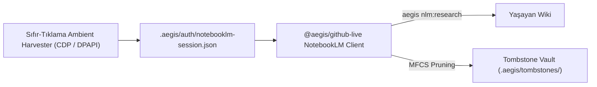

# 🌐 07 — Yaşayan GitHub Wiki ve Google NotebookLM Entegrasyonu

> Aegis; statik dokümantasyonların eskiyip unutulması problemini çözmek için **56+ Sayfalık Yaşayan GitHub Wiki Döngüsü**, **RFC Mimari Karar Süreci** ve **Google NotebookLM Araştırma Köprüsü** sunar.

---

## 1. Yaşayan GitHub Wiki Döngüsü (`<repo>.wiki.git`)

Geleneksel projelerde dokümantasyonlar kod değiştikçe eskir ve yapay zeka modellerini yanıltır. Aegis, depoların resmi GitHub Wiki alanını otonom yaşayan hafıza (*living memory*) olarak kullanır:

```mermaid
flowchart TD
  CodeMerge["Atomik Kod Birleşimi (aegis merge)"]
  CleanRoom["Clean-Room Wiki Sentezi (aegis wiki:clean)"]
  LocalCache[".aegis/wiki-cache/ (Çevrimdışı Bellek)"]
  RemoteWiki["GitHub Wiki (<repo>.wiki.git)"]
  AjanTask["Yeni Göreve Başlayan Ajan"]

  CodeMerge --> CleanRoom
  CleanRoom --> LocalCache
  LocalCache <-->|aegis wiki:sync (RFC-029/030)| RemoteWiki
  LocalCache -->|3-Maddelik Özet Enjeksiyonu| AjanTask
```

### Wiki Senkronizasyonunun Temel Özellikleri
- **56+ Sayfa Senkronizasyonu:** Çekirdek mimari, API referansları ve RFC spesifikasyonları GitHub Wiki ile çift yönlü eşitlenir.
- **Sıfır Gecikmeli Çevrimdışı Önbellek (RFC-029/030):** Ağ kesintilerinde veya soket zaman aşımlarında `.aegis/wiki-cache/` yerel dizini kullanılarak ajanların bloklanması önlenir.
- **3-Maddelik Teknik Özet:** Her merge sonrası ilgili modülün Wiki sayfasına 3 maddelik cerrahi teknik özet işlenir; yeni ajan tüm repoyu okumak yerine yalnızca bu özeti hafızasına alır.

---

## 2. RFC Mimarisi & Yaşam Döngüsü (RFC-001 – RFC-041)

Aegis'te mimari değişiklikler doğrudan koda dökülmez; açık kaynak standartlarında 4 aşamalı RFC döngüsünden geçer:

```
┌─────────────────────────────────────────────────────────────┐
│ 1. Doğal Dil Fikir Tespiti & rfc:create                     │
├─────────────────────────────────────────────────────────────┤
│ 2. GitHub Discussions ('Ideas' Kategorisi) İncelemesi       │
├─────────────────────────────────────────────────────────────┤
│ 3. rfc:approve ile Temiz Mimari Wiki Sayfası Sentezi        │
├─────────────────────────────────────────────────────────────┤
│ 4. rfc:decompose ile Atomik GitHub Issue Bölümleme (TIP)    │
└─────────────────────────────────────────────────────────────┘
```

### Karar Kaydı (ADR) Standartları
- Tüm RFC'ler `docs/rfc/` altında versiyonlanır.
- RFC kabul kriterleri (`Acceptance Criteria`), test senaryoları ve token bütçeleri önceden dondurulur.
- `aegis rfc:decompose <rfcId>` komutu kriterleri parçalayarak bağımsız GitHub Issue'ları oluşturur ve TIP kuyruğuna sahneler.

---

## 3. Google NotebookLM Entegrasyonu

Aegis, karmaşık mimari araştırmalar ve büyük doküman kütüphaneleri için Google NotebookLM ile doğrudan bağ kurar:



### 3.1. Sıfır-Tıklama Ortam Hasatçısı (Zero-Click Ambient Harvester)
- Manuel çerez ve token kopyalama hamallığını ortadan kaldırır.
- Sistem aktif Chromium debug portlarını (`9222-9229`), Windows DPAPI şifreli çerez kasalarını (Chrome, Edge, Brave) ve Firefox profillerini otomatik tarayarak oturumu çözer (RFC-022).

### 3.2. Hesap Değiştirme (`aegis nlm:switch`)
- Birden fazla Google hesabı arasında tek komutla geçiş yapar.
- Mevcut oturumu zaman damgasıyla güvenle yedekler ve yeni hesabın ortam çerezlerini devreye alır.

### 3.3. Tri-State Etkileşimli Yetkilendirme Protokolü
Oturum süresi dolduğunda veya bağlantı kesildiğinde motor sessizce offline moda düşerek halüsinasyona sebep olmaz; 3 yollu etkileşimli protokol devreye girer:
1. **Yenile (Refresh):** IDE içinde `ask_question` modalı açılarak tek tıkla tarayıcı oturumu yenilenir.
2. **Çevrimdışı Devam (Offline):** Yerel Wiki önbelleği ile çalışmaya devam edilir.
3. **İptal (Cancel):** Görev dondurulur ve token israfı önlenir.

---

## 4. Otonom Bilgi Yönetimi (AKG) & Mezar Taşı Mahzeni (Tombstone Vault)

NotebookLM üzerindeki 50 kaynaklık kota sınırını yönetmek için **MFCS (Multi-Factor Content Significance)** algoritması işletilir (RFC-023):

```bash
# Bayat kaynakları analiz edip güvenle budama
aegis nlm:prune

# Gerekirse silinen bir kaynağı geri getirme
aegis nlm:restore <sourceId>
```

- **Tazelik Radarı:** Belgelerin son güncellenme tarihi ve kullanım sıklığı puanlanır.
- **Tombstone Vault:** Silinen kaynakların tam metin ve özetleri `.aegis/tombstones/` altında saklanır; ihtiyaç anında tek komutla NotebookLM'e geri yüklenir.

---

## 5. İlgili Belgeler

- [`01-architecture-and-memory.md`](file:///C:/Users/Lenovo/AntigravityProfiles/client-a/.gemini/antigravity/scratch/aegis/docs/01-architecture-and-memory.md) — 5-Katmanlı Kod Tabanı Hafızası.
- [`02-task-ingestion-and-teamwork.md`](file:///C:/Users/Lenovo/AntigravityProfiles/client-a/.gemini/antigravity/scratch/aegis/docs/02-task-ingestion-and-teamwork.md) — TIP görev kuyruğu.
- [`03-universal-cli-reference.md`](file:///C:/Users/Lenovo/AntigravityProfiles/client-a/.gemini/antigravity/scratch/aegis/docs/03-universal-cli-reference.md) — `rfc:*`, `wiki:*` ve `nlm:*` komutları.
- [RFC-001: Autonomous NotebookLM Ideation](file:///C:/Users/Lenovo/AntigravityProfiles/client-a/.gemini/antigravity/scratch/aegis/docs/rfc/RFC-001-autonomous-notebooklm-ideation-and-gap-filling-engine.md)
- [RFC-022: Zero-Click Ambient Browser Session Harvester](file:///C:/Users/Lenovo/AntigravityProfiles/client-a/.gemini/antigravity/scratch/aegis/docs/rfc/RFC-022-rfc-022-zero-click-ambient-browser-session-harvester-and-conversational-account-switching-intent-substrate.md)
- [RFC-023: Quota Sentinel & Source Freshness Radar](file:///C:/Users/Lenovo/AntigravityProfiles/client-a/.gemini/antigravity/scratch/aegis/docs/rfc/RFC-023-autonomous-knowledge-lifecycle-management-quota-sentinel-source-freshness-radar.md)
- [RFC-029: Zero-Roundtrip GitHub Wiki Synchronization](file:///C:/Users/Lenovo/AntigravityProfiles/client-a/.gemini/antigravity/scratch/aegis/docs/rfc/RFC-029-high-performance-zero-roundtrip-github-wiki-synchronization-substrate.md)
