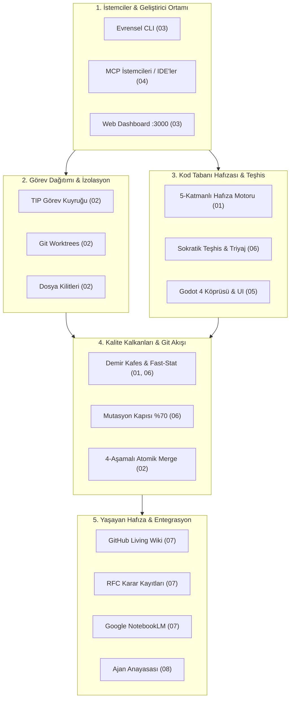

# 📚 Aegis — Modüler Dokümantasyon ve Mimari Kütüphanesi

> **Aegis Autonomous Vibe Coding Engine** için kapsamlı, modüler, Demir Kafes kurallarına (< 300 satır) tam uyumlu mimari ve kullanım dokümantasyonu rehberi.

---

## 📑 Dokümantasyon İndeksi & Hızlı Erişim Matrisi

Codex için [kurulum ve uyumluluk](codex-compatibility.md), [native ekip çalışması ve kapasite sınırları](codex-orchestra.md) ve [doğrulama kanıtları](codex-orchestra-validation.md) rehberlerine bakın.

Aegis mimarisi tek bir monolitik dosya yerine bağımsız, derinlemesine odaklanmış 8 temel bölüme ayrılmıştır:

| Bölüm | Başlık | Odak Kapsamı | İlgili Dosya |
| :---: | :--- | :--- | :---: |
| **01** | **Mimari ve 5-Katmanlı Hafıza** | L1-L5 Hafıza hiyerarşisi, Bounded Depth, Nominal Opaque Stubbing, %67-%95 token tasarrufu. | [`01-architecture-and-memory.md`](file:///C:/Users/Lenovo/AntigravityProfiles/client-a/.gemini/antigravity/scratch/aegis/docs/01-architecture-and-memory.md) |
| **02** | **Görev Dağıtımı (TIP) ve Teamwork** | Çekme tabanlı görev kuyruğu (`.aegis/task-inbox.json`), Mutex dosya kilitleri, Git Worktrees, 4-Aşamalı Merge. | [`02-task-ingestion-and-teamwork.md`](file:///C:/Users/Lenovo/AntigravityProfiles/client-a/.gemini/antigravity/scratch/aegis/docs/02-task-ingestion-and-teamwork.md) |
| **03** | **Evrensel CLI & Web Komuta Merkezi** | 50+ komutluk CLI referansı, SSE streaming Web Paneli (`localhost:3000`), canlı IDE oturum algılama. | [`03-universal-cli-reference.md`](file:///C:/Users/Lenovo/AntigravityProfiles/client-a/.gemini/antigravity/scratch/aegis/docs/03-universal-cli-reference.md) |
| **04** | **Model Context Protocol (MCP)** | Yerel stdio JSON-RPC MCP sunucusu, 19 çekirdek araç şeması, Teamwork ve Godot MCP eklentileri. | [`04-mcp-server-specification.md`](file:///C:/Users/Lenovo/AntigravityProfiles/client-a/.gemini/antigravity/scratch/aegis/docs/04-mcp-server-specification.md) |
| **05** | **Godot 4 Köprüsü ve UI Mimarisi** | `@aegis/godot-bridge`, ClassDB Canlı Oracle, Headless Playtest, Container-first UI kuralları, UI Linter & Scaffold. | [`05-godot-bridge-and-ui.md`](file:///C:/Users/Lenovo/AntigravityProfiles/client-a/.gemini/antigravity/scratch/aegis/docs/05-godot-bridge-and-ui.md) |
| **06** | **Teşhis Motoru ve Kalite Kapıları** | Sokratik teşhis (`aegis debug`), kanıt tabanlı triyaj (`triage`), Immutable Oracle, Mutasyon testi (%70), Devre kesici. | [`06-diagnostics-and-quality-gates.md`](file:///C:/Users/Lenovo/AntigravityProfiles/client-a/.gemini/antigravity/scratch/aegis/docs/06-diagnostics-and-quality-gates.md) |
| **07** | **Yaşayan GitHub Wiki & NotebookLM** | 56+ sayfa Wiki senkronizasyonu (`<repo>.wiki.git`), RFC döngüsü (RFC-001–041), sıfır-tıklama ambient harvester, MFCS pruning. | [`07-living-wiki-and-notebooklm.md`](file:///C:/Users/Lenovo/AntigravityProfiles/client-a/.gemini/antigravity/scratch/aegis/docs/07-living-wiki-and-notebooklm.md) |
| **08** | **Hızlı Başlangıç & Katkı Kuralları** | Node/npm/TS gereksinimleri, Turborepo monorepo paket yapısı, 14 maddelik Ajan Anayasası, Git kancaları. | [`08-getting-started-and-contributing.md`](file:///C:/Users/Lenovo/AntigravityProfiles/client-a/.gemini/antigravity/scratch/aegis/docs/08-getting-started-and-contributing.md) |

---

## 🏛️ Mimari Akış ve Modül İlişkileri

---

## 🛡️ Demir Kafes & Modülerlik Standartları

Bu kütüphanedeki tüm dokümantasyon dosyaları **Demir Kafes Standartları** uyarınca yazılmıştır:
1. **Maksimum 300 Satır Kuralı:** Hiçbir dokümantasyon veya kod dosyası 300 satırı aşamaz.
2. **Kendi Başına Anlaşılabilir Modülerlik:** Her doküman bağımsız bir mühendislik kılavuzu niteliğindedir.
3. **Bağlantılı Referanslar:** İlgili kod bileşenleri, CLI komutları, MCP araçları ve RFC'ler birbirine tıklanabilir bağlantılarla entegredir.

---

## 🔗 Ek Kaynaklar & Orijinal Belgeler

- [Ajan Anayasası (`agent-constitution.md`)](file:///C:/Users/Lenovo/AntigravityProfiles/client-a/.gemini/antigravity/scratch/aegis/docs/agent-constitution.md)
- [Antigravity Takım Çalışması Mimarisi (`TEAMWORK.md`)](file:///C:/Users/Lenovo/AntigravityProfiles/client-a/.gemini/antigravity/scratch/aegis/docs/TEAMWORK.md)
- [Godot UI Standartları (`GODOT_UI.md`)](file:///C:/Users/Lenovo/AntigravityProfiles/client-a/.gemini/antigravity/scratch/aegis/docs/GODOT_UI.md)
- [Güvenlik Modeli (`security-model.md`)](file:///C:/Users/Lenovo/AntigravityProfiles/client-a/.gemini/antigravity/scratch/aegis/docs/security-model.md)
- [RFC Arşivi (`docs/rfc/`)](file:///C:/Users/Lenovo/AntigravityProfiles/client-a/.gemini/antigravity/scratch/aegis/docs/rfc/)
- [Ana Depo README'si (`README.md`)](file:///C:/Users/Lenovo/AntigravityProfiles/client-a/.gemini/antigravity/scratch/aegis/README.md)
