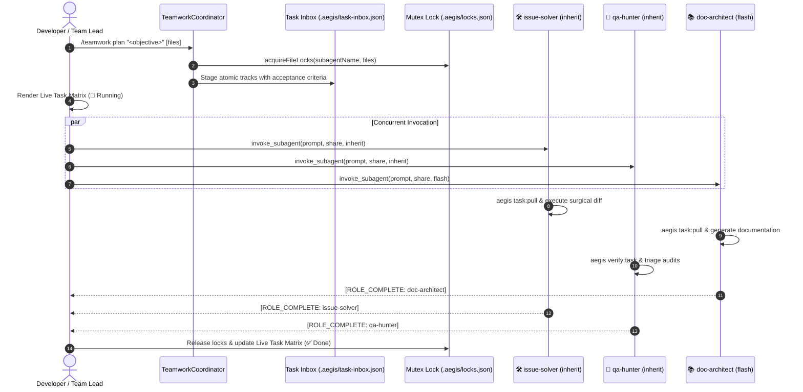
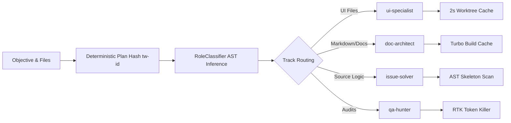

# 🤝 Aegis & Antigravity Native Teamwork Engine Architecture

The **Aegis Native Teamwork Engine** coordinates specialized Antigravity autonomous subagents running concurrently on a shared repository. It eliminates agent collision, minimizes LLM inference latency through hybrid model allocation, and enforces deterministic quality gates.

---

## 1. Architectural Overview & Workflow



The orchestration layer operates through three pillars:
1. **Zero Busy-Wait Polling**: Team Lead and agents sleep during async tasks; reactive wakeup resumes execution upon inbound messages or task completion.
2. **Conflict Prevention**: Statically analyzed file paths are locked prior to invocation.
3. **Decoupled Workspaces**: Agents operate either in `share` mode under file locks or in isolated git worktrees (`experimental/<role>`).

---

## 2. Concurrency Model & Mutex File Locks

To prevent concurrent write corruption, file-level exclusivity is enforced by `WorktreeManager` (`packages/core/orchestrator/src/worktree-manager.ts`).

### Lock State Store (`.aegis/locks.json`)
Active locks map target relative file paths to their owning subagents:
```json
{
  "packages/core/orchestrator/src/teamwork-coordinator.ts": "issue-solver",
  "docs/TEAMWORK.md": "doc-architect"
}
```

### Atomic Mutex Acquisition Protocol
1. **Lock File Serialization**: `WorktreeMutex.acquire(lockPath)` takes an OS-level atomic lock before reading or modifying locks.
2. **Atomic Write-Replace**: New lock states are written to a unique temp file (`.aegis/locks.json.tmp.<pid>.<timestamp>`) and swapped atomically using `fs.renameSync` (with fallback to copy+unlink).
3. **Collision Rejection**: If another agent attempts to lock a file already held by a peer, `acquireFileLocks()` rejects the claim and returns `{ success: false, conflictingFiles: [...] }`.
4. **Guaranteed Release**: Upon task conclusion (`[ROLE_COMPLETE]`), Team Lead invokes `releaseFileLocks(agentName)` or `aegis task:release <id> done`.

---

## 3. Specialized Subagent Roles & Hybrid Model Allocation

Rather than deploying monolithic generalist agents, the engine provisions 4 specialized personas configured with optimal LLM tiers.

| Subagent Name | Role Title | Focus Scope | Default Model | Workspace Mode |
| :--- | :--- | :--- | :--- | :--- |
| `issue-solver` | Isolated Code Solver & Implementer | Core business logic, bugfixes, refactoring, algorithms | `inherit` (Pro) | `share` |
| `qa-hunter` | Diagnostic, Gameplay & Quality Auditor | Evidence-based triage, playtests, mutation testing, test suites | `inherit` (Pro) | `share` |
| `ui-specialist` | UI, Theme & Visual Polish Specialist | Godot 4 scenes (`.tscn`), Themes (`.tres`), responsive anchors | `inherit` (Pro) | `share` |
| `doc-architect` | GitHub Documentation & Architecture Planner | Living wiki (`.wiki.git`), RFCs, clean-room specs, task breakdowns | `flash` | `share` |

### Hybrid Model Allocation Benefits
- **Cost Reduction**: Documentation, specification drafting, and wiki synchronization run on fast high-throughput models (`flash`), cutting token costs by ~70%.
- **Deep Reasoning**: Heavy code transformations, AST modifications, and mutation testing remain assigned to high-tier reasoning engines (`inherit` / `pro`).
- **Parallel Throughput**: All four subagents execute concurrently without contention.

---

## 4. Reactive Wakeup Messaging Loop

The engine relies on reactive messaging notifications rather than continuous status polling.

### Subagent Execution Contract
When spawned, each subagent receives an assigned prompt detailing its locked targets and acceptance criteria. Upon finishing work and passing local verification (`aegis verify:task`), the agent dispatches a standard completion notification:

```markdown
[ROLE_COMPLETE: <subagent-name>]
- Files modified: <list of files>
- Verification summary: Demir Kafes passed (<300 lines/file, <40 lines/function), tests green
```

### Team Lead Wakeup Loop
1. **Idle Suspension**: After issuing `invoke_subagent` calls, the Team Lead process idles.
2. **Interrupt Wakeup**: Arrival of `[ROLE_COMPLETE: <role>]` triggers a high-priority wakeup.
3. **Progress Tracking**: Team Lead inspects incoming diffs, marks the role `✅ Tamamlandı` in the live markdown matrix, and unlocks held files.
4. **Final Consolidation**: Once all staged tracks report complete, Team Lead presents the consolidated review summary.

---

## 5. Deterministic Plan Hashing & Performance Optimizations

High execution velocity is guaranteed through deterministic data structures and multi-layer caching:



### Optimizations
- **Deterministic Plan Partitioning**: `RoleClassifier` automatically classifies files (`isUiFile`, markdown patterns) and groups them into non-overlapping tracks, preventing redundant work.
- **Worktree Cache TTL**: `WorktreeManager` caches git worktree status with a 2000ms TTL (`WT_CACHE_TTL_MS`), preventing repeated synchronous `git worktree list` executions during burst operations.
- **Safe Root Resolution**: `resolveSafeRepoRoot` detects system fallback paths and dynamically binds to the active repository root.
- **Monorepo Build Caching**: Turbo pipeline (`turbo run test`) leverages hash caching (`FULL TURBO`), executing test validation in milliseconds.
- **AST Skeleton Optimization**: Pre-execution code analysis hides function bodies via `@aegis/ast-skeleton`, reducing token usage by 73% to 95%.

---

## 6. CLI & Tooling Quick Reference

| Action | Aegis CLI Command | MCP Tool Equivalent |
| :--- | :--- | :--- |
| **Inspect Status** | `aegis teamwork status` | `aegis:worktree_status` / `aegis:lock_status` |
| **Generate Plan** | `aegis teamwork plan "<obj>" [files]` | `aegis:teamwork_plan` |
| **Export Manifest** | `aegis teamwork setup [outDir]` | - |
| **Pull Role Task** | `aegis task:pull <role>` | `aegis:task_inbox_pull` |
| **Claim Task** | `aegis task:claim <id> [agent]` | `aegis:task_claim` |
| **Release Task** | `aegis task:release <id> [status]` | `aegis:task_release` |
| **Verify Gate** | `aegis verify:task [file]` | `aegis:cage_check` |
