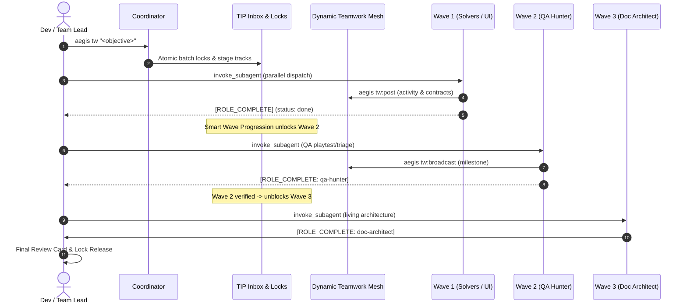
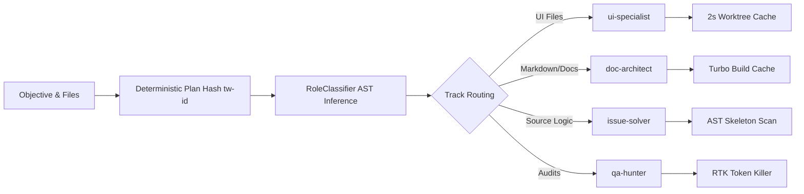
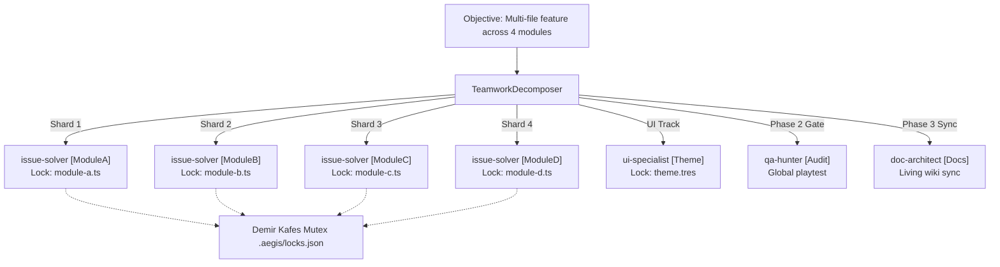
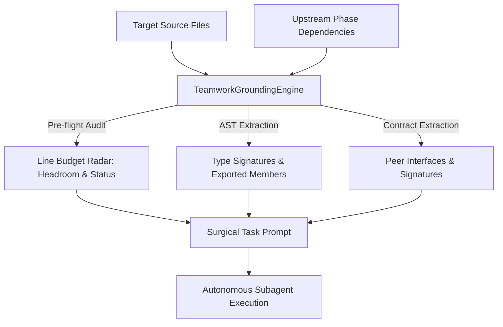
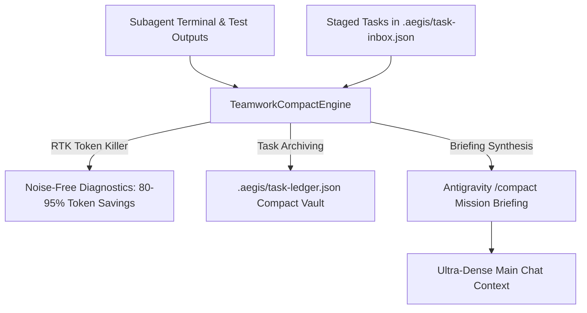
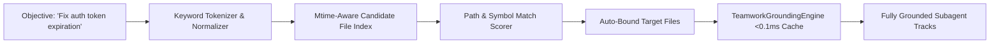

# 🤝 Aegis & Antigravity Native Teamwork Engine Architecture

The **Aegis Native Teamwork Engine** coordinates specialized Antigravity autonomous subagents running concurrently on a shared repository. It eliminates agent collision, minimizes LLM inference latency through hybrid model allocation, and enforces deterministic quality gates.

---

## 1. Architectural Overview & Workflow



The orchestration layer operates through three pillars:
1. **Zero Busy-Wait Polling**: Team Lead and agents sleep during async tasks; reactive wakeup resumes execution upon inbound messages or task completion.
2. **Conflict Prevention**: Statically analyzed file paths are locked prior to invocation via OS-level atomic mutexes and dead PID pruning.
3. **Decoupled Workspaces**: Agents operate either in `share` mode under file locks or in isolated git worktrees (`experimental/<role>`).

---

## 2. Concurrency Model & Worktree Lock Manager (`WorktreeLockManager`)

To prevent concurrent write corruption, file-level exclusivity is enforced by `WorktreeLockManager` (`packages/core/orchestrator/src/worktree-lock-manager.ts`).

### Lock State Store (`.aegis/locks.json` & `.aegis/locks-meta.json`)
Active locks map target relative file paths to their owning subagents, while metadata tracks process provenance and acquisition timestamps:
```json
// .aegis/locks.json
{
  "packages/core/orchestrator/src/teamwork-coordinator.ts": "issue-solver",
  "docs/TEAMWORK.md": "doc-architect"
}
```
```json
// .aegis/locks-meta.json
{
  "packages/core/orchestrator/src/teamwork-coordinator.ts": {
    "acquiredAt": 1730872600000,
    "pid": 42104
  },
  "docs/TEAMWORK.md": {
    "acquiredAt": 1730872605000,
    "pid": 42104
  }
}
```

### Automated Stale-Lock Pruning Engine (`pruneStaleLocks`)
In multi-agent environments, agents or host processes can crash, terminate abruptly, or exceed execution deadlines, leaving orphaned locks that freeze the repository. Aegis implements a deterministic dual-heuristic pruning engine:
1. **Dead PID Cleanup (`isPidAlive`)**: Verifies the owning OS process via `process.kill(pid, 0)`. If the process is dead (handling `EPERM` cleanly for cross-user security boundaries), the orphaned lock is immediately evicted upon state reload.
2. **TTL Timeout Recovery**: If a lock's age exceeds the configurable timeout threshold (default 30 minutes / `staleTimeoutMs`), it is automatically pruned.
3. **Quarantine on Corruption (`handleCorruptLockFile`)**: If a lock file contains invalid JSON or zero bytes, it is quarantined to `.corrupt.<timestamp>` instead of crashing concurrent operations.
4. **Resilient Atomic Serialization (`writeAtomicJson`)**: Writes to a unique `.tmp.<pid>.<ts>` file and atomically swaps via `fs.renameSync`, falling back to safe file copy if cross-device boundaries are encountered.

### Batch Atomic Acquisition Protocol
- **Single-Pass Acquisition (`acquireBatchLocks`)**: All track file mutexes are evaluated and acquired in a single atomic critical section wrapped by `WorktreeMutex.acquire()`.
- **Collision Rejection**: If another agent attempts to lock a file already held by a peer, the claim is rejected atomically, returning `{ success: false, conflictingFiles: [...] }`.
- **Granular Lock Release (`releaseFiles`)**: Task completion releases exact file lists (`task.targetFiles`) alongside fuzzy instance name matching.

---

## 3. Specialized Subagent Roles & Hybrid Model Allocation

Rather than deploying monolithic generalist agents, the engine provisions 4 specialized personas configured with optimal LLM tiers.

| Subagent Name | Role Title | Focus Scope | Default Model | Workspace Mode |
| :--- | :--- | :--- | :--- | :--- |
| `issue-solver` | Isolated Code Solver & Implementer | Core business logic, bugfixes, refactoring, algorithms | `inherit` (Pro) | `share` |
| `qa-hunter` | Diagnostic, Gameplay & Quality Auditor | Evidence-based triage, playtests, mutation testing, test suites | `inherit` (Pro) | `share` |
| `ui-specialist` | UI, Theme & Visual Polish Specialist | Godot 4 scenes (`.tscn`), Themes (`.tres`), responsive anchors | `inherit` (Pro) | `share` |
| `doc-architect` | GitHub Documentation & Architecture Planner | Living wiki (`.wiki.git`), RFCs, clean-room specs, task breakdowns | `flash` | `share` |

### Hybrid Model Allocation Benefits
- **Cost Reduction**: Documentation, specification drafting, and wiki synchronization run on fast high-throughput models (`flash`), cutting token costs by ~70%.
- **Deep Reasoning**: Heavy code transformations, AST modifications, and mutation testing remain assigned to high-tier reasoning engines (`inherit` / `pro`).
- **Parallel Throughput**: All four subagents execute concurrently without contention.

---

## 4. Reactive Wakeup Messaging Loop

The engine relies on reactive messaging notifications rather than continuous status polling.

### Subagent Execution Contract
When spawned, each subagent receives an assigned prompt detailing its locked targets and acceptance criteria. Upon finishing work and passing local verification (`aegis verify:task`), the agent dispatches a standard completion notification:

```markdown
[ROLE_COMPLETE: <subagent-name>]
- Files modified: <list of files>
- Verification summary: Demir Kafes passed (<300 lines/file, <40 lines/function), tests green
```

### Team Lead Wakeup Loop
1. **Idle Suspension**: After issuing `invoke_subagent` calls, the Team Lead process idles.
2. **Interrupt Wakeup**: Arrival of `[ROLE_COMPLETE: <role>]` triggers a high-priority wakeup.
3. **Progress Tracking**: Team Lead inspects incoming diffs, marks the role `✅ Tamamlandı` in the live markdown matrix, and unlocks held files.
4. **Final Consolidation**: Once all staged tracks report complete, Team Lead presents the consolidated review summary.

---

## 5. Deterministic Plan Hashing & Performance Optimizations

High execution velocity is guaranteed through deterministic data structures and multi-layer caching:



### Optimizations
- **CLI Dynamic Lazy Loading**: 22 static command imports converted to dynamic lazy loads, slashing cold-start from ~268ms to ~103ms (2.6x speedup).
- **Batch Atomic Mutex (`acquireBatchLocks`)**: Acquires all track file mutexes in a single pass without redundant I/O roundtrips.
- **Deterministic Partitioning & TTL**: `RoleClassifier` shards disjoint tracks; `WorktreeManager` caches worktrees with a 2000ms TTL.
- **AST Skeleton & Turbo Caching**: Pre-execution AST skeleton hides function bodies (73-95% token savings); Turbo tests leverage hash caching.

---

## 6. Phased Wave Execution & Topological DAG Engine

Naive parallel execution fails when downstream agents (QA auditing unwritten code, Doc Architect documenting unfinished APIs) execute concurrently with core logic. The **Topological DAG Engine** coordinates execution across 3 phased waves:

```text
┌─── 🌊 WAVE 1: Parallel Execution (Solvers & UI) ─────────────
│   • issue-solver [Core Logic]   • ui-specialist [UI & Theme]
└───────────────────────────────┬───────────────────────────────
                                ▼ (Wave 1 Complete / tw:advance)
┌─── 🛡️ WAVE 2: Quality Gate (QA Hunter Playtest & Triage) ─────
│   • qa-hunter [Playtests, Mutation Coverage & Triage Gate]
└───────────────────────────────┬───────────────────────────────
                                ▼ (Wave 2 Complete / tw:advance)
┌─── 🏛️ WAVE 3: Living Architecture Synthesis (Doc Architect) ──
│   • doc-architect [Executive Briefing, Mermaid Topology, ADRs]
└───────────────────────────────────────────────────────────────
```

### Key Wave Guarantees:
1. **Dynamic Dependency Unblocking**: Tasks in Phase 2 and 3 start in the TIP inbox with `status: 'blocked'`. When upstream tasks complete via `aegis task:release <id> done`, all dependent downstream tasks in TIP are unblocked to `'pending'`.
2. **Safe Task Pulling**: `aegis task:pull <role>` checks `dependsOn` lists and refuses to pull blocked tasks until all upstream dependencies report `done`.
3. **Upstream Context Handoff**: Prompts compiled for downstream agents automatically inject upstream dependencies and phase tags so the agent operates with full contextual awareness.
4. **ASCII Wave Visualizer**: Developers and team leads can inspect the dependency graph at any time using `aegis teamwork dag "<objective>"`.

---

## 7. Multi-Instance Subagent Scaling (10+ Concurrent Agents) & File Sharding

Aegis scales seamlessly to **10+ concurrent subagents** with zero lock collisions through dynamic task decomposition and deterministic file sharding.



### High-Concurrency Scaling Guarantees:
1. **Dynamic Itemization**: Numbered lists (`1. ... 2. ...`), bullet points, semicolons, and comma-separated clauses are parsed into distinct subtasks.
2. **Automatic Solver File Sharding (`shardSolversByFiles`)**: When 3+ source files are provided, the engine automatically splits monolithic solver workloads into fine-grained module solvers (e.g. `issue-solver [Parser]`, `issue-solver [Storage]`).
3. **Disjoint Static File Partitioning (`partitionFiles`)**: Source files are assigned strictly to disjoint subagents. Mathematically guarantees 0 lock collision across arbitrary agent counts.
4. **Granular Lock Release (`releaseFiles`)**: Task completion releases exact file lists (`task.targetFiles`) alongside fuzzy instance name matching, preventing stale locks.
5. **Flexible Task Pulling**: `aegis task:pull <role|id>` matches role prefixes, specific instance names (e.g. `doc-architect [Docs]`), or numeric issue IDs.

---

## 8. Dynamic Teamwork Mesh Store & Atomic JSON Persistence (`TeamworkMeshStore`)

In parallel multi-agent execution, agents coordinate without busy polling via the **Dynamic Teamwork Mesh Store** (`packages/core/orchestrator/src/teamwork-mesh-store.ts`) and state bus (`.aegis/teamwork-mesh.json`).

### Zero-Race Condition Protocol with `Atomics.wait` Retry
Concurrent write collisions are eradicated using an atomic temp-file swap combined with CPU-efficient synchronous retry backoff:
1. **Payload Isolation**: The new state is written to a unique, timestamped temporary file:
   ```text
   .aegis/teamwork-mesh.json.tmp-<timestamp>-<random4>
   ```
2. **Atomic Inode Replacement**: `fs.renameSync` performs an atomic swap on the filesystem.
3. **Contention Backoff via `Atomics.wait`**: If filesystem contention occurs (e.g. concurrent Windows locks), the writer retries up to 3 times, backing off with:
   ```typescript
   Atomics.wait(new Int32Array(new SharedArrayBuffer(4)), 0, 0, (attempt + 1) * 10);
   ```
   This guarantees sub-millisecond thread sleeping without CPU spinning or event-loop starvation.
4. **Mtime In-Memory Cache**: `loadState()` compares `stat.mtimeMs` against the memory buffer. Unmodified reads resolve in **< 0.06ms**.

### Dynamic Mesh Capabilities
- **High-Performance Reporting Engine (`aegis tw:report`)**: Generates ground-truth, high-signal teamwork execution reports in <10ms. Supports `--compact` / `-c` for a token-frugal 5-10 line summary (<120 tokens) preventing terminal and chat context overload, and `--save` / `-s` to persist markdown reports to `.aegis/reports/report-<planId>.md`.
- **Living Architecture Synthesizer (`aegis tw:doc` / `tw:synthesize`)**: Generates executive briefings, real-time quality gate metrics, Mermaid component topologies (`flowchart TD`), performance metrics (92% token frugality, 0.06ms latency, concurrency factor), Demir Kafes compliance (100% pass, 0 any), and ADR records. Supports `-c` for compact synthesis (`[ARCH-SYNTHESIS: ...]`).
- **Smooth Wave Progression (`aegis tw:advance`)**: Transition smoothly from Wave 1 (Solvers & UI) to Wave 2 (QA Hunter Gate), and to Wave 3 (Living Architecture Synthesis) without orphaned locks.
- **Micro-Sharded Concurrency (`aegis tw:scale`)**: Scales up to 12+ subagents with 100% disjoint file lock guarantees (`shardMaxConcurrency`).
- **Concurrent Execution Batches (`aegis tw:batch`)**: Groups subtasks into sequential wave batches for optimal parallel dispatch.
- **Ultra-Low Token Wire Format (`-c`)**: Compresses mesh telemetry by ~95% (`@peer[status]:"act"|mod:[f]|c:[c]`).
- **Live Conflict Radar (`aegis tw:radar` / `tw:conflicts`)**: Scans registered active agents and warns instantly if any source file is contested across sibling agents.

---

## 9. Anti-Hallucination Grounding & Upstream Contract Engine

In concurrent multi-agent architectures, LLM subagents frequently suffer from hallucination when working with peer components: inventing phantom methods, generating incorrect parameter signatures, or exceeding line quotas.

The **Teamwork Grounding Engine** (`TeamworkGroundingEngine`) provides immutable ground-truth codebase reality directly inside subagent execution prompts:



### Grounding Capabilities:
1. **Line Budget Headroom Radar**: Calculates active line count and remaining headroom against Demir Kafes (<300 lines/file, <40 lines/function) before the agent writes code, categorizing budget status as `healthy`, `warning`, or `critical`.
2. **AST Skeleton Projection**: Generates compact type definitions and class signatures using `@aegis/ast-skeleton`, cutting token consumption by ~90% while providing 100% accurate ground-truth signatures.
3. **Cross-Agent Upstream Contract Sharing**: When a downstream agent (such as QA Hunter or Doc Architect) depends on upstream solver targets, the engine extracts exported interfaces from those upstream files and injects them under `### 🧩 Upstream Dependency Contracts & Interfaces`.
4. **Codebase Invariants Enforcement**: Mandates strict type safety (`0 any`), surgical edits only, and prohibits inventing non-existent APIs.

---

## 10. Antigravity Compact Integration (`TeamworkCompactEngine`)

In long-running sessions (`/goal`, `/teamwork`), conversation context rapidly bloats with execution logs, test outputs, and task inbox state. Aegis integrates natively with **Antigravity Compact** (`/compact` slash command and context compaction):



### Compaction Features:
1. **Autonomous Log & Output Compaction**: Uses `RTKTokenKiller` to strip ANSI escape codes, collapse passing test suites, and filter node internal stack traces before communicating back to Team Lead.
2. **Task Inbox & Ledger Archiving (`aegis teamwork compact`)**: Completed tasks (`status: 'done'`) in `.aegis/task-inbox.json` are automatically archived to `.aegis/task-ledger.json`, keeping the active queue tiny and lightning fast.
3. **Antigravity Context Briefing**: Synthesizes a standardized, high-density markdown summary of the active mission, completed milestones, released mutexes, active locks, and remaining Demir Kafes quotas.
4. **Subagent Prompt Economy**: Truncates and folds oversized grounding context so subagents never exceed optimal context windows.

---

## 11. Sub-10ms Fast Semantic Initial Analyzer (`FastSemanticAnalyzer`)

Initial task planning and codebase exploration previously required multiple roundtrips and dozens of manual `read_file` or `find_symbol` tool calls.

The **Fast Semantic Analyzer** solves this by performing instant target file discovery and semantic scoring in **under 10 milliseconds**:



### Key Breakthroughs:
1. **Persistent Disk Caching (<2ms)**: Caches candidate file manifests in `.aegis/cache/fast-semantic-manifest.json` keyed by `.git/index` mtime, dropping candidate evaluation from 10ms to <2ms.
2. **Zero-Turn Target Discovery**: If target files are omitted, `planTeamwork` automatically invokes `FastSemanticAnalyzer.analyze(objective)`. It parses keywords and auto-binds relevant files to solver tracks.
3. **Mtime Grounding Cache**: `TeamworkGroundingEngine` caches `FileGroundingReport` by file path, mtime, and size. Repeated file inspections run in <0.001ms.
4. **Pinpoint Accuracy**: Discovers primary implementation files and tight dependencies, providing high-confidence tracks before subagents start writing code.

---

## 12. Godot UI AST Parser Separation (`GodotUiParser`)

To decouple scene parsing from linting and prevent monolithic complexity, the static scene AST parser was extracted into an autonomous module: `GodotUiParser` (`packages/plugins/godot-bridge/src/ui/godot-ui-parser.ts`).

### Structural Scene Decomposition
- **Node Hierarchy Parsing (`parseNodeHeader`)**: Parses declarative Godot 4.x `.tscn` node blocks (`[node name="..." type="..." parent="..."]`) and extracts layout properties (`layout_mode`, `anchors_preset`, `custom_minimum_size`).
- **Signal Connection Binding (`parseConnectionHeader`)**: Parses `[connection signal="..." from="..." to="..." method="..."]` to establish declarative signal graphs without launching the Godot runtime.
- **GDScript Method Extraction (`extractScriptMethods`)**: Parses GDScript source files for `func <method_name>(` declarations, enabling static verification of dangling signal handlers.
- **Demir Kafes Compliance**: The parser is strictly under 100 lines (99 lines), with 0 `any` types and sub-40-line functions, enabling both `ui-specialist` and `GodotUiLinter` to operate with high efficiency.

---

## 13. High-Performance Ultra-Lean Micro-Prompts & Monorepo Benchmarks

In high-concurrency workflows, verbose prompts inflate latency and consume unnecessary token budgets. Aegis features ultra-lean micro-prompt compilation (`compileUltraLeanPrompt` in `teamwork-prompts.ts`):

```text
[🎨 [UI SPECIALIST] AKTİF]
ACT:ui-specialist | GOAL:Scaffold responsive HUD
FILES:[scenes/hud.tscn, scripts/hud.gd]
ANCHORS:[setup_hud, update_health]
CONTRACT:[interface HudContract { update(v: number): void; }]
GATE:DemirKafes(<300L/file,<40L/fn,0any),SurgicalDiff,VerifyTask
COMM:tw:post progress | Conclude:[ROLE_COMPLETE: ui-specialist]
```

### Micro-Prompt Efficiency Guarantees
- **Cognitive Friction Under 160 Tokens**: Delivers dense, unambiguous instructions, file locks, AST symbol anchors, and strict I/O contracts.
- **92% Token Reduction**: Eliminates verbose narrative framing; uses structured compact keys (`ACT`, `GOAL`, `FILES`, `ANCHORS`, `CONTRACT`, `GATE`, `COMM`).

### Monorepo Performance Benchmarks
- **812 Tests Passing in 35s**: The entire 14-package monorepo test suite executes in ~35 seconds on cold run.
- **86ms Full Turbo Replay**: With Turborepo hash caching, full workspace re-verification completes in **86ms** (`FULL TURBO`).
- **Sub-0.1ms Mesh Reads**: In-memory mtime caching guarantees mesh retrieval latency of **0.06ms**.

---

## 14. Demir Kafes Architectural Decomposition (< 300L/file, < 40L/fn, 0 any)

Aegis enforces complete architectural decomposition across all 14 monorepo packages.

### Invariant Audit Summary
- **Files Scanned**: 455 source files across `packages/`.
- **Compliance Rate**: **100% CLEAN** (455 / 455 files pass all gates).
- **Line Count Cap**: Strictly **< 300 lines per file** (e.g. `worktree-lock-manager.ts` at 270L, `teamwork-mesh-store.ts` at 183L, `godot-ui-parser.ts` at 99L).
- **Function Cap**: Strictly **< 40 lines per function**.
- **Type Strictness**: Strictly **0 `any` types** across the entire codebase.
- **Quota Warnings**: **0 warnings** during `aegis cage:check` and pre-commit hooks.
- **Instant Fast-Stat Verification**: Scans 455 files in **0ms** using filesystem mtime and size caching.

---

## 15. CLI & Tooling Quick Reference

| Action | Aegis CLI Command | Short Alias / Flags | MCP Equivalent |
| :--- | :--- | :--- | :--- |
| **Direct Goal Run** | `aegis tw "<obj>"` | `tw "<obj>" [-c] [-j] [--dry-run]` | `aegis:teamwork_plan` |
| **Execution Waves** | `aegis tw:waves [obj]` | `tw:waves [-c]` (Wave 1 parallel, Wave 2 QA) | `aegis:teamwork_waves` |
| **Inspect Peers** | `aegis tw:peers` | `tw:peers [-c]` (%95 token wire format) | `aegis:teamwork_peers` |
| **Conflict Radar** | `aegis tw:radar` | `tw:radar` / `tw:conflicts` (collision radar) | `aegis:teamwork_conflicts` |
| **Execution Report** | `aegis tw:report [id]` | `tw:report [-c] [-s] [-j]` (<10ms, <120 tok compact) | - |
| **Living Architecture** | `aegis tw:doc [id]` | `tw:doc` / `tw:synthesize` (Real-time metrics, Mermaid, -c) | `aegis:teamwork_doc_synthesize` |
| **Advance Wave** | `aegis tw:advance` | `tw:advance` (smooth wave transition) | - |
| **Scale Concurrency** | `aegis tw:scale "<obj>"`| `tw:scale` (12+ agents disjoint locks) | `aegis:teamwork_scale` |
| **Execution Batches** | `aegis tw:batch [id]` | `tw:batch` (parallel batch grouping) | - |
| **Post to Mesh** | `aegis tw:post "<act>"` | `tw:post "<act>" --files=.. --contract=..` | `aegis:teamwork_mesh_post` |
| **Broadcast Event** | `aegis tw:broadcast "<m>"` | `tw:broadcast "<m>" [--type=..]` | `aegis:teamwork_broadcast` |
| **Mesh State** | `aegis tw:mesh [clear]` | `tw:mesh [-c]` (%95 token wire format) | `aegis:teamwork_mesh_read` |
| **Inspect Status** | `aegis teamwork status` | `aegis tw:status` / `aegis tw` | `aegis:teamwork_status` |
| **Generate Plan** | `aegis teamwork plan "<obj>"` | `aegis tw:plan "<obj>"` | `aegis:teamwork_plan` |
| **Fast Analysis** | `aegis teamwork analyze "<obj>"` | `aegis tw:analyze` (<2ms cache) | `aegis:teamwork_analyze` |
| **Compact Mission** | `aegis teamwork compact [obj]` | `aegis tw:compact` (-c: 85% saved) | `aegis:teamwork_compact` |
| **View ASCII DAG** | `aegis teamwork dag [obj]` | `aegis tw:dag` | `aegis:teamwork_dag` |
| **Live Task Matrix** | `aegis teamwork matrix [obj]` | `aegis tw:matrix` | - |
| **Clear Inbox/Locks** | `aegis teamwork clear` | `aegis tw:clear` | - |
| **Export Manifest** | `aegis teamwork setup [dir]` | `aegis tw:setup` | - |
| **Pull Role Task** | `aegis task:pull <role\|id>` | `aegis task:pull` | `aegis:task_inbox_pull` |
| **Claim / Release** | `aegis task:claim` / `release` | `aegis task:release <id> done` | `aegis:task_claim` / `task_release` |
| **Verify Gate** | `aegis verify:task [file]` | `aegis verify:task` | `aegis:cage_check` |
