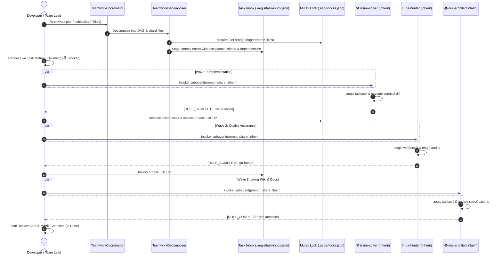
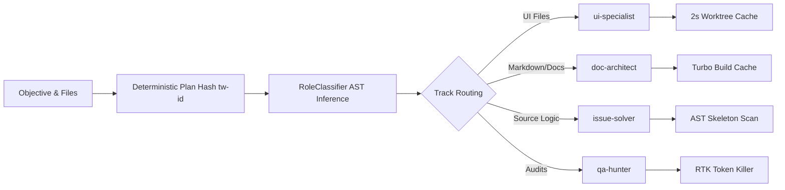
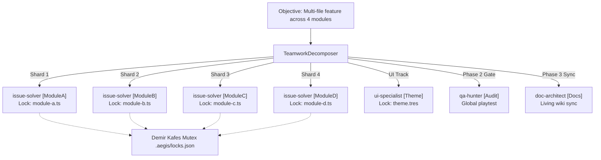
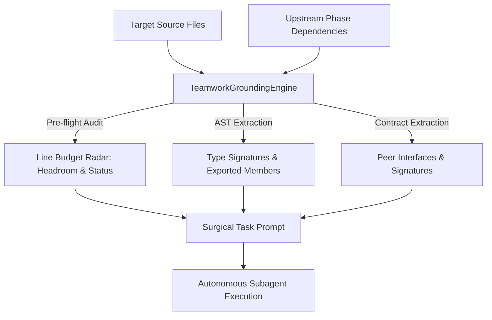
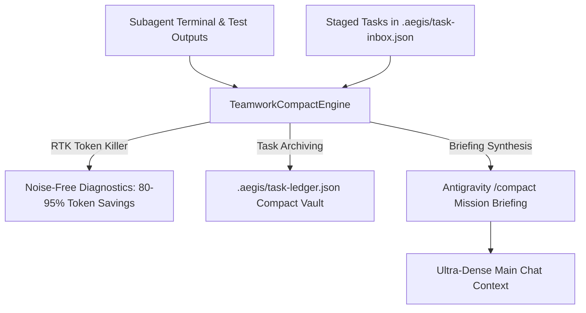
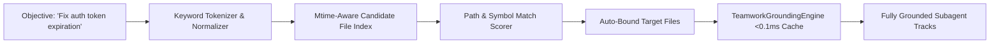

# 🤝 Aegis & Antigravity Native Teamwork Engine Architecture

The **Aegis Native Teamwork Engine** coordinates specialized Antigravity autonomous subagents running concurrently on a shared repository. It eliminates agent collision, minimizes LLM inference latency through hybrid model allocation, and enforces deterministic quality gates.

---

## 1. Architectural Overview & Workflow



The orchestration layer operates through three pillars:
1. **Zero Busy-Wait Polling**: Team Lead and agents sleep during async tasks; reactive wakeup resumes execution upon inbound messages or task completion.
2. **Conflict Prevention**: Statically analyzed file paths are locked prior to invocation.
3. **Decoupled Workspaces**: Agents operate either in `share` mode under file locks or in isolated git worktrees (`experimental/<role>`).

---

## 2. Concurrency Model & Mutex File Locks

To prevent concurrent write corruption, file-level exclusivity is enforced by `WorktreeManager` (`packages/core/orchestrator/src/worktree-manager.ts`).

### Lock State Store (`.aegis/locks.json`)
Active locks map target relative file paths to their owning subagents:
```json
{
  "packages/core/orchestrator/src/teamwork-coordinator.ts": "issue-solver",
  "docs/TEAMWORK.md": "doc-architect"
}
```

### Atomic Mutex Acquisition Protocol
1. **Batch Atomic Acquisition (`acquireBatchLocks`)**: All track file mutexes are acquired in a single atomic pass, preventing partial locks and race conditions.
2. **Lock Serialization & Atomic Swap**: `WorktreeMutex.acquire(lockPath)` takes an OS-level atomic lock, writes state to `.aegis/locks.json.tmp.<pid>.<ts>`, and swaps atomically using `fs.renameSync`.
3. **Collision Rejection**: If another agent attempts to lock a file already held by a peer, `acquireBatchLocks()` rejects the claim and returns `{ success: false, conflictingFiles: [...] }`.
4. **Guaranteed Release**: Upon task conclusion (`[ROLE_COMPLETE]`), Team Lead invokes `releaseFiles()` or `aegis task:release <id> done`. `aegis tw:clear` flushes stale locks.

---

## 3. Specialized Subagent Roles & Hybrid Model Allocation

Rather than deploying monolithic generalist agents, the engine provisions 4 specialized personas configured with optimal LLM tiers.

| Subagent Name | Role Title | Focus Scope | Default Model | Workspace Mode |
| :--- | :--- | :--- | :--- | :--- |
| `issue-solver` | Isolated Code Solver & Implementer | Core business logic, bugfixes, refactoring, algorithms | `inherit` (Pro) | `share` |
| `qa-hunter` | Diagnostic, Gameplay & Quality Auditor | Evidence-based triage, playtests, mutation testing, test suites | `inherit` (Pro) | `share` |
| `ui-specialist` | UI, Theme & Visual Polish Specialist | Godot 4 scenes (`.tscn`), Themes (`.tres`), responsive anchors | `inherit` (Pro) | `share` |
| `doc-architect` | GitHub Documentation & Architecture Planner | Living wiki (`.wiki.git`), RFCs, clean-room specs, task breakdowns | `flash` | `share` |

### Hybrid Model Allocation Benefits
- **Cost Reduction**: Documentation, specification drafting, and wiki synchronization run on fast high-throughput models (`flash`), cutting token costs by ~70%.
- **Deep Reasoning**: Heavy code transformations, AST modifications, and mutation testing remain assigned to high-tier reasoning engines (`inherit` / `pro`).
- **Parallel Throughput**: All four subagents execute concurrently without contention.

---

## 4. Reactive Wakeup Messaging Loop

The engine relies on reactive messaging notifications rather than continuous status polling.

### Subagent Execution Contract
When spawned, each subagent receives an assigned prompt detailing its locked targets and acceptance criteria. Upon finishing work and passing local verification (`aegis verify:task`), the agent dispatches a standard completion notification:

```markdown
[ROLE_COMPLETE: <subagent-name>]
- Files modified: <list of files>
- Verification summary: Demir Kafes passed (<300 lines/file, <40 lines/function), tests green
```

### Team Lead Wakeup Loop
1. **Idle Suspension**: After issuing `invoke_subagent` calls, the Team Lead process idles.
2. **Interrupt Wakeup**: Arrival of `[ROLE_COMPLETE: <role>]` triggers a high-priority wakeup.
3. **Progress Tracking**: Team Lead inspects incoming diffs, marks the role `✅ Tamamlandı` in the live markdown matrix, and unlocks held files.
4. **Final Consolidation**: Once all staged tracks report complete, Team Lead presents the consolidated review summary.

---

## 5. Deterministic Plan Hashing & Performance Optimizations

High execution velocity is guaranteed through deterministic data structures and multi-layer caching:



### Optimizations
- **CLI Dynamic Lazy Loading**: 22 static command imports converted to dynamic lazy loads, slashing cold-start from ~268ms to ~103ms (2.6x speedup).
- **Batch Atomic Mutex (`acquireBatchLocks`)**: Acquires all track file mutexes in a single pass without redundant I/O roundtrips.
- **Deterministic Partitioning & TTL**: `RoleClassifier` shards disjoint tracks; `WorktreeManager` caches worktrees with a 2000ms TTL.
- **AST Skeleton & Turbo Caching**: Pre-execution AST skeleton hides function bodies (73-95% token savings); Turbo tests leverage hash caching.

---

## 6. Phased Wave Execution & Topological DAG Engine

Naive parallel execution fails when downstream agents (QA auditing unwritten code, Doc Architect documenting unfinished APIs) execute concurrently with core logic. The **Topological DAG Engine** coordinates execution across 3 phased waves:

```text
┌─── 🌊 FAZ 1: Temel Uygulama (Solvers & UI) ───────────────────
│   • [issue-solver [ModuleA]] (packages/.../module-a.ts)
│   • [issue-solver [ModuleB]] (packages/.../module-b.ts)
│   • [ui-specialist [UI]] (scenes/main.tscn)
└───────────────────────────────────────────────────────────────
                  │
                  ▼  (Önceki faz tamamlanınca açılır)
┌─── 🛡️ FAZ 2: Kalite Güvence (QA Hunter & Playtest) ──────────
│   • [qa-hunter [Audit]] ── [bağımlı: ModuleA, ModuleB, UI]
└───────────────────────────────────────────────────────────────
                  │
                  ▼  (Önceki faz tamamlanınca açılır)
┌─── 📚 FAZ 3: Dokümantasyon & Wiki (Doc Architect) ────────────
│   • [doc-architect [Docs]] ── [bağımlı: Audit]
└───────────────────────────────────────────────────────────────
```

### Key Wave Guarantees:
1. **Dynamic Dependency Unblocking**: Tasks in Phase 2 and 3 start in the TIP inbox with `status: 'blocked'`. When upstream tasks complete via `aegis task:release <id> done`, all dependent downstream tasks in TIP are unblocked to `'pending'`.
2. **Safe Task Pulling**: `aegis task:pull <role>` checks `dependsOn` lists and refuses to pull blocked tasks until all upstream dependencies report `done`.
3. **Upstream Context Handoff**: Prompts compiled for downstream agents automatically inject upstream dependencies and phase tags so the agent operates with full contextual awareness.
4. **ASCII Wave Visualizer**: Developers and team leads can inspect the dependency graph at any time using `aegis teamwork dag "<objective>"`.

---

## 7. Multi-Instance Subagent Scaling (10+ Concurrent Agents) & File Sharding

Aegis scales seamlessly to **10+ concurrent subagents** with zero lock collisions through dynamic task decomposition and deterministic file sharding.



### High-Concurrency Scaling Guarantees:
1. **Dynamic Itemization**: Numbered lists (`1. ... 2. ...`), bullet points, semicolons, and comma-separated clauses are parsed into distinct subtasks.
2. **Automatic Solver File Sharding (`shardSolversByFiles`)**: When 3+ source files are provided, the engine automatically splits monolithic solver workloads into fine-grained module solvers (e.g. `issue-solver [Parser]`, `issue-solver [Storage]`).
3. **Disjoint Static File Partitioning (`partitionFiles`)**: Source files are assigned strictly to disjoint subagents. Mathematically guarantees 0 lock collision across arbitrary agent counts.
4. **Granular Lock Release (`releaseFiles`)**: Task completion releases exact file lists (`task.targetFiles`) alongside fuzzy instance name matching, preventing stale locks.
5. **Flexible Task Pulling**: `aegis task:pull <role|id>` matches role prefixes, specific instance names (e.g. `doc-architect [Docs]`), or numeric issue IDs.

---

## 9. Anti-Hallucination Grounding & Upstream Contract Engine

In concurrent multi-agent architectures, LLM subagents frequently suffer from hallucination when working with peer components: inventing phantom methods, generating incorrect parameter signatures, or exceeding line quotas.

The **Teamwork Grounding Engine** (`TeamworkGroundingEngine`) provides immutable ground-truth codebase reality directly inside subagent execution prompts:



### Grounding Capabilities:
1. **Line Budget Headroom Radar**: Calculates active line count and remaining headroom against Demir Kafes (<300 lines/file, <40 lines/function) before the agent writes code, categorizing budget status as `healthy`, `warning`, or `critical`.
2. **AST Skeleton Projection**: Generates compact type definitions and class signatures using `@aegis/ast-skeleton`, cutting token consumption by ~90% while providing 100% accurate ground-truth signatures.
3. **Cross-Agent Upstream Contract Sharing**: When a downstream agent (such as QA Hunter or Doc Architect) depends on upstream solver targets, the engine extracts exported interfaces from those upstream files and injects them under `### 🧩 Upstream Dependency Contracts & Interfaces`.
4. **Codebase Invariants Enforcement**: Mandates strict type safety (`0 any`), surgical edits only, and prohibits inventing non-existent APIs.

---

## 10. Antigravity Compact Integration (`TeamworkCompactEngine`)

In long-running sessions (`/goal`, `/teamwork`), conversation context rapidly bloats with execution logs, test outputs, and task inbox state. Aegis integrates natively with **Antigravity Compact** (`/compact` slash command and context compaction):



### Compaction Features:
1. **Autonomous Log & Output Compaction**: Uses `RTKTokenKiller` to strip ANSI escape codes, collapse passing test suites, and filter node internal stack traces before communicating back to Team Lead.
2. **Task Inbox & Ledger Archiving (`aegis teamwork compact`)**: Completed tasks (`status: 'done'`) in `.aegis/task-inbox.json` are automatically archived to `.aegis/task-ledger.json`, keeping the active queue tiny and lightning fast.
3. **Antigravity Context Briefing**: Synthesizes a standardized, high-density markdown summary of the active mission, completed milestones, released mutexes, active locks, and remaining Demir Kafes quotas.
4. **Subagent Prompt Economy**: Truncates and folds oversized grounding context so subagents never exceed optimal context windows.

---

## 11. Sub-10ms Fast Semantic Initial Analyzer (`FastSemanticAnalyzer`)

Initial task planning and codebase exploration previously required multiple roundtrips and dozens of manual `read_file` or `find_symbol` tool calls.

The **Fast Semantic Analyzer** solves this by performing instant target file discovery and semantic scoring in **under 10 milliseconds**:



### Key Breakthroughs:
1. **Persistent Disk Caching (<2ms)**: Caches candidate file manifests in `.aegis/cache/fast-semantic-manifest.json` keyed by `.git/index` mtime, dropping candidate evaluation from 10ms to <2ms.
2. **Zero-Turn Target Discovery**: If target files are omitted, `planTeamwork` automatically invokes `FastSemanticAnalyzer.analyze(objective)`. It parses keywords and auto-binds relevant files to solver tracks.
3. **Mtime Grounding Cache**: `TeamworkGroundingEngine` caches `FileGroundingReport` by file path, mtime, and size. Repeated file inspections run in <0.001ms.
4. **Pinpoint Accuracy**: Discovers primary implementation files and tight dependencies, providing high-confidence tracks before subagents start writing code.

---

## 12. CLI & Tooling Quick Reference

| Action | Aegis CLI Command | Short Alias / Flags | MCP Equivalent |
| :--- | :--- | :--- | :--- |
| **Direct Goal Run** | `aegis tw "<obj>"` | `tw "<obj>" [-c] [-j] [--dry-run]` | `aegis:teamwork_plan` |
| **Inspect Status** | `aegis teamwork status` | `aegis tw:status` / `aegis tw` | `aegis:teamwork_status` |
| **Generate Plan** | `aegis teamwork plan "<obj>"` | `aegis tw:plan "<obj>"` | `aegis:teamwork_plan` |
| **Fast Semantic Analysis**| `aegis teamwork analyze "<obj>"` | `aegis tw:analyze` (<2ms cache) | `aegis:teamwork_analyze` |
| **Compact Mission** | `aegis teamwork compact [obj]` | `aegis tw:compact` (-c: 85% saved) | `aegis:teamwork_compact` |
| **View ASCII DAG** | `aegis teamwork dag [obj]` | `aegis tw:dag` | `aegis:teamwork_dag` |
| **Live Task Matrix** | `aegis teamwork matrix [obj]` | `aegis tw:matrix` | - |
| **Clear Inbox & Locks** | `aegis teamwork clear` | `aegis tw:clear` | - |
| **Export Manifest** | `aegis teamwork setup [dir]` | `aegis tw:setup` | - |
| **Pull Role Task** | `aegis task:pull <role\|id>` | `aegis task:pull` | `aegis:task_inbox_pull` |
| **Claim / Release** | `aegis task:claim` / `release` | `aegis task:release <id> done` | `aegis:task_claim` / `release` |
| **Verify Gate** | `aegis verify:task [file]` | `aegis verify:task` | `aegis:cage_check` |
