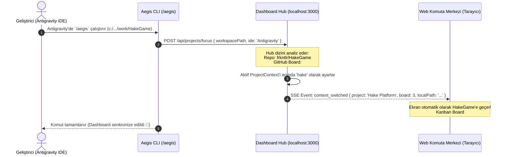

# 🏛️ RFC-001: Aegis Merkezi Çoklu Proje Komuta Merkezi (Multi-Project Hub)
### Antigravity IDE Otomatik Bağlam Takibi (Auto-Follow) & Sıfır-Müdahale Çoklu Proje Mimarisi

- **Durum:** Güncellendi (Review Pending — User Feedback Incorporated)
- **Tarih:** 2026-10-23
- **Yazar:** Aegis Autonomous Architecture Guild & @frkntlr
- **Kapsam:** `@aegis/web-dashboard`, `@aegis/orchestrator`, `@aegis/github-live`, `aegis-cli`

---

## 🔍 1. Problem Tanımı & Kullanıcı Geri Bildirimi

> [!IMPORTANT]
> **Kullanıcı Direktifi:** *"Otomatik kendisi algılaması gerek. Mesela Antigravity'de `/aegis` çağırdığımda buna göre Dashboard kendisi takip edilebilir şekilde tüm ayarları ve yapısıyla o projeye adapte gelmeli."*

Geliştiricinin projeler arasında geçiş yaparken tarayıcıya gidip manuel olarak bir açılır menüden proje seçmesi sürtünme yaratır (*context-switching friction*). Dashboard, bir arayüzden ziyade **akıllı, yaşayan bir refakatçi (co-pilot)** gibi davranmalı; Antigravity IDE'de hangi projede `/aegis` çağrılırsa anında o projeyi tanımalı ve tüm görünümünü kendiliğinden o projenin ayarlarına, kilitlerine ve GitHub panosuna uyarlamalıdır.

---

## 🧭 2. Çözüm: "Auto-Follow IDE" (Otomatik Bağlam Algılama)



### Temel Davranış İlkeleri:
1. **Sıfır-Müdahale (Zero-Touch) Algılama:** Antigravity IDE'de hangi klasörde olursanız olun `/aegis` (veya `status`, `auto`, `cage:check` vb.) çalıştırıldığında, CLI yerel Hub'a tek milisaniyelik hafif bir ping atar (`/api/projects/focus`).
2. **Kendiliğinden Adaptasyon:** Dashboard saniyenin onda biri sürede:
   - İlgili projenin GitHub Projects panosunu (#3 Hake, #4 Aegis vb.) otomatik bağlar.
   - İlgili projenin yerel AST İskelet haritasını ve token tasarrufunu ekrana yansıtır.
   - İlgili projenin izole kilitlerini (`.aegis/locks.json`) ve worktree durumlarını yükler.
3. **Canlı Tarayıcı Senkronizasyonu (SSE):** Açık olan tüm tarayıcı pencerelerine SSE üzerinden anlık `context_switched` sinyali gönderilir; sayfa yenilemeye gerek kalmadan arayüz kendiliğinden aktif projeye dönüşür.

---

## 🔒 3. Sıfır-Çakışmalı Namespaced Context Mimarisi

Birden fazla proje (örneğin Aegis ve HakeGame) aynı anda aktif olsa dahi arka planda verilerin karışmasını fiziksel olarak engelleyen mimari:

```typescript
export interface ProjectContext {
  id: string;               // örn: 'frkntlr/aegis' | 'frkntlr/HakeGame'
  name: string;             // örn: 'Hake Platform'
  projectNumber: number;    // GitHub Projects v2 Board ID (#3, #4)
  repoOwner: string;        // 'frkntlr'
  repoName: string;         // 'HakeGame'
  localPath: string;        // 'C:/Users/Lenovo/Documents/work/HakeGame'
  isLocalBound: boolean;    // true ise yerel worktree/AST devrede
  lastFocusedAt: string;    // Son IDE etkileşim zamanı (Antigravity Heartbeat)
  
  // İzole Çalışma Motorları (Her Projeye Özel Örnekler)
  wtManager: WorktreeManager;           // Yalnızca HakeGame/.aegis/locks.json ile konuşur
  detector: SessionDetector;           // Yalnızca HakeGame oturumlarını izler
  metrics: RealtimeMetricsService;     // Yalnızca HakeGame kodunu analiz eder
  kanban: GitHubKanbanService;         // Yalnızca GitHub Project #3 ile senkronize olur
}
```

### Karışmayı Önleyen Güvenlik Duvarları:
- **Kilit İzolasyonu:** Proje A'daki bir dosya kilidi (`src/test.ts`) Proje B'deki dosyayı asla etkileyemez; çünkü kilitler her projenin kendi yerel dizinindeki `.aegis/locks.json` dosyasına yazılır.
- **Dizin Doğrulaması:** CLI veya Web arayüzünden tetiklenen tüm işlemler (`run_engine_tool`, `move_task`) sadece ve sadece o projenin `localPath` çalışma dizininde koşturulur. Başka repoda `git` işlemi yapılması engellenir.
- **Filtrelenmiş SSE:** Tarayıcı aktif proje ID'sine (`activeProjectId`) göre filtrelenmiş veriyi alır; Proje A'nın metrikleri Proje B'nin ekranına sızamaz.

---

## 🌐 4. Genişletilmiş API Spesifikasyonu

| Metot | Uç Nokta | Görev / İşlev |
| :--- | :--- | :--- |
| `POST` | `/api/projects/focus` | **[YENİ]** Antigravity IDE veya CLI'dan aktif çalışma dizinini bildirir. Hub anında bu projeye adapte olur ve SSE ile tarayıcıyı tetikler. |
| `GET` | `/api/projects` | Keşfedilen tüm projeleri, eşleşen yerel yolları ve son odaklanma zamanlarını listeler. |
| `POST` | `/api/projects/switch` | Arayüzden manuel olarak projeyi sabitlemek (Pin) istendiğinde kullanılır. |
| `GET` | `/api/events` | Gerçek zamanlı SSE akışı (`snapshot`, `context_switched`, `task_moved`, `lock_updated`). |
| `GET` | `/api/status` | Aktif odaklanılan projenin anlık metrikleri, kilitleri ve canlı ajan durumları. |
| `POST` | `/api/move_task` | Görevi aktif projenin Projects v2 panosunda günceller ve izole worktree kilidini edinir. |
| `POST` | `/api/run_engine_tool`| Aktif projenin kendi kök dizininde `cage:check` veya `skeleton:scan` koşturur. |

---

## 🎨 5. Arayüz (UI/UX) ve Görsel İndikatörler

Başlık çubuğu, geliştiricinin hangi projede çalıştığını ve Antigravity bağlantısını açıkça yansıtır:

```
+-------------------------------------------------------------------------------------------------------+
| 🛡️ AEGIS COMMAND CENTER   [ 📁 Aktif: Hake Platform (#3) ▼ ]   (🟢 ANTIGRAVITY BAĞLI: work/HakeGame)  |
| 🟢 AUTO-FOLLOW: AKTİF (Antigravity'deki proje değişimleri otomatik takip ediliyor)                     |
+-------------------------------------------------------------------------------------------------------+
| Canlı Proje Listesi:                                                                                  |
|  • 🎮 frkntlr/HakeGame     | Board #3 | 🟢 LOCAL (c:/.../work/HakeGame) | [ODAKLANDI ⚡] (Son: 1s önce)|
|  • ⭐ frkntlr/aegis        | Board #4 | 🟢 LOCAL (c:/.../work/aegis)    | [Beklemede]                  |
|  • 🧪 frkntlr/Test         | Board #2 | ☁️ CLOUD ONLY                   | [Beklemede]                  |
+-------------------------------------------------------------------------------------------------------+
```

- **🟢 ANTIGRAVITY BAĞLI:** Antigravity IDE penceresinden gelen son `/aegis` çağrısıyla senkronize olunduğunu gösterir.
- **⚡ ODAKLANDI Rozeti:** Hangi projenin terminalinde işlem yapıldıysa anında yeşil parlayarak odaklanır.
- **📌 İsteğe Bağlı Sabitleme:** İstenirse "Auto-Follow" geçici olarak duraklatılıp belirli bir projede kilitli kalınabilir.

---

## 📋 6. Kabul Kriterleri (Acceptance Criteria)

- [ ] **AC-1 (Antigravity Auto-Focus):** Antigravity IDE'de herhangi bir proje dizininde `/aegis` veya `npm run aegis` çalıştırıldığında, Dashboard otomatik olarak o projeyi algılar ve aktif bağlamı günceller.
- [ ] **AC-2 (Sıfır-Müdahale Arayüz Geçişi):** Odak değiştiğinde tarayıcıdaki açık Dashboard sekmesi sayfa yenilenmeden SSE sinyaliyle (`context_switched`) otomatik olarak yeni projeye geçer.
- [ ] **AC-3 (Proje Özelinde GitHub Panosu):** HakeGame seçildiğinde GitHub Project #3; Aegis seçildiğinde Project #4 otomatik olarak Kanban'a oturur.
- [ ] **AC-4 (Karışma Koruması - 0 Contamination):** Farklı projelerdeki aynı dosya isimleri (`src/index.ts`) için kilitler sadece ilgili projenin `.aegis/locks.json` dosyasına yazılır, çapraz çakışma yaşanmaz.
- [ ] **AC-5 (Demir Kafes Standartları):** Yazılan tüm servisler $\le 40$ satır/fonksiyon ve $\le 300$ satır/dosya kuralına harfiyen uyar.
