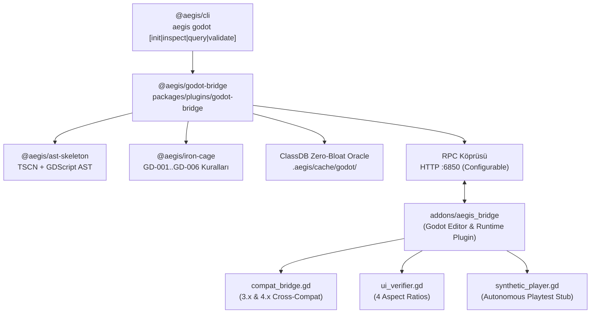

# 🏛️ RFC-002: Aegis Godot Engine Otonom Köprü ve Görsel Denetim Mimarisi
### Godot 3.x ve 4.x+ Uyumlu Runtime ClassDB Doğrulayıcı, Bounding-Box UI Telemetrisi ve Otomasyon Motoru

- **RFC ID:** RFC-002
- **Durum:** Approved / Implementation Complete ✅
- **Tarih:** 2026-10-24
- **Yazar:** Furkan Canberk Atalar & Aegis Architecture Guild
- **Kapsam:** `@aegis/godot-bridge`, `@aegis/ast-skeleton`, `@aegis/iron-cage`, `@aegis/cli`, `@aegis/shared`, `@aegis/orchestrator`

---

## 🔍 1. Fikir ve Problem Tanımı

Godot Engine projelerinde çalışan otonom kodlama ajanları üç kritik sürtünmeyle karşılaşır:
1. **Belge Şişkinliği (Token Bloat):** Git deposuna `godot-docs` yüklemek veya tam API belgelerini prompt bağlamına dökmek LLM token limitlerini tüketir. Bunun yerine Godot motorunun yerel `--doctool` ve runtime `ClassDB` oraclesi kullanılmalıdır.
2. **Görsel Körlük (Visual Blindness):** Ajanlar GDScript kodunu yazsa da Control ve CanvasItem hiyerarşilerinde düğümlerin 16:9, 21:9, 16:10 ve 9:16 çözünürlüklerde üst üste binip binmediğini göremez. Sıfır-token JSON bounding-box telemetrisi ile görsel doğrulama şarttır.
3. **Manuel Kurulum Sürtünmesi:** Yeni veya mevcut bir Godot projesine Aegis köprüsünün entegrasyonu tek bir komutla (`aegis godot init`) tamamlanmalıdır.

---

## 🏗️ 2. Mimari Bileşenler

---

## 🔒 3. Demir Kafes Standartları
- Azami 300 satır/dosya, azami 40 satır/fonksiyon.
- Cyclomatic complexity $\le 10$.
- Vitest birim testleri ile %80+ kapsama ve %70+ mutasyon skoru.

---

## 🎯 4. Kabul Kriterleri (Acceptance Criteria)
- [x] Mimari Plan ve Grill-Me netleştirildi (`RFC-002-implementation-plan.md`).
- [x] `@aegis/godot-bridge` monorepo paketi oluşturuldu ve derlendi.
- [x] `aegis.config.json` Godot yapılandırma şeması bağlandı.
- [x] `.tscn` ve `.tres` AST iskelet çıkarıcısı eklendi.
- [x] Iron Cage GDScript kuralları (GD-001..GD-006) bağlandı.
- [x] RPC HTTP sunucusu ve Godot GDScript eklentisi hazırlandı.
- [x] `aegis godot init` komutu çalıştırılabilir duruma getirildi.
- [x] ClassDB Zero-Bloat Oracle ve 4 ekran oranı UI telemetrisi doğrulandı.
