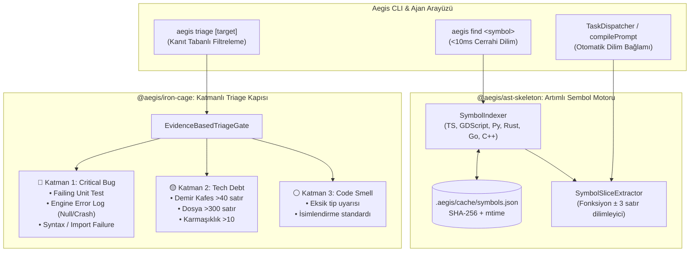

# 🏛️ RFC-003: Hafif Artımlı Sembol İndeksi ve Kanıt Tabanlı Hata Sınıflandırma Kapısı (Triage Gate)
### Hızlı Cerrahi Kod Arama (Symbol Slicing) ve Sahte Bug Patlamasını Önleyen Katmanlı Triage Mimarisi

- **RFC ID:** RFC-003
- **Durum:** Approved / Implementation Blueprint Ready 🎯
- **Tarih:** 2026-10-24
- **Yazar:** Furkan Canberk Atalar & Aegis Architecture Guild
- **Kaynak Tartışma:** [GitHub Discussion #53](https://github.com/frkntlr/aegis/discussions/53)
- **Kapsam:** `@aegis/ast-skeleton`, `@aegis/iron-cage`, `@aegis/orchestrator`, `@aegis/cli`, `@aegis/shared`

---

## 🔍 1. Fikir ve Problem Tanımı (Root Cause Deep-Dive)

Aegis motoru ve bağlı otonom ajanlar (`solver`, `qa`, `yap`) gerçek projelerde çalışırken iki majör operasyonel sürtünmeyle karşılaşmaktadır:

### Darboğaz A: Kod Bulma ve İncelemede Aşırı Gecikme (High Latency & Context Bloat)
1. **Dizinsiz Ardışık G/Ç (Unindexed Sequential I/O):**
   - Bir ajan bir fonksiyonu, metodu veya Godot sinyalini ararken kod tabanındaki dosyaları baştan sona okumakta (`read_file`) veya her seferinde sıfırdan AST derlemektedir.
   - Dosya içerikleri değişmese dahi her komutta tüm depo taranmakta, bu da saniyeler süren gecikmeye ve çoklu araç turlarına (*tool roundtrip*) sebep olmaktadır.
2. **Körlemesine Bağlam Şişmesi (Context Flooding):**
   - 20 satırlık bir fonksiyonu incelemek için 500 satırlık dosyanın tamamı LLM bağlam penceresine gönderilmektedir. Bu durum hem model yanıt süresini (TTFT) katlamakta hem de token tüketimini hızla tüketmektedir.
3. **Kalıcı Önbellek Eksikliği:**
   - Git HEAD üzerindeki değişmeyen kaynak dosyaların sembolleri için disk tabanlı, kalıcı ve SHA-256 / mtime kontrollü bir indeks bulunmamaktadır.

### Darboğaz B: "Bug Diz / Yap" Denildiğinde Sürekli Sahte/Sonsuz Bug Listelenmesi
1. **Stil Metrikleri ile Çalışma Zamanı Hatalarının Eş Tutulması:**
   - `IronCageValidator` ve `GDScriptRulesValidator`, 40 satırı aşan fonksiyonları (`MAX_FUNCTION_LINES`), 300 satırı aşan dosyaları (`MAX_FILE_LINES`) ve karmaşıklığı > 10 olan yapıları doğrudan hata (*violation*) sayar.
   - Ajan veya kullanıcı "bug ara" talimatı verdiğinde, bu metrik ihlalleri doğrudan yazılım hatası (*defect/bug*) gibi sunulmaktadır. Oysa bu ihlaller gerçekte birer **Mimari Borç (Tech Debt)** veya **Refactor İhtiyacı**dır.
2. **LLM Onay Yanlılığı (Confirmation Bias & Sycophancy):**
   - Bir modele "hata bul / bug ara" dendiğinde, model görev baskısı altında kalarak teorik ve varsayımsal uç senaryolar türetir (*"Bu fonksiyon null kontrolü yapmıyor, parametre nil gelirse çöker"*). Somut bir test kırılması veya motor çökmesi olmadan bu teorik ihtimaller kritik hata gibi listelenir.
3. **Motor Çalışma Zamanı ve Sinyal Körlüğü (Godot / Framework Blindness):**
   - Godot'ta sahne ağacı (`.tscn`) içinden bağlanan buton/timer sinyalleri veya motor yaşam döngüsü metotları (`_ready()`, `_process()`, `_physics_process()`), statik araçlar tarafından "çağrılmayan ölü kod" veya "bağlantısız sinyal" sanılarak sahte hata olarak fişlenmektedir.

---

## 🏗️ 2. Sistem Mimarisi ve Veri Akışı



---

## ⚡ 3. Bileşen Detayları ve Spesifikasyonlar

### 3.1. SymbolIndexer (`@aegis/ast-skeleton`)
- **İşlev:** Projedeki kaynak kodları (`.ts`, `.gd`, `.py`, `.rs`, `.go`, `.cpp`, `.tscn`) tarar; sınıf, fonksiyon, metot, sinyal ve arayüzlerin konumlarını çıkartır.
- **Incremental Cache:** `.aegis/cache/symbols.json` dosyasını yönetir.
  - Dosya hash'i (`sha256(content)`) ve `mtime` bilgisi değişmemişse AST ayrıştırmasını atlar.
  - Sadece değişen veya yeni eklenen dosyalar ayrıştırılır.
  - Depo genelinde arama süresi: `<10ms`.

```typescript
export interface SymbolEntry {
  name: string;
  kind: 'class' | 'function' | 'method' | 'signal' | 'interface' | 'variable';
  filePath: string;
  startLine: number;
  endLine: number;
  signature: string;
  docstring?: string;
}

export interface SymbolDatabase {
  version: string;
  lastUpdated: string;
  files: Record<string, {
    hash: string;
    mtime: number;
    symbols: SymbolEntry[];
  }>;
}
```

### 3.2. SymbolSliceExtractor (`@aegis/ast-skeleton`)
- **İşlev:** Verilen bir sembol adı veya `dosya:satır` referansı için, tüm dosyayı yüklemek yerine yalnızca ilgili fonksiyon bloğunu ve çevreleyen $\pm 3$ satırlık bağlamı çeker.
- **Token Tasarrufu:** 500 satırlık dosya yerine 25 satırlık dilim döndürerek token tüketimini **%85–%95 oranında azaltır**.

```typescript
export interface SliceResult {
  symbol: string;
  filePath: string;
  startLine: number;
  endLine: number;
  codeSlice: string;
  lineCount: number;
}
```

### 3.3. EvidenceBasedTriageGate (`@aegis/iron-cage`)
- **İşlev:** Raporlanan veya tespit edilen her sorunu 3 katı kanıt filtresinden geçirerek sınıflandırır.
- **Katman Kuralları:**
  1. **🔴 Critical Runtime Bug (Kesin Kusur):**
     - Birim test çökmesi (`failing tests > 0`).
     - Motor çalışma zamanı log hatası (`get_debug_output`, `game_get_errors` null-pointer, crash, assert failure).
     - Sözdizimi veya derleme hatası.
     - *Aksiyon:* GitHub Issue açılır, solver ajanına acil atanır.
  2. **🟡 Architectural Debt (Mimari Borç / Demir Kafes):**
     - Fonksiyon satırı $> 40$, dosya satırı $> 300$, karmaşıklık $> 10$.
     - *Aksiyon:* Asla bug olarak listelenmez! Refactor havuzuna (`type:tech-debt`) kaydedilir.
  3. **⚪ Code Smell (Kod Kokusu):**
     - Eksik tip belirteçleri, stil önerileri.
     - *Aksiyon:* Yalnızca linter çıktısında bilgi amaçlı tutulur.

```typescript
export interface TriageFinding {
  id: string;
  category: 'CRITICAL_DEFECT' | 'ARCHITECTURAL_DEBT' | 'CODE_SMELL';
  title: string;
  filePath: string;
  line?: number;
  evidence: string;
  blocking: boolean;
}

export interface TriageReport {
  criticalCount: number;
  debtCount: number;
  smellCount: number;
  findings: TriageFinding[];
  clean: boolean;
}
```

---

## 🛠️ 4. Yeni CLI Komutları ve Kullanım Örnekleri

### 4.1. `aegis find <symbol>`
Belirtilen sınıfı, fonksiyonu veya sinyali milisaniyeler içinde bulur ve cerrahi dilimi ekrana basar:

```powershell
npm run aegis -- find IronCageValidator
npm run aegis -- find Player._on_hit
```

*Çıktı Örneği:*
```
🔍 Symbol found: 'IronCageValidator' (packages/core/iron-cage/src/cage-validator.ts:17-244)
• Kind: class | Cache: HIT (<2ms)
--------------------------------------------------------------------------------
17: export class IronCageValidator {
18:   private maxFunctionLines: number;
...
--------------------------------------------------------------------------------
💡 To extract specific method slice: aegis find IronCageValidator.validateFileContent
```

### 4.2. `aegis triage [target]`
Kanıt tabanlı hata taraması yapar; sahte bug listelemelerini tamamen engeller:

```powershell
npm run aegis -- triage packages/core
```

*Çıktı Örneği:*
```
🛡️  AEGIS - Evidence-Based Bug Triage Gate
──────────────────────────────────────────────────
🔴 Critical Defects: 0 (No runtime crashers / test failures detected ✅)
🟡 Tech Debt:         3 (Demir Kafes >40 line warnings - Segregated to Refactor)
⚪ Code Smells:       1 (Style recommendation)
──────────────────────────────────────────────────
✅ Triage Verdict: CLEAN (Zero blocking bugs).
```

---

## 🔒 5. Demir Kafes Standartları
- Tüm yeni TypeScript dosyaları azami 300 satır.
- Tüm fonksiyonlar azami 40 satır.
- Cyclomatic complexity $\le 10$.
- Pre-commit testlerinin tamamından geçme zorunluluğu.
- Vitest test kapsamı $\ge 80\%$, mutasyon skoru $\ge 70\%$.

---

## 🎯 6. Atomik Görev Dağılımı ve Uygulama Yol Haritası

- [ ] **Görev 1 (Index Engine):** `packages/core/ast-skeleton/src/symbol-indexer.ts` ve birim testleri (`symbol-indexer.test.ts`).
- [ ] **Görev 2 (Slice Engine):** `packages/core/ast-skeleton/src/symbol-slice-extractor.ts` ve cerrahi dilimleme testleri.
- [ ] **Görev 3 (Triage Gate):** `packages/core/iron-cage/src/triage-gate.ts` ve kanıt ayrıştırma testleri (`triage-gate.test.ts`).
- [ ] **Görev 4 (CLI & Ajan Köprüsü):** `packages/cli/src/commands/find-command.ts`, `triage-command.ts` ve `compilePrompt` entegrasyonu.
- [ ] **Görev 5 (Doğrulama):** Demir Kafes %100 uyumu ve `npm test` tam yeşil geçişi.
