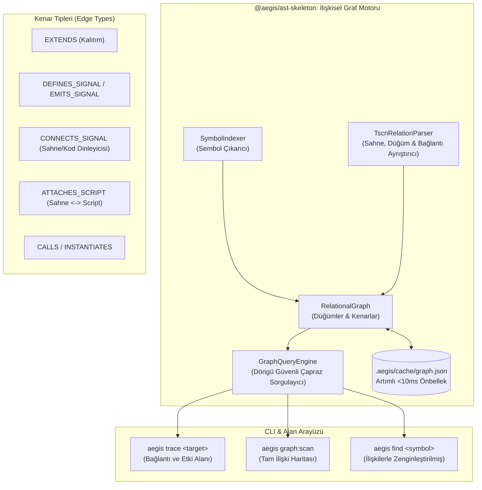

# 🏛️ RFC-004: İlişkisel Bilgi Grafı ve Çoklu-Varlık Çapraz Referans Motoru (Relational Knowledge Graph)
### Godot Sahneleri (.tscn), GDScript Sinyalleri, Sınıf Kalıtımları ve Kod Bağımlılıkları İçin Deterministik İlişki Haritası

- **RFC ID:** RFC-004
- **Durum:** Approved / Implementation Blueprint Ready 🎯
- **Tarih:** 2026-10-24
- **Yazar:** Furkan Canberk Atalar & Aegis Architecture Guild
- **Kaynak Tartışma:** [GitHub Discussion #55](https://github.com/frkntlr/aegis/discussions/55)
- **Kapsam:** `@aegis/ast-skeleton`, `@aegis/godot-bridge`, `@aegis/orchestrator`, `@aegis/cli`, `@aegis/shared`

---

## 🔍 1. Fikir ve Problem Tanımı (Why Relational Graph?)

RFC-003 ile getirilen `SymbolIndexer` ve `SymbolSliceExtractor`, tekil dosyalar içindeki sembolleri <3ms'de bulmayı ve cerrahi dilimlemeyi çözmüştür. Ancak modern oyun projeleri (Godot 4.x) ve büyük ölçekli çoklu-dil projeleri dosyalar arası derin ilişkisel ağlara dayanır:

1. **Sinyal & Sahne Körlüğü (Signal & Scene Blindness):**
   - Bir GDScript içinde tanımlanan `signal health_depleted`, başka bir script'ten tetiklenir (`.emit()`) ve `.tscn` sahne ağacı içindeki bir GUI butonuna veya diyalog paneline (`[connection ...]`) bağlanır.
   - Ajan yalnızca dosyayı okuduğunda, o sinyali kimlerin dinlediğini veya hangi `.tscn` sahnesinin hangi metoduna bağlı olduğunu göremez. Sonuç olarak metot adını değiştirdiğinde sahneler çalışma zamanında çöker (*Null reference / signal disconnect*).
2. **Kalıtım ve Çağrı Hiyerarşisi Bilinmezliği:**
   - Bir sınıfın (`class_name Player extends CharacterBody2D`) veya TypeScript servisinin (`UserService extends BaseService`) hiyerarşisi bilinmediğinde, ajan temel sınıftaki metodun üzerine yazıp ezebilir (*shadowing/overwrite*).
3. **Etki Alanı (Blast Radius) Tahmin Edilemezliği:**
   - Bir fonksiyonda değişiklik yapıldığında depodaki hangi dosyaların, sahnelerin ve testlerin etkileneceği anlaşılamaz.

---

## 🏗️ 2. Sistem Mimarisi ve Veri Modeli



---

## ⚡ 3. Düğüm ve Kenar Şeması

### 3.1. Düğümler (Nodes)
* **`SymbolNode`:** Sınıf, metot, fonksiyon, sinyal, arayüz (`id: "filePath::symbolName"`).
* **`FileNode`:** Kaynak dosya (`id: "filePath"`).
* **`SceneNode`:** Godot Sahnesi (`.tscn`) ve sahne düğümleri (`id: "scenePath::NodeName"`).

### 3.2. Kenarlar (Edges)
```typescript
export type RelationalEdgeType =
  | 'EXTENDS'          // Class A extends Class B
  | 'IMPLEMENTS'       // Class A implements Interface B
  | 'DEFINES_SIGNAL'   // Class/Script defines Signal
  | 'EMITS_SIGNAL'     // Method emits Signal
  | 'CONNECTS_SIGNAL'  // Scene node or script connects Signal to Handler Method
  | 'ATTACHES_SCRIPT'  // Scene node attaches Script (ExtResource)
  | 'INSTANTIATES'     // Class/Method instantiates Scene or Object
  | 'CALLS';           // Method A calls Method B

export interface RelationalEdge {
  from: string;
  to: string;
  type: RelationalEdgeType;
  metadata?: Record<string, string>;
}
```

---

## 🔒 4. Kesinlikle Buglanmayacak Sağlamlık Garantileri

1. **Döngü Güvenli Derinlik Sınırı (Cycle-Safe Depth-Limited Traversal):**
   - Karşılıklı referanslarda (`A -> B -> A`) sonsuz döngüyü önlemek için `Set<string> visited` seti ve `maxDepth: number = 8` mekanizması uygulanır.
2. **Kırık Referans ve Yetim Güvenliği (Null-Safe Orphan Handling):**
   - Dosyası silinmiş veya bulunamayan `res://` yolları motoru çökertmez; `unresolved:<path>` olarak izole edilir.
3. **Artımlı Güncelleme (Incremental Delta Invalidation):**
   - Bir `.gd` veya `.tscn` dosyası değiştiğinde tüm grafiği sıfırdan hesaplamak yerine, sadece o dosyanın giden ve gelen kenarları silinip yeniden bağlanır.
4. **Demir Kafes Standartları:**
   - Azami 300 satır/dosya, azami 40 satır/fonksiyon.
   - Vitest birim testleri ile %80+ kapsama ve %70+ mutasyon skoru.

---

## 🛠️ 5. Yeni CLI Komutları ve Kullanım Örnekleri

### 5.1. `aegis trace <target>`
Bir sinyali, metodu, sınıfı veya sahneyi sorgular; tüm giden ve gelen bağlantılarını ve etki alanını ekrana döker:

```powershell
npm run aegis -- trace Hero.health_changed
```

*Çıktı Örneği:*
```
🕸️  RELATIONAL TRACE: 'Hero.health_changed' (SIGNAL)
──────────────────────────────────────────────────
 📡 Defined In:   scripts/hero.gd:2 (Hero)
 ⚡ Emitted By (1):
    • scripts/hero.gd:6 (Hero.take_damage)
 🔗 Connected By (2):
    • scenes/hud.tscn [Node: HealthBar] -> scripts/hud.gd:15 (_on_hero_health_changed)
    • scripts/game_controller.gd:24 (GameController.setup_listeners) -> GameController._on_death
 💥 Blast Radius (Etki Alanı):
    • scripts/hero.gd, scenes/hud.tscn, scripts/hud.gd, scripts/game_controller.gd
──────────────────────────────────────────────────
✅ Query completed in 3.12ms (Graph Cache HIT).
```

### 5.2. `aegis graph:scan [dir]`
Tüm çalışma alanını tarar, sahneleri, scriptleri ve sinyalleri birbirine bağlayıp `.aegis/cache/graph.json` dosyasına kaydeder.

---

## 🎯 6. Kabul Kriterleri (Acceptance Criteria)

- [ ] `packages/core/ast-skeleton/src/relational-graph.ts` (Düğüm, kenar ekleme, silme, serialization).
- [ ] `packages/core/ast-skeleton/src/tscn-relation-parser.ts` (`.tscn` içindeki script, düğüm, connection ve instance eşleştirmesi).
- [ ] `packages/core/ast-skeleton/src/graph-query-engine.ts` (Döngü korumalı trace, blast radius ve caller/listener sorguları).
- [ ] `packages/core/ast-skeleton/src/cross-reference-linker.ts` (`res://` yollarını çözme, sinyalleri ve çağrıları bağlama).
- [ ] CLI komutları: `aegis trace <target>` ve `aegis graph:scan [dir]`.
- [ ] `aegis find` çıktısına bağlantılı sinyal ve sahne ilişkilerini otomatik ekleme.
- [ ] Demir Kafes (%100 temiz, <40 satır/fonksiyon, <300 satır/dosya) ve tam yeşil testler.
