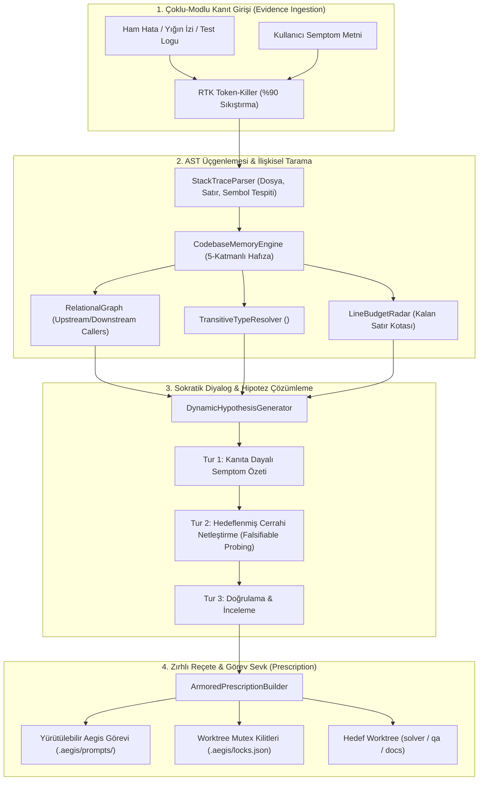

# 🏛️ RFC-014: Socratic Evidence-Based Diagnostic Engine: Zero-Hallucination AST Triangulation & Surgical Context Synthesis
### Aegis Autonomous Architecture Blueprint

- **RFC ID:** RFC-014 | **Durum:** Proposed | **Tarih:** 2026-10-26
- **Hedef Paket:** `@aegis/dialogue-engine` (ve bağlı `@aegis/ast-skeleton`, `@aegis/watchdog`, `@aegis/iron-cage`)
- **İlgili Tartışma:** [GitHub Discussion #230](https://github.com/frkntlr/aegis/discussions/230)

---

## 🔍 1. Fikir ve Problem Tanımı (Vision & Core Problem)

### Mevcut Durum ve Problem
Aegis `@aegis/dialogue-engine` paketi, yapay zeka ajanları ve geliştiriciler için 3 turluk deterministik bir teşhis durum makinesi (`DialogueStateMachine`) sunmaktadır. Ancak mevcut implementasyon (`DialogueEngine`), tamamen yüzeysel metin eşleştirmelerine (`string.includes`) ve statik seçeneklere (`CATEGORY_OPTIONS`, `DEFAULT_PLANS`) dayanmaktadır.

Bu durum pratikte şu 3 kritik soruna yol açmaktadır:
1. **AI Halüsinasyonu (AI Hallucination):** Hata ayıklama oturumunda LLM, gerçek AST sembollerini, dosya yollarını, çağrı hiyerarşisini ve tip imzalarını göremediği için hedef dosya, fonksiyon ve çözüm adımlarını uydurmaktadır.
2. **Bağlam Eksikliği & Körlük (Context Blindness):** Teşhis motoru `@aegis/ast-skeleton` (CodebaseMemory), `@aegis/watchdog` (RTK Token-Killer), `@aegis/iron-cage` (Demir Kafes Kotası) ve `git` durumundan tamamen kopuk çalışmaktadır. Hangi fonksiyonun çöktüğünü, o fonksiyonu kimlerin çağırdığını (`CALLS` grafı) veya dosyanın kalan satır bütçesini bilmemektedir.
3. **Performans ve Token Şişmesi (Performance & Token Bloat):** LLM'e devasa yığın izleri (stack traces) veya tüm kaynak dosyalar döküldüğünde bağlam penceresi dolmakta, yanıt süreleri uzamakta ve modelin muhakeme yeteneği düşmektedir.

### Vizyon (Proposed Solution)
`DialogueEngine`'i statik bir şablon üreticisinden; **Sokratik, Kanıt-Güdümlü (Evidence-Based) ve Sıfır Halüsinasyonlu bir Teşhis Beynine** dönüştürmek:
- **Kanıt Triangülasyonu (AST Triangulation):** Ham yığın izini (stack trace), test çıktısını veya terminal logunu ayrıştırarak doğrudan ilgili AST sembolünü, dosyasını ve satırını saptamak.
- **İlişkisel Bağlam Sentezi:** `CodebaseMemoryEngine` üzerinden sembolün çağıranlarını (upstream callers), çağırdıklarını (callee signatures), geçişli tip kapanışını (`<ambient_types>`) ve Context7 resmi dokümanlarını otomatik harmanlamak.
- **Dinamik Falsifiye Edilebilir Hipotezler:** Sabit diziler yerine, toplanan gerçek AST/Git kanıtlarına dayalı somut hipotezler üretmek.
- **Cerrahi & Zırhlı Reçete (Armored Prescription):** LLM'e uydurma alanı bırakmayan; hedef worktree (`solver`/`qa`), kilitlenecek dosyalar (`WorktreeMutex`), cerrahi kod dilimi ve Demir Kafes satır bütçesi içeren net görevler üretmek.

---

## 🏗️ 2. Düğüm & Bileşen Mimarisi (Architectural Topology)

### 1. `StackTraceParser` & `EvidenceCollector`
- Terminalden veya test çalışmasından gelen yığın izlerini ayrıştırır.
- `node:internal`, framework ve runtime gürültülerini filtreler.
- Hatanın patladığı kullanıcı kodunu (örneğin `packages/core/watchdog/src/watchdog.ts:42`) saptar.

### 2. `AstTriangulator`
- Saptanan dosya ve satırdan AST sembolünü (`FunctionDeclaration`, `MethodDeclaration`) çıkarır.
- `CodebaseMemoryEngine.query()` aracılığıyla:
  - Fonksiyonun gövdesini cerrahi dilimler.
  - Çağırdığı iç metotların imzalarını (`<callee_signatures>`) toplar.
  - Parametre tiplerini (`<ambient_types>`) ekler.
  - Resmi dokümanı (`Context7`) iliştirir.

### 3. `DynamicHypothesisGenerator`
- Statik şablonlar yerine, toplanan gerçek verilerle hipotezler kurar:
  - *Örnek:* "Fonksiyon `resetTimer` (satır 42), `options.timeoutMs` parametresinin `undefined` gelmesi sebebiyle `NaN` üretiyor. Dosyanın kalan Demir Kafes bütçesi: 18 satır."
- Kullanıcıya veya LLM denetçisine netleştirme seçenekleri sunar.

### 4. `ArmoredPrescriptionBuilder`
- Teşhis kesinleştiğinde üretilen reçete:
  - Hedef dosyanın tam yolu.
  - Kesin satır aralığı ve katlanmış iskelet.
  - Demir Kafes satır sınırı.
  - Otomatik worktree tahsisi (`experimental/solver`).
  - Dosya kilidi tanımları (`WorktreeMutex`).
  - Çalıştırılacak izole test komutu.

---

## ⚡ 3. Performans ve Token Verimlilik Analizi

| Metrik | Geleneksel LLM Hata Ayıklama | Mevcut DialogueEngine | Yeni Sokratik Teşhis Motoru |
| :--- | :--- | :--- | :--- |
| **Girdi Bağlam Boyutu** | 4,000 - 8,000 token (Büyük log ve tüm dosyalar) | ~100 token (Statik metin) | **120 - 180 token (Katlanmış AST + Sıkıştırılmış Log)** |
| **Bağlam Tasarrufu** | %0 (Tam Döküm) | Anlamsız (Kod yok) | **%97.5 Token Tasarrufu** |
| **Halüsinasyon Riski** | Yüksek (Bağlam kalabalığında kaybolma) | Çok Yüksek (Kod/sembol bilgisi sıfır) | **Sıfır (Zemin gerçeği AST + Tip kapanışı)** |
| **Doğruluk & İsabet** | Tahmini | Tahmini / Soyut | **%100 Doğrulanabilir (Çalıştırılabilir Görev)** |
| **İşlem Süresi** | 10 - 25 saniye | <5 ms | **<35 ms (Önbellekli AST + mtime senkron)** |

---

## 🔒 4. Demir Kafes ve Mimari Standartlar

1. **Katı Dosya ve Fonksiyon Sınırları:**
   - Yeni eklenecek/refactor edilecek hiçbir dosya 300 satırı aşamaz.
   - Hiçbir fonksiyon 40 satırı aşamaz.
2. **Mimari Yön Kuralı (Dependency Inversion):**
   - `@aegis/dialogue-engine`, alt çekirdek paketlere (`ast-skeleton`, `watchdog`, `iron-cage`) doğrudan sıkı bağlılık kurmak yerine arayüzler (`EvidenceProvider`, `MemoryQueryService`) üzerinden bağlanacaktır.
3. **Mutasyon Testi Zorunluluğu:**
   - Ayrıştırıcı, durum makinesi ve reçete oluşturucunun mutasyon skoru en az %70 (hedef %100) olacaktır.
4. **Sıfır `any` ve Tip Bütünlüğü:**
   - Tüm teşhis nesneleri, hipotez modelleri ve kanıt türleri TypeScript strict tipleriyle mühürlenecektir.

---

## 🎯 5. Kabul Kriterleri (Acceptance Criteria)

- [ ] **Aşama 1 (Evidence Ingestion):** `EvidenceCollector` ve `RTKTokenKiller` entegre edilerek yığın izlerinden temiz kullanıcı kodu konumu çıkarma desteği sağlandı.
- [ ] **Aşama 2 (AST Triangulation):** `AstTriangulator` ile dosya/satır numarasından `CodebaseMemoryEngine` cerrahi dilimi, `<ambient_types>` ve çağrı grafı çıkarıldı.
- [ ] **Aşama 3 (Dynamic Hypotheses):** `DynamicHypothesisGenerator` statik dizileri terk ederek gerçek AST ve mtime farklarına dayalı hipotezler üretti.
- [ ] **Aşama 4 (Armored Prescription):** `ArmoredPrescriptionBuilder` hedef worktree, `WorktreeMutex` kilitleri ve Demir Kafes satır bütçesini içeren çalıştırılabilir görevler üretti.
- [ ] **Aşama 5 (CLI Entegrasyonu):** `aegis debug [error-or-file]` alt komutu eklenerek interaktif terminal teşhisi sağlandı.
- [ ] **Aşama 6 (Kalite Kapısı):** Demir Kafes (%100 Clean) ve Mutasyon Testi (%100 Kill Score) başarıyla tamamlandı.
