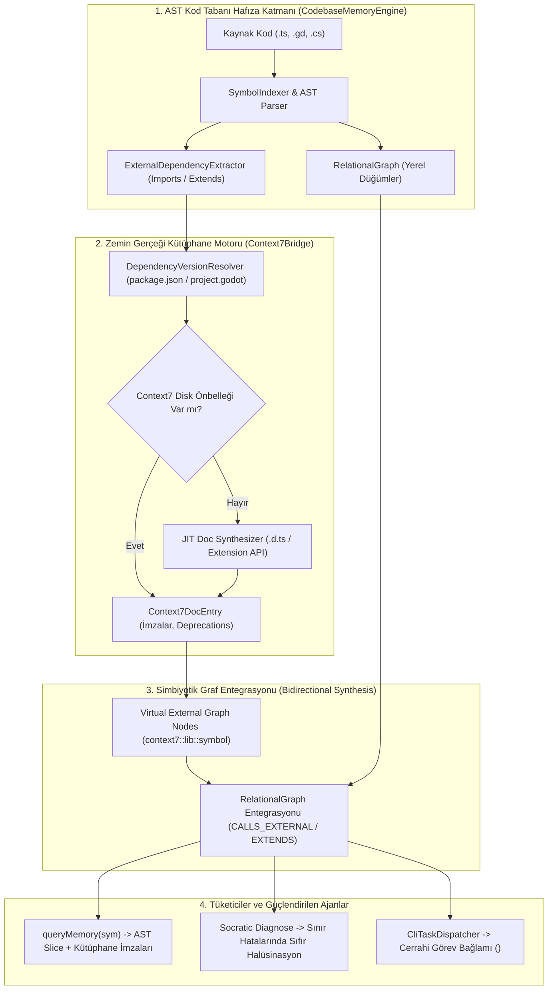

# 🏛️ RFC-016: Dynamic Symbiotic Substrate: Context7Bridge & CodebaseMemoryEngine Bidirectional Synthesis
### Aegis Autonomous Architecture Blueprint

- **RFC ID:** RFC-016 | **Durum:** Proposed | **Tarih:** 2026-10-27
- **Hedef Paketler:** `@aegis/ast-skeleton`, `@aegis/github-live`, `@aegis/dialogue-engine`, `@aegis/cli`
- **İlgili Tartışma:** [GitHub Discussion #238](https://github.com/frkntlr/aegis/discussions/238)

---

## 🔍 1. Fikir ve Problem Tanımı (Vision & Core Problem)

### Mevcut Durum ve Mimari Boşluk (Current Architecture & Gaps)
Aegis mimarisinde `@aegis/ast-skeleton` (CodebaseMemoryEngine) ve `@aegis/github-live` (Context7Bridge) motorları, sistemin iki ana bilgi sütununu oluşturur. Ancak aralarındaki mevcut iletişim tamamen tek yönlü, gevşek bağlı ve statik bir geri çağırma (callback) fonksiyonundan ibarettir:
`docProvider?: (library: string, topic: string) => string | null`

Bu yüzeysel mimari şu 4 temel aksaklığı doğurmaktadır:
1. **Statik ve Kaba Eşleme (Coarse-Grained Heuristic):** `MemoryAdapterResolver`, hedef dosyanın TypeScript olup olmadığını ve `/test|assert/` içerip içermediğini basit regex ile kontrol eder. Gerçek AST'deki zengin tip ve sınıf ilişkilerini dikkate almaz.
2. **Kütüphane Körlüğü (Third-Party Blind Spots):** Projeye yeni bir npm paketi (`zod`, `pino`, `fast-glob`) veya Godot eklentisi dahil edildiğinde, Context7 bunu statik haritalarında bulamaz ve `null` döner.
3. **Grafiksel İzolasyon (Graph Isolation):** `RelationalGraph` yalnızca yerel projenin iç sembollerini düğüm olarak saklar. Kodda çağrılan `move_and_slide()` (Godot) veya `z.object()` (npm) gibi harici kütüphane fonksiyonları grafiğe dahil edilmez; bu nedenle etki alanı (blast radius) veya çağrılanlar (callees) harici sözleşmelerden yoksundur.
4. **Sınır Hatalarında Halüsinasyon (Boundary Exception Blindness):** `socratic_diagnose` ve `DialogueEngine` bir runtime hatası incelediğinde, yerel kaynak kod ile çağrılan kütüphanenin resmi tip/parametre sözleşmesini aynı anda çapraz sorgulayamamaktadır.

### Önerilen Çözüm: Dinamik Simbiyotik Bilgi Alt-Katmanı (Proposed Solution)
`Context7Bridge` ve `CodebaseMemoryEngine`'i birbirinden bağımsız iki modül olmaktan çıkarıp, birbirini besleyen **İki-Yönlü Simbiyotik Bilgi Alt-Katmanı (Dynamic Symbiotic Substrate)** haline getirmek:
- **Aşağıdan-Yukarıya (Bottom-Up):** `CodebaseMemoryEngine`, AST'den ayrıştırdığı harici importları ve miras (extends) hiyerarşisini `Context7Bridge`'e aktarır.
- **Yukarıdan-Aşağıya (Top-Down):** `Context7Bridge`, `RelationalGraph` içerisine harici sanal zemin gerçeği düğümleri (`context7::<lib>::<symbol>`) enjekte eder.
- **Yerel JIT Sentezi (Offline JIT Doc Synthesis):** Bilinmeyen harici paketlerin `.d.ts` ve Godot Extension API tanımları yerel olarak anında katlanarak iskelet dokümantasyona dönüştürülür.
- **Sokratik Triangülasyon:** Hata ayıklama sırasında yerel kod dilimi ile kütüphanenin resmi sözleşmesi çapraz denetlenerek sıfır-halüsinasyonlu teşhis üretilir.

---

## 🏗️ 2. Düğüm & Bileşen Mimarisi (Architectural Topology)

### 5 Ana Mimari Sütun (The 5 Pillars)

#### 1. `ExternalDependencyExtractor` (AST-Güdümlü Bağımlılık Ayrıştırıcı)
- Dosya indekslenirken `import`, `require`, `extends`, `implements` ve `preload()` ifadelerini AST düzeyinde yakalar.
- Çıkarılan harici sembolleri hedef kütüphane ismiyle eşleştirir (`@aegis/ast-skeleton` -> `ExternalDependencyExtractor`).

#### 2. `VirtualGroundTruthNode` & `RelationalGraph` Harici Düğüm Entegrasyonu
- `RelationalGraph` yapısına `NodeType.EXTERNAL_DOC` ve `EdgeType.CALLS_EXTERNAL`, `EdgeType.EXTENDS_FRAMEWORK` eklenir.
- Bir fonksiyon `CharacterBody2D.move_and_slide()` çağırdığında, grafikte doğrudan `context7::godot4::CharacterBody2D::move_and_slide` düğümüne yönlendirilir.

#### 3. `JitDocSynthesizer` (Çevrimdışı JIT Dokümantasyon Sentezleyicisi)
- Hazır şablonlarda bulunmayan yeni paketler için `node_modules/<pkg>/package.json` içerisindeki `types` (`.d.ts`) dosyasını bulur.
- `SkeletonGenerator` ile `.d.ts` dosyasından yalnızca dışa aktarılan arayüzleri cerrahi olarak çıkarır; `.aegis/cache/context7/<pkg>.json` dosyasına kaydeder.
- Sıfır internet ihtiyacı, anında çevrimdışı zemin gerçeği!

#### 4. `ReactiveCacheSyncer` (Olay-Güdümlü Önbellek Senkronizasyonu)
- `CodebaseMemoryWatcher`, `package.json` veya `project.godot` dosyalarında bir güncelleme gördüğünde Context7 önbelleğini hedefli olarak geçersiz kılar.

#### 5. `SymbioticDiagnosticTriangulator` (Sokratik Hata Teşhisi Bütünleşmesi)
- Runtime veya derleme hatası oluştuğunda kütüphane çağrısı ile yerel kod arasındaki imza uyumsuzluklarını ve amorti edilmiş (deprecated) fonksiyonları anında teşhis eder.

---

## ⚡ 3. Performans ve Token Verimlilik Analizi

| Metrik | Geleneksel RAG / LLM Arama | Mevcut Ayrık Mimari | Dinamik Simbiyotik Alt-Katman |
| :--- | :--- | :--- | :--- |
| **Harici Kütüphane Çözümleme** | Tüm dokümanı bağlama basar (~4,000 token) | Statik 1-2 şablon veya null | **Cerrahi imza + uyarı (~40-80 token)** |
| **Bağlam Tasarrufu** | %0 | Yanıltıcı / Eksik | **%95+ Token Tasarrufu** |
| **Yeni Paket Desteği** | Model eğitim sınırına bağımlı | Desteklenmez (null) | **Yerel `.d.ts` JIT Sentezi (Evrensel)** |
| **Sorgu Gecikmesi** | 1,500 - 3,000 ms (Ağ/LLM) | <1 ms (Yerel) | **<4 ms (AST + Önbellekli Sanal Düğüm)** |
| **Kırıcı Değişiklik Tespiti** | Tahmini (Halüsinatif) | Yüzeysel regex | **Deterministik AST Karşılaştırması** |

---

## 🔒 4. Demir Kafes ve Mimari Standartlar

1. **Katı Dosya ve Fonksiyon Sınırları:**
   - Eklenecek her yeni servis sınıfı maksimum 300 satır ve fonksiyon başına maksimum 40 satır olacaktır.
2. **Paket Sınırları ve Dependency Inversion:**
   - `@aegis/ast-skeleton`, `@aegis/github-live` paketine doğrudan sıkı bağımlılık oluşturmayacak; `GroundTruthDocAdapter` arayüzü ile polimorfik olarak beslenecektir.
3. **Bellek Bütçesi & Sanal Düğüm Sınırı:**
   - Harici graf düğümleri bellek şişmesini önlemek amacıyla LRU önbellek (maksimum 500 harici düğüm) ile sınırlandırılacaktır.
4. **%100 Mutasyon Testi Başarısı:**
   - `JitDocSynthesizer`, `ExternalDependencyExtractor` ve `SymbioticDiagnosticTriangulator` için asgari %70 (hedef %100) mutant imha skoru zorunludur.

---

## 🎯 5. Kabul Kriterleri (Acceptance Criteria)

- [ ] **Aşama 1 (AST Extraction):** `ExternalDependencyExtractor` ile `.ts`, `.gd` ve `.cs` dosyalarındaki harici import/extends ilişkileri AST'den çıkarıldı.
- [ ] **Aşama 2 (Graph Virtual Nodes):** `RelationalGraph` harici kütüphane sanal düğümlerini (`EXTERNAL_DOC`) ve çağrı kenarlarını (`CALLS_EXTERNAL`) destekleyecek şekilde genişletildi.
- [ ] **Aşama 3 (JIT Synthesis):** `JitDocSynthesizer` yerel `node_modules` `.d.ts` dosyalarını parse edip token-tasarruflu Context7 JSON önbelleğine dönüştürdü.
- [ ] **Aşama 4 (Memory Query Entegrasyonu):** `queryMemory` çağrısı yerel AST dilimiyle birlikte çağırdığı harici fonksiyonların Context7 zemin gerçeği imzalarını tek yanıtta döndürdü.
- [ ] **Aşama 5 (Socratic Diagnostic Triangulation):** `socratic_diagnose` kütüphane sınırındaki çökmeleri yerel kod ve harici imza ile çaprazlayarak doğruladı.
- [ ] **Aşama 6 (Kalite Kapısı):** Demir Kafes (%100 Clean) ve Mutasyon Testi (%100 Kill Score) başarıyla tamamlandı.
