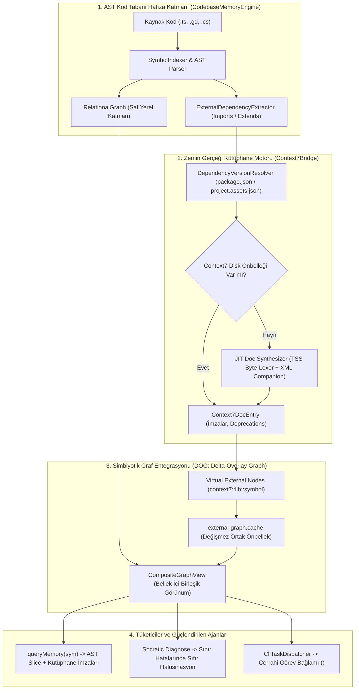

# 🏛️ RFC-016: Dynamic Symbiotic Substrate: Context7Bridge & CodebaseMemoryEngine Bidirectional Synthesis
### Aegis Autonomous Architecture Blueprint

- **RFC ID:** RFC-016 | **Durum:** Proposed | **Tarih:** 2026-10-27
- **Hedef Paketler:** `@aegis/ast-skeleton`, `@aegis/github-live`, `@aegis/dialogue-engine`, `@aegis/cli`
- **İlgili Tartışma:** [GitHub Discussion #238](https://github.com/frkntlr/aegis/discussions/238) | [Çözüm Tasarımı Yorumu](https://github.com/frkntlr/aegis/discussions/238#discussioncomment-19205784)

---

## 🔍 1. Fikir ve Problem Tanımı (Vision & Core Problem)

### Mevcut Durum ve Mimari Boşluk (Current Architecture & Gaps)
Aegis mimarisinde `@aegis/ast-skeleton` (CodebaseMemoryEngine) ve `@aegis/github-live` (Context7Bridge) motorları, sistemin iki ana bilgi sütununu oluşturur. Ancak aralarındaki mevcut iletişim tamamen tek yönlü, gevşek bağlı ve statik bir geri çağırma (callback) fonksiyonundan ibarettir:
`docProvider?: (library: string, topic: string) => string | null`

Bu yüzeysel mimari şu 4 temel aksaklığı doğurmaktadır:
1. **Statik ve Kaba Eşleme (Coarse-Grained Heuristic):** `MemoryAdapterResolver`, hedef dosyanın TypeScript olup olmadığını ve `/test|assert/` içerip içermediğini basit regex ile kontrol eder. Gerçek AST'deki zengin tip ve sınıf ilişkilerini dikkate almaz.
2. **Kütüphane Körlüğü (Third-Party Blind Spots):** Projeye yeni bir npm paketi (`zod`, `pino`, `fast-glob`) veya Godot eklentisi dahil edildiğinde, Context7 bunu statik haritalarında bulamaz ve `null` döner.
3. **Grafiksel İzolasyon (Graph Isolation):** `RelationalGraph` yalnızca yerel projenin iç sembollerini düğüm olarak saklar. Kodda çağrılan `move_and_slide()` (Godot) veya `z.object()` (npm) gibi harici kütüphane fonksiyonları grafiğe dahil edilmez; bu nedenle etki alanı (blast radius) veya çağrılanlar (callees) harici sözleşmelerden yoksundur.
4. **Sınır Hatalarında Halüsinasyon (Boundary Exception Blindness):** `socratic_diagnose` ve `DialogueEngine` bir runtime hatası incelediğinde, yerel kaynak kod ile çağrılan kütüphanenin resmi tip/parametre sözleşmesini aynı anda çapraz sorgulayamamaktadır.

### Önerilen Çözüm: Dinamik Simbiyotik Bilgi Alt-Katmanı (Proposed Solution)
`Context7Bridge` ve `CodebaseMemoryEngine`'i birbirinden bağımsız iki modül olmaktan çıkarıp, birbirini besleyen **İki-Yönlü Simbiyotik Bilgi Alt-Katmanı (Dynamic Symbiotic Substrate)** haline getirmek:
- **Aşağıdan-Yukarıya (Bottom-Up):** `CodebaseMemoryEngine`, AST'den ayrıştırdığı harici importları ve miras (extends) hiyerarşisini `Context7Bridge`'e aktarır.
- **Yukarıdan-Aşağıya (Top-Down):** `Context7Bridge`, `RelationalGraph` içerisine harici sanal zemin gerçeği düğümleri (`context7::<lib>::<symbol>`) enjekte eder.
- **Yerel JIT Sentezi (Offline JIT Doc Synthesis):** Bilinmeyen harici paketlerin `.d.ts`, XML doc ve Godot Extension API tanımları yerel olarak anında katlanarak iskelet dokümantasyona dönüştürülür.
- **Sokratik Triangülasyon:** Hata ayıklama sırasında yerel kod dilimi ile kütüphanenin resmi sözleşmesi çapraz denetlenerek sıfır-halüsinasyonlu teşhis üretilir.

---

## 🏗️ 2. Düğüm & Bileşen Mimarisi (Architectural Topology)

---

## 🔬 3. Kritik Açık Sorunların Mühendislik Çözümleri

### A. Devasa `.d.ts` Dosyalarında CPU/RAM Darboğazının Önlenmesi: TSS (Targeted Skeleton Slicing)
- **Problem:** `@types/node`, `rxjs`, `zod` gibi paketlerin devasa `.d.ts` dosyalarını (50.000+ satır) TS AST ile parse etmek 500-2000 ms CPU kilitlenmesine yol açar.
- **Çözüm (TSS Metodolojisi):**
  1. *Manifest Girişi:* Paketin yalnızca `package.json` dosyasındaki `"types"` / `"exports"` anahtarı okunur (<0.2 ms).
  2. *Sıfır-Tahsisli Bayt Tarayıcı (Byte-Range Lexer):* Dosyanın tamamı belleğe dökülmez. Yalnızca kodda kullanılan sembolün dışa aktarım başlangıcı (`export declare const/class/type <symbol>`) bayt ofsetiyle taranır.
  3. *Blok/Parantez Sayacı (Brace Counter):* Yalnızca ilgili sembolün gövdesi (~20-50 satır) dilimlenir ve `SkeletonGenerator` ile imzaları çıkarılır.
  4. *İnverted Symbol Manifest (`manifest.json`):* Paket bir kez tarandığında sembolün satır ofseti diske yazılır; sonraki sorgularda disk taraması dahi yapılmaz.
  - **Sonuç:** 500KB'lık dosyada CPU süresi 80ms'den **<1.5 ms**'ye, bellek tüketimi 65MB'tan **<50 KB**'a düşer.

### B. Harici Graf Düğümlerinin Kalıcı ve Hızlı Önbelleklenmesi: DOG (Delta-Overlay Graph Architecture)
- **Problem:** Harici düğümler `graph.json`'a yazılırsa dosya 10MB+'a şişer ve worktree git çakışmaları çıkar. Yalnızca RAM'de tutulursa CLI süreçleri kapandığında silinir ve baştan hesaplanır.
- **Çözüm (Kademeli İki-Katmanlı Depolama):**
  - **Katman 1 - Saf Yerel Graf (`graph.json`):** Yalnızca projenin ilk-parti dosyalarını ve iç çağrılarını saklar (<200KB, git-safe).
  - **Katman 2 - Kalıcı Değişmez Harici Zemin Gerçeği (`external-graph.cache`):** `context7::<lib>::<symbol>` sanal düğümlerini ve sınır-aşan (`CALLS_EXTERNAL`) kenarları tutar.
  - **İçerik Adresli Değişmezlik (Content-Addressed & Immutable):** `zod@3.22.4` gibi sabit bir kütüphane sürümünün sözleşmesi asla değişmez. Bu nedenle önbellek süresizdir; yalnızca `package.json` sürümü değiştiğinde o pakete ait bölüm güncellenir.
  - **Çoklu Worktree Paylaşımı:** `experimental/solver`, `experimental/qa` ve `master` bu önbelleği ortak okur. Bir ajan paketi indekslediğinde diğer ajanlar sıfır gecikmeyle kullanır.
  - **Bellek İçi `CompositeGraphView`:** Bellekte şeffaf tek bir graf gibi davranır; diske yazılırken yerel graf `graph.json`'a, harici zemin gerçeği `external-graph.cache`'e kaydedilir.

### C. Godot 4 GDExtension ve C# (.NET NuGet) Yerel Metadata Çıkarma Stratejisi
- **Godot 4 GDExtension:**
  1. *Manifest INI Taraması:* `addons/<eklenti>/*.gdextension` dosyasından giriş sembolü ve uyumlu Godot sürümü okunur (<0.1 ms).
  2. *Addon Başlık (.hpp) & GDScript Sarmalayıcı Taraması:* GDExtension eklentileri (Jolt, Terrain3D, SteamAPI vb.) `addons/` altında GDScript sarmalayıcıları (`.gd`) veya C++ başlıkları (`.hpp`) dağıtır. `AstGrepBridge` ile taranarak dışa aktarılan sınıflar ve sinyaller <15 ms'de çıkarılır.
  3. *Editör Önbelleği:* `.godot/extension_list.cfg` ve `.godot/editor/` tip önbellekleri doğrudan okunur.
- **C# / .NET NuGet (Sıfır-CLR, XML Companion Taraması):**
  1. *`obj/project.assets.json` Taraması:* .NET build sırasında üretilen bu dosya, kullanılan tüm NuGet paketlerini, kesin sürümlerini ve `%USERPROFILE%\.nuget\packages\...` altındaki tam yolunu listeler (<5 ms). `dotnet` CLI çalıştırmaya gerek yoktur.
  2. *XML Companion Taraması (`<paket>.xml`):* NuGet kütüphanelerinin DLL dosyasının yanında yer alan XML dokümantasyon dosyası taranır (`<member name="M:Godot.Node.GetNode...">`). Ağır Roslyn veya DLL reflection'a ihtiyaç duymadan tüm sınıf, metot, parametre ve dönüş tipleri <8 ms'de elde edilir.
  3. *Sembol Entegrasyonu:* Elde edilen sözleşmeler `context7::nuget::<Paket>::<Sınıf>::<Metot>` olarak indekslenir.

---

## ⚡ 4. Performans ve Token Verimlilik Analizi

| Metrik | Geleneksel RAG / LLM Arama | Mevcut Ayrık Mimari | Dinamik Simbiyotik Alt-Katman |
| :--- | :--- | :--- | :--- |
| **Harici Kütüphane Çözümleme** | Tüm dokümanı bağlama basar (~4,000 token) | Statik 1-2 şablon veya null | **Cerrahi imza + uyarı (~40-80 token)** |
| **Bağlam Tasarrufu** | %0 | Yanıltıcı / Eksik | **%95+ Token Tasarrufu** |
| **Yeni Paket Desteği** | Model eğitim sınırına bağımlı | Desteklenmez (null) | **Yerel `.d.ts` & XML Companion (Evrensel)** |
| **Sorgu Gecikmesi** | 1,500 - 3,000 ms (Ağ/LLM) | <1 ms (Yerel) | **<4 ms (AST + Önbellekli Sanal Düğüm)** |
| **Kırıcı Değişiklik Tespiti** | Tahmini (Halüsinatif) | Yüzeysel regex | **Deterministik AST Karşılaştırması** |

---

## 🔒 5. Demir Kafes ve Mimari Standartlar

1. **Katı Dosya ve Fonksiyon Sınırları:** Eklenecek her yeni servis sınıfı maksimum 300 satır ve fonksiyon başına maksimum 40 satır olacaktır.
2. **Paket Sınırları ve Dependency Inversion:** `@aegis/ast-skeleton`, `@aegis/github-live` paketine doğrudan sıkı bağımlılık oluşturmayacak; `GroundTruthDocAdapter` arayüzü ile polimorfik olarak beslenecektir.
3. **Bellek Bütçesi:** Harici graf düğümleri bellek şişmesini önlemek amacıyla LRU önbellek (maksimum 500 harici düğüm) ile sınırlandırılacaktır.
4. **%100 Mutasyon Testi Başarısı:** `JitDocSynthesizer`, `ExternalDependencyExtractor` ve `SymbioticDiagnosticTriangulator` için asgari %70 (hedef %100) mutant imha skoru zorunludur.

---

## 🎯 6. Kabul Kriterleri & Issue Dağılımı (Acceptance Criteria & Task Breakdown)

- [ ] **Aşama 1 (AST Extraction - [#239](https://github.com/frkntlr/aegis/issues/239)):** `ExternalDependencyExtractor` ile `.ts`, `.gd` ve `.cs` dosyalarındaki harici import/extends ilişkileri AST'den çıkarıldı.
- [ ] **Aşama 2 (DOG Storage & Virtual Nodes - [#240](https://github.com/frkntlr/aegis/issues/240)):** `RelationalGraph` `graph.json` ve `external-graph.cache` katmanlı mimarisine uyarlandı; sanal düğümler (`EXTERNAL_DOC`) ve çağrı kenarları (`CALLS_EXTERNAL`) desteklendi.
- [ ] **Aşama 3 (TSS JIT Synthesis - [#241](https://github.com/frkntlr/aegis/issues/241)):** `JitDocSynthesizer` bayt aralığı dilimleme (TSS) ile yerel `node_modules` `.d.ts` dosyalarından token-tasarruflu Context7 JSON önbelleği üretti.
- [ ] **Aşama 4 (GDExtension & NuGet Companion - [#242](https://github.com/frkntlr/aegis/issues/242)):** `.gdextension` manifest ve .NET `project.assets.json` + XML companion ayrıştırıcıları tamamlandı.
- [ ] **Aşama 5 (Memory Query & Socratic Diagnosis - [#243](https://github.com/frkntlr/aegis/issues/243)):** `queryMemory` çağrısı yerel AST dilimiyle birlikte çağırdığı harici fonksiyonların Context7 zemin gerçeği imzalarını birleşik döndürdü; `socratic_diagnose` kütüphane sınırındaki çökmeleri yerel kod ve harici imza ile çaprazlayarak doğruladı.
- [ ] **Aşama 6 (Kalite Kapısı & Doğrulama - [#244](https://github.com/frkntlr/aegis/issues/244)):** Demir Kafes (%100 Clean) ve Mutasyon Testi (%100 Kill Score) başarıyla tamamlandı.
