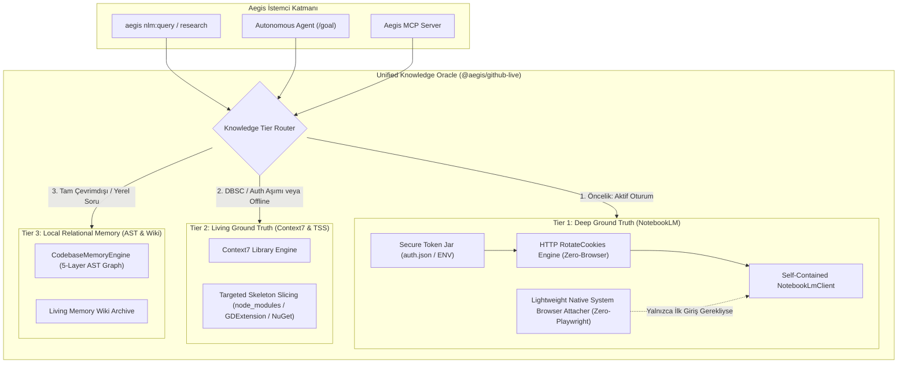

# 📑 RFC-017: Zero-Chromium Resilient NotebookLM Bridge & Multi-Tier Knowledge Oracle Substrate

* **Durum:** Proposed (Gözden Geçiriliyor) 🔍
* **Tarih:** 2026-10-27
* **Yazar:** Antigravity AI Engine & frkntlr
* **Kategori:** Mimari & Entegrasyon (`@aegis/github-live`, `@aegis/cli`, `@aegis/ast-skeleton`)
* **GitHub Discussion:** [#245](https://github.com/frkntlr/aegis/discussions/245)

---

## 1. 📋 Yönetici Özeti (Executive Summary)

Aegis'in otonom karar alma, mimari araştırma (`aegis nlm:research`) ve proje zemin bilgisi sorgulama (`aegis nlm:query`) süreçlerinde Google NotebookLM kritik bir "Ground-Truth Oracle" rolü üstlenmektedir. Ancak mevcut entegrasyonda ciddi teknik borçlar, kırılgan bağımlılıklar ve ağır çalışma zamanı maliyetleri tespit edilmiştir:

1. **Ağır Chromium & Playwright Bağımlılığı:** Oturum doğrulama ve DBSC (Device Bound Session Credentials) aşımı için Playwright üzerinden ~400MB Chromium ikilisinin indirilmesi zorunlu kılınmakta; bu durum >500MB RAM tüketimine, 3-6 saniye soğuk başlatma (cold-start) gecikmesine, headless/CI ortamlarında çökmelere ve `.notebooklm-mcp/browser-data` kilitlenme (`EBUSY`) hatalarına yol açmaktadır.
2. **Kırılgan Göreli Yol Bağımlılığı (`../notebooklm/notebooklm-mcp-server`):** `NotebookLmResearchEngine` ve `nlm-command`, proje dışındaki bir klasöre sabitlenmiştir. Git Worktree (`experimental/solver`, `experimental/qa`) altında veya izole ortamlarda `process.cwd()` değiştiği için bağlantı tamamen kopmaktadır.
3. **Kademeli Yedekleme (Fallback) Eksikliği:** NotebookLM oturumu süresi dolduğunda veya Google RPC sınırında hata alındığında tüm `/goal` ve otonom döngüler kurtarılamaz biçimde çökmektedir.

Bu RFC, **Chromium bağımlılığını tamamen ortadan kaldıran (Zero-Chromium)**, hafif CDP (Chrome DevTools Protocol) ve doğrudan HTTP `RotateCookies` mekanizmalarını içeren, harici klasör bağımlılıklarını izole bir iç modüle (`@aegis/github-live`) taşıyan ve **Kademeli 3-Katmanlı Bilgi Kahini (Unified Multi-Tier Knowledge Oracle)** mimarisini sisteme kazandıran köklü bir çözümü tanımlar.

---

## 2. 🔍 Mevcut Durum ve Sorun Analizi (Root Cause Analysis)

### 2.1. Playwright / Chromium Ağır Yükü ve Kilitlenme (EBUSY)
Mevcut `notebooklm-mcp-server/src/browserBridge.ts` ve `auth.ts` mimarisi:
- Her istekte veya arka plan sorgusunda `chromium.launchPersistentContext()` çağrısı yapar.
- Headless çalışsa dahi arka planda tam bir V8 motoru ve render hattı ayağa kalkar (~400MB-800MB RAM).
- Aynı anda hem Aegis CLI, hem Antigravity MCP sunucusu, hem de bir arka plan ajanı sorgu attığında Chromium profil dizini (`browser-data`) Windows üzerinde kilitlenir (`EBUSY: resource locked`) ve işlem askıda kalır.
- CI/CD ve uzak sunucu (SSH) ortamlarında grafik sunucusu (X11/Wayland) veya Chromium bulunmadığından testler derhal çöker.

### 2.2. DBSC (Device Bound Session Credentials) ve Oturum Döngüsü
- Google, oturum çalınmasını engellemek için tarayıcı TPM anahtarına bağlı DBSC ve dönen oturum anahtarları (`__Secure-1PSIDTS`) kullanmaktadır.
- Ancak bu anahtarlar, geçerli bir `SID` ve `SAPISID` mevcut olduğu sürece Google'ın `https://accounts.google.com/RotateCookies` uç noktasına doğrudan saf HTTP POST isteği yapılarak da yenilenebilmektedir (`client.ts` içindeki `rotateCookies()` fonksiyonu bunu kanıtlamaktadır).
- Buna rağmen doğrulama ve köprüleme için gereksiz yere tüm bir Chromium örneği canlı tutulmaktadır.

### 2.3. Göreli Dizin Çökmesi (Worktree Path Invalidation)
`packages/core/github-live/src/research-engine.ts` (Satır 20):
```typescript
const local = path.resolve(process.cwd(), '..', 'notebooklm', 'notebooklm-mcp-server', 'dist', 'client.js');
```
Kök dizinde çalışırken `c:\work\aegis\..\notebooklm` yoluna giderken; izole bir çalışma ağacında (`c:\work\aegis\experimental\solver`) çalıştırıldığında `c:\work\aegis\experimental\..\notebooklm` yolunu aramakta ve modülü bulamayarak otonom döngüyü kırmaktadır.

---

## 3. 🏛️ Hedef Mimari: Resilient Zero-Chromium Substrate



### 3.1. Katman 1: Tamamen Kendi Kendine Yeten İstemci (`Self-Contained NotebookLmClient`)
- Harici `../notebooklm/notebooklm-mcp-server` klasörüne olan tüm bağımlılıklar sonlandırılır.
- `@aegis/github-live/src/notebooklm/` altına temiz, tür güvenlikli (0 `any`), Demir Kafes uyumlu (<300 satır/dosya, <40 satır/fonksiyon) bir `NotebookLmNativeClient` inşa edilir.
- Ağır `pdf-parse` veya gereksiz dev bağımlılıklar soyutlanır.

### 3.2. Katman 2: Sıfır-Chromium Saf HTTP Oturum Yönetimi (`Zero-Chromium HTTP Session Engine`)
1. **Ortam Değişkeni & Token Enjeksiyonu:**
   - `.aegis/auth/notebooklm.json` veya `NOTEBOOKLM_SESSION` ortam değişkeninden oturum çerezleri okunur.
2. **Saf HTTP Üzerinden `RotateCookies`:**
   - Tarayıcı açılmadan, `accounts.google.com/RotateCookies` servisine JSON-RPC isteği gönderilerek `__Secure-1PSIDTS` anahtarı arka planda <100ms içinde otomatik olarak yenilenir.
   - Dosya sistemi kilitlenmesi veya tarayıcı çakışması riski %0'a indirilir.

### 3.3. Katman 3: Yerel Sistem Tarayıcısına Hafif CDP Bağlantısı (`System Browser Attacher`)
- Eğer kullanıcının hiç token'ı yoksa ve ilk kez giriş yapması gerekiyorsa:
  - Playwright ile 400MB Chromium indirilmez!
  - Windows/macOS/Linux'ta zaten kurulu olan varsayılan Google Chrome veya Microsoft Edge (`msedge.exe` / `chrome.exe`) tespit edilir.
  - Minimal bir WebSocket CDP (Chrome DevTools Protocol) oturumu ile bağlanılır; kullanıcı mevcut profilinde zaten oturum açmış olduğu için çerezler doğrudan ve anında okunur.
  - İşlem bittiğinde hiçbir arka plan süreci askıda bırakılmaz.

### 3.4. Katman 4: Kademeli Bilgi Kahini (`Unified Knowledge Oracle`)
- Eğer Google uç noktası geçici olarak erişilemez, IP kısıtlamasına takılmış veya oturum geçersizleşmişse:
  - İstek anında **Context7 Ground-Truth** katmanına devredilir (Tier 2).
  - Yerel kod ilişkileri için **CodebaseMemoryEngine** (Tier 3) devreye girer.
  - Ajan veya kullanıcıya `[SOURCE: Context7 / Local AST Fallback]` etiketiyle doğrulanmış yanıt üretilir, işlem asla çöpe gitmez veya yarıda kesilmez.

---

## 4. 📋 Görev Ayrıştırma Taslağı (Implementation Roadmap)

1. **[#246](https://github.com/frkntlr/aegis/issues/246) - `feat(github-live): implement self-contained NotebookLmNativeClient and MultiRootTokenResolver`:**
   - Harici bağımlılıkları ortadan kaldıran, Worktree dostu, saf HTTP destekli istemcinin oluşturulması.
2. **[#247](https://github.com/frkntlr/aegis/issues/247) - `feat(github-live): implement Zero-Chromium HttpRotateEngine for headless session recovery`:**
   - `accounts.google.com/RotateCookies` üzerinde saf HTTP tabanlı oturum yenileme ve çerez havuzu yönetimi.
3. **[#248](https://github.com/frkntlr/aegis/issues/248) - `feat(github-live): implement NativeBrowserCdpAttacher for zero-download system browser discovery`:**
   - Playwright/Chromium indirmesini kaldıran; mevcut Chrome/Edge tarayıcılarına hafif CDP ile bağlanan modül.
4. **[#249](https://github.com/frkntlr/aegis/issues/249) - `feat(github-live): implement UnifiedKnowledgeOracle with cascading 3-tier fallback`:**
   - NotebookLM -> Context7 -> CodebaseMemoryEngine kademeli yedekleme mimarisi.
5. **[#250](https://github.com/frkntlr/aegis/issues/250) - `feat(cli): refactor aegis nlm:query and nlm:research to use UnifiedKnowledgeOracle`:**
   - CLI komutlarının yeni altyapıya geçirilmesi, headless bayrakları ve `--offline` desteği.
6. **[#251](https://github.com/frkntlr/aegis/issues/251) - `test(verification): comprehensive mutation testing gate and Demir Kafes compliance audit`:**
   - 0 `any`, %100 mutant imha skoru, 28/28 monorepo test doğrulaması ve master'a atomik birleştirme.

---

## 5. 🛡️ Demir Kafes & Güvenlik Kriterleri
- **Dosya ve Fonksiyon Sınırları:** Her dosya <= 300 satır, her fonksiyon <= 40 satır.
- **Sıfır `any` Prensibi:** Tüm veri yapıları TypeScript arabirimleri ile katı tiplendirilecek.
- **Faz Sınır Kapısı:** Tüm kaynak kod geliştirmeleri izole `experimental/solver` çalışma ağacında yürütülecek, ana dal doğrudan kirletilmeyecektir.
