# 🏛️ RFC-018: Autonomous Deep Research Loop & Freshness Pruning Substrate
### Aegis Autonomous Architecture Blueprint

- **RFC ID:** RFC-018 | **Durum:** Proposed | **Tarih:** 2026-10-27
- **GitHub Discussion:** [#252](https://github.com/frkntlr/aegis/discussions/252)
- **Hedef Paketler:** `@aegis/github-live`, `@aegis/cli`, `@aegis/ast-skeleton`

---

## 🔍 1. Fikir ve Problem Tanımı

Aegis'in 5-Katmanlı Kod Tabanı Belleği (Codebase Memory) ve `UnifiedKnowledgeOracle` mimarisi (RFC-017), harici Chromium bağımlılığını ortadan kaldırarak sıfır indirmeli saf HTTP istemcisine kavuşmuştur. Ancak otonom bilgi üretim ve yaşam döngüsü yönetiminde 5 kritik açık tespit edilmiştir:

1. **Derin Analiz ve Asenkron Polling Eksikliği:** Mevcut motor sadece yüzeysel `mode: fast` (~30 saniye) çalışmaktadır. 40+ teknik kaynağı tarayan 3-5 dakikalık `mode: deep` araştırmalarında CLI zaman aşımı, soket kopması ve terminal kilitlenmesi riskleri bulunmaktadır.
2. **50-Kaynak Sınırı ve Kotanın Patlaması (Quota Exhaustion):** Google NotebookLM'in defter başına azami 50 kaynak sınırı vardır. Her derin araştırma 40 ayrı link eklerse 2. aramada defter dolacak ve API `RESOURCE_EXHAUSTED` hatası verecektir. Ayrıca dağınık web linkleri zemin bilgisinde (grounding context) çöp bilgiye (noise bloat) yol açacaktır.
3. **Kopuk Bilgi Döngüsü (Unclosed Ingestion Loop):** Yapılan araştırmalar defterin kalıcı indeksine aktarılmadığı için, sonraki `nlm:query` sorgularında yapay zeka bu taze araştırmayı görememektedir.
4. **Bilgi Eskimesi ve Yıkıcı Silme Riski (Knowledge Drift & Amnesia):** Eski mimari dokümanlar defterde kaldığında LLM çelişkili yanıtlar üretmektedir. Ancak sadece "tarih eski" diye körlemesine silme yapılırsa kurucu mimari dokümanlar (`RFC-001`, Anayasa) silinip projenin hafızası kaybolabilir.
5. **Oturum Düşmesi ve Ajan Çakışması (In-Flight Auth Expiry & Race Conditions):** 4 dakikalık derin araştırma sırasında oturum çerezi süresi dolabilmekte; eşzamanlı çalışan worktree ajanları (`solver`, `qa`) aynı defter üzerinde yarış durumuna (race condition) girebilmektedir.

Bu RFC; **5 Güvenlik Kalkanı (5-Shield Architecture)** ile donatılmış sıfır Chromium bir derin araştırma, kaynak koruma ve tazelik tasfiye motorunu hayata geçirir.

---

## 🏗️ 2. Düğüm & Bileşen Mimarisi (The 5-Shield Architecture)

```mermaid
flowchart TD
    subgraph Shield1 ["🛡️ Kalkan 1: Kota Koruyucu (Digest-First Ingestion)"]
        S1_DIGEST["Synthesized Digest Source<br/>(40 ham link yerine 1 damıtılmış doküman)"]
        S1_LIMIT{"Kaynak Sayısı >= 45?"}
        S1_LIMIT -- Evet --> S1_BLOCK["İçe Aktarmayı Koru / Prune Uyarısı"]
        S1_LIMIT -- Hayır --> S1_OK["Güvenli İçe Aktar (1 slot harcanır)"]
    end

    subgraph Shield2 ["🛡️ Kalkan 2: Asenkron & Kesintiye Dayanıklı Polling"]
        S2_START["StartResearch (mode: 'deep') -> taskId"] --> S2_DETACH["--detach veya --wait Seçeneği"]
        S2_DETACH --> S2_POLL["Exponential Backoff Polling (10s -> 15s -> 20s -> 30s)"]
        S2_POLL --> S2_RESUME["Idempotent Resume: aegis nlm:import <taskId>"]
    end

    subgraph Shield3 ["🛡️ Kalkan 3: Yıkıcı Olmayan Tasfiye (Tombstone & Pinned Whitelist)"]
        S3_AUDIT["SourceFreshnessAuditor"] --> S3_PIN{"Pinned / Protected mı?"}
        S3_PIN -- Evet --> S3_PROTECT["Dokunulmaz (Silinemez)"]
        S3_PIN -- Hayır --> S3_CHECK{"Status: Superseded mı?"}
        S3_CHECK -- Evet --> S3_DRY["Dry-Run Önizleme & Onay Kilidi"]
        S3_CHECK -- Hayır --> S3_KEEP["Kaynak Korunur"]
        S3_DRY --> S3_DELETE["SourceTombstonePruner (source_delete)"]
    end

    subgraph Shield4 ["🛡️ Kalkan 4: Uçuş Sırasında Kimlik Yenileme (In-Flight Re-Auth)"]
        S4_PRE["Pre-Flight Token Denetimi"] --> S4_RUN["İşlem Yürütme"]
        S4_RUN --> S4_ERR{"401 / 403 Alındı mı?"}
        S4_ERR -- Evet --> S4_ROT["HttpRotateEngine.rotate() Sessizce Yenile"]
        S4_ERR -- Hayır --> S4_DONE["Başarılı"]
        S4_ROT --> S4_RETRY["Aynı taskId ile Yeniden Dene"]
    end

    subgraph Shield5 ["🛡️ Kalkan 5: Çoklu Çalışma Ağacı Kilidi (Cross-Worktree Mutex)"]
        S5_LOCK[".aegis/locks/notebooklm.lock Atomik Dosya Kilidi"]
    end
```

### 2.1. Bileşen Dağılımı ve Görevleri

1. **`NotebookLmNativeClient` Genişletmesi:**
   - `pollResearch(notebookId, taskId)`: Araştırma durumunu, bulunan kaynakları ve sentezi çeken saf HTTP RPC.
   - `addTextSource(notebookId, title, content)`: Sentez raporunu 1 kaynak slotunda deftere enjekte eden RPC.
   - `importResearchSources(notebookId, taskId, sourceIndices)`: Seçici web kaynaklarını ekleyen RPC.
   - `listSources(notebookId)`: Defterdeki kaynakları ID, başlık, tür ve güncelleme tarihiyle listeleyen RPC.
   - `deleteSource(sourceId)`: Belirtilen kaynağı silen RPC.

2. **`NotebookLmDeepResearchWorkflow`:**
   - Polling döngüsünü `10s -> 15s -> 20s -> azami 30s` üstel bekleme (exponential backoff) ile yönetir.
   - CLI'da `--detach` bayrağı verilirse hemen `taskId` dönüp sonlanır; `--wait` ile ilerleme çubuğu göstererek bekler.
   - 40 ham web kaynağı yerine, araştırmanın tüm çıktısını içeren tek bir **"Architectural Research Digest"** dokümanı ekleyerek 50-kaynak kotasını korur.

3. **`SourceFreshnessAuditor` ve `SourceTombstonePruner`:**
   - `pinnedSources` beyaz listesi (Anayasa, Demir Kafes, çekirdek mimari) dokunulmazdır.
   - Bir kaynağın tasfiye edilmesi için sadece "eski olması" yetmez; `docs/rfc/` veya Wiki'de açıkça `Status: Superseded` veya `Status: Obsolete` olarak işaretlenmiş olması zorunludur.
   - Varsayılan olarak `--dry-run` çalışır; silinecek kaynaklar listelenir, `--force` olmadan fiziksel silme yapılmaz.

4. **`LivingMemorySyncBridge` & `UnifiedKnowledgeOracle`:**
   - Deftere eklenen her rapora `[RFC-XXX | YYYY-MM-DD | Active]` metadata başlığı verilir.
   - Oracle prompt katmanına dinamik kısıt eklenir: *"Always ground in the highest version / most recent active RFC. Discard superseded precedents."*

5. **Cross-Worktree Mutex:**
   - `.aegis/locks/notebooklm.lock` dosyası ile `solver`, `qa` ve `docs` ajanlarının defteri aynı anda manipüle etmesi engellenir.

---

## 🔒 3. Demir Kafes Standartları & Güvenlik

- **Azami Satır/Fonksiyon Sınırları:** Tüm yeni kaynak dosyaları <= 300 satır, fonksiyonlar <= 40 satır ve 0 `any` tip kısıtına uyar.
- **Sıfır İndirme (Zero-Chromium):** Tüm yeni RPC'ler saf HTTP `batchexecute` ile çalışır; Chromium veya Playwright asla kullanılmaz.
- **Yıkıcı Eylemlerde Güvenlik:** `prune` komutu varsayılan olarak dry-run çalışır, silme öncesi onay veya `--force` bayrağı zorunludur.

---

## 🎯 4. Kabul Kriterleri (Acceptance Criteria)

- [ ] **Kriter 1 (Saf HTTP Genişletilmiş RPC'ler):** `NotebookLmNativeClient` içinde `pollResearch`, `addTextSource`, `importResearchSources`, `listSources` ve `deleteSource` metodları uygulandı ve mock testleri yazıldı.
- [ ] **Kriter 2 (Kota Koruyucu Digest İçe Aktarma):** `NotebookLmDeepResearchWorkflow`, derin araştırma çıktısını tek bir `Synthesized Digest` dokümanı olarak ekleyerek 50 kaynak kotasını korur; kota doluluğu (%90) durumunda uyarı verir.
- [ ] **Kriter 3 (Asenkron Polling ve Idempotent Resume):** `nlm:research --deep` komutunda exponential backoff ile polling sağlandı; `--detach` bayrağı ile `taskId` dönülmesi ve `aegis nlm:import <taskId>` ile sonradan deftere aktarım doğrulandı.
- [ ] **Kriter 4 (Korumalı Tasfiye & Tombstone Pruner):** `SourceFreshnessAuditor` yalnızca `Status: Superseded` olan dokümanları tasfiye adayı yapar; `pinned` kaynaklara dokunulmaz; varsayılan `--dry-run` modu ile güvenli önizleme sağlanır.
- [ ] **Kriter 5 (Oturum Koruma ve Worktree Mutex):** Derin araştırma öncesi pre-flight token kontrolü ve 401 anında otomatik yeniden deneme uygulandı; `.aegis/locks/notebooklm.lock` ile yarış durumları engellendi.
- [ ] **Kriter 6 (CLI Arayüzü & Geriye Dönük Uyumluluk):** `nlm:research --deep [--detach|--import]`, `nlm:sources`, `nlm:poll <taskId>` ve `nlm:prune [--dry-run|--force]` CLI komutları eklendi.
- [ ] **Kriter 7 (Demir Kafes ve %100 Mutasyon Skoru):** Tüm yeni modüller %100 Demir Kafes (<300 satır, <40 satır, 0 `any`) ve %100 Mutasyon İmha Skoru (Mutation Kill Score) sağladı.
- [ ] **Kriter 8 (İzole Worktree ve Çok Kademeli Birleştirme):** Geliştirme `experimental/solver` çalışma ağacında tamamlandı; monorepo birim testleri (28/28) başarılı oldu ve `master` dalına hızlı-ileri birleştirildi.
