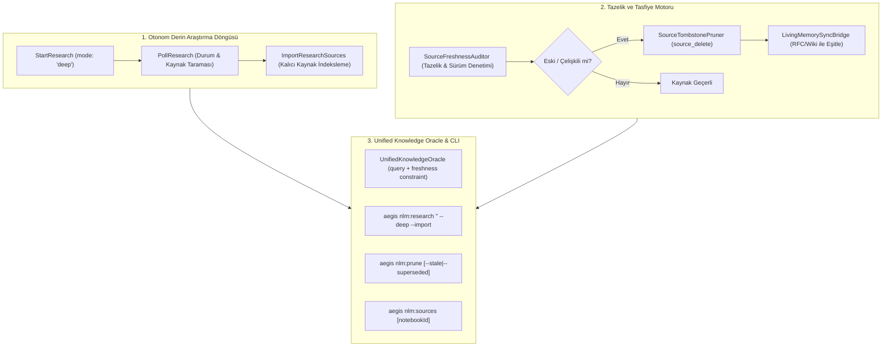

# 🏛️ RFC-018: Autonomous Deep Research Loop & Freshness Pruning Substrate
### Aegis Autonomous Architecture Blueprint

- **RFC ID:** RFC-018 | **Durum:** Proposed | **Tarih:** 2026-10-27
- **GitHub Discussion:** [#252](https://github.com/frkntlr/aegis/discussions/252)
- **Hedef Paketler:** `@aegis/github-live`, `@aegis/cli`, `@aegis/ast-skeleton`

---

## 🔍 1. Fikir ve Problem Tanımı

Aegis'in 5-Katmanlı Kod Tabanı Belleği (Codebase Memory) ve `UnifiedKnowledgeOracle` mimarisi (RFC-017), harici Chromium bağımlılığını ortadan kaldırarak sıfır indirmeli saf HTTP istemcisine kavuşmuştur. Ancak bilgi üretim ve yaşam döngüsü yönetiminde 3 kritik açık mevcuttur:

1. **Derin Analiz Eksikliği (Shallow Research Limitation):** Mevcut `nlm:research` yalnızca `mode: fast` (~30 saniye, 8-12 web kaynağı) çalıştırabilmektedir. 40+ teknik kaynağı tarayan, akademik/mimari derin analiz yapan `mode: deep` (~3-5 dakika) ve durum sorgulama (polling) döngüsü mevcut değildir.
2. **Kopuk Bilgi Döngüsü (Unclosed Ingestion Loop):** Yapılan araştırmalar ekrana yazdırılmakta veya Wiki'ye basılmakta; ancak Google NotebookLM'in kendi kalıcı kaynak havuzuna (`research_import`) aktarılmamaktadır. Bu nedenle yapay zeka, bir sonraki `nlm:query` sorgusunda bu taze araştırma kaynaklarını zemin (grounding) olarak kullanamamaktadır.
3. **Bilgi Eskimesi ve Çelişkili Bağlam (Knowledge Drift & Stale Context):** Kod tabanında ve mimaride yapılan yenilikler (ör. RFC-016 Symbiotic Cache, RFC-017 Zero-Chromium Bridge) sonrasında, defterde kalan eski RFC'ler veya önceki Godot 3 dokümanları temizlenmemektedir. NotebookLM her iki kaynağı da gördüğünde çelişkili (hallucinated/stale) yanıtlar üretmektedir.

Bu RFC; **Derin Araştırma (Deep Research)**, **Otonom Kaynak İçe Aktarma (Source Ingestion)** ve **Eski Bilgi Tasfiyesi (Tombstone Pruning)** yeteneklerini sıfır Chromium prensibiyle Aegis motoruna kazandırmayı amaçlar.

---

## 🏗️ 2. Düğüm & Bileşen Mimarisi (Component Breakdown)

### 2.1. `NotebookLmDeepResearchWorkflow`
- **Sıfır Chromium Polling Döngüsü:** `StartResearch(mode: 'deep')` RPC'si tetiklendikten sonra 10 saniyelik aralıklarla Google Labs Tailwind `PollResearch` RPC'sini sorgulayarak 40+ adede kadar bulunan kaynakları toplar.
- **Toplu İçe Aktarma (`ImportResearchSources`):** Araştırma tamamlandığında kaynak listesini doğrudan Google RPC `ImportDiscoveredSources` yüküne dönüştürerek hedef deftere kalıcı kaynak olarak ekler.

### 2.2. `SourceFreshnessAuditor` & `SourceTombstonePruner`
- **Tazelik Analizi:** Defterdeki kaynakların başlıklarındaki zaman damgalarını (`[vX.Y | YYYY-MM-DD]`), URL içerik tazeliğini ve yerel RFC durumlarını denetler.
- **Hükmünü Yitirmiş Doküman Tasfiyesi (Superseded Eviction):** `docs/rfc/` altında "Superseded" veya "Obsolete" durumuna geçen eski mimari dokümanlar tespit edilir ve NotebookLM'den `DeleteSource` RPC ile atomik olarak silinir.
- **Çelişki Bastırma:** Eski Godot 3 veya eski motor kalıntıları temizlenerek defterin daima "Tek Doğru Gerçek Kaynağı" (Single Source of Truth) kalması sağlanır.

### 2.3. `UnifiedKnowledgeOracle` Genişletmesi
- Sorgulama sırasında en güncel kaynakları önceliklendiren ve çelişkili eski sürümleri bastıran semantik prompt kısıtları eklenir:
  `"Prefer the latest architecture (vX.Y / current year). Discard obsolete or superseded conventions."`

---

## 🔒 3. Demir Kafes Standartları & Güvenlik

- **Azami Satır/Fonksiyon Sınırları:** Tüm yeni modüller <300 satır/dosya, <40 satır/fonksiyon ve 0 `any` kuralına uyar.
- **Sıfır İndirme (Zero-Chromium):** Yeni RPC'ler (`PollResearch`, `ImportResearchSources`, `DeleteSource`, `ListSources`) doğrudan `NotebookLmNativeClient`'ın saf HTTP `batchexecute` katmanına eklenir.
- **Geriye Dönük Uyumluluk:** Mevcut `nlm:query` ve `nlm:research` varsayılan argümanları korunur; yeni özellikler `--deep`, `--import`, `--prune` bayraklarıyla opt-in çalışır.

---

## 🎯 4. Kabul Kriterleri (Acceptance Criteria)

- [ ] **Kriter 1 (Deep Research RPC):** `NotebookLmNativeClient` içinde `pollResearch` ve `importSources` RPC yöntemleri saf HTTP ile uygulandı.
- [ ] **Kriter 2 (Otonom Döngü):** `NotebookLmResearchEngine`, `mode: 'deep'` durumunda polling yaparak kaynakları toplar ve `--import` ile deftere kalıcı olarak ekler.
- [ ] **Kriter 3 (Tazelik & Tasfiye):** `SourceFreshnessAuditor` ve `SourceTombstonePruner` sınıfları eski kaynakları tespit eder ve `DeleteSource` ile güvenli şekilde kaldırır.
- [ ] **Kriter 4 (CLI Genişletmesi):** `aegis nlm:research --deep --import`, `aegis nlm:sources` ve `aegis nlm:prune` komutları eklendi.
- [ ] **Kriter 5 (Demir Kafes & Mutasyon Skoru):** Yeni modüller %100 Demir Kafes (<300 satır, <40 satır, 0 `any`) ve %100 Mutasyon İmha Skoru (Mutation Kill Score) sağladı.
- [ ] **Kriter 6 (Çok Kademeli Birleştirme):** Geliştirme izole `experimental/solver` çalışma ağacında tamamlandı, monorepo testleri eksiksiz geçti ve `master` dalına aktarıldı.
