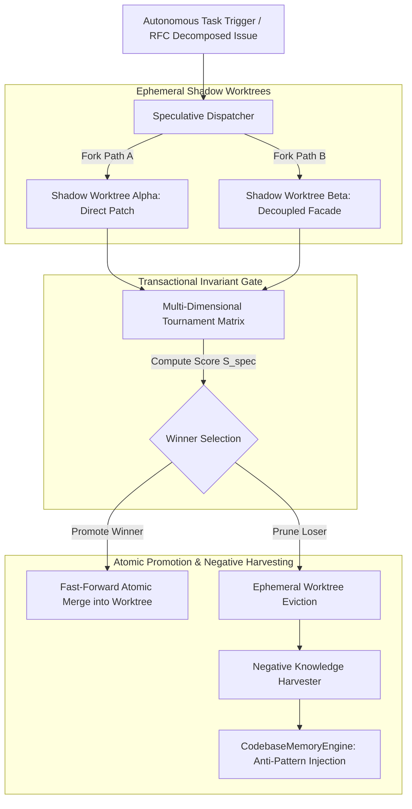

# RFC-019: Speculative Multi-Agent Execution & Transactional Invariant Verification Substrate

- **Status:** Proposed
- **Author:** Aegis Autonomous Vibe Coding Engine
- **Target Subsystem:** `@aegis/orchestrator`, `@aegis/compound-checker`, `@aegis/github-live`, `@aegis/cli`
- **Related Discussions:** [#259](https://github.com/frkntlr/aegis/discussions/259), [#252](https://github.com/frkntlr/aegis/discussions/252)
- **Living Memory Specification:** `wiki/RFC-019-Speculative-Execution-Substrate.md`

---

## 1. Executive Summary & Context

Aegis has established a deterministic foundation for autonomous software engineering through:
- **Demir Kafes (Iron Cage):** Structural complexity and file budget gates (<300 lines/file, <40 lines/function, 0 `any`).
- **5-Layer Codebase Memory & Context7:** Ground-truth symbol resolution and dynamic library retrieval.
- **Socratic Evidence-Based Debugging:** Zero-assumption diagnostic triangulation.
- **Zero-Chromium Resilient Knowledge Oracle:** Persistent NotebookLM integration and deep research loops.

However, existing autonomous agents—including Aegis—remain bound to a **sequential trial-and-error execution model**:
1. An agent receives a task in an isolated worktree.
2. It chooses a single hypothesis, writes code, and runs tests.
3. If an unforeseen design flaw, type divergence, or test failure occurs, the agent enters an iterative correction loop.
4. **The Trial-and-Error Stall:** Complex refactoring or ambiguous root causes can trap the agent in compounding error loops, ballooning diff budgets and wasting tokens.
5. **The Verification Bottleneck:** In high-velocity autonomous coding, writing code is instantaneous; verifying architectural invariants and selecting optimal implementations is the primary bottleneck.

**RFC-019 introduces the Speculative Multi-Agent Execution & Transactional Invariant Verification Substrate.** Borrowing principles from microprocessor branch prediction, transactional memory, and recent 2025/2026 AI systems research (e.g., Microsoft PASTE, Sandboxed Speculation, and Tournament Selection), Aegis will execute competing implementation hypotheses in parallel ephemeral shadow worktrees, evaluate them via a deterministic invariant tournament, atomically promote the winning patch, and harvest negative telemetry from aborted trials into long-term Codebase Memory.

---

## 2. Core Architectural Pillars

### Pillar 1: Dynamic Shadow Worktrees (Ephemeral Sandboxes)
- Rather than testing ambiguous hypotheses sequentially, the orchestrator forks the task into $K$ speculative branches (typically $K=2$ or $K=3$).
- Ephemeral Git worktrees are spawned under `.aegis/shadow/spec-<taskId>-<hash>` sharing the underlying `.git` object store with zero repo duplication.
- Each shadow worktree executes in strict process isolation with independent scratch buffers and timeouts.

### Pillar 2: Pre-Execution Invariant Synthesis (Contract Gates)
- Before speculative execution begins, the orchestrator synthesizes deterministic invariant contracts directly from the RFC acceptance criteria and Demir Kafes rules:
  - $\mathcal{I}_1$ (Kafes Integrity): Max file lines $\le 300$, max function lines $\le 40$, 0 `any`.
  - $\mathcal{I}_2$ (Test Pass): 100% monorepo unit test pass without skipped suites.
  - $\mathcal{I}_3$ (Mutation Gate): Minimum 80% mutation kill score across touched files.
  - $\mathcal{I}_4$ (Diff Budget): Surgical diff headroom $\Delta_{\text{diff}} \le \text{Threshold}$.
  - $\mathcal{I}_5$ (Runtime Budget): Total verification execution time $T \le T_{\text{max}}$.

### Pillar 3: Multi-Dimensional Tournament Selection Matrix
The competing speculative branches are scored via a deterministic objective composite function:

$$\mathcal{S}_{\text{spec}} = w_1 \cdot \mathcal{V}_{\text{tests}} + w_2 \cdot \mathcal{M}_{\text{kill}} + w_3 \cdot \mathcal{D}_{\text{kafes}} - w_4 \cdot \frac{\Delta_{\text{diff}}}{\Delta_{\text{limit}}} - w_5 \cdot \frac{T_{\text{exec}}}{T_{\text{max}}}$$

Where:
- $\mathcal{V}_{\text{tests}} \in \{0, 1\}$: Binary test pass verification.
- $\mathcal{M}_{\text{kill}} \in [0, 1]$: Mutation testing kill ratio.
- $\mathcal{D}_{\text{kafes}} \in [0, 1]$: Iron cage compliance ratio.
- $\Delta_{\text{diff}}$: Total surgical diff lines added or changed.
- $T_{\text{exec}}$: Execution wall-clock latency.
- Weights $w = [0.35, 0.25, 0.20, 0.10, 0.10]$ prioritizing correctness and mutation immunity over raw speed.

### Pillar 4: Commit Barrier & Transactional Atomic Promotion
- Speculative operations remain strictly behind a **Commit Barrier**.
- The winning branch is atomically fast-forward merged into the target worktree (`experimental/solver`) or `master`.
- Defeated or disqualified shadow branches are instantly pruned from disk (`git worktree remove --force`), preventing workspace pollution.

### Pillar 5: Negative Knowledge Harvesting (Failure Telemetry Mining)
- Rejected or failing speculative paths contain invaluable telemetry regarding dead ends, subtle compiler traps, and API incompatibilities.
- The `NegativeKnowledgeHarvester` parses failing test assertions and stack traces via `CliEvidenceProvider`.
- Extracts an **Anti-Pattern Constraint** and records it directly into `CodebaseMemoryEngine`:
  - *Example:* `"Approach [X] failed on Symbol [Y]: caused circular reference in EventBus. Avoid [X] for this module."*
- Ensures neither the winning agent nor future sibling worktrees repeat the identified dead end.

---

## 3. Failure Mode & Edge Case Analysis

| ID | Failure Mode | Severity | Mitigation & Architectural Guard |
| :--- | :--- | :--- | :--- |
| **FM-1** | **Shadow Worktree Disk Bloat** | Medium | Ephemeral shadow worktrees are registered with a TTL and auto-cleaned via `try/finally` blocks and `reclaimOrphanShadows()` at startup. |
| **FM-2** | **Token Budget Multiplier** | High | Dynamic Speculation Throttling: Speculation ($K > 1$) is ONLY permitted for tasks flagged as `COMPLEX_REFACTOR` or when Socratic triage detects ambiguity. Straightforward tasks default to $K=1$. |
| **FM-3** | **Tie in Tournament Score** | Low | Deterministic Tie-Breaker: Prefer the branch with the smallest diff budget ($\Delta_{\text{diff}}$), followed by highest mutation score. |
| **FM-4** | **All Speculative Branches Fail** | High | Socratic Circuit Breaker: If all $K$ branches violate invariants, trigger Socratic Diagnostic Gate (`/aegis debug`), dump failure logs to discussion, and suspend task for human triage. |
| **FM-5** | **Concurrent Lock Contention** | Medium | Shadow worktrees inherit read access but use namespaced ephemeral locks (`.aegis/locks/shadow-<id>.lock`). Only the winning branch acquires the primary worktree lock during promotion. |

---

## 4. Phased Implementation Roadmap

- **Phase 0 (Research & Grounding):** Literature review on speculative execution, tournament evaluation, and negative knowledge mining (Completed via NotebookLM & Web Grounding).
- **Phase 1 (Repository Blueprint & Discussion):** Establish RFC-019 specification, publish GitHub Discussion under `Ideas`, and update Living Memory Wiki.
- **Phase 2 (Issue Decomposition):** Decompose RFC-019 into 5 atomic issues:
  1. `feat(orchestrator): implement EphemeralShadowWorktreeManager with auto-cleanup and TTL`
  2. `feat(compound-checker): implement InvariantContractSynthesizer and TournamentEvaluator`
  3. `feat(orchestrator): implement SpeculativeDispatcher with K-branch parallel execution`
  4. `feat(compound-checker): implement NegativeKnowledgeHarvester and anti-pattern memory injection`
  5. `feat(cli): add aegis spec:run and aegis spec:tournament commands with mutation gate verification`
- **Phase 3 (Isolated Implementation):** Execute exclusively within `experimental/solver` under Demir Kafes and 100% mutation testing kill score.
