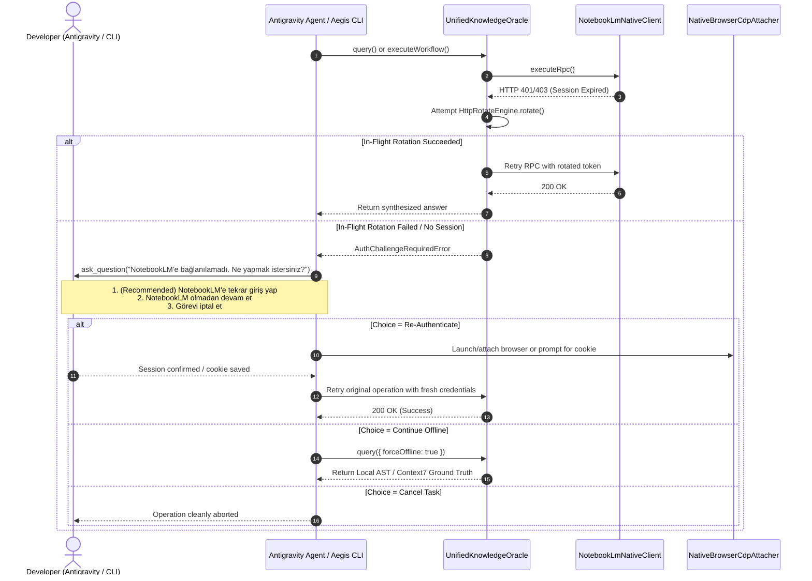

# RFC-020: Interactive Auth Resolution & Tri-State Fallback Protocol for NotebookLM

- **Status:** Proposed
- **Author:** Aegis Autonomous Vibe Coding Engine
- **Target Subsystem:** `@aegis/github-live`, `@aegis/cli`, Antigravity Skills & Protocol Rules
- **Related Discussions:** [#260](https://github.com/frkntlr/aegis/discussions/260), [#259](https://github.com/frkntlr/aegis/discussions/259), [#252](https://github.com/frkntlr/aegis/discussions/252)
- **Living Memory Specification:** `wiki/RFC-020-Interactive-Auth-Resolution-Protocol.md`

---

## 1. Executive Summary & Problem Statement

In **RFC-017** and **RFC-018**, Aegis eliminated the 400MB Chromium dependency by introducing the pure HTTP `NotebookLmNativeClient`, the 5-Shield Deep Research Workflow, and `HttpRotateEngine`.

However, an operational UX blindspot remains when credentials expire or when Google invalidates session cookies (`__Secure-1PSIDTS`, `SID`):
1. **Silent Fallback Ambiguity:** Currently, `UnifiedKnowledgeOracle.query()` silently degrades to Tier 2 (Context7) or Tier 3 (Local AST Living Memory) when NotebookLM returns HTTP 401/403. While resilient, the user is not given a choice: the agent operates in degraded offline mode even when the user would have happily refreshed their session.
2. **CLI Error Dead Ends:** In CLI commands (`nlm:sources`, `nlm:research --deep`, `nlm:prune`), auth failures output a raw error (`❌ Failed to list sources: NotebookLM RPC ... HTTP 400/401`) and terminate without offering an immediate recovery path.
3. **Absence of Interactive Modal in Antigravity:** When Antigravity executes an autonomous workflow, it does not prompt the user via its native interactive question modal (`ask_question`).

**RFC-020 introduces the Tri-State Interactive Auth Resolution Protocol:**
Whenever NotebookLM connection or authentication fails, the engine intercepts the failure and presents an interactive tri-state decision to the developer across both Antigravity chat and CLI TTY:
1. **Option 1 (Re-Authenticate):** Launch browser auth / CDP cookie sniff / interactive paste, update credentials, and seamlessly retry the operation.
2. **Option 2 (Continue Offline):** Explicitly proceed using Local AST Codebase Memory, Living Memory Wiki, and Context7.
3. **Option 3 (Cancel Task):** Cleanly abort the task with zero side-effects.

---

## 2. Interaction Architecture & Workflow



---

## 3. Core Architectural Components

### Pillar 1: Structured `AuthChallengeError` & Hook in `@aegis/github-live`
- Define `NotebookLmAuthError` inheriting from standard `Error`:
  ```ts
  export interface AuthChallengeContext {
    operation: string;
    notebookId?: string;
    statusCode?: number;
    errorDetails: string;
  }
  ```
- Add optional `onAuthChallenge` handler to `OracleQueryOptions` and `NativeClientOptions`:
  ```ts
  export type AuthResolutionAction = 'REAUTH' | 'OFFLINE_FALLBACK' | 'ABORT';
  export type AuthChallengeHandler = (ctx: AuthChallengeContext) => Promise<AuthResolutionAction>;
  ```
- If no handler is provided (e.g. unattended batch CI), defaults to graceful offline degradation with diagnostic warning.

### Pillar 2: Antigravity Interactive Bridge (`ask_question` Protocol)
- Codified into Aegis Agent Rules (`GEMINI.md`) and Skill (`SKILL.md`):
- When an agent triggers a NotebookLM query/workflow and receives an auth challenge:
  - The agent **MUST NOT** proceed silently.
  - The agent **MUST IMMEDIATELY** call the `ask_question` tool with:
    - `question`: `"NotebookLM'e bağlanılamadı. Ne yapmak istersiniz?"`
    - `options`:
      1. `"(Recommended) NotebookLM'e tekrar giriş yap / oturumu yenile"`
      2. `"NotebookLM olmadan (Yerel AST ve Context7 ile) devam et"`
      3. `"Görevi iptal et"`
  - Execute the corresponding pathway strictly based on user selection.

### Pillar 3: Interactive TTY Resolution & `aegis nlm:auth` in `@aegis/cli`
- In `packages/cli/src/commands/nlm-command.ts`:
  - Detect TTY (`process.stdin.isTTY`). If interactive, present terminal menu with the 3 choices.
- Implement dedicated `aegis nlm:auth` command:
  - `--browser`: Spawns system browser with remote debugging port 9222 to capture cookies via CDP.
  - `--paste`: Accepts interactive cookie string or JSON token payload via stdin.
  - `--status`: Inspects current cookie validity, expiration, and SID binding.

---

## 4. Failure Modes & Edge Case Safeguards

| Failure Mode | Severity | Mitigation & Guard |
| :--- | :--- | :--- |
| **Non-Interactive CI Hang** | High | If `process.stdin.isTTY === false` or `CI=true`, interactive prompts are strictly bypassed; auto-degrades to Tier 2/3. |
| **Invalid Cookie Pasted** | Medium | Validation gate parses cookie string, verifies presence of `SID` / `HSID` / `__Secure-1PSIDTS`, and rejects malformed inputs before saving. |
| **Browser Port 9222 Conflict** | Low | Fallback to next available port (e.g. 9223) or prompt user to close conflicting instances. |
| **User Cancels Prompt** | Low | Handled gracefully as `ABORT`; releases mutex locks (`notebooklm.lock`) and exits with clean status 0. |

---

## 5. Decomposed Atomic GitHub Issues

1. **Issue 1 (`feat(github-live)`):** Implement `NotebookLmAuthError`, `AuthChallengeContext`, and interactive challenge hook in `UnifiedKnowledgeOracle` and `NotebookLmNativeClient`.
2. **Issue 2 (`feat(github-live)`):** Implement `SessionCredentialsManager` with cookie validation, format inspection, and safe write-through to `~/.notebooklm-mcp/auth.json`.
3. **Issue 3 (`feat(cli)`):** Implement `aegis nlm:auth` command (`--status`, `--paste`, `--browser`) and interactive TTY fallback prompt in `nlm-command.ts`.
4. **Issue 4 (`feat(skills)`):** Update `GEMINI.md` and `SKILL.md` with the Antigravity `ask_question` Tri-State resolution protocol rule.
5. **Issue 5 (`test(verification)`):** Unit test suite, 100% mutation testing kill score, and Demir Kafes compliance audit (<300 lines/file, <40 lines/function).
