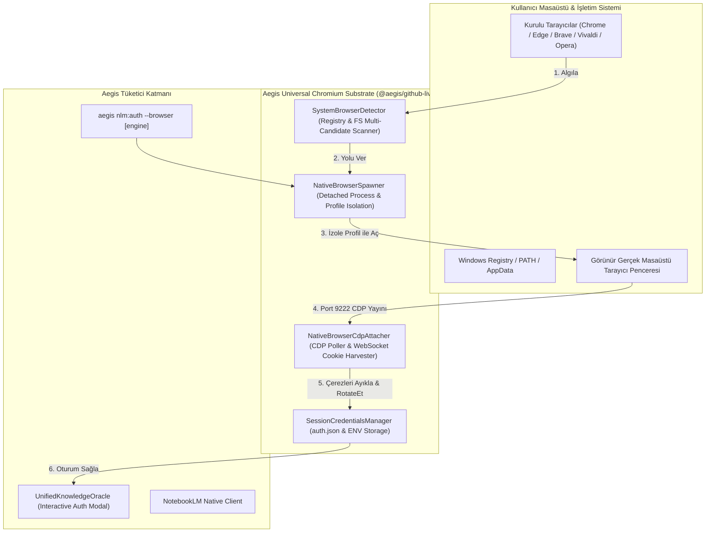

# 🏛️ RFC-021: Universal Chromium Browser Bridge & Interactive CDP Substrate

### Aegis Autonomous Architecture Blueprint

- **RFC ID:** RFC-021 | **Durum:** Approved (Onaylandı) ✅ | **Tarih:** 2026-10-27
- **Yazar:** Antigravity AI Engine & frkntlr
- **Kategori:** Mimari & Entegrasyon (`@aegis/github-live`, `@aegis/cli`)
- **GitHub Discussion:** [#266](https://github.com/frkntlr/aegis/discussions/266)

---

## 🔍 1. Fikir ve Problem Tanımı (Root Cause & Problem Statement)

Google NotebookLM, Aegis'in otonom karar alma, yaşayan hafıza ve derin mimari araştırma (`aegis nlm:research`, `aegis nlm:query`) süreçlerinde en üst düzey Bilgi Kaynağıdır (Ground-Truth Oracle). Ancak mevcut kimlik doğrulama sisteminde kullanıcı deneyimini ve otonom döngüleri kilitleyen kritik sorunlar tespit edilmiştir:

### 1.1. Harici `notebooklm-mcp-server` ve Playwright Kilitlenmesi
1. **Pencerenin Asla Açılmaması:** Playwright'ın `chromium.launchPersistentContext()` çağrısı, IDE içi alt kabuklarda (detached/headless worker) çalıştırıldığında Windows GUI masaüstü oturumuyla eşleşememekte ve `[Status] Loading NotebookLM...` satırında sonsuz döngüde asılı kalmaktadır.
2. **Kukla Tarayıcı Engeli (Google Bot Detection):** Playwright'ın içine gömülü gelen 400MB'lık Chromium ikilisi (`ms-playwright/chromium-1208`), Google hesap servisleri tarafından "Bu tarayıcı veya uygulama güvenli olmayabilir" hatasıyla doğrudan engellenmektedir.
3. **Mevcut Tarayıcı Çakışması:** Kullanıcı Google Chrome veya Microsoft Edge'i zaten masaüstünde açık tutarken harici bir komut ile `chrome.exe --remote-debugging-port=9222` çalıştırıldığında, Chrome yeni bir CDP oturumu açmaz; mevcut çalışan Chrome sürecine bir sekme ekler ve **port 9222 parametresini tamamen yok sayar**. Bu yüzden kullanıcı tarayıcıyı açsa bile arka plandaki CDP dinleyicisine hiçbir veri düşmez.

### 1.2. Çözüm Vizyonu
Aegis, üçüncü parti Playwright paketlerine olan bağımlılığı tamamen kaldırarak; sistemde zaten kurulu olan **herhangi bir Chromium ailesi tarayıcıyı (Google Chrome, Microsoft Edge, Brave, Vivaldi, Opera, Chromium)** doğrudan algılayan, izole bir kullanıcı profili (`--user-data-dir`) ile masaüstünde gerçek bir pencere olarak başlatan ve yerel CDP WebSocket hattı üzerinden güvenli oturum çerezlerini (`SID`, `__Secure-1PSIDTS`, `SAPISID`) sıfır ek yükle yakalayan **Universal Chromium Browser Bridge** motorunu hayata geçirecektir.

---

## 🏗️ 2. Düğüm & Bileşen Mimarisi (Component Breakdown)



### 2.1. Bileşen 1: Gelişmiş Tarayıcı Algılayıcı (`SystemBrowserDetector`)
- Yalnızca sabit yollara güvenmek yerine, Windows Registry (`HKLM\SOFTWARE\Clients\StartMenuInternet`) ve platforma özgü tüm Chromium varyantlarını (Chrome, Chrome Canary, Edge, Brave, Vivaldi, Opera, Opera GX, Chromium) öncelik sırasına göre tarar.
- Kullanıcıya `--browser chrome` veya `--browser edge` parametresiyle tercih hakkı tanır; belirtilmediğinde en kararlı kurulu tarayıcıyı otomatik seçer.

### 2.2. Bileşen 2: İzole Profil Tarayıcı Başlatıcı (`NativeBrowserSpawner`)
- Tarayıcıyı şu hayati parametrelerle `child_process.spawn()` kullanarak başlatır:
  ```bash
  <browser_exe> \
    --remote-debugging-port=9222 \
    --user-data-dir="%USERPROFILE%/.aegis/browser-profiles/<browser-name>" \
    --no-first-run \
    --no-default-browser-check \
    https://notebooklm.google.com
  ```
- `{ detached: true, stdio: 'ignore', windowsHide: false }` ve `child.unref()` yapılandırması sayesinde Windows masaüstünde derhal görünür bir pencere açılır.
- `--user-data-dir` ayrımı sayesinde kullanıcının günlük açık olan Chrome/Edge pencereleriyle çakışma yaşanmaz ve port 9222 kesin olarak dinlemeye başlar.
- Profil dizini kalıcı olduğu için kullanıcı bir defa oturum açtıktan sonra gelecekteki yenilemelerde tekrar şifre girmesine gerek kalmaz.

### 2.3. Bileşen 3: Yerel CDP Çerez Hasatçısı (`NativeBrowserCdpAttacher`)
- `http://127.0.0.1:9222/json/version` adresini 500ms aralıklarla yoklayarak tarayıcının hazır olmasını bekler (azami 20 sn zaman aşımı).
- WebSocket ile bağlanır, `Network.getCookies` çalıştırır.
- `SID` ve `SAPISID` mevcut olduğunda, eksik `__Secure-1PSIDTS` varsa `RotateCookies` HTTP motorunu tetikler.
- Çerezler tamamlandığında `Browser.close` ile tarayıcıyı nazikçe kapatır (veya kullanıcının açık bırakma isteğine göre ayırır).

### 2.4. Bileşen 4: Oturum ve CLI Entegratörü (`handleNlmAuth` & `nlm:auth`)
- `aegis nlm:auth --browser [tarayıcı]` komutu tek satırda tarayıcıyı başlatır, oturumu tamamlar ve sonucu raporlar.
- `ask_question` interaktif arayüzünden "NotebookLM'e tekrar giriş yap" seçildiğinde bu akış otomatik olarak devreye girer.

---

## 🔒 3. Demir Kafes Standartları (Architecture & Code Quality)

1. **Sıfır Dış Bağımlılık (Zero Heavy Deps):** Playwright, Puppeteer veya harici büyük ikililer kesinlikle eklenmeyecektir. Yalnızca Node.js `node:child_process`, `node:http`, `node:fs` ve saf WebSocket kullanılacaktır.
2. **Dosya & Fonksiyon Boyut Sınırları:**
   - Her kaynak dosya en fazla 300 satır.
   - Her fonksiyon en fazla 40 satır.
   - Kesinlikle `any` tipi kullanılmayacak, tip güvenliği tam sağlanacaktır.
3. **İzole Çalışma Ağacı:** Kodlama safhası `experimental/solver` çalışma ağacında yürütülecektir.

---

## 🎯 4. Kabul Kriterleri (Acceptance Criteria)

- [ ] **AC-1 (Evrensel Algılama):** `SystemBrowserDetector`, Edge, Chrome, Brave, Vivaldi ve Opera tarayıcılarını Windows, macOS ve Linux üzerinde başarıyla bulur.
- [ ] **AC-2 (İzole Başlatma):** `NativeBrowserSpawner`, kullanıcının masaüstünde açık tarayıcısı varken dahi bağımsız profil ile yeni bir görünür pencere açar ve 9222 portunu dinlemeye alır.
- [ ] **AC-3 (CDP Dinleme & Çerez Toplama):** `NativeBrowserCdpAttacher`, port 9222 üzerinden NotebookLM çerezlerini WebSocket ile okur ve `SessionCredentialsManager`'a kaydeder.
- [ ] **AC-4 (CLI & E2E Akışı):** `npm run aegis -- nlm:auth --browser` komutu sıfır elle müdahaleyle (kullanıcı sadece tarayıcıda giriş butonuna basarak) doğrulama döngüsünü tamamlar.
- [ ] **AC-5 (Kalite Kapısı):** Demir Kafes kural denetimi (300/40), 0 `any`, %100 birim test başarı oranı ve mutasyon testi onayından geçer.
