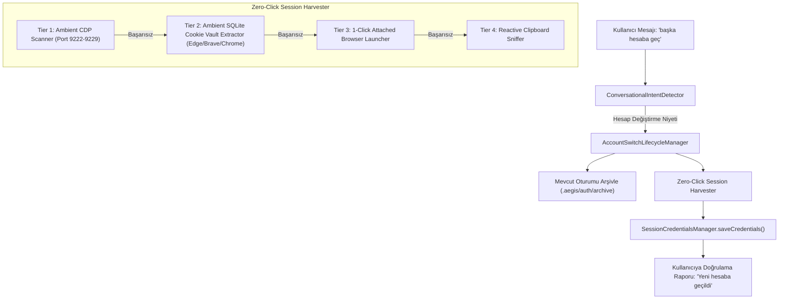

# 🏛️ RFC-022: Zero-Click Ambient Browser Session Harvester and Conversational Account Switching Intent Substrate
### Aegis Autonomous Architecture Blueprint

- **RFC ID:** RFC-022 | **Durum:** Proposed | **Tarih:** 2026-10-27
- **Target Discussion:** [Discussion #272](https://github.com/frkntlr/aegis/discussions/272)

---

## 🔍 1. Fikir ve Problem Tanımı (Motivation & Problem Space)

RFC-021 ile sağlanan Chromium CDP köprüsü ve pano (clipboard) aktarımı önemli bir ilerleme sağlamıştır; ancak kullanıcı deneyimi açısından iki kritik sürtünme noktası (friction point) bulunmaktadır:

1. **Manuel Çerez/cURL Kopyalama Zorunluluğu (Sıfır Efor / Zero-Click İhtiyacı):**
   - Kullanıcı günlük tarayıcısında (Google Chrome, Microsoft Edge, Brave) zaten Google hesabına ve NotebookLM'e giriş yapmış durumdadır.
   - Kullanıcıdan `F12` Geliştirici Araçlarını açıp Console'a `copy(document.cookie)` yazmasını veya Network sekmesinden `Copy as cURL` yapmasını istemek sürtünme yaratmaktadır.
   - **Hedef:** Sistem, kullanıcının bilgisayarında çalışan veya yüklü olan günlük tarayıcı profilini ve açık sekmelerini otomatik taramalı; hiçbir el müdahalesi gerektirmeden (Zero-Click) Google oturum çerezlerini (`SID`, `__Secure-1PSIDTS`, `HSID`, `SAPISID`) çekip yetkilendirmelidir.

2. **Yapay Zeka Doğal Dil Hesap Değiştirme Niyeti (Conversational Account Switching Intent):**
   - Kullanıcı yapay zekaya doğrudan *"başka bir hesaba geçelim"*, *"farklı bir hesapla giriş yap"*, *"hesabı değiştir"* veya *"oturumumu sıfırla"* dediğinde; AI bu niyeti doğal dil bağlamında algılamalıdır.
   - Kullanıcının CLI bayraklarını (`--force`) veya komut parametrelerini ezberlemesine gerek kalmadan, mevcut oturumu güvenle arşivleyip yeni hesap açma akışını (`aegis nlm:switch` / `aegis nlm:auth --browser --force`) otonom olarak tetiklemelidir.

---

## 🏗️ 2. Düğüm & Bileşen Mimarisi (Component Breakdown)

### 2.1. Ambient CDP Auto-Scanner (`ambient-cdp-scanner.ts`)
- Yerel makinede varsayılan veya geliştirici modunda çalışan tarayıcıların portlarını (9222-9229 aralığı) 100 ms içinde tarar.
- `http://127.0.0.1:<port>/json/list` üzerinden `notebooklm.google.com` veya `google.com` açık sekmelerini tespit eder.
- WebSocket CDP bağlantısı kurarak `Network.getCookies` ile oturumu anında hafızaya çeker.

### 2.2. Ambient SQLite Cookie Vault Extractor (`ambient-cookie-vault-extractor.ts`)
- Windows/Linux/macOS üzerinde Edge, Brave ve Chrome'un kullanıcı profili depolama konumlarını tarar:
  - Edge: `%LOCALAPPDATA%\Microsoft\Edge\User Data\Default\Network\Cookies`
  - Brave: `%LOCALAPPDATA%\BraveSoftware\Brave-Browser\User Data\Default\Network\Cookies`
  - Chrome: `%LOCALAPPDATA%\Google\Chrome\User Data\Default\Network\Cookies`
- Dosya kilidini aşmak için veritabanını geçici dizine `FileShare.ReadWrite` akışıyla kopyalar.
- `Local State` dosyasındaki `os_crypt.encrypted_key` anahtarını DPAPI (`CryptUnprotectData`) ile çözer.
- SQLite üzerinden `.google.com` etki alanına ait AES-256-GCM ile şifrelenmiş çerezleri çözer ve geçerli `SID` + `__Secure-1PSIDTS` çiftini elde eder.

### 2.3. Conversational Intent Detector (`conversational-intent-detector.ts`)
- Doğal dildeki hesap değiştirme, oturum sıfırlama veya oturum tazeleme taleplerini regex ve anlamsal kalıplarla tespit eder:
  - `/(başka|farklı|yeni)\s+(hesap|oturum)|hesap\s+değiştir|oturum(u)?\s+(kapat|yenile|sıfırla)|switch\s+account|change\s+account|log\s*out/i`
- Eşleştiğinde kullanıcıyı teknik komutlara yönlendirmek yerine otonom eylem planını başlatır.

### 2.4. Account Switch Lifecycle Manager (`account-switch-lifecycle-manager.ts`)
- Aktif oturumu güvenli bir zaman damgasıyla `.notebooklm-mcp/auth.backup-<timestamp>.json` konumuna arşivler.
- `SessionCredentialsManager` önbelleğini geçersiz kılar (eviction).
- `aegis nlm:switch` veya `aegis nlm:auth --browser --force` akışını tetikler.
- Yeni oturum alındıktan sonra token sağlığını doğrular ve kullanıcıya hangi hesaba geçildiğini onaylar.

---

## 🔒 3. Demir Kafes Standartları (Iron Cage Compliance)

- **Dosya Başına Azami Satır:** 300 satır.
- **Fonksiyon Başına Azami Satır:** 40 satır.
- **Tip Güvenliği:** Sıfır `any` toleransı.
- **Sıfır Ağır Bağımlılık:** Harici native C++ bağımlılığı yok, pure Node.js `crypto`, `child_process`, `fs` ve SQLite/CDP protokolü.
- **Mutasyon Kapısı:** Tüm yeni sınıflar için asgari %70 (hedef %100) Mutant Kill Score.

---

## 🎯 4. Kabul Kriterleri (Acceptance Criteria)

- [ ] **Kriter 1 (Ambient CDP Probe):** Port 9222-9229 üzerinde çalışan bir tarayıcı varsa, sekmelerden NotebookLM çerezleri sıfır tıklamayla çekilebilmelidir.
- [ ] **Kriter 2 (Vault Extractor):** Microsoft Edge ve Brave üzerinde kayıtlı Google çerezleri SQLite + DPAPI üzerinden kullanıcıya hissettirilmeden otomatik çekilebilmelidir.
- [ ] **Kriter 3 (Conversational Intent):** Kullanıcı "farklı bir hesaba geçelim" dediğinde AI bu niyeti algılayıp `AccountSwitchLifecycleManager` üzerinden hesap değiştirme sürecini başlatmalıdır.
- [ ] **Kriter 4 (Oturum Arşivleme & Geri Alma):** Hesap değiştirildiğinde eski oturum ezilmemeli, `.notebooklm-mcp/` altında yedeklenmelidir.
- [ ] **Kriter 5 (Demir Kafes & Testler):** Tüm kodlar Demir Kafes standartlarına uymalı ve birim testler %100 geçmelidir.
