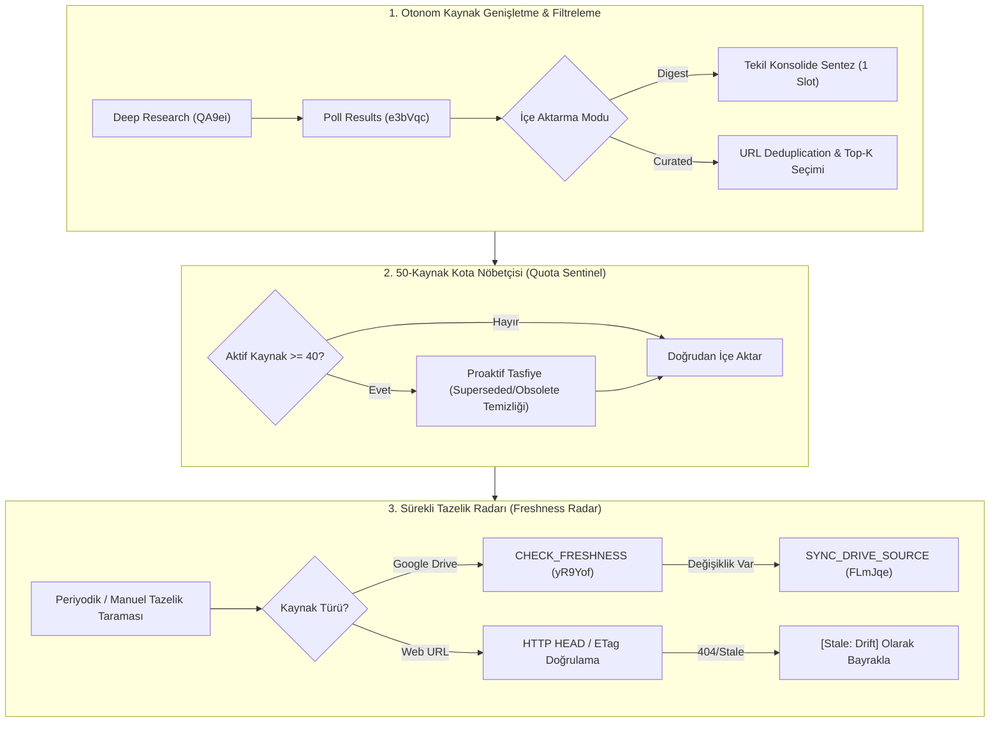

# 🏛️ RFC-023: Autonomous Knowledge Lifecycle Management, Quota Sentinel & Source Freshness Radar
### Aegis Autonomous Architecture Blueprint

- **RFC ID:** RFC-023 | **Durum:** Proposed | **Tarih:** 2026-10-27
- **GitHub Discussion:** [#289](https://github.com/frkntlr/aegis/discussions/289)
- **Hedef Paketler:** `@aegis/github-live`, `@aegis/cli`, `@aegis/ast-skeleton`, `@aegis/shared`

---

## 🔍 1. Fikir ve Problem Tanımı (Research & Grounding)

Google NotebookLM (Gemini Notebook) üzerinde derin arama ve analiz yaparken kaynakların nasıl yönetildiği, güncellendiği, tasfiye edildiği ve güncellik durumlarının nasıl ayarlandığı incelenmiş; otonom ajan ekosistemi için 3 temel mimari gerçeklik ve risk saptanmıştır:

### 1.1. Derin Arama ve Analizde Kaynak Genişletme Davranışı
- **Google NotebookLM Mekanizması:** `mode: 'deep'` (RPC `QA9ei` / `START_DEEP_RESEARCH`) ile web üzerinde çok aşamalı arama yapıldığında bulunan ~40 kaynak **defterin kaynak listesine otomatik olarak eklenmez**. Sonuçlar arama görevinin geçici havuzunda (`e3bVqc` / `POLL_RESEARCH`) bekletilir. Deftere eklenmesi için `LBwxtb` (`IMPORT_RESEARCH` / `research_import`) çağrısının açıkça yapılması şarttır.
- **Problem:** Eğer bir ajan arama sonuçlarını doğrudan deftere kontrolsüzce aktarırsa, her derin aramada 30-40 web kaynağı defteri doldurarak hızla gürültüye (noise bloat) ve kota tükenmesine neden olur.
- **Aegis Çözümü:** Aegis `NotebookLmDeepResearchWorkflow` ile çift mod sunar:
  1. `digest` (Varsayılan): 40 ham link yerine tüm araştırmayı sentezleyen tek bir *"Research Digest: <topic>"* dokümanı eklenir (tam olarak 1 kaynak harcanır).
  2. `curated`: Yalnızca en yüksek alaka düzeyine sahip top-$K$ (varsayılan 5) kaynak filtrelenerek içe aktarılır.

### 1.2. Gereksiz / Eskiyen Kaynakların Tasfiyesi (Garbage Collection & Pruning)
- **Google NotebookLM Mekanizması:** Google platformunda **otomatik kaynak silme veya çöp toplama (GC) mekanizması YOKTUR**. Bir kaynak (URL, Drive belgesi veya metin) manuel olarak silinene kadar sonsuza dek defterde kalır.
- **Kritik Sınır (50-Kaynak Tavanı):** NotebookLM defter başına azami **50 kaynak** sınırına sahiptir. 50 kaynak aşıldığında sistem yeni kaynak eklenmesini engeller (`RESOURCE_EXHAUSTED`).
- **Aegis Çözümü:** Aegis `SourceFreshnessAuditor` ve `SourceTombstonePruner` ile dokunulmaz belgeleri (`PinnedSourceConfig`: Anayasa, Demir Kafes, Core Architecture vb.) koruma altına alır. Yalnızca `Status: Superseded` işaretli RFC'leri ve `[obsolete]` etiketli kaynakları tespit ederek güvenli dry-run sonrası `--force` ile tasfiye eder.

### 1.3. Kaynak Güncelliği ve Tazelik Tespiti (Freshness & Auto-Sync)
- **Google NotebookLM Mekanizması:** Kaynaklar eklendikleri anın **statik görüntüsü (snapshot)** olarak saklanır. Dış dünyada orijinal web sayfası değiştiğinde defter otomatik olarak güncellenmez.
- **Drive Senkronizasyonu:** Google Drive dokümanları (Docs, Sheets, Slides) için Google API `yR9Yof` (`CHECK_FRESHNESS`) ile tazelik sorgulamayı ve `FLmJqe` (`SYNC_DRIVE_SOURCE`) ile en son içeriği çekmeyi destekler. Ancak harici web URL'lerinde otomatik güncelleme bulunmaz; silinip yeniden eklenmesi gerekir.
- **Aegis İhtiyacı:** Sürekli çalışan bir Tazelik Radarı (Freshness Radar) ile Drive kaynaklarının otomatik eşitlenmesi, dış web linklerinin ise HTTP HEAD/ETag ile taranarak kırılan (404/410) veya değişen linklerin tespit edilmesi gereklidir.

---

## 🏗️ 2. Düğüm & Bileşen Mimarisi (AKLM-Substrate)

### 2.1. Temel Bileşenler

1. **`QuotaSentinel` (`@aegis/github-live`):**
   - Derin araştırma veya kaynak ekleme öncesi defter kaynak sayısını denetler ($N / 50$).
   - $N \ge 40$ durumunda alarm üretir ve `SourceTombstonePruner` aracılığıyla korumasız eski kaynakları temizlemek üzere proaktif plan çıkarır.

2. **`SourceFreshnessRadar` (`@aegis/github-live`):**
   - `CHECK_FRESHNESS` (`yR9Yof`) RPC'si ile Drive kaynaklarını denetler.
   - Değişiklik saptandığında `SYNC_DRIVE_SOURCE` (`FLmJqe`) ile içeriği yeniler.
   - Web URL'leri için hafif HTTP HEAD istekleriyle erişilebilirlik ve ETag denetimi yapar.

3. **`NotebookLmNativeClient` Protokol Eşitlemesi:**
   - Empirik Google Labs Tailwind batchexecute RPC haritası (`wXbhsf`, `yR9Yof`, `FLmJqe`, `tGMBJ`, `QA9ei`, `e3bVqc`, `LBwxtb`) ve `https://notebook.google.com` baz URL'i ile yerel MCP sunucusu arasında tam uyum sağlanır.

---

## 💻 3. CLI & MCP Entegrasyonu

| Komut | Açıklama |
| :--- | :--- |
| `aegis nlm:freshness [notebookId] [--sync-drive]` | Tüm kaynakların güncelliğini denetler ve değişen Drive dokümanlarını senkronize eder. |
| `aegis nlm:prune [notebookId] [--force]` | Superseded/Obsolete durumdaki sahipsiz kaynakları güvenle tasfiye eder. |
| `aegis nlm:research "<t>" --deep [--auto-prune]` | Kota nöbetçisi korumalı derin araştırma yapar, gerektiğinde yer açarak sonuçları damıtır. |
| `aegis nlm:sources [notebookId]` | Kaynakları tazelik, koruma (pinned) ve kota doluluk durumlarıyla listeler. |

---

## 🔒 4. Demir Kafes Standartları & Güvenlik

- **Kota ve Satır Limitleri:** Azami 300 satır/dosya, azami 40 satır/fonksiyon, 0 `any` tip kullanımı.
- **Korumalı Beyaz Liste (Pinned Whitelist):** Anayasa, Demir Kafes ve ana mimari kaynakları asla otonom silinemez.
- **Dry-Run İlkesi:** Kaynak tasfiyesi varsayılan olarak dry-run çalışır; fiziksel silme açık `--force` parametresi gerektirir.
- **Headless Git & Ağ Güvenliği:** Git ağ çağrıları ve HTTP RPC istekleri zaman aşımı korumalıdır (hang engeli).

---

## 🎯 5. Kabul Kriterleri (Acceptance Criteria)

- [ ] `QuotaSentinel` entegrasyonu ile 40+ kaynak doluluğunda proaktif uyarı ve tasfiye tetiklendi.
- [ ] `SourceFreshnessRadar` ile Drive dokümanlarında `CHECK_FRESHNESS` ve `SYNC_DRIVE_SOURCE` döngüsü tamamlandı.
- [ ] Dış web kaynakları için URL deduplication ve HTTP HEAD erişilebilirlik doğrulaması eklendi.
- [ ] `NotebookLmNativeClient` Google Labs Tailwind batchexecute RPC kodlarıyla (`yR9Yof`, `FLmJqe`, `tGMBJ`) eşitlendi.
- [ ] Tüm yeni modüller Deterministik Demir Kafes (300/40) ve %100 test onayından geçti.
