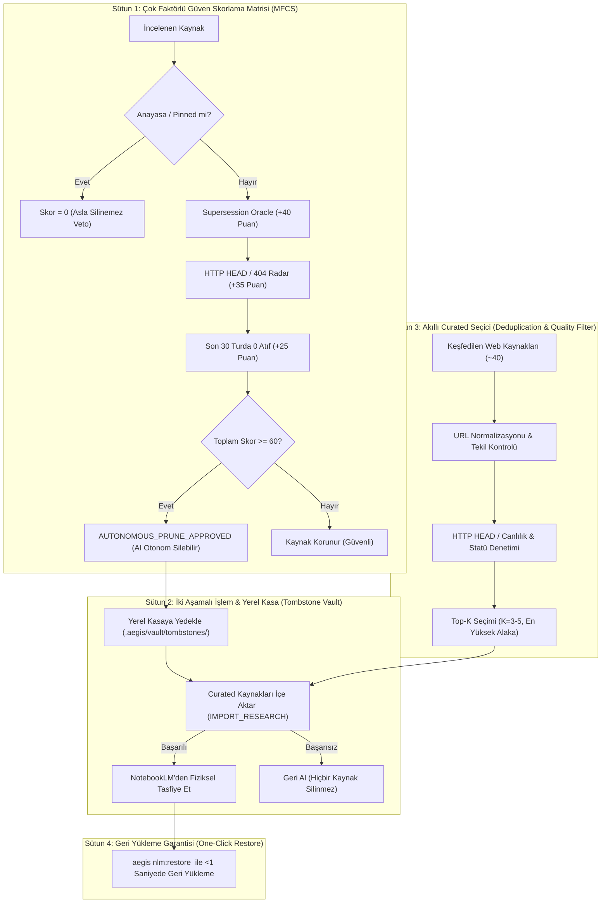

# 🏛️ RFC-023: Autonomous Knowledge Lifecycle Management, Quota Sentinel & Source Freshness Radar
### Aegis Autonomous Architecture Blueprint

- **RFC ID:** RFC-023 | **Durum:** Proposed | **Tarih:** 2026-10-27
- **GitHub Discussion:** [#289](https://github.com/frkntlr/aegis/discussions/289)
- **Hedef Paketler:** `@aegis/github-live`, `@aegis/cli`, `@aegis/ast-skeleton`, `@aegis/shared`

---

## 🔍 1. Fikir ve Problem Tanımı (Research & Grounding)

Google NotebookLM (Gemini Notebook) üzerinde derin arama ve analiz yaparken kaynakların yönetimi, tasfiyesi ve güncelliği incelenmiş; kullanıcının belirlediği iki stratejik yönelim doğrultusunda kapsamlı bir risk ve çözüm mimarisi oluşturulmuştur:
1. **Curated Modunun Varsayılan Olması:** Derin araştırmada keşfedilen en yüksek alaka düzeyli top-$K$ (3–5) web kaynağının filtrelenerek doğrudan notebook'a gerçek kaynak olarak eklenmesi.
2. **Yapay Zeka Kararlı Otonom Tasfiye:** Manuel `--force` ve dry-run engelleri yerine, yapay zekanın (AI) eskimiş/gereksiz kaynakları otonom olarak belirleyip doğrudan silebilecek zekaya kavuşturulması.

### 1.1. Kapsamlı Risk Analizi (Deep Risk Analysis)

| Risk | Tehdit & Mekanizma | Şiddet | Aegis Güvenlik Bariyeri |
| :--- | :--- | :---: | :--- |
| **R1: AI Hafıza Kaybı (Amnesia)** | AI'ın Anayasa, Demir Kafes veya kurucu RFC'leri "eski tarihli" diye yanlışlıkla silmesi. | **Kritik** | **Dokunulmazlık Kalkanı (Hard Veto):** Anayasal anahtar kelimeleri taşıyan kaynaklar için Score = 0 (Asla Silinemez). |
| **R2: Geri Döndürülemez Kayıp** | NotebookLM'in `DELETE_SOURCE` işleminin kalıcı olması ve çöp kutusunun bulunmaması. | **Kritik** | **Yerel Mezar Taşı Kasası (`.aegis/vault/tombstones/`):** Silinmeden önce tam içerik yerelde arşivlenir; `aegis nlm:restore` ile <1 saniyede geri yüklenir. |
| **R3: 50-Kaynak Tavanı Kilitlenmesi** | Curated modda her aramada 3-5 kaynak eklenmesiyle kotanın hızla dolup kilitlenmesi. | **Yüksek** | **Kota Nöbetçisi & Transactional Swap:** $N \ge 40$ olduğunda yeni kaynak eklenmeden önce eski kaynaklar rezerve edilir ve yer açılır. |
| **R4: Düşük Kaliteli / Çöp Web Linkleri** | SEO spamı, 404/410 dönen kırık sayfalar veya boş giriş ekranlarının eklenmesi. | **Orta** | **Akıllı Curated Filtresi:** URL normalizasyonu, deduplication ve HTTP HEAD canlılık testi. |
| **R5: Yarış Durumu & Net Bilgi Kaybı** | Kaynak silindikten sonra yeni kaynak aktarımının ağ hatasıyla çökmesi. | **Yüksek** | **İki Aşamalı İşlem (Two-Phase Commit):** Yeni kaynaklar başarıyla eklenmeden eski kaynaklar NotebookLM'den fiziksel olarak silinmez (Rollback koruması). |

---

## 🏗️ 2. Düğüm & Bileşen Mimarisi (The 4-Pillar AKG Substrate)

### 2.1. Temel Bileşenler ve Görevleri

1. **`AutonomousPruningEngine` (`@aegis/github-live`):**
   - Çok Faktörlü Güven Skorlama Matrisini (MFCS) işletir.
   - Puanı $\ge 60$ olan adayları insan onayı veya `--force` beklemeden otonom tasfiye için onaylar.
   - Dokunulmazlık Kalkanı ile kurucu dosyaları mutlak korur.

2. **`TombstoneVaultManager` (`@aegis/github-live`):**
   - Tasfiye edilecek tüm kaynakların içerik, URL ve metadata'sını `.aegis/vault/tombstones/<sourceId>.json` dizinine arşivler.
   - İki aşamalı takas (Transactional Swap) mantığıyla yeni kaynaklar başarıyla yüklenene kadar fiziksel silmeyi bloke eder.
   - `restore(sourceId)` metoduyla arşivdeki kaynağı anında NotebookLM'e geri yükler.

3. **`CuratedIngestionPipeline` (`@aegis/github-live`):**
   - Derin araştırmada varsayılan olarak çalışır.
   - URL temizleme (tracking param strip) ve notebook içi tekillik denetimi yapar.
   - HTTP HEAD ile 404/ölü siteleri eler, kalanlardan en yüksek puanlı top-$K$ (3–5) kaynağı ekler.

4. **`SourceFreshnessRadar` & Wire Protocol Alignment:**
   - Google Drive kaynaklarını `CHECK_FRESHNESS` (`yR9Yof`) ve `SYNC_DRIVE_SOURCE` (`FLmJqe`) ile otomatik günceller.
   - `NotebookLmNativeClient` RPC ID'lerini (`wXbhsf`, `yR9Yof`, `FLmJqe`, `tGMBJ`, `QA9ei`, `e3bVqc`, `LBwxtb`) doğrudan `https://notebook.google.com` ile eşitler.

---

## 💻 3. CLI & MCP Entegrasyonu

| Komut | Açıklama |
| :--- | :--- |
| `aegis nlm:research "<t>" --deep` | Varsayılan olarak Akıllı Curated Mod ve Otonom Kota Takası (Swap) ile çalışır. |
| `aegis nlm:prune [notebookId]` | Varsayılan olarak AI karar motoruyla $\ge 60$ skorlu kaynakları yerel kasaya yedekleyip otonom tasfiye eder. |
| `aegis nlm:restore <sourceId>` | Yerel Mezar Taşı Kasasından silinmiş bir kaynağı NotebookLM'e anında geri yükler. |
| `aegis nlm:freshness [notebookId]` | Drive dokümanlarını otomatik eşitler ve harici linklerdeki drift/404 durumunu raporlar. |
| `aegis nlm:sources [notebookId]` | Defter kaynaklarını güven skoru, kota doluluk ve yedeklilik durumuyla listeler. |

---

## 🔒 4. Demir Kafes Standartları & Güvenlik

- **Kota ve Satır Limitleri:** Azami 300 satır/dosya, azami 40 satır/fonksiyon, 0 `any` tip kullanımı.
- **Sıfır Veri Kaybı Garantisi:** Fiziksel silme öncesi yerel JSON arşivleme zorunludur.
- **İki Aşamalı Atomik Takas:** İçe aktarım doğrulanmadan silme kesinleştirilmez.

---

## 🎯 5. Kabul Kriterleri (Acceptance Criteria)

- [ ] `CuratedIngestionPipeline` ile derin aramada top 3–5 tekil ve canlı web kaynağının varsayılan eklenmesi sağlandı.
- [ ] `AutonomousPruningEngine` ile Çok Faktörlü Güven Skorlama Matrisi (MFCS, Eşik: 60) uygulandı.
- [ ] `TombstoneVaultManager` ile `.aegis/vault/tombstones/` yerel yedekleme ve `aegis nlm:restore` komutu tamamlandı.
- [ ] İki Aşamalı Atomik Takas (Two-Phase Commit) ile içe aktarım başarısızlığında silmenin geri alınması doğrulandı.
- [ ] Drive `source_check_freshness` ve `source_sync` otomatik döngüsü entegre edildi.
- [ ] Tüm modüller Deterministik Demir Kafes (300/40) ve %100 birim/mutasyon test onayından geçti.
