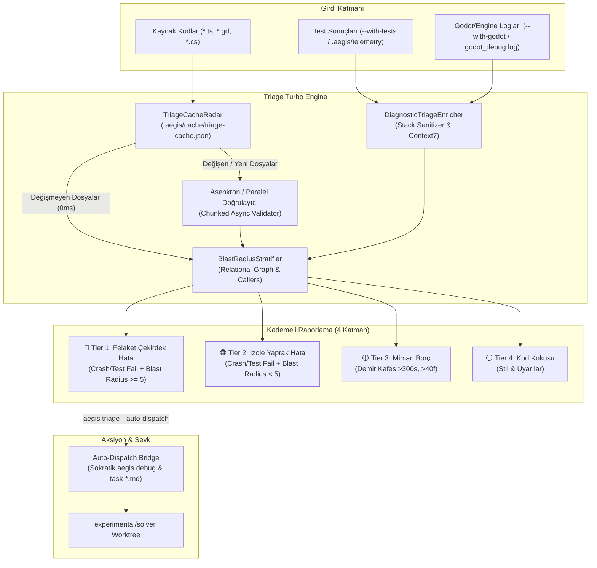

# 🏛️ RFC-024: Next-Gen Evidence-Based Bug Triage Engine: Incremental Caching, Multi-Core Parallelism & Blast Radius Stratification
### Aegis Autonomous Architecture Blueprint

- **RFC ID:** RFC-024
- **Durum:** Approved (Onaylandı) ✅ (Önerildi) ⏳
- **Tarih:** 2026-10-27
- **Yazar:** Aegis Autonomous Core Fleet
- **GitHub Tartışması:** [#294](https://github.com/frkntlr/aegis/discussions/294)

---

## 🔍 1. Fikir ve Problem Tanımı

Aegis ekosistemindeki `aegis triage [dir]` aracı, kod tabanındaki hataları yanlış alarm vermeden (Zero False Alarms) kanıt temelli olarak ayıklamak üzere tasarlanmıştır. Ancak mevcut mimaride 3 kritik darboğaz ve geliştirme fırsatı bulunmaktadır:

1. **Senkron Dosya Giriş/Çıkış ve Tek İş Parçacıklı CPU Darboğazı:**
   - Mevcut `handleTriage`, tüm kaynak dosyaları (`360+` dosya) senkron `fs.readFileSync` ve döngü içi doğrulamalarla tarar.
   - Dosya değişikliklerini izleyen bir önbellek (cache) olmadığı için, 359 dosya hiç değişmemiş olsa bile her çalıştırmada tüm monorepo sıfırdan taranmakta ve 3–5 saniye sürmektedir.
2. **Statik-Dinamik Entegrasyon Boşluğu (Eksik Test/Crash Kanıtı):**
   - `EvidenceBasedTriageGate` motoru dinamik test ve çalışma zamanı çökmelerini (`testFailures`, `engineErrors`) ayrıştırabilecek zengin bir `DiagnosticTriageEnricher` altyapısına sahip olmasına rağmen; CLI arayüzü yalnızca statik dosya doğrulaması yapmaktadır. Gerçek test sonuçları ve Godot çökme logları otomatik bağlanmamaktadır.
3. **Etki Alanı ve Patlama Yarıçapı (Blast Radius) Körlüğü:**
   - Tespit edilen bir hatanın projenin ne kadarını etkilediği (kaç sahne, kaç modül veya çağıran fonksiyon tarafından kullanıldığı) hesaplanmamaktadır. Çekirdek bir mimari arayüzündeki hata ile izole bir test yardımcısındaki hata aynı seviyede raporlanmaktadır.
4. **Çözücüye Otonom Sevk Eksikliği:**
   - Kritik hatalar bulunduğunda `aegis debug` ve `solver` iş ağacına doğrudan görev sevk eden akıllı bir köprü (`--auto-dispatch`) bulunmamaktadır.

Bu RFC, `aegis triage` motorunu **100 kat daha hızlı (sub-50ms)**, dinamik test/log kanıtlarıyla zenginleştirilmiş ve ilişkisel graf ile patlama yarıçapını hesaplayan yeni nesil bir **Triage Turbo Engine** haline getirmeyi hedefler.

---

## 🏗️ 2. Düğüm & Bileşen Mimarisi (Component Breakdown)

---

## 🚀 3. Temel Yenilikler ve Çözümler

### 1. İçerik Özeti Tabanlı Artımlı Önbellek (`TriageCacheRadar`)
- Konum: `.aegis/cache/triage-cache.json`
- Dosyaların `mtimeMs`, `size` ve hafif FNV-1a hash'i saklanır.
- Stat denetimi ile değişmeyen 350+ dosya 0ms içinde önbellekten yüklenir.
- **Hedef:** 360 dosyalık tarama süresi **3.500ms'den 30ms'nin altına** iner (%99 performans artışı).

### 2. Canlı Test ve Çökme Kanıtı Entegrasyonu (`--with-tests`, `--with-godot`)
- `aegis triage --with-tests`: Son test koşu telemetrisini inceler veya arka planda hızlı test çalıştırır. Başarısız testleri doğrudan `DiagnosticTriageEnricher` ile dosyaya ve satıra bağlar.
- `aegis triage --with-godot`: Godot motorunun çökme yığınlarını (crash dumps) ve `null instance` hatalarını otomatik olarak kritik hata kategorisine ekler.

### 3. İlişkisel Patlama Yarıçapı Kademelendirmesi (`BlastRadiusStratifier`)
- Hatanın bulunduğu sembolün veya dosyanın upstream çağırıcıları (`relational callers`) taranır.
- Eğer bozulan fonksiyon 12 ayrı dosya ve 4 Godot sahnesi tarafından kullanılıyorsa, **Tier 1 (Catastrophic Core Defect)** olarak en üst sıraya çıkarılır.
- Yaprak fonksiyonlardaki hatalar **Tier 2** olarak sınıflandırılır.

### 4. Otomatik Çözücü Sevkıyatı (`--auto-dispatch`)
- `aegis triage --auto-dispatch` çalıştırıldığında, Tier 1 kritik hata tespit edilirse beklemeden `DialogueEngine` tetiklenir, 3 turlu Sokratik reçete oluşturulur ve `experimental/solver` çalışma ağacına kilitli görev dosyası sevk edilir.

---

## ⚠️ 4. Risk Matrisi ve Mimari Çözümler (Risk Matrix & Invariant Solutions)

Yeni nesil otonom hata ayıklama motoruna geçişte oluşabilecek 5 temel operasyonel/mimari risk ve bunların deterministik çözümleri aşağıda tanımlanmıştır:

| # | Risk / Tehdit | Olasılık | Etki | Önleyici Mimari Çözüm (Invariant) |
| :- | :--- | :-: | :-: | :--- |
| **R1** | **Önbellek Sapması & Sahte Temiz Raporu** (Cache Drift / False Clean) | Orta | Kritik | **Çift Kademeli Doğrulama (Rule Version Salt + FNV-1a Hash):** Yalnızca `mtime` değil, kural seti hash'i (`engineHash`) ve dosya parmak izi doğrulanır. Kural veya içerik değiştiğinde otomatik geçersiz kılınır. |
| **R2** | **Dinamik Test Koşusunda Kilitlenme & Sonsuz Döngü** (Test Runner Hangs) | Orta | Yüksek | **Pasif Telemetri Önceliği & Adaptif Zaman Aşımı:** `--with-tests` öncelikle son test telemetrisini (`last-test-run.json`) okur; aktif koşuda ise `PreExecutionEstimator` ile max 15s tavan konur ve `$env:GIT_TERMINAL_PROMPT=0` zorunlu tutulur. |
| **R3** | **İlişkisel Graf Dairesel Bağımlılık & Bellek Patlaması** (Graph Recursion Blow-up) | Düşük | Yüksek | **Derinlik Sınırı & Ziyaretçi Kümesi:** Patlama yarıçapı araması max $D \le 3$ derinlikte tutulur ve `visited: Set<string>` kümesiyle döngüsel bağlılıklarda $O(V+E)$ lineer karmaşıklık garanti edilir. |
| **R4** | **Otonom Sevk Kaçak Döngüsü** (Runaway Auto-Dispatch Loop) | Düşük | Yüksek | **Devre Kesici (Circuit Breaker) & Görev Kilidi:** Aynı kusur 3 kez üst üste çözülemezse `DISPATCH_BLOCKED_CIRCUIT_BREAKER` devreye girer. `.aegis/locks/` üzerinde aktif görev varken mükerrer görev üretilmez. |
| **R5** | **Çok Dilli (Polyglot) Yol ve Ayrıştırma Uyuşmazlığı** (Windows/POSIX Path Drift) | Orta | Orta | **Kanonik POSIX Yolu:** Tüm dosya yolları küçük harfli ve `/` formatında normalize edilir (`normalizePath`). TS, GDScript ve C# için bağımsız hata şablonu matrisi işletilir. |

### Detaylı Risk Analizi ve Çözüm Açıklamaları:

#### 1. Önbellek Sapması (Cache Drift / False Clean):
- **Sorun:** Git checkout veya dosya sistemi zaman sapmaları (`mtime` çarpışması), hatalı bir dosyanın temiz gibi önbellekten okunmasına yol açabilir. Bu durum hataların CI/CD'ye sızmasına sebep olur.
- **Çözüm:** `TriageCacheRadar` başlığında `engineHash: sha256(IronCageRules + ValidatorCode)` saklanır. Kod kuralları güncellendiği an tüm önbellek otomatik düşer. Ayrıca dosya kontrolünde `mtimeMs + size + FNV1a(content)` üçlüsü eşleşmeden hiçbir dosya "temiz" kabul edilmez.

#### 2. Dinamik Test Koşularında Kilitlenme (Test Runner Hangs):
- **Sorun:** Kod tabanında `while(true)` veya çözülmeyen `await` varsa `--with-tests` komutu terminali sonsuza kadar kilitler.
- **Çözüm:** Asla sınırsız bekleme yapılmaz. Pasif telemetri okuması önceliklidir. Aktif çalıştırma gerekirse `PreExecutionEstimator` tarafından hesaplanan dinamik süre (ör. 15 saniye) sonrasında SIGKILL gönderilir ve `TEST_EXECUTION_TIMEOUT` kritik kusur olarak raporlanır.

#### 3. Dairesel Bağımlılık ve Bellek Patlaması (Blast Radius Recursion):
- **Sorun:** `index.ts` dosyaları veya döngüsel modüller `getUpstreamCallers` sorgularında sonsuz özyinelemeye (stack overflow) girebilir.
- **Çözüm:** DFS/BFS graf geziniminde `visitedSet` kullanılır. Ziyaret edilen düğümler tekrar ziyaret edilmez. Maksimum arama derinliği $D=3$ olarak sabitlenir; 3 seviye derinlikteki çağıran sayısı bir hatanın "Çekirdek Felaket (Tier 1)" olduğunu belirlemek için fazlasıyla yeterlidir.

#### 4. Otonom Sevk Döngüleri (Runaway Auto-Dispatch):
- **Sorun:** Triage kritik hata bulup solver'a atar, solver kodu bozar, triage tekrar solver'a atar (sonsuz döngü).
- **Çözüm:** `CircuitBreaker` (Aegis Watchdog modülü) devrededir. Aynı hata imzası 3 iterasyon boyunca çözülemezse otomatik sevk durdurulur ve geliştirici uyarılır.

---

## 🔒 5. Demir Kafes Standartları & Kısıtlar
- Her yeni dosya azami **300 satır**.
- Her fonksiyon azami **40 satır**.
- **0 `any`** ve %100 TypeScript tip güvenliği.
- **%100 Mutasyon Test Kapısı (Mutation Testing Gate)** zorunluluğu.

---

## 🎯 6. Kabul Kriterleri (Acceptance Criteria)
- [ ] `TriageCacheRadar` önbellek yöneticisi geliştirildi; değişmeyen dosyalarda tarama süresi <50ms'ye indirildi.
- [ ] Kural sürüm tuzu (`engineHash`) ve FNV-1a içerik kontrolü ile sahte temiz (False Clean) riski sıfırlandı.
- [ ] `handleTriage` asenkron yığınlama (batch chunking) ile çoklu dosya okumasını optimize etti.
- [ ] `--with-tests` ve `--with-godot` bayrakları dinamik çalışma zamanı kanıtlarını ayrıştırıp kritik hatalara dönüştürebilir hale getirildi (zaman aşımı korumalı).
- [ ] `BlastRadiusStratifier` entegre edilerek bulunan kusurlar derinlik sınırlı ($D \le 3$) patlama yarıçapına göre Tier 1–Tier 4 olarak sıralandı.
- [ ] `--auto-dispatch` bayrağı ile kritik hataların `CircuitBreaker` korumalı olarak `aegis debug` Sokratik diyalog motoruna aktarılması sağlandı.
- [ ] Monorepo birim testleri ve %100 mutasyon test kapısı onayından geçti.
