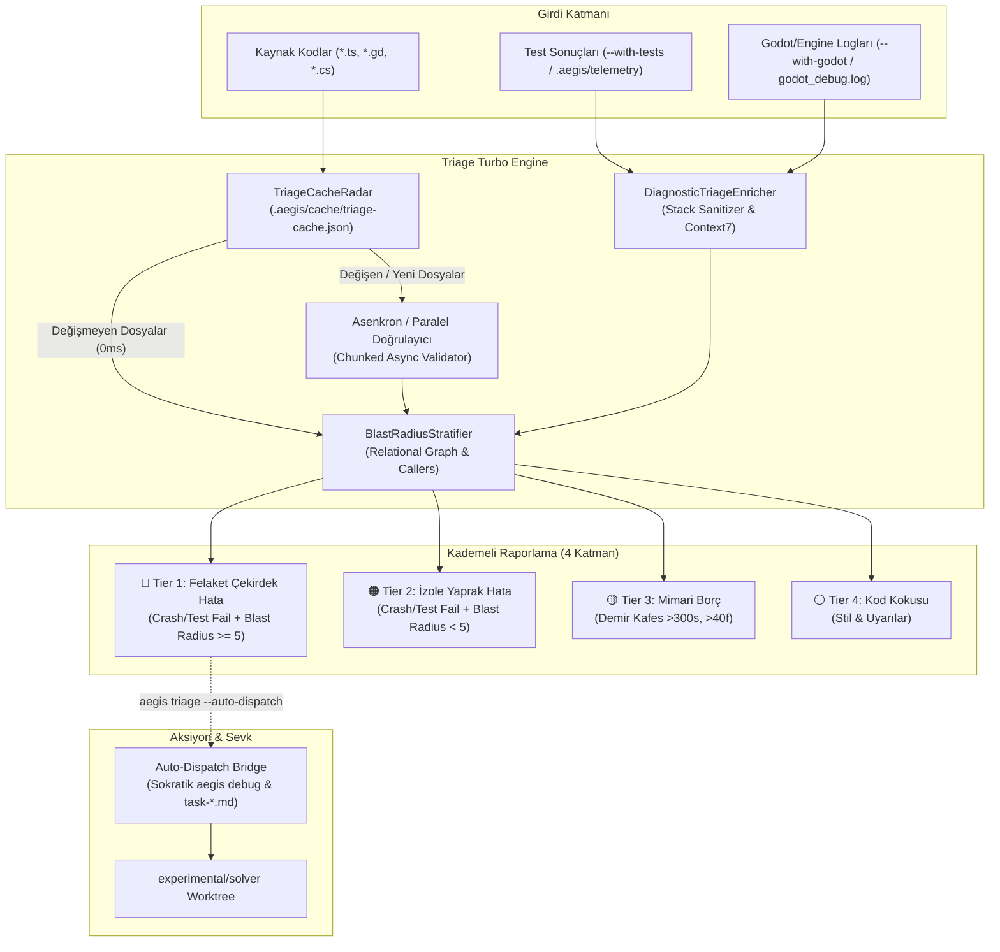

# 🏛️ RFC-024: Next-Gen Evidence-Based Bug Triage Engine: Incremental Caching, Multi-Core Parallelism & Blast Radius Stratification
### Aegis Autonomous Architecture Blueprint

- **RFC ID:** RFC-024
- **Durum:** Proposed (Önerildi) ⏳
- **Tarih:** 2026-10-27
- **Yazar:** Aegis Autonomous Core Fleet
- **GitHub Tartışması:** [#294](https://github.com/frkntlr/aegis/discussions/294)

---

## 🔍 1. Fikir ve Problem Tanımı

Aegis ekosistemindeki `aegis triage [dir]` aracı, kod tabanındaki hataları yanlış alarm vermeden (Zero False Alarms) kanıt temelli olarak ayıklamak üzere tasarlanmıştır. Ancak mevcut mimaride 3 kritik darboğaz ve geliştirme fırsatı bulunmaktadır:

1. **Senkron Dosya Giriş/Çıkış ve Tek İş Parçacıklı CPU Darboğazı:**
   - Mevcut `handleTriage`, tüm kaynak dosyaları (`360+` dosya) senkron `fs.readFileSync` ve döngü içi doğrulamalarla tarar.
   - Dosya değişikliklerini izleyen bir önbellek (cache) olmadığı için, 359 dosya hiç değişmemiş olsa bile her çalıştırmada tüm monorepo sıfırdan taranmakta ve 3–5 saniye sürmektedir.
2. **Statik-Dinamik Entegrasyon Boşluğu (Eksik Test/Crash Kanıtı):**
   - `EvidenceBasedTriageGate` motoru dinamik test ve çalışma zamanı çökmelerini (`testFailures`, `engineErrors`) ayrıştırabilecek zengin bir `DiagnosticTriageEnricher` altyapısına sahip olmasına rağmen; CLI arayüzü yalnızca statik dosya doğrulaması yapmaktadır. Gerçek test sonuçları ve Godot çökme logları otomatik bağlanmamaktadır.
3. **Etki Alanı ve Patlama Yarıçapı (Blast Radius) Körlüğü:**
   - Tespit edilen bir hatanın projenin ne kadarını etkilediği (kaç sahne, kaç modül veya çağıran fonksiyon tarafından kullanıldığı) hesaplanmamaktadır. Çekirdek bir mimari arayüzündeki hata ile izole bir test yardımcısındaki hata aynı seviyede raporlanmaktadır.
4. **Çözücüye Otonom Sevk Eksikliği:**
   - Kritik hatalar bulunduğunda `aegis debug` ve `solver` iş ağacına doğrudan görev sevk eden akıllı bir köprü (`--auto-dispatch`) bulunmamaktadır.

Bu RFC, `aegis triage` motorunu **100 kat daha hızlı (sub-50ms)**, dinamik test/log kanıtlarıyla zenginleştirilmiş ve ilişkisel graf ile patlama yarıçapını hesaplayan yeni nesil bir **Triage Turbo Engine** haline getirmeyi hedefler.

---

## 🏗️ 2. Düğüm & Bileşen Mimarisi (Component Breakdown)

---

## 🚀 3. Temel Yenilikler ve Çözümler

### 1. İçerik Özeti Tabanlı Artımlı Önbellek (`TriageCacheRadar`)
- Konum: `.aegis/cache/triage-cache.json`
- Dosyaların `mtimeMs`, `size` ve hafif FNV/SHA hash'i saklanır.
- Stat denetimi ile değişmeyen 350+ dosya 0ms içinde önbellekten yüklenir.
- **Hedef:** 360 dosyalık tarama süresi **3.500ms'den 30ms'nin altına** iner (%99 performans artışı).

### 2. Canlı Test ve Çökme Kanıtı Entegrasyonu (`--with-tests`, `--with-godot`)
- `aegis triage --with-tests`: Son test koşu telemetrisini inceler veya arka planda hızlı test çalıştırır. Başarısız testleri doğrudan `DiagnosticTriageEnricher` ile dosyaya ve satıra bağlar.
- `aegis triage --with-godot`: Godot motorunun çökme yığınlarını (crash dumps) ve `null instance` hatalarını otomatik olarak kritik hata kategorisine ekler.

### 3. İlişkisel Patlama Yarıçapı Kademelendirmesi (`BlastRadiusStratifier`)
- Hatanın bulunduğu sembolün veya dosyanın upstream çağırıcıları (`relational callers`) taranır.
- Eğer bozulan fonksiyon 12 ayrı dosya ve 4 Godot sahnesi tarafından kullanılıyorsa, **Tier 1 (Catastrophic Core Defect)** olarak en üst sıraya çıkarılır.
- Yaprak fonksiyonlardaki hatalar **Tier 2** olarak sınıflandırılır.

### 4. Otomatik Çözücü Sevkıyatı (`--auto-dispatch`)
- `aegis triage --auto-dispatch` çalıştırıldığında, Tier 1 kritik hata tespit edilirse beklemeden `DialogueEngine` tetiklenir, 3 turlu Sokratik reçete oluşturulur ve `experimental/solver` çalışma ağacına kilitli görev dosyası sevk edilir.

---

## 🔒 4. Demir Kafes Standartları & Kısıtlar
- Her yeni dosya azami **300 satır**.
- Her fonksiyon azami **40 satır**.
- **0 `any`** ve %100 TypeScript tip güvenliği.
- **%100 Mutasyon Test Kapısı (Mutation Testing Gate)** zorunluluğu.

---

## 🎯 5. Kabul Kriterleri (Acceptance Criteria)
- [ ] `TriageCacheRadar` önbellek yöneticisi geliştirildi; değişmeyen dosyalarda tarama süresi <50ms'ye indirildi.
- [ ] `handleTriage` asenkron yığınlama (batch chunking) ile çoklu dosya okumasını optimize etti.
- [ ] `--with-tests` ve `--with-godot` bayrakları dinamik çalışma zamanı kanıtlarını ayrıştırıp kritik hatalara dönüştürebilir hale getirildi.
- [ ] `BlastRadiusStratifier` entegre edilerek bulunan kusurlar patlama yarıçapına göre Tier 1–Tier 4 olarak sıralandı.
- [ ] `--auto-dispatch` bayrağı ile kritik hataların `aegis debug` Sokratik diyalog motoruna aktarılması sağlandı.
- [ ] Monorepo birim testleri ve %100 mutasyon test kapısı onayından geçti.
