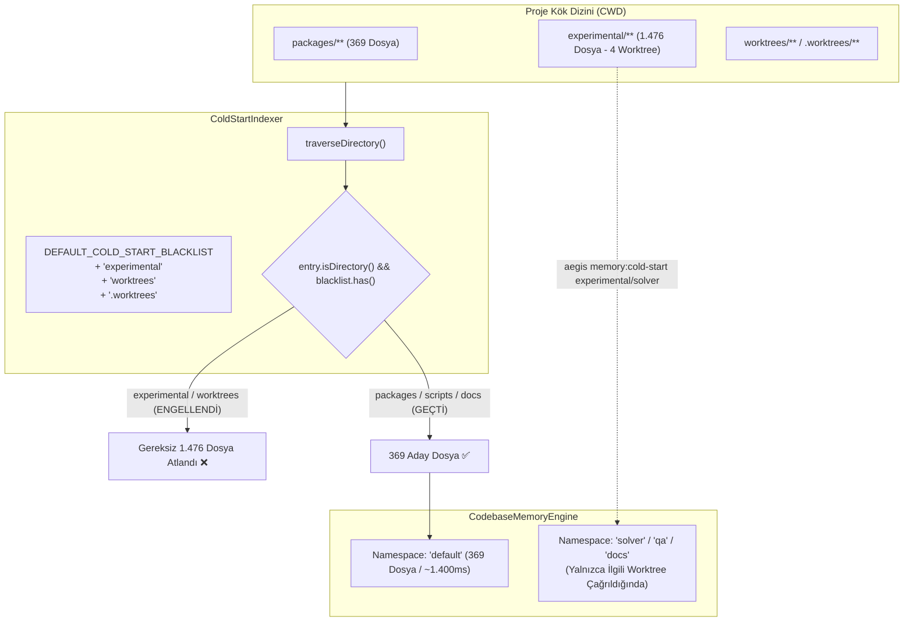

# 🏛️ RFC-026: Cold-Start Indexer Worktree Isolation and Redundant AST Walk Elimination
### Aegis Autonomous Architecture Blueprint

- **RFC ID:** RFC-026
- **Durum:** Approved (Onaylandı) ✅
- **Tarih:** 2026-10-27
- **Yazar:** Aegis Autonomous Core Fleet
- **GitHub Tartışması:** [#301](https://github.com/frkntlr/aegis/discussions/301)

---

## 🔍 1. Fikir ve Problem Tanımı

Aegis otonom kodlama motorunun 5-Katmanlı Kod Tabanı Belleği (`CodebaseMemoryEngine`), proje açılışında sembol haritasını ve çağrı ilişkilerini oluşturmak için `ColdStartIndexer` bileşenini kullanır (`aegis memory:cold-start`).

### Temel Darboğaz ve Kök Neden:
1. **İzole Git Worktree Dizinlerinin Taranması:**
   Aegis çoklu ajan mimarisinde `experimental/solver`, `experimental/qa`, `experimental/docs`, `experimental/contributor` ve muhtemel `worktrees/`, `.worktrees/` dizinleri kök dizin altında izole çalışma alanları olarak yer alır.
2. **Kara Liste Eksikliği:**
   `DEFAULT_COLD_START_BLACKLIST` içinde sadece `node_modules`, `.git`, `dist`, `build`, `.aegis`, `.turbo`, `coverage`, `.godot`, `tmp`, `.cache` tanımlı olup `experimental`, `worktrees`, `.worktrees` yer almamaktadır.
3. **5 Kat Gereksiz Yük:**
   Bu durum, projenin 369 kaynak dosyası yerine 4 izole worktree'nin de tekrar tekrar taranarak toplam **1.845 dosyanın** gezilmesine yol açmaktadır.
4. **I/O ve Senkron AST Tıkanması:**
   1.845 dosya için gereksiz disk okuması, SHA-256 hash hesaplaması ve senkron AST ayrıştırması yapılarak ilk soğuk başlatma süresi **~12 saniyeye (11.923 ms)** fırlamaktadır. Ayrıca `default` bellek ad alanına henüz birleştirilmemiş izole ajan değişiklikleri sızmaktadır.

---

## 🏗️ 2. Düğüm & Bileşen Mimarisi (Component Breakdown)

---

## 🔒 3. Demir Kafes Standartları

- Azami 300 satır/dosya, azami 40 satır/fonksiyon.
- Cerrahi ve tek odaklı değişiklikler.
- %100 birim test başarı kriteri.

---

## 🎯 4. Kabul Kriterleri (Acceptance Criteria)

- [x] `DEFAULT_COLD_START_BLACKLIST` dizisine `'experimental'`, `'worktrees'`, `'.worktrees'` eklendi.
- [x] `AstGrepBridge.searchDirectory` kara listesine `'experimental'`, `'worktrees'`, `'.worktrees'` eklendi.
- [x] `CodebaseMemoryWatcher` dosya olaylarında worktree uyuşmazlığı kontrolü sağlandı.
- [x] Taranan aday dosya sayısı 1.845'ten 369'a indirildi (%80 / 1.476 dosya tasarrufu).
- [x] Birim testler (`cold-start-indexer.test.ts`, `codebase-memory-watcher.test.ts`) güncellendi ve başarıyla geçti.
- [x] `npm run aegis -- memory:cold-start` çıktısı ile 369 dosyalık optimize tarama doğrulandı.
