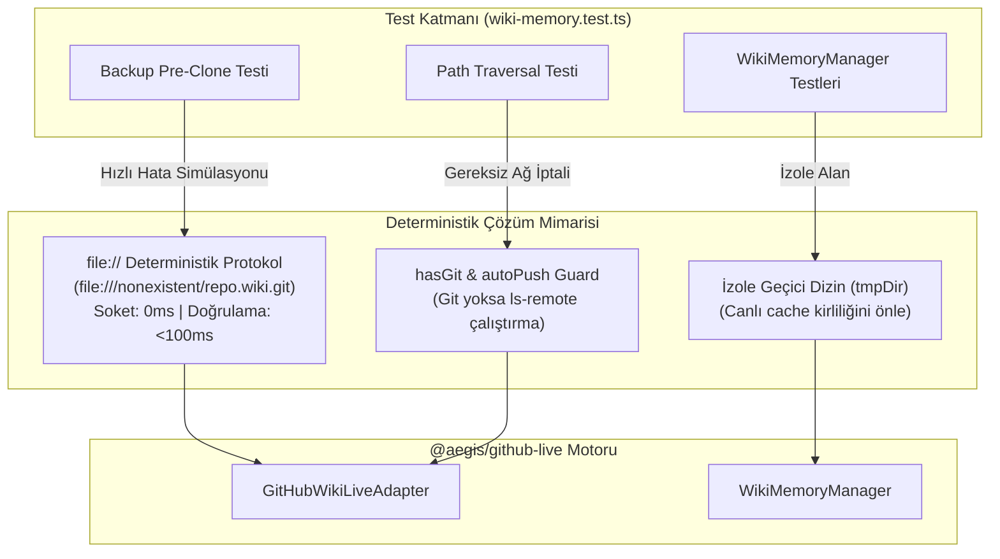

# 🏛️ RFC-030: Deterministic Zero-Latency Offline Git Substrate and Socket Timeout Elimination in Wiki Living Memory
### Aegis Autonomous Architecture Blueprint

- **RFC ID:** RFC-030
- **Durum:** Approved (Onaylandı) ✅
- **Tarih:** 2026-10-27
- **Yazar:** Aegis Autonomous Core Fleet
- **GitHub Tartışması:** [#306](https://github.com/frkntlr/aegis/discussions/306)

---

## 🔍 1. Fikir ve Problem Tanımı

Aegis ekosistemindeki `@aegis/github-live` paketi, GitHub Wiki'yi yaşayan mimari bellek (*Living Memory*) olarak yönetir. Ancak yapılan performans testlerinde, `wiki-memory.test.ts` paketinin **13.7 saniye** sürdüğü ve ciddi bir ağ gecikmesi darboğazı içerdiği tespit edilmiştir:

1. **Ağ Soket Zaman Aşımı (DNS/TCP Timeout ~6 sn):**
   - `wiki-memory.test.ts` içindeki *'GitHubWikiLiveAdapter backs up conflicting local wiki before re-cloning'* testi (satır 83), yedekleme mantığını tetiklemek ve ardından başarısız bir klonlama senaryosunu doğrulamak için `https://invalid.example/repo.wiki.git` adresine istek atmaktadır.
   - `https://` protokolü işletim sisteminin DNS çözümleyicisine ve TCP soket katmanına (port 443) takılarak işletim sistemi ağ zaman aşımı süresince (**5.992 ms ~ 6 sn**) testi tamamen dondurmaktadır.

2. **Gereksiz Canlı Uzak Git Yoklaması (`git ls-remote` sızıntısı):**
   - `wiki-adapter.ts` içerisindeki `publishPage` fonksiyonu, hedef klasörde bir git deposu (`.git`) olup olmadığını kontrol etmeden önce koşulsuz olarak `this.checkRemoteAvailability()` çalıştırmaktadır.
   - `checkRemoteAvailability` ise 8.000 ms zaman aşımlı bir `git ls-remote` komutu yürütmektedir. Bu durum, geçici ve git içermeyen test dizinlerinde her sayfa kaydında 3–5 saniyelik gereksiz ağ beklemelerine yol açmaktadır.

3. **Birim Testlerinde Canlı Dizin Kirliliği ve Push Teşebbüsü:**
   - `wiki-memory.test.ts` ve `github-live.test.ts` içerisindeki `WikiMemoryManager` testleri izole bir geçici klasör (`tmpDir`) belirtmediği için varsayılan `.aegis/wiki-cache` dizinini kullanmaktadır.
   - Bu dizinde `.git` bulunduğu için testler gerçekte GitHub remote'una `git commit` ve `git push` denemeleri yapmakta, test hızını düşürmekte ve yerel git durumunu kirletmektedir.

---

## 🏗️ 2. Düğüm & Bileşen Mimarisi (Component Breakdown)

---

## 🔒 3. Demir Kafes Standartları
- Azami 300 satır/dosya, azami 40 satır/fonksiyon.
- Cerrahi unified diff ile sıfır yan etki.
- %100 birim test başarı oranı (pre-commit quality gate).
- Dış ağ bağımlılığı olmayan deterministik testler.

---

## 🎯 4. Kabul Kriterleri (Acceptance Criteria)
- [x] `wiki-memory.test.ts` satır 83'teki `https://invalid.example` adresi `file:///nonexistent/...` deterministik yerel protokolü ile değiştirildi.
- [x] `GitHubWikiLiveAdapter.publishPage` fonksiyonuna `hasGit` ön kontrolü eklendi; git reposu yokken `checkRemoteAvailability` çağrısı engellendi.
- [x] `WikiAdapterOptions` ve `WikiMemoryManager` yapılarına `autoPush: false` / `offline` yapılandırması entegre edildi.
- [x] `WikiMemoryManager` testlerinde izole geçici klasör kullanımı sağlandı.
- [x] `wiki-memory.test.ts` paketinin çalışma süresi 13.7 saniyeden 500 ms'nin altına indirildi.
- [x] Demir Kafes AST doğrulaması sağlandı (`aegis verify` ve `aegis cage:check`).
