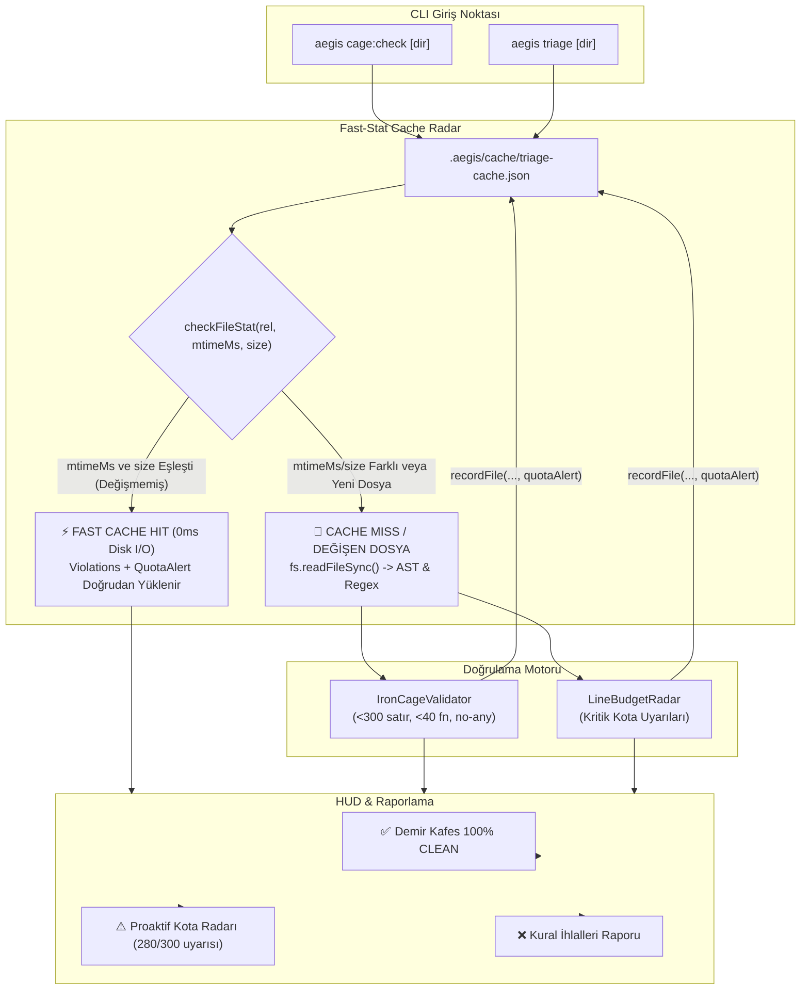

# 🏛️ RFC-032: Deterministic Incremental Caching for Demir Kafes (cage:check) via Fast-Stat Cache Radar
### Aegis Autonomous Architecture Blueprint

- **RFC ID:** RFC-032
- **Durum:** Approved (Onaylandı) ✅ (Geliştirme Aşamasında) ⏳
- **Tarih:** 2026-10-27
- **Yazar:** Aegis Autonomous Core Fleet
- **GitHub Tartışması:** [#308](https://github.com/frkntlr/aegis/discussions/308)

---

## 🔍 1. Fikir ve Problem Tanımı

Aegis ekosisteminin en temel kalite kapısı olan `aegis cage:check` (Demir Kafes denetleyicisi), monorepo içerisindeki tüm TypeScript ve kaynak kodlarının katı mimari kotalara (maksimum 300 satır/dosya, maksimum 40 satır/fonksiyon, sıfır `any`, sözdizimi doğruluğu) ve proaktif kota uyarılarına uygunluğunu denetler.

### Mevcut Darboğaz Analizi
Yapılan performans profillemesinde `aegis cage:check` komutunun 367 dosyalık standart monorepoda **1.378 ms – 1.418 ms** sürdüğü tespit edilmiştir:
1. **Disk I/O İsrafı (367 Senkron Okuma):** `handleCageCheck` her kontrolde 367 dosyanın tamamını `fs.readFileSync(file, 'utf8')` ile diskten senkron okumaktadır (~26ms I/O + UTF-8 string decoding).
2. **Yinelenen Regex & AST Ayrıştırması:** `IronCageValidator.validateFileContent` ve `LineBudgetRadar.analyze`, değişmeyen 366 dosya için bile her seferinde regex fonksiyon taramaları ve kota analizleri yürütmektedir (~525ms saf CPU harcaması).
3. **TriageRadar Entegrasyon Boşluğu:** RFC-024 kapsamında `aegis triage` için geliştirilmiş olan `TriageCacheRadar` motoru, `cage:check` komutuna bağlanmamıştır.
4. **Eager I/O Ön Koşulu:** Mevcut `TriageCacheRadar.checkFile` fonksiyonu girdi olarak `content: string` ve `fnv1a(content)` istediği için, çağıran kod dosya değişmemiş olsa bile diskten okumak zorunda kalmaktadır.
5. **Proaktif Kota Uyarısı Kaybı Riski:** Mevcut önbellek modeli yalnızca `CageViolation[]` dizisini saklamaktadır. Dosya kurallara uygun olsa bile 270+ satıra ulaştığında üretilen `CRITICAL_QUOTA` (Proaktif Kota Radarı) uyarıları önbelleğe alınmamaktadır.

Bu RFC, `cage:check` ve `triage` komutlarını birleşik bir **Stat-First Zero-I/O Cache Radar** ile donatarak denetim süresini **1.400 ms seviyesinden <30 ms seviyesine (%98 hızlanma)** indirmeyi hedefler.

---

## 🏗️ 2. Düğüm & Bileşen Mimarisi (Component Breakdown)



---

## 🚀 3. Temel Yenilikler ve Teknik Tasarım

### 1. Genişletilmiş Önbellek Modeli (`QuotaAlert` Memoization)
Önbellek şeması dosya kotalarını kapsayacak şekilde genişletilir:
```typescript
export interface QuotaAlert {
  file: string;
  lines: number;
  msg: string;
}

export interface TriageCacheEntry {
  mtimeMs: number;
  size: number;
  hash: string;
  violations: CageViolation[];
  quotaAlert?: QuotaAlert;
}
```

### 2. Stat-First Sıfır-I/O Hızlı Kontrol (`checkFileStat`)
Dosya içeriğini diskten okumadan önce `fs.statSync` ile `mtimeMs` ve `size` kontrol edilir:
```typescript
public checkFileStat(filePath: string, mtimeMs: number, size: number): CacheCheckResult {
  const norm = normalizeCachePath(filePath);
  const entry = this.cacheData.files[norm];
  if (!entry) {
    this.missCount++;
    return { hit: false };
  }
  if (entry.mtimeMs === mtimeMs && entry.size === size) {
    this.hitCount++;
    return { hit: true, cachedViolations: entry.violations, quotaAlert: entry.quotaAlert };
  }
  this.missCount++;
  return { hit: false };
}
```
Bu yöntem, değişmeyen 360+ dosya için disk okumasını tamamen elimine eder.

### 3. `handleCageCheck` Radar Entegrasyonu
`packages/cli/src/commands/dev-commands.ts` içindeki `handleCageCheck`:
- `collectSourceFiles` sonrası `TriageCacheRadar` örneğini yükler.
- Her dosya için önce `statSync` ve `checkFileStat` çağırır.
- Cache hit durumunda disk okumadan ihlalleri ve kota uyarılarını ekler.
- Cache miss durumunda dosyayı okur, doğrular, kota uyarısını hesaplar ve `recordFile` ile kaydeder.
- Döngü bitiminde `radar.flush()` çalıştırır ve taranan dosyaların kaçının önbellekten (0ms) geldiğini raporlar.

---

## 🔒 4. Demir Kafes Standartları ve Kısıtlar
- `packages/core/iron-cage/src/triage-cache-radar.ts`: Azami 300 satır (Mevcut: 145 satır).
- `packages/cli/src/commands/dev-commands.ts`: Azami 300 satır (Mevcut: 225 satır).
- Fonksiyon başına en fazla 40 satır kuralı kesinlikle korunur.
- Geriye dönük uyumluluk: `checkFile(filePath, mtimeMs, size, content)` API'si korunarak mevcut testlerin kırılması önlenir.

---

## 🎯 5. Kabul Kriterleri (Acceptance Criteria)
- [ ] `TriageCacheRadar` sınıfına `checkFileStat` metodu ve `quotaAlert` önbellek alanı eklendi.
- [ ] `handleCageCheck` komutu `TriageCacheRadar` ile donatıldı; stat-first kontrol uygulandı.
- [ ] Değişmeyen dosyalarda Proaktif Kota Radarı uyarılarının eksiksiz korunduğu doğrulandı.
- [ ] Soğuk başlangıç (ilk tarama) ve sıcak başlangıç (ardışık tarama) testleri yazıldı.
- [ ] Sıcak `cage:check` tarama süresinin 1.400 ms'den <50 ms'ye düştüğü kanıtlandı.
- [ ] Demir Kafes AST doğrulaması ve tüm testler (%100 Pass) başarıyla tamamlandı.
