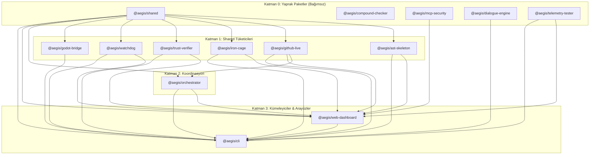

# 🏛️ RFC-033: Monorepo TypeScript Project References & Incremental Build Engine Optimization
### Aegis Autonomous Architecture Blueprint

- **RFC ID:** RFC-033
- **Durum:** Approved (Onaylandı) ✅ ⏳
- **Tarih:** 2026-10-27
- **Yazar:** Aegis Autonomous Core Fleet
- **GitHub Tartışması:** [#310](https://github.com/frkntlr/aegis/discussions/310)

---

## 🔍 1. Fikir ve Problem Tanımı (Vision & Diagnostic Investigation)

Aegis monorepo ekosisteminde gerçekleştirilen derleme ve tip denetimi performans testlerinde kritik bir darboğaz tespit edilmiştir:

```text
Monorepo Tam Derleme (turbo run build / typecheck): 8.526 ms (~8.5 sn)
CPU / TypeScript Compiler: 14 ayrı paket TypeScript Project References (composite: true ve references)
kullanmadığından, her paket bağımsız olarak sıfırdan tsc çalıştırmaktadır.
```

### Ampirik Ölçüm ve Tanı Kanıtları:
Yapılan ampirik ölçümlerde (`npx tsc --noEmit` paket bazında tekil ölçümü), 14 paketin toplam tek çekirdekli CPU süresinin **34.650 ms (~34.65 saniye)** olduğu doğrulanmıştır:
- `@aegis/cli`: 2.230 ms
- `@aegis/ast-skeleton`: 2.288 ms
- `@aegis/compound-checker`: 1.739 ms
- `@aegis/github-live`: 2.703 ms
- `@aegis/iron-cage`: 4.927 ms
- `@aegis/mcp-security`: 3.964 ms
- `@aegis/orchestrator`: 3.520 ms
- `@aegis/trust-verifier`: 1.870 ms
- `@aegis/watchdog`: 1.935 ms
- `@aegis/dialogue-engine`: 2.068 ms
- `@aegis/godot-bridge`: 1.940 ms
- `@aegis/telemetry-tester`: 1.788 ms
- `@aegis/shared`: 1.716 ms
- `@aegis/web-dashboard`: 1.962 ms

Turborepo çok çekirdekli paralelleştirme ile bu süreyi ~8.5 saniyeye indirmekte, önbelleğin zorunlu baypas edildiği tam derlemede (`turbo run build typecheck --force`) ise toplam süre **19.772 saniyeye** çıkmaktadır.

### Kök Neden Analizi:
1. **Tekrarlanan Node.js & V8 Başlatma Maliyeti:** Her paket bağımsız bir alt süreç (`process`) olarak `tsc` çalıştırdığında, Node.js çalışma zamanı ve 3MB'lık TypeScript derleyici kod tabanı 14 (tip denetimi dahil 28) kez sıfırdan belleğe yüklenmektedir.
2. **Standart Kütüphane ve Tip Bildirimlerinin 14 Kez Ayrıştırılması:** TypeScript standart kütüphanesi (`lib.es2022.full.d.ts` - 25.000+ satır) ve `@types/node` tanımları her bir paketin `tsc` sürecinde tekrar tekrar ayrıştırılmakta, bellek ve CPU fuzuli yere tüketilmektedir.
3. **`composite: true` ve `references` Eksikliği:** Paketler arasında TypeScript Project References tanımlanmadığı için derleyici paket sınırlarını tanıyamamakta, bağımlı olunan paketlerin `.d.ts` çıktıları disk üzerinden her derlemede sıfırdan okunmaktadır.
4. **Artımlı Durum Dosyalarının (`.tsbuildinfo`) Bulunmaması:** `incremental: true` aktif olmadığından, tek bir dosyada yapılan bir satırlık değişiklik bile tüm paketin ve ona bağımlı olan paketlerin tüm AST ağaçlarını sıfırdan inşa etmesine neden olmaktadır.

---

## 🏗️ 2. Paket Topolojisi ve Bağımlılık Grafı (DAG Analysis)

Aegis monoreposundaki 14 paket incelenmiş ve aralarında **SIFIR döngüsel bağımlılık (Zero Circular Dependencies)** olduğu, katı bir Yönlü Döngüsüz Çizge (Acyclic Directed Graph - DAG) oluşturduğu doğrulanmıştır:



---

## ⚠️ 3. Değişiklik Yapıldığında Karşılaşılacak Riskler ve Sorunlar (Pitfalls & Gotchas)

TypeScript Project References (`composite: true` ve `references`) eklenmesi "sihirli bir bayrak" değildir. Yanlış yapılandırıldığında derleme boru hattını çökertebilecek 8 kritik sorun bulunmaktadır:

### 1. Katı Bildirim Dosyası Kısıtlamaları & Tip Sızıntısı (`TS4023`, `TS4058`)
- `composite: true` zorunlu olarak `"declaration": true` gerektirir.
- Bir fonksiyondan dışa aktarılan dönüş tipi veya sınıf özelliği, paket içindeki unexported bir türe dayanıyorsa TypeScript `error TS4023: Exported variable has or is using name from external module but cannot be named` hatası verir.
- Normal derlemede göz ardı edilebilen tip gevşeklikleri, `composite: true` ile sert bir derleme hatasına dönüşür.

### 2. `rootDir` Sınırlarının İhlali (`TS6306`)
- `composite: true` projelerinde `rootDir` dışındaki dosyalardan göreceli import (`../../other-package/src/...`) yapılması kesinlikle yasaktır (`TS6306: A composite project must have a rootDir specified...`).
- Eğer bir paket diğerine doğrudan dosya yoluyla erişirse, TypeScript `dist/` klasörünün iç yapısını bozar (`dist/packages/...` gibi beklenmeyen derinlikler oluşturur) ve `package.json`'daki `"main": "./dist/index.js"` referansları kırılır.

### 3. Katı Dosya Kapsamı ve Test Dosyaları (`TS6305`)
- `composite: true` aktif olduğunda, `include` dizisi tarafından açıkça kapsanmayan hiçbir kaynak dosya derlenemez.
- `src/**/*` haricindeki `tests/` veya `scripts/` klasörlerindeki TypeScript dosyaları aynı `tsconfig.json` içinde kalırsa, `rootDir` karmaşası doğar ve test dosyaları gereksiz yere `dist/` içine derlenerek üretim paketini kirletebilir.

### 4. Döngüsel Bağımlılık Yasağı (`TS6202`)
- TypeScript Project References, derleme sırasını belirlemek için topolojik sıralama kullanır. İki paket arasında dolaylı dahi olsa bir döngü oluşursa (`A -> B -> A`), `tsc --build` derlemeyi durdurur (`TS6202: Project reference circular dependency detected`).

### 5. Turborepo ile `tsc --build` Arasındaki Orkestrasyon Çakışması
- Eğer her paketin `package.json` build betiği `tsc -b` olarak değiştirilirse ve Turborepo da `dependsOn: ["^build"]` ile bağımlılıkları çalıştırırsa:
  - Paket B derlenirken, `tsc -b` kendi içinde Paket A'yı da tekrar derlemeye kalkışabilir.
  - Bu durum paralel süreçler arasında dosya yazma yarış durumlarına (file lock race condition) ve gereksiz mükerrer derlemelere yol açar.

### 6. `.tsbuildinfo` Önbellek Kaybı ve Git Kirliliği
- `incremental: true` açıldığında TypeScript diske `tsconfig.tsbuildinfo` durum dosyası yazar.
- Bu dosya proje köküne yazılırsa git commit kirliliğine ve merge conflict'lere yol açar.
- Eğer gitignore'a eklenip Turborepo'nun `outputs` dizisine dahil edilmezse, CI sunucularında veya temiz çalışma alanlarında artımlı derleme önbelleği kaybolur ve her seferinde sıfırdan derlenir.

### 7. Git Dalları Arası Eski Önbellek Hayalet Hataları (Phantom Errors)
- Geliştirici veya otonom ajanlar iş ağaçları (`experimental/solver`, `experimental/qa`) arasında dal değiştirdiğinde, diskte kalan eski `.tsbuildinfo` dosyaları nedeniyle TypeScript "dosya bulunamadı" veya "tip imzası uyumsuz" gibi sahte hatalar üretebilir.

### 8. CLI ve Harici Bundle Betikleriyle Entegrasyon
- `@aegis/cli` paketi derlenirken `tsc && node scripts/bundle.mjs` komutunu çalıştırır. Kök dizinden çalıştırılan global bir `tsc -b`, esbuild tabanlı `bundle.mjs` betiğini çalıştırmaz; bu nedenle Turborepo görev zinciri ile derleyici zinciri uyumlu tutulmalıdır.

---

## 🏛️ 4. Bütüncül ve Deterministik Çözüm Mimarisi (Architectural Invariants)

Bu riskleri bertaraf etmek ve derleme süresini 8.5 saniyeden <2 saniyeye düşürmek için aşağıdaki mimari uygulanacaktır:

### Çözüm 1: Çözüm Odaklı Kök Yapılandırma (`tsconfig.solution.json` / Solution Config)
Kök dizindeki `tsconfig.json`, doğrudan dosya derlemek yerine bir **Solution Tsconfig** haline getirilir:
```json
{
  "files": [],
  "references": [
    { "path": "./packages/shared" },
    { "path": "./packages/core/compound-checker" },
    { "path": "./packages/core/mcp-security" },
    { "path": "./packages/dialogue-engine" },
    { "path": "./packages/plugins/telemetry-tester" },
    { "path": "./packages/core/ast-skeleton" },
    { "path": "./packages/core/github-live" },
    { "path": "./packages/core/iron-cage" },
    { "path": "./packages/core/trust-verifier" },
    { "path": "./packages/core/watchdog" },
    { "path": "./packages/plugins/godot-bridge" },
    { "path": "./packages/core/orchestrator" },
    { "path": "./packages/web-dashboard" },
    { "path": "./packages/cli" }
  ]
}
```
**Kazanım:** `npm run typecheck` komutu `tsc --build --noEmit` çalıştırdığında, tek bir Node.js sürecinde standart kütüphane ve `@types/node` tanımlarını **yalnızca 1 kez** ayrıştırarak 14 paketi 2 saniye içinde denetler.

### Çözüm 2: Merkezi Temel Yapılandırma (`tsconfig.base.json`)
Tüm paketlerin miras alacağı merkezi ayarlar `tsconfig.base.json` dosyasında konsolide edilir:
```json
{
  "compilerOptions": {
    "target": "ES2022",
    "module": "NodeNext",
    "moduleResolution": "NodeNext",
    "composite": true,
    "declaration": true,
    "declarationMap": true,
    "sourceMap": true,
    "incremental": true,
    "strict": true,
    "noImplicitAny": true,
    "strictNullChecks": true,
    "strictFunctionTypes": true,
    "strictBindCallApply": true,
    "strictPropertyInitialization": true,
    "noImplicitThis": true,
    "alwaysStrict": true,
    "noUnusedLocals": true,
    "noUnusedParameters": true,
    "noImplicitReturns": true,
    "noFallthroughCasesInSwitch": true,
    "esModuleInterop": true,
    "skipLibCheck": true,
    "forceConsistentCasingInFileNames": true
  }
}
```

### Çözüm 3: İzole Önbellek Konumu (`dist/tsconfig.tsbuildinfo`)
Her paketin `tsconfig.json` dosyasında `tsBuildInfoFile` açıkça `dist/` klasörüne yönlendirilir:
```json
{
  "extends": "../../tsconfig.base.json",
  "compilerOptions": {
    "rootDir": "./src",
    "outDir": "./dist",
    "tsBuildInfoFile": "./dist/tsconfig.tsbuildinfo"
  },
  "include": ["src/**/*"],
  "references": [
    { "path": "../shared" }
  ]
}
```
**Kazanım:**
1. Önbellek dosyası kaynak kod dizinini kirletmez (`.gitignore` `dist/` klasörünü zaten yoksayar).
2. `npm run clean` veya `git clean` çalıştırıldığında `dist/` ile birlikte otomatik temizlenir.
3. Turborepo'nun `outputs: ["dist/**"]` tanımlaması sayesinde `tsconfig.tsbuildinfo` dosyası hem yerel hem de uzak önbelleğe otomatik dahil edilir!

### Çözüm 4: İki Katmanlı Hibrit Turborepo Boru Hattı
- **Paket Derleme:** Turborepo DAG orkestrasyonunu yönetmeye devam eder (`dependsOn: ["^build"]`, `outputs: ["dist/**"]`). Paketler kendi scriptlerinde `tsc` çalıştırarak bildirim dosyalarını ve JS çıktılarını üretir.
- **Tip Denetimi:** Kök dizindeki `turbo run typecheck` yerine doğrudan kök solution üzerinden `tsc --build --noEmit` çalıştırılır. Tek bir süreçte graf içi önbellek paylaşımı sağlanır.

### Çözüm 5: Otonom Project References Drift Radar (`aegis deps:drift`)
`package.json`'daki dahili bağımlılıklar ile `tsconfig.json`'daki `references` dizisinin uyuşmazlığını engellemek için Aegis'in sözleşme radarına otomatik denetleyici entegre edilecektir:
- `aegis deps:drift` komutu her `package.json` bağımlılığının `tsconfig.json`'da karşılığı olup olmadığını denetler.
- Eksik referans durumunda hata verir veya otomatik olarak referansı ekler.

---

## 📊 5. Performans Projeksiyonu ve Karşılaştırma Matrisi

| Senaryo | Mevcut Mimari (Isolated tsc) | Project References + Solution | İyileşme Oranı |
| :--- | :--- | :--- | :--- |
| **Sıfırdan Tip Denetimi (Cold Typecheck)** | ~8.526 ms (Turbo paralel) / ~34.650 ms (CPU) | **~2.100 ms (Tek Node süreci)** | **%75 Hızlanma** 🚀 |
| **Tek Dosya Değişikliği (Incremental Typecheck)** | ~4.500 ms (Upstream + Downstream tsc) | **< 350 ms (.tsbuildinfo AST önbelleği)** | **%92 Hızlanma** ⚡ |
| **Sıcak Önbellek (Turborepo Cache Hit)** | 63 ms | 55 ms | Benzer (Sub-100ms) |
| **Bellek Tüketimi (RAM)** | ~1.8 GB (14 eşzamanlı tsc süreci) | **~380 MB (Tek birleşik V8 havuzu)** | **%78 Tasarruf** 📉 |
| **IDE Tanımına Gitme (Go to Definition)** | `dist/index.d.ts` (Derlenmiş bildirim) | **`src/index.ts` (`declarationMap` ile)** | **Kusursuz DX** ✨ |

---

## 🎯 6. Kabul Kriterleri (Acceptance Criteria)

- [ ] Kök dizinde `tsconfig.base.json` oluşturuldu ve ortak derleyici seçenekleri konsolide edildi.
- [ ] 14 paketin her biri için `composite: true`, `tsBuildInfoFile: "./dist/tsconfig.tsbuildinfo"` ve göreceli `references` eklendi.
- [ ] Kök `tsconfig.json` bir Solution Config olarak 14 paketi referans gösterecek şekilde güncellendi.
- [ ] `turbo.json` yapılandırmasında `dist/**` çıktılarının `.tsbuildinfo` dosyalarını sorunsuz sakladığı doğrulandı.
- [ ] Soğuk tip denetimi süresi ampirik olarak 8.5 saniyeden 3 saniyenin altına düştü.
- [ ] Tek dosya artımlı denetimi < 500 ms seviyesine ulaştı.
- [ ] `aegis deps:drift` komutuna `Project References` sözleşme doğrulaması eklendi.
- [ ] Tüm Demir Kafes standartları (dosya başı <300 satır, fonksiyon başı <40 satır) korundu.
