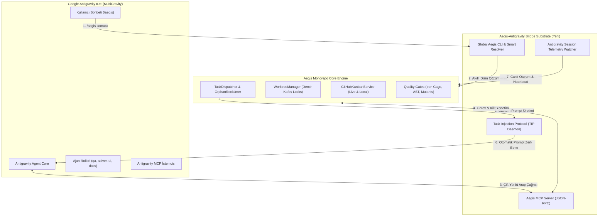

# 🏛️ RFC-034: Google Antigravity IDE & Aegis Çift Yönlü Entegrasyon, Komut Aktivasyon ve Otonom Görev Köprüsü Protokolü
### Aegis Autonomous Architecture Blueprint

- **RFC ID:** RFC-034
- **Durum:** Proposed (Teklif Edildi) ⏳
- **Tarih:** 2026-10-27
- **Yazar:** Aegis Autonomous Fleet & Antigravity Pair Developers
- **Kategori:** Ideas (Fikirler & Mimari İnovasyon)
- **GitHub Tartışması:** [#317](https://github.com/frkntlr/aegis/discussions/317)

---

## 🔍 1. Fikir ve Problem Tanımı (Vision & Diagnostic Investigation)

Aegis otonom kodlama motoru, Antigravity IDE ve çoklu worktree ortamlarında çalışacak şekilde tasarlanmıştır. Ancak geliştiricilerin ve yapay zeka ajanlarının gerçek kullanım deneyiminde (dogfooding) üç temel alanda kritik iletişim ve entegrasyon kopuklukları tespit edilmiştir:

```text
[Kullanıcı / Antigravity Sohbeti] ---> /aegis komutu tetiklenir
       │
       ▼ (Kopukluk 1: Yanlış Çalışma Alanı & Bağımlılık Hatası)
npm run aegis -- status  ---> Hata: "npm ERR! missing script: aegis" (Hake Game kök dizininde)
       │
       ▼ (Kopukluk 2: Oturum & Telemetri Körlüğü)
Antigravity Ajanı <---(Sıfır IPC/Canlı Köprü)---> Aegis Command Center (localhost:3000)
       │
       ▼ (Kopukluk 3: Görev & Kilit Senkronizasyonu Yok)
Aegis Prompt Dosyası (.aegis/prompts/) oluşturuldu <--- Antigravity ajanı otomatik okuyamıyor
```

### Ampirik Tanı ve Saha Kanıtları:
1. **Çalışma Alanı (Workspace) Çapraz Çağrı Kopukluğu:**
   - Antigravity IDE çoğunlukla `Hake Game` projesinde (`C:\Users\Lenovo\Documents\work\Hake Game`) aktiftir. Aegis motoru ise kardeş dizinde (`C:\Users\Lenovo\Documents\work\aegis`) yer almaktadır.
   - Global `~/.gemini/config/skills/aegis/SKILL.md` becerisi komutları `npm run aegis -- <args>` biçiminde çalıştırmayı talimatlandırmaktadır. `Hake Game` kök dizininde `package.json` bulunmadığından `/aegis` veya `/aegis status` anında kabuk hatasıyla çökmekte veya ajanı yanıltmaktadır.
2. **Antigravity Oturumu ile Aegis Motoru Arasında Sıfır Canlı İletişim (Zero Telemetry & Session Blindness):**
   - Aegis `SessionDetector`, çalışma alanındaki `.antigravity/` dizinini veya worktree yapılandırmalarını yalnızca pasif dosya taramasıyla koklamaktadır.
   - Antigravity'nin anlık hangi `conversationId` ile çalıştığı, hangi alt modele (`flash`, `pro`, `flash_lite`) sahip olduğu veya kullanıcının sohbet penceresinden verdiği görevlerin canlı durumu Aegis motoruna iletilememektedir.
3. **Verilen Görevlerin (Task Ingestion & Delegation) Yürütülememesi:**
   - Aegis otonom dağıtıcısı (`/auto` veya `dispatchNextTask`) bir issue'yu çözmek için `.aegis/prompts/<agent>-issue-<id>.md` dosyasını derlemektedir. Ancak Antigravity'de bu dosyayı doğrudan aktif konuşmaya zerk edecek (inject) bir köprü bulunmamaktadır.
   - Kullanıcı sohbette "şu hatayı çöz" dediğinde, bu görev Aegis Kanban'ına (`status:in_progress`) ve dosya kilit sistemine (`WorktreeManager.acquireFileLocks`) otomatik kaydedilmemekte, çakışma riski doğmaktadır.
   - Antigravity'de tamamlanan işlerin Playtest-Before-PR kanıtları (ekran görüntüleri, terminal logları, godot-engine testleri) doğrudan Aegis kalite kapısına aktarılamamaktadır.

---

## 🏗️ 2. Mimari ve Çözüm Bileşenleri (Architectural Blueprint)



---

## 📦 3. Somut Çözüm Protokolü ve Katmanları

### Katman 1: Universal CLI & Akıllı Çalışma Alanı Çözümleyici (`aegis-cli`)
- `aegis` CLI'ı sistem genelinde bir global komut (PATH binary shim veya `npm link`) olarak yapılandırılacaktır.
- `SKILL.md` içindeki `npm run aegis --` yönergeleri doğrudan evrensel `aegis <cmd>` veya akıllı `node <aegis-bin> <cmd>` çağrısına dönüştürülecektir.
- **Akıllı Dizin Çözümleme:** `aegis` komutu hangi alt klasörden (örn: `Hake Game`, `HakeApi`, `experimental/solver`) çalıştırılırsa çalıştırılsın, ortam değişkeni (`AEGIS_HOME`), üst dizin taraması veya kayıtlı profil dosyasından Aegis motorunu bularak hedef proje bağlamına odaklanacaktır.

### Katman 2: Antigravity MCP Server & Yerel Araç Köprüsü
Kabuk (`powershell`) üzerinden kırılgan komut satırı çalıştırmak yerine, Antigravity'nin MCP entegrasyonu güçlendirilecektir:
- `mcp_aegis_status`: Aktif kilitleri, asılı görevleri ve worktree durumunu sıfır token ile Antigravity'ye döner.
- `mcp_aegis_task_claim`: Verilen görevi Kanban'da `in_progress` durumuna alır ve dosya kilitlerini rezerve eder.
- `mcp_aegis_verify`: Değiştirilen dosyaları Demir Kafes, AST iskelet ve mutasyon testlerinden geçirerek anında doğrulama raporu üretir.
- `mcp_aegis_playtest_report`: Playtest ekran görüntülerini ve loglarını doğrudan Aegis kalite kalkanına iliştirir.

### Katman 3: Otonom Görev Enjeksiyon Protokolü (Task Injection Protocol - TIP)
- `aegis task:inject <issueNumber>` veya `/aegis task <issueNumber>` komutu tetiklendiğinde:
  1. Görevin tüm kabul kriterleri, hedef dosyaları ve bağımlılıkları tek bir cerrahi prompt bloğuna derlenir.
  2. Antigravity oturumu için hazır görev direktifi formatına getirilir (`/goal` veya subagent promptu).
  3. Çakışma önleyici kilitler (`WorktreeManager.acquireFileLocks`) otomatik devreye alınır.

### Katman 4: Çift Yönlü Canlı Oturum ve Kalp Atışı İzleyicisi (Session & Heartbeat Watcher)
- Antigravity'nin aktif oturumları (`.antigravity/` ve transcript dosyaları) Aegis `SessionDetector` tarafından gerçek zamanlı taranır.
- Aktif konuşmanın donması, çökmesi veya model hatası vermesi durumunda Aegis `OrphanTaskReclaimer` devreye girerek kilitleri serbest bırakır ve görevi `ready` sütununa devreder.

---

## ⚠️ 4. Karşılaşılabilecek Riskler ve Çözüm Stratejileri

| Risk | Olasılık | Etki | Önleyici Mimari Strateji |
| :--- | :--- | :--- | :--- |
| **Çoklu Depo Bağlam Kayması (Context Drift)** | Yüksek | Kritik | `ProjectHub` workspace path bazlı izolasyon sağlar; `Hake Game` ve `aegis` bağlamları kesinlikle birbirine karıştırılmaz. |
| **MCP Bağlantı Kopması / Timeout** | Orta | Orta | Zayıf bağlı (loose-coupling) mimari: MCP yanıt vermezse CLI fallback devreye girer. |
| **Demir Kafes Standartlarının Aşılması** | Orta | Yüksek | Yeni eklenecek bridge ve shim modülleri kesinlikle <300 satır/dosya ve <40 satır/fonksiyon limitine sadık kalacaktır. |
| **İzin ve Process Yetki Sorunları (Windows)** | Düşük | Orta | Windows ortamında PowerShell execution policy ve symlink gereksinimleri için portable `.cmd` / Node.js launcher kullanılacaktır. |

---

## 🎯 5. Kabul Kriterleri (Acceptance Criteria)

- [ ] Global `aegis` CLI launcher/shim mekanizması tanımlandı ve herhangi bir dizinden (`Hake Game` dahil) çalıştırılabildiği doğrulandı.
- [ ] `~/.gemini/config/skills/aegis/SKILL.md` güncellenerek kırılgan `npm run aegis` yerine bağımsız ve akıllı komut formatı yerleştirildi.
- [ ] Antigravity MCP sunucusuna görev talep etme (`task_claim`), kilit sorgulama (`lock_query`) ve doğrulama (`task_verify`) araçları eklendi.
- [ ] `aegis task:inject <num>` komutu ile GitHub görevlerinin Antigravity ajan oturumlarına cerrahi prompt olarak aktarılması sağlandı.
- [ ] Antigravity'nin Playtest-Before-PR kanıtlarının (log ve ekran görüntüleri) doğrudan Aegis kalite raporuna kaydedilmesi doğrulandı.
- [ ] Tüm yeni modüller Demir Kafes kurallarına (max 40 satır/fonksiyon, max 300 satır/dosya) %100 uyumlu yazıldı.
- [ ] Monorepo testleri (%100 yeşil) ve pre-commit mutasyon kapısından tam puanla geçti.
