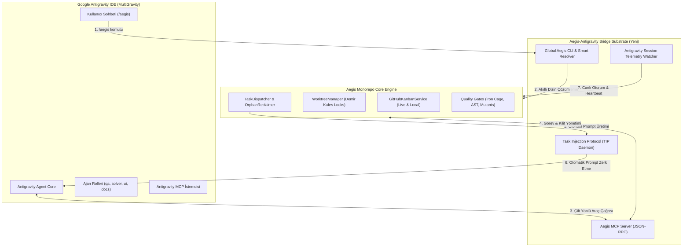

# 🏛️ RFC-034: Google Antigravity IDE & Aegis Çift Yönlü Entegrasyon, Komut Aktivasyon ve Otonom Görev Köprüsü Protokolü
### Aegis Autonomous Architecture Blueprint

- **RFC ID:** RFC-034
- **Durum:** Proposed (Teklif Edildi) ⏳
- **Tarih:** 2026-10-27
- **Yazar:** Aegis Autonomous Fleet & Antigravity Pair Developers
- **Kategori:** Ideas (Fikirler & Mimari İnovasyon)
- **GitHub Tartışması:** [#317](https://github.com/frkntlr/aegis/discussions/317)
- **Topluluk İnceleme Yorumu:** [Comment #19212610](https://github.com/frkntlr/aegis/discussions/317#discussioncomment-19212610)

---

## 🔍 1. Fikir ve Problem Tanımı (Vision & Diagnostic Investigation)

Aegis otonom kodlama motoru, Antigravity IDE ve çoklu worktree ortamlarında çalışacak şekilde tasarlanmıştır. Ancak geliştiricilerin ve yapay zeka ajanlarının gerçek kullanım deneyiminde (dogfooding) üç temel alanda kritik iletişim ve entegrasyon kopuklukları tespit edilmiştir:

```text
[Kullanıcı / Antigravity Sohbeti] ---> /aegis komutu tetiklenir
       │
       ▼ (Kopukluk 1: Yanlış Çalışma Alanı & Bağımlılık Hatası)
npm run aegis -- status  ---> Hata: "npm ERR! missing script: aegis" (Hake Game kök dizininde)
       │
       ▼ (Kopukluk 2: Oturum & Telemetri Körlüğü)
Antigravity Ajanı <---(Sıfır IPC/Canlı Köprü)---> Aegis Command Center (localhost:3000)
       │
       ▼ (Kopukluk 3: Görev & Kilit Senkronizasyonu Yok)
Aegis Prompt Dosyası (.aegis/prompts/) oluşturuldu <--- Antigravity ajanı otomatik okuyamıyor
```

### Ampirik Tanı ve Saha Kanıtları:
1. **Çalışma Alanı (Workspace) Çapraz Çağrı Kopukluğu:**
   - Antigravity IDE çoğunlukla `Hake Game` projesinde (`C:\Users\Lenovo\Documents\work\Hake Game`) aktiftir. Aegis motoru ise kardeş dizinde (`C:\Users\Lenovo\Documents\work\aegis`) yer almaktadır.
   - Global `~/.gemini/config/skills/aegis/SKILL.md` becerisi komutları `npm run aegis -- <args>` biçiminde çalıştırmayı talimatlandırmaktadır. `Hake Game` kök dizininde `package.json` bulunmadığından `/aegis` veya `/aegis status` anında kabuk hatasıyla çökmekte veya ajanı yanıltmaktadır.
2. **Antigravity Oturumu ile Aegis Motoru Arasında Sıfır Canlı İletişim (Zero Telemetry & Session Blindness):**
   - Aegis `SessionDetector`, çalışma alanındaki `.antigravity/` dizinini veya worktree yapılandırmalarını yalnızca pasif dosya taramasıyla koklamaktadır.
   - Antigravity'nin anlık hangi `conversationId` ile çalıştığı, hangi alt modele (`flash`, `pro`, `flash_lite`) sahip olduğu veya kullanıcının sohbet penceresinden verdiği görevlerin canlı durumu Aegis motoruna iletilememektedir.
3. **Verilen Görevlerin (Task Ingestion & Delegation) Yürütülememesi:**
   - Aegis otonom dağıtıcısı (`/auto` veya `dispatchNextTask`) bir issue'yu çözmek için `.aegis/prompts/<agent>-issue-<id>.md` dosyasını derlemektedir. Ancak Antigravity'de bu dosyayı doğrudan aktif konuşmaya zerk edecek (inject) bir köprü bulunmamaktadır.
   - Kullanıcı sohbette "şu hatayı çöz" dediğinde, bu görev Aegis Kanban'ına (`status:in_progress`) ve dosya kilit sistemine (`WorktreeManager.acquireFileLocks`) otomatik kaydedilmemekte, çakışma riski doğmaktadır.
   - Antigravity'de tamamlanan işlerin Playtest-Before-PR kanıtları (ekran görüntüleri, terminal logları, godot-engine testleri) doğrudan Aegis kalite kapısına aktarılamamaktadır.

---

## 🏗️ 2. Mimari ve Çözüm Bileşenleri (Architectural Blueprint)



---

## 🚨 3. Kritik Analiz: Eksik, Sorunlu Taraflar ve Mühendislik Çözümleri

### 1. Darboğaz: Görev Enjeksiyonunun (Task Ingestion) Antigravity Reaktif Modeliyle Uyuşmaması
* **Sorun:** Antigravity dışarıdan kontrolsüz webhook veya soket ile sohbete yazı yazılmasına izin vermez. Ajan, dışarıdan zorla push edilerek değil; kullanıcının mesajı, `schedule` zamanlayıcısı veya subagent mesajı ile tetiklenen **Reaktif Uyanma (Reactive Wakeup)** modeliyle çalışır.
* **Mühendislik Çözümü (Pull-Based Autonomous Task Ingestion Protocol):**
  - **Atomik Görev Kutusu (`.aegis/task-inbox.json`):** Dağıtıcı görevi atadığında disk üzerinde atomik bir manifest yazar.
  - **Yerel MCP Çekme Aracı (`mcp_aegis_pull_task`):** Ajan `/aegis next` dediğinde veya zamanlayıcı tetiklendiğinde aracı çağırır.
  - **Alt Ajan Delegasyonu (`invoke_subagent`):** Görev ana sohbet geçmişini şişirmeden, Antigravity'nin yerleşik `invoke_subagent` yeteneğiyle izole bir alt ajana (`issue-solver` veya `qa-hunter`) devredilir.

### 2. Darboğaz: Çalışma Alanı (Workspace) ve Çoklu Worktree Yönlendirme Belirsizliği
* **Sorun:** Motor `work/aegis`, hedef depo `work/Hake Game`, aktif worktree'ler ise `HakeGame-solver`, `HakeGame-qa` dizinlerindedir. Tek bir `process.cwd()` varsayımı hem araçların motoru bulamamasına hem de kilitlerin yanlış yerde aranmasına yol açar.
* **Mühendislik Çözümü (Two-Tier Workspace Context Anchor):**
  - **EngineRoot vs TargetProjectRoot:** `EngineRoot` (Aegis motoru) ile `TargetProjectRoot` (o an kod yazılan ve kilitlenen hedef proje) ayrılır.
  - **Otomatik Bağlanma (`.aegis.json`):** Hedef proje köküne manifest yerleştirilir (`{ "projectId": "hake-game", "worktrees": ["../HakeGame-solver"], "engine": "godot4" }`).

### 3. Darboğaz: Rol Dağılımı ve Ajan Anayasası (`AGENTS.md`) Kimlik Çatışması
* **Sorun:** Projede `AGENTS.md` Anayasası bağlayıcıdır (`qa-hunter`, `issue-solver`, `ui-specialist`, `doc-architect`). `/aegis` yazıldığında yapay zeka bu rollerden hangisine bürüneceğini bilemez ve yetki sınırlarını ihlal edebilir.
* **Mühendislik Çözümü (Unified Aegis Constitutional Gateway):**
  - `/aegis` üst orkestratör olarak çalışır ve parametreye göre doğru rolü devreye alır:
    - `/aegis qa` -> `🎯 [QA HUNTER] AKTİF` (Read-only, UI tarama, bug tespiti)
    - `/aegis solve <issue>` -> `🛠️ [ISSUE SOLVER] AKTİF` (İzole worktree, kilit kontrolü, kod düzeltme)
    - `/aegis ui` -> `🎨 [UI SPECIALIST] AKTİF` (Container, shader, UI sahneleri)
    - `/aegis docs` -> `📚 [DOC ARCHITECT] AKTİF` (Dokümantasyon ve mimari)

### 4. Darboğaz: MCP Sunucusunda Görev & Kilit Şemasının Bulunmaması
* **Sorun:** Mevcut Aegis MCP sunucusu yalnızca AST arama ve hafıza araçlarına sahiptir. Görev alma, kilit rezerve etme ve durum güncelleme araçları şemada yer almadığı için ajan kırılgan PowerShell kabuk komutlarına zorlanmaktadır.
* **Mühendislik Çözümü (Aegis Task & Concurrency MCP Suite):**
  - `aegis` MCP sunucusuna 4 yerel araç eklenir:
    - `aegis_task_list(filter)`: Sıfır token ile bekleyen/devam eden görevleri listeler.
    - `aegis_task_claim(issueNumber, agentRole)`: Görevi rezerve eder, çakışmasız dosya kilitlerini alır.
    - `aegis_task_release(issueNumber, status)`: Görev bittiğinde kilitleri atomik serbest bırakır.
    - `aegis_lock_status(files)`: Dosyaların kilit durumunu sorgular.

### 5. Darboğaz: Çok Modlu Doğrulama Eksikliği (Godot & Playtest-Before-PR Entegrasyonu)
* **Sorun:** Sadece `npm test` ile oyun projeleri doğrulanamaz. `AGENTS.md` Madde 5 gereği oyunu bizzat açıp tıklayarak (`simulate_input`, `take_screenshot`, `game_get_errors`) test etmek zorunludur.
* **Mühendislik Çözümü (Pluggable Multimodal Quality Gate):**
  - `aegis verify:task` motoru çok modlu sürücüler (drivers) çalıştırır:
    - **TypeScript Sürücüsü:** Demir Kafes + Biome + Vitest + Mutasyon testi.
    - **Godot 4.7 Sürücüsü:** GDScript Demir Kafes + `godot-runtime` başlatma + UI elemanı taraması + ekran görüntüsü logu.
    - **API Sürücüsü:** Smoke test matrisi (`npm run smoke:all`).

---

## ⚠️ 4. Karşılaşılabilecek Riskler ve Çözüm Stratejileri

| Risk | Olasılık | Etki | Önleyici Mimari Strateji |
| :--- | :--- | :--- | :--- |
| **Çoklu Depo Bağlam Kayması (Context Drift)** | Yüksek | Kritik | `ProjectHub` workspace path bazlı izolasyon sağlar; `Hake Game` ve `aegis` bağlamları kesinlikle birbirine karıştırılmaz. |
| **MCP Bağlantı Kopması / Timeout** | Orta | Orta | Zayıf bağlı (loose-coupling) mimari: MCP yanıt vermezse CLI fallback devreye girer. |
| **Demir Kafes Standartlarının Aşılması** | Orta | Yüksek | Yeni eklenecek bridge ve shim modülleri kesinlikle <300 satır/dosya ve <40 satır/fonksiyon limitine sadık kalacaktır. |
| **İzin ve Process Yetki Sorunları (Windows)** | Düşük | Orta | Windows ortamında PowerShell execution policy ve symlink gereksinimleri için portable `.cmd` / Node.js launcher kullanılacaktır. |

---

## 🎯 5. Kabul Kriterleri (Acceptance Criteria)

- [ ] Global `aegis` CLI launcher/shim mekanizması tanımlandı ve herhangi bir dizinden (`Hake Game` dahil) çalıştırılabildiği doğrulandı.
- [ ] `~/.gemini/config/skills/aegis/SKILL.md` güncellenerek kırılgan `npm run aegis` yerine bağımsız ve akıllı komut formatı yerleştirildi.
- [ ] Antigravity MCP sunucusuna görev listeleme (`aegis_task_list`), görev talep etme (`aegis_task_claim`), kilit sorgulama (`aegis_lock_status`) ve serbest bırakma (`aegis_task_release`) araçları eklendi.
- [ ] `pull-based` görev çekme protokolü (`.aegis/task-inbox.json`) ve Antigravity `invoke_subagent` delegasyon kalıbı dokümante edilip bağlandı.
- [ ] Antigravity'nin Godot 4.7 Playtest-Before-PR kanıtlarının (log ve ekran görüntüleri) doğrudan Aegis kalite raporuna kaydedilmesi doğrulandı.
- [ ] Tüm yeni modüller Demir Kafes kurallarına (max 40 satır/fonksiyon, max 300 satır/dosya) %100 uyumlu yazıldı.
- [ ] Monorepo testleri (%100 yeşil) ve pre-commit mutasyon kapısından tam puanla geçti.
