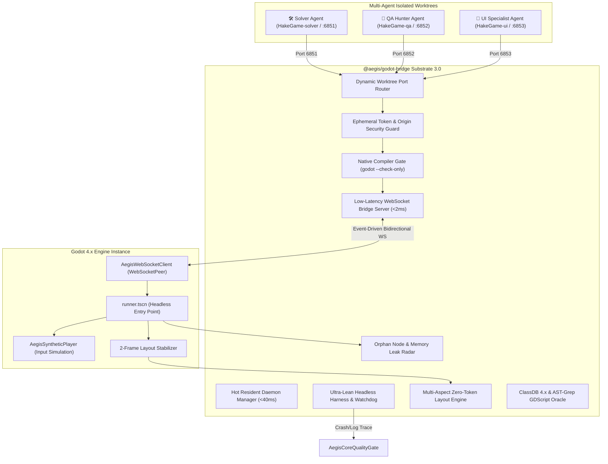

# 🏛️ RFC-035: Godot Engine High-Performance Substrate and Autonomous Multi-Agent Workflow Integration
### Aegis Autonomous Architecture Blueprint

- **RFC ID:** RFC-035
- **Durum:** Approved (Onaylandı) ✅
- **Tarih:** 2026-10-28
- **Yazar:** Aegis Autonomous Fleet & Antigravity Pair Developers
- **Kategori:** Ideas (Oyun Motoru & Otonom Çoklu Worktree Mimarisi)
- **GitHub Tartışması:** [#318](https://github.com/frkntlr/aegis/discussions/318)
- **Topluluk İnceleme Yorumları:** [Review #1](https://github.com/frkntlr/aegis/discussions/318#discussioncomment-19230578) | [Review #2 (Güvenlik)](https://github.com/frkntlr/aegis/discussions/318#discussioncomment-19230672) | [Review #3 (7-Katmanlı Motor)](https://github.com/frkntlr/aegis/discussions/318#discussioncomment-19230832) | [Review #4 (Risk Matrisi)](https://github.com/frkntlr/aegis/discussions/318#discussioncomment-19230890) | [Review #5 (Uygulama Planı & Issues)](https://github.com/frkntlr/aegis/discussions/318#discussioncomment-19231015)

---

## 🔍 1. Fikir ve Problem Tanımı (Vision & Diagnostic Investigation)

Aegis 2.0 ile birlikte iş akışımız; izole Git Worktree'leri (`experimental/solver`, `experimental/qa`, `experimental/ui`), Pull-Tabanlı Görev İşleme Protokolü (TIP), 5-Katmanlı Kod Tabanı Hafızası ve Demir Kafes kalite kapıları etrafında baştan aşağı yenilenmiştir.

Godot 4.x motoruna tam anlamıyla hâkim olmak, endüstri standardı test altyapısı kurmak ve olası tüm sistemik riskleri sıfırlamak amacıyla sistem **7-Katmanlı Otonom Oyun Test & Kalite Altyapısı** olarak yapılandırılmıştır:

```text
[Ajan: issue-solver / qa-hunter / ui-specialist] ---> Godot İş Akışı Tetiklenir
       │
       ▼ (1. Katman: Yerel Derleyici Ön-Kontrolü - <200ms)
godot --headless --check-only -s <file.gd> ---> Sözdizimi & AST kontrolü (Sıfır LLM maliyeti)
       │
       ▼ (2. Katman: 3 Kademeli Test Piramidi)
Tier 1: SceneTree Micro-Runner (<50ms) -> Tier 2: Sahne İzolasyonu -> Tier 3: E2E Playtest
       │
       ▼ (3. Katman: Bellek Sızıntısı & Yetim Düğüm Radarı)
Performance.OBJECT_ORPHAN_NODE_COUNT ---> Sızan yetim düğümler yakalanır (PR anında kilitlenir!)
       │
       ▼ (4. Katman: 10x Hızlandırma & Determinizm)
--fixed-fps 60 --time-scale 5.0 ---> Donanımdan bağımsız deterministik testler
```

---

## 🏗️ 2. Mimari ve Bileşen Topolojisi (Architectural Blueprint)



---

## 🚨 3. Kritik Analiz: 7 Temel Hakimiyet Katmanı

1. **Yerel Derleyici Ön-Kontrolü (`godot --check-only`):** GDScript değişikliklerinde runtime başlatmadan önce **<200 ms** hızla derleyici kontrolü.
2. **Üç Kademeli Test Piramidi:** Tier 1 (SceneTree, <50ms), Tier 2 (Sahne İzolasyonu), Tier 3 (E2E Playtest & UI).
3. **Bellek Sızıntısı & Yetim Düğüm Radarı:** `Performance.get_monitor(OBJECT_ORPHAN_NODE_COUNT)` ile sızan düğümler anında yakalanır.
4. **Deterministik Fizik ve 10x Hızlandırma:** `--fixed-fps 60` ve `--time-scale 5.0` ile donanımdan bağımsız hızlı simülasyon.
5. **Geçici Oturum Güvenliği:** 32-karakterlik token (`--aegis-token`) ve katı `Origin` başlığı denetimi (CSWSH koruması).
6. **8-Araçlık Yetkili MCP Süper-Seti:** 4 harici MCP'deki 279 araç yerine tek yetkili paket (`status`, `playtest`, `inspect_ui`, `tree`, `signals`, `screenshot`, `validate`, `eval`).
7. **Sokratik Hata Ayrıştırma:** Godot motor hataları regex ile satır/sütun bazında `aegis debug` motoruna beslenir.

---

## 🗺️ 4. Atomik GitHub Issue Ayrıştırması (Implementation Roadmap)

| Issue ID | Başlık | Hedef Modül | Rol |
| :--- | :--- | :--- | :--- |
| **[#320](https://github.com/frkntlr/aegis/issues/320)** | WebSocket Köprüsü & Token Handshake | `ws-bridge-server.ts`, `aegis_client.gd` | `@issue-solver` |
| **[#321](https://github.com/frkntlr/aegis/issues/321)** | Worktree Port Router & Zombi Süreç Avcısı | `godot-port-router.ts`, `watchdog.ts` | `@issue-solver` |
| **[#322](https://github.com/frkntlr/aegis/issues/322)** | Derleyici Ön-Kontrolü (`check-only`) & 3-Kademe Test | `godot-test-runner.ts`, `task-commands.ts` | `@issue-solver` |
| **[#323](https://github.com/frkntlr/aegis/issues/323)** | Yetim Düğüm Radarı & 2-Kare UI Denetimi | `godot-ui-verifier.ts`, `ui_verifier.gd` | `@ui-specialist` |
| **[#324](https://github.com/frkntlr/aegis/issues/324)** | 8-Araçlık Birleşik Godot MCP Sunucusu | `godot-mcp-provider.ts`, `mcp-server.ts` | `@issue-solver` |

---

## 🎯 5. Kabul Kriterleri (Acceptance Criteria)

- [ ] **Derleyici Kapısı:** `godot --headless --check-only` <200ms sürede GDScript sözdizimini derledi ve hataları yakaladı.
- [ ] **Test Piramidi:** Tier 1 (SceneTree), Tier 2 (Sahne İzolasyonu) ve Tier 3 (E2E) test koşucuları koşturuldu.
- [ ] **Yetim Düğüm:** `OBJECT_ORPHAN_NODE_COUNT` izlendi ve bellek sızdıran sahneler PR öncesi bloklandı.
- [ ] **Zaman Bükme:** `--fixed-fps 60` ve `--time-scale 5.0` ile test süresi 5x hızlandırıldı ve determinizm sağlandı.
- [ ] **Güvenlik:** WebSocket el sıkışması geçici oturum tokeni (`--aegis-token`) ve Origin denetimi ile korundu.
- [ ] **Atomik Ayrıştırma:** 5 GitHub Issue'su (#320-#324) izole worktree'lerde bağımsız uygulanabilir şekilde açıldı.
- [ ] **Demir Kafes:** Tüm GDScript ve TypeScript bileşenleri azami 300 satır/dosya ve 40 satır/fonksiyon sınırlarına uydu.
- [ ] **Test Kapsamı:** Birim testler (%100 geçiş) ve mutasyon testi onayından geçti.
