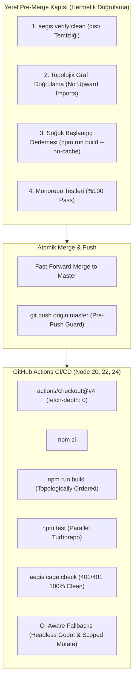

# 🏛️ RFC-036: CI/CD & Multi-Agent Atomic Merge Hardening: Cold-Start Monorepo Invariant Verification, Topological Dependency Graph Enforcement & Hermetic Pipeline Gates
### Aegis Autonomous Architecture Blueprint

- **RFC ID:** RFC-036 | **Durum:** Proposed | **Tarih:** 2026-10-28
- **GitHub Discussion:** [#325](https://github.com/frkntlr/aegis/discussions/325)
- **Kapsam:** `@aegis/core/orchestrator`, `@aegis/core/ast-skeleton`, `@aegis/cli`, `.github/workflows/`

---

## 🔍 1. Fikir ve Problem Tanımı (Motivation & Root Cause Analysis)

Aegis çoklu-ajan mimarisinde ajanlar izole Git worktree'lerinde çalışıp `aegis merge <agent>` ile değişiklikleri `master` dalına başarıyla birleştirseler bile, uzak depoya itildikten sonra GitHub Actions CI/CD boru hattında kaskad derleme ve test hataları (`TS2307`) oluşabilmektedir.

### Kök Neden Analizi (Root Causes):
1. **Yerel vs. Uzak Önbellek Asimetrisi (False Local Green):**
   - Yerel geliştirici veya ajan ortamında paketlerin `dist/` klasörleri daha önceki derlemelerden mevcut olduğu için `tsc` tip tanımlarını (`.d.ts`) önbellekten bularak başarıyla geçer.
   - GitHub Actions gibi temiz ve soğuk bir çalışma ortamında (cold-start) Turborepo, 14 paketi sıfırdan paralel derler.
2. **Topolojik Bağımlılık Grafı Ters Yüzü (Dependency Graph Inversion):**
   - `@aegis/ast-skeleton` (Katman 1 Çekirdek) içerisindeki `symbiotic-substrate-2.e2e.test.ts`, üst seviye bir entegrasyon paketi olan `@aegis/github-live` (Katman 3) paketinden `ContractDriftRadar` sınıfını import etmektedir.
   - `@aegis/ast-skeleton/package.json` içerisinde `@aegis/github-live` bağımlılığı tanımlı değildir.
   - Turborepo bağımlılık grafını bilmediği için `ast-skeleton` ve `github-live` paketlerini aynı anda derlemeye çalışır; `github-live/dist` henüz üretilmediğinden derleme `TS2307: Cannot find module '@aegis/github-live'` hatası ile çöker.
3. **CI/CD Ortam Uyumsuzlukları (Environment Asymmetry):**
   - CI ortamlarında Godot motoru kurulu değildir; `aegis inspect` veya `aegis godot status` adımları CI algılaması olmadan çalıştırıldığında kırılganlık yaratır.
   - `aegis mutate` komutu staged değişiklikleri arar; `push` olayında staged dosya bulunmadığı için davranış sapması oluşur.

---

## 🏗️ 2. Mimari Çözüm & Sistem Tasarımı (Architectural Solution)

### Temel Mimari Prensipler:
1. **Katı Katman Hiyerarşisi (Strict Layer Hierarchy):**
   - Katman 0: `@aegis/shared`
   - Katman 1: `@aegis/core/ast-skeleton`, `@aegis/core/iron-cage`
   - Katman 2: `@aegis/core/compound-checker`, `@aegis/core/watchdog`, `@aegis/core/trust-verifier`
   - Katman 3: `@aegis/core/github-live`, `@aegis/plugins/godot-bridge`, `@aegis/plugins/telemetry-tester`
   - Katman 4: `@aegis/core/orchestrator`, `@aegis/dialogue-engine`, `@aegis/web-dashboard`
   - Katman 5: `@aegis/cli`
   - *Kural:* Alt katmandaki bir paket asla üst katmandaki bir paketi import edemez!
2. **Hermetik Soğuk Başlangıç Kapısı (`aegis verify:clean`):**
   - `aegis merge <agent>` pipeline'ına soğuk derleme testi eklenir. `dist` ve `.turbo` silinerek temiz derleme teyit edilmeden birleştirmeye izin verilmez.
3. **CI-Duyarlı Komuta Adaptörü (CI-Aware Adapter):**
   - Komutlar `process.env.CI === 'true'` durumunu algılayarak Godot kurulu olmayan sistemlerde ClassDB çevrimdışı doğrulamasına ve push olaylarında `HEAD~1..HEAD` aralık mutasyonuna geçer.
4. **İş Akışı Sağlamlaştırması (`ci.yml`, `pr-shield.yml`):**
   - `fetch-depth: 0` ile git geçmişi tam çekilir; Node 20, 22, 24 matrisinde deterministik başarı garanti edilir.

---

## 🔒 3. Demir Kafes Standartları
- Azami 300 satır/dosya, azami 40 satır/fonksiyon.
- %100 Monorepo test geçişi, %70+ Mutation Testing Gate skoru.
- Sıfır yukarı-yönlü (upward) paket bağımlılığı.

---

## 🎯 4. Kabul Kriterleri (Acceptance Criteria)
- [ ] **AC-1:** `@aegis/ast-skeleton` içerisindeki `@aegis/github-live` bağımlılığı kaldırılarak E2E testi üst seviye entegrasyon paketine taşındı.
- [ ] **AC-2:** 14 paketin tamamında `tsconfig.json` Project References ve `package.json` bağımlılıkları katman hiyerarşisine göre doğrulandı.
- [ ] **AC-3:** Temiz çalışma alanında (`npm run clean && npm run build`) soğuk derlemenin 0 hata ile geçtiği kanıtlandı.
- [ ] **AC-4:** `ci.yml` ve `pr-shield.yml` iş akışları CI-duyarlı adımlarla sağlamlaştırıldı; Node 20, 22 ve 24 sürümlerinde GitHub Actions üzerinde yeşil geçiş sağlandı.
- [ ] **AC-5:** Demir Kafes (300/40) kurallarına %100 uyum sağlandı.
