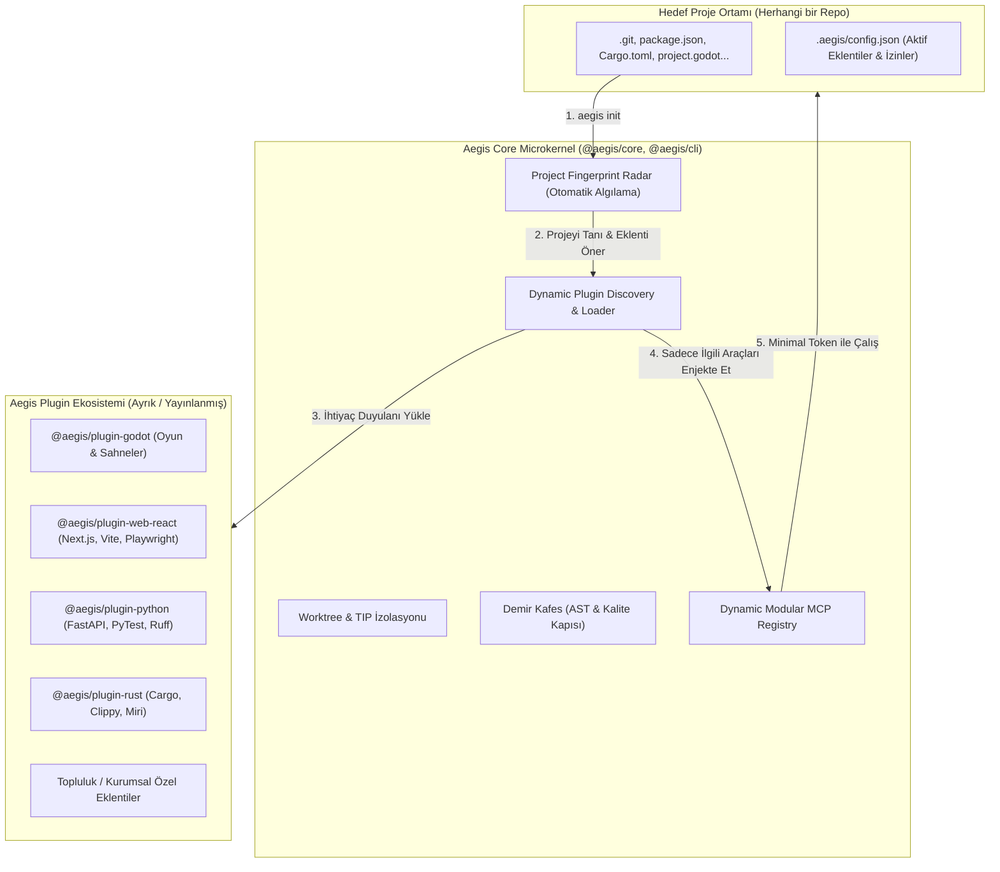

# 🏛️ RFC-037: Dynamic Plugin Ecosystem, Microkernel Decoupling, and Project-Agnostic Modular Substrate
### Aegis Autonomous Architecture Blueprint

- **RFC ID:** RFC-037
- **Durum:** Proposed (Teklif Edildi / Tartışmaya Açık) ⏳
- **Tarih:** 2026-10-28
- **Yazar:** Aegis Autonomous Fleet & Doc Architect (`📚 [DOC ARCHITECT]`)
- **Kategori:** Ideas (Fikirler & Temel Mimari İnovasyon)
- **GitHub Tartışması:** [#327](https://github.com/frkntlr/aegis/discussions/327)

---

## 🔍 1. Fikir ve Problem Tanımı (Vision & Strategic Dilemma)

Aegis şu an monorepo içerisinde tek parça (monolitik paket demeti) olarak geliştirilmekte ve derlenmektedir. `packages/cli`, doğrudan `packages/plugins/godot-bridge` ve `packages/plugins/telemetry-tester` gibi etki alanına (domain-specific) özel paketlere statik importlarla bağlıdır:

```text
[Aegis CLI (Dist)]
  ├── @aegis/orchestrator (Core)
  ├── @aegis/iron-cage (Core)
  ├── @aegis/watchdog (Core)
  ├── @aegis/godot-bridge (Spesifik: Godot 4.x Oyun Motoru)  <-- Statik bağımlı!
  └── @aegis/telemetry-tester (Spesifik: Görsel UI / Pixelmatch)
```

### Saha Gözlemi ve Temel Sorun:
Bir geliştirici veya ekip Aegis motorunu **çok farklı bir projede** kullanmak istediğinde (örneğin: React/Next.js frontend, Python FastAPI mikroservisi, Rust sistem yazılımı veya C# masaüstü projesi):
1. **Gereksiz Yük ve Paket Şişkinliği (Domain Bloat):** Proje Godot motoruyla hiçbir ilgisi olmamasına rağmen Godot RPC köprüsü, doctool tarayıcısı ve Godot MCP araçları projeye yüklenmekte ve belleğe alınmaktadır.
2. **LLM Context & Token İsrafı (MCP Token Pollution):** Aegis MCP sunucusu 27 aracı tek seferde Antigravity veya Claude IDE'ye kaydeder. Bir React projesinde çalışan LLM'in context penceresine `godot_inspect`, `godot_run`, `godot_validate` gibi 8 adet gereksiz Godot aracı doldurulur. Bu durum her istekte gereksiz token tüketir ve modelin araç seçme isabetini düşürür.
3. **Tek Depoda Test ve Gelişim Darboğazı (Monorepo CI Coupling):** Godot eklentisindeki bir değişiklik veya test arızası, çekirdek (core) CLI veya web orkestratörünün derleme ve test sürecini bloklar.
4. **Harici Projeye Özelleşmiş Kurulum Eksikliği:** Aegis'in hedef projeyi otomatik analiz edip (fingerprinting), o projeye uygun araç ve eklentileri (plugin) dinamik olarak indirip kuracağı bir "Paket / Eklenti Ekosistemi" henüz dinamik değildir.

---

## 🏗️ 2. Önerilen Mimari: Microkernel + Dinamik Plugin Ekosistemi



### Temel Bileşenler:
1. **Aegis Core (Microkernel):**
   - Dil ve motordan bağımsız çekirdek: Worktree yönetimi, Görev Dağıtıcı (TIP), Demir Kafes (300/40 satır kuralı), Watchdog ve Temel Git Güvenliği.
   - Sadece eklenti yükleme motoru ve dinamik MCP kayıtçısı barındırır.
2. **Project Fingerprint Radar (Ortam Koklama):**
   - `aegis init` çalıştırıldığında projedeki belirteç dosyaları (`project.godot`, `package.json`, `Cargo.toml`, `pyproject.toml`, `go.mod`) inceler ve uygun eklentileri önerir / kurar.
3. **Dynamic MCP Server:**
   - LLM'e sadece kurulu eklentilerin araçlarını dinamik olarak bildirir. React projesinde 8 Godot aracı gizlenir, React/Jest/Playwright araçları açılır.

---

## ⚖️ 3. Avantaj ve Dezavantaj Analizi (Comprehensive Trade-Off Matrix)

| Kriter | Mevcut Monolitik Yapı (Mono-Repo & All-In-One) | Önerilen Dinamik Plugin Mimarisi (Microkernel + Modular) |
| :--- | :--- | :--- |
| **Token Verimliliği (LLM Context)** | ❌ **Düşük:** 27 MCP aracı her projeye yüklenir; yüzlerce token gereksiz tüketilir. | ✅ **Üstün:** Sadece ilgili projenin araçları (örn. 8-10 araç) yüklenir. Sıfır token israfı. |
| **Kurulum & Kullanım Kolaylığı** | ✅ **Yüksek:** `npm install` ile her şey gelir, ek indirme gerekmez. | ⚠️ **Dikkat Gerekli:** İlk kurulumda internet / paket çekme adımı veya ek yükleme gerekir. |
| **Çoklu Proje / Dil Uyumluluğu** | ❌ **Kısıtlı:** Godot ve genel TS/JS ağırlıklı; başka dillerde yabancı yük taşır. | ✅ **Sınırsız:** Python, Rust, Go, Web veya Godot projelerine tam uyumlu özelleşmiş ortam. |
| **Geliştirme ve CI Hızı** | ⚠️ **Yavaşlayan:** Godot eklentisindeki hata genel CLI derlemesini etkiler. | ✅ **Hızlı & İzole:** Her eklenti kendi bağımsız CI/CD ve test döngüsüne sahip olur. |
| **Topluluk ve Ekosistem Gücü** | ❌ **Kapalı:** Üçüncü partiler monorepo içine girmeden yeni araç ekleyemez. | ✅ **Açık Ekosistem:** İsteyen herkes `@company/aegis-plugin-xyz` geliştirip yayınlayabilir. |
| **Sürümleme ve API Değişimi** | ✅ **Kolay:** Tek repo içinde anlık refactor edilir, uyumsuzluk yaşanmaz. | ⚠️ **Sözleşme Disiplini:** Core API değişimlerinde Semantic Versioning ve katı sözleşme şarttır. |

---

## 🔒 4. Demir Kafes ve Sözleşme Standardı

Eklentiler için resmi bir `AegisPlugin` sözleşmesi:

```typescript
export interface AegisPlugin {
  id: string;
  name: string;
  version: string;
  detect(projectRoot: string): boolean | Promise<boolean>;
  getMcpTools(): McpToolDefinition[];
  getQualityGates?(): QualityGate[];
  onInit?(context: PluginContext): Promise<void>;
}
```

---

## 🎯 5. Kabul Kriterleri ve Aşamalı Yol Haritası (Roadmap)

- [ ] **Aşama 1 (Microkernel İzolasyonu):** `@aegis/godot-bridge` ve `@aegis/telemetry-tester` paketlerinin CLI içerisindeki statik importları kaldırılıp `PluginRegistry` üzerinden dinamik arayüze bağlanması.
- [ ] **Aşama 2 (Proje Koklama & Konfigürasyon):** `aegis init` esnasında `.aegis/config.json` oluşturulması ve proje türüne göre aktif eklenti listesinin yönetilmesi.
- [ ] **Aşama 3 (Dinamik MCP Sağlayıcı):** `mcp-server-command.ts` dosyasının sadece aktif eklentilerin araçlarını istemciye expose etmesi.
- [ ] **Aşama 4 (Eklenti Yönetim Komutları):** `aegis plugin list`, `aegis plugin add <name>`, `aegis plugin remove <name>` komutlarının CLI'ya kazandırılması.
