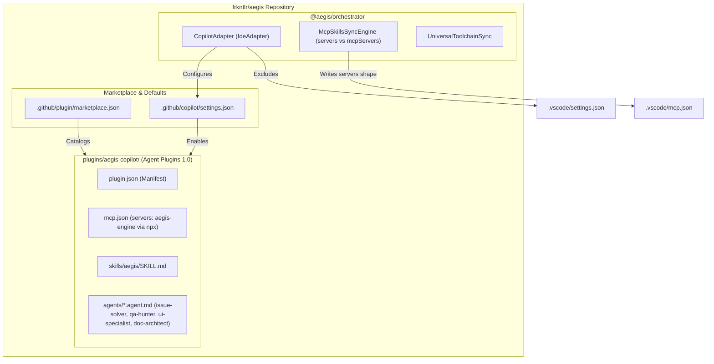

# 🏛️ RFC-041: GitHub Copilot Plugin Distribution for Aegis
### Aegis Autonomous Architecture Blueprint

- **RFC ID:** RFC-041
- **Status:** Implemented & Authoritative ✅
- **Date:** 2026-11-02
- **Authors:** Doc Architect (`📚 [DOC ARCHITECT]`) & Issue Solver (`🛠️ [ISSUE SOLVER]`)
- **Target Monorepo:** `frkntlr/aegis`
- **Related Discussion:** [#423](https://github.com/frkntlr/aegis/discussions/423)
- **Associated Issue:** [#422](https://github.com/frkntlr/aegis/issues/422)

---

## 1. Problem and Goal

Aegis provides deep autonomous coding capabilities, multi-agent orchestration, a 5-layer codebase memory system, and deterministic Demir Kafes quality gates. While Aegis integrates with Google Antigravity, Cursor, Windsurf, Zed, and Godot through custom IDE adapters, it lacked a first-class, installable packaging format for the GitHub Copilot Agent Plugins 1.0 ecosystem.

This specification establishes Aegis as an installable GitHub Copilot Agent Plugin, standardizing:
1. An Agent Plugins 1.0 package manifest (`plugin.json`), MCP declaration (`mcp.json`), workflow skill (`skills/aegis/SKILL.md`), and custom agents (`agents/*.agent.md`).
2. A repository-hosted plugin marketplace catalog at `.github/plugin/marketplace.json`.
3. Non-mandatory repository default settings at `.github/copilot/settings.json`.
4. Idempotent MCP synchronization adhering to VS Code's documented `servers` shape rather than assuming vendor-specific keys.
5. Zero maintainer-machine leakage (avoiding hardcoded user home directories or developer-specific paths).

---

## 2. Component Topology & Package Layout



### Directory Structure:
```text
plugins/aegis-copilot/
  ├── plugin.json
  ├── mcp.json
  ├── skills/
  │   └── aegis/
  │       └── SKILL.md
  └── agents/
      ├── issue-solver.agent.md
      ├── qa-hunter.agent.md
      ├── ui-specialist.agent.md
      └── doc-architect.agent.md
.github/
  ├── plugin/
  │   └── marketplace.json
  └── copilot/
      └── settings.json
```

---

## 3. Specifications & Contracts

### A. Plugin Manifest (`plugins/aegis-copilot/plugin.json`)
The manifest conforms to the open Agent Plugins 1.0 schema:
```json
{
  "$schema": "https://json.schemastore.org/agent-plugin.json",
  "name": "aegis-copilot",
  "version": "0.1.0",
  "description": "Aegis Autonomous Vibe Coding Engine plugin for GitHub Copilot with multi-agent orchestration, Demir Kafes quality gates, and 5-layer codebase memory.",
  "author": { "name": "frkntlr" },
  "license": "MIT",
  "mcpServers": "./mcp.json",
  "agents": "./agents",
  "skills": "./skills"
}
```

### B. Portable MCP Configuration (`plugins/aegis-copilot/mcp.json`)
The MCP declaration uses standard `npx` execution without embedding maintainer machine paths:
```json
{
  "servers": {
    "aegis-engine": {
      "command": "npx",
      "args": ["--yes", "@aegis/cli", "mcp"]
    }
  }
}
```

### C. Repository Marketplace Catalog (`.github/plugin/marketplace.json`)
Registers Aegis for discovery via `copilot plugin marketplace`:
```json
{
  "name": "aegis-marketplace",
  "version": "0.1.0",
  "description": "Aegis Autonomous Vibe Coding Engine Plugin Marketplace Catalog",
  "plugins": [
    {
      "id": "aegis-copilot",
      "name": "Aegis Vibe Coding Engine",
      "version": "0.1.0",
      "description": "Autonomous Vibe Coding Engine with multi-agent orchestration, Demir Kafes quality gates, and 5-layer codebase memory.",
      "path": "plugins/aegis-copilot",
      "author": { "name": "frkntlr" },
      "keywords": ["aegis", "copilot", "vibe-coding", "mcp", "subagents", "demir-kafes"]
    }
  ]
}
```

### D. VS Code & Copilot MCP Synchronization
VS Code's native MCP integration uses the top-level `servers` key in `.vscode/mcp.json`. `McpSkillsSyncEngine` evaluates adapter identity:
- When targeting `vscode` or `copilot`, configuration writes to `servers`.
- When targeting `antigravity`, `cursor`, `windsurf`, or other IDEs, configuration writes to `mcpServers`.
- Existing configuration keys and server entries outside of the Aegis domain are merged and preserved.

---

## 4. Verification and Acceptance Checklist

- [x] Agent Plugins 1.0 manifest, marketplace catalog, MCP configuration, skill, and Copilot-specific agents are created.
- [x] IDE synchronization writes VS Code's `servers` shape and merges cleanly without deleting existing entries.
- [x] Copilot setup and sync outcomes are explicit and covered by unit/integration tests.
- [x] Zero maintainer-specific machine paths or personal tokens exist in plugin files.
- [x] 100% Demir Kafes compliance (<300 lines/file, <40 lines/function, 0 `any`).
- [x] All 28 test suites in the monorepo pass cleanly.
