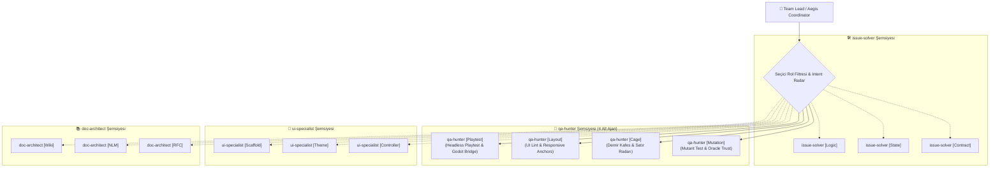

# 🏛️ RFC-044: Hierarchical Subagent Tree Orchestration and Adaptive Selective Activation
### Aegis Autonomous Architecture Blueprint

- **RFC ID:** RFC-044 | **Durum:** Proposed | **Tarih:** 2026-11-07
- **Yazar:** frkntlr & Aegis Core Team
- **Bağlantılı Tartışma:** https://github.com/frkntlr/aegis/discussions/517

---

## 🔍 1. Fikir ve Problem Tanımı

### 1.1 Mevcut Sınırlamalar
1. **Körü Körüne 4 Rol Tetikleme (Unconditional Track Spawning):**
   Mevcut Aegis Teamwork (`/aegis tw`) mekanizmasında `ensureRequiredTracks` mantığı, hedef yalnızca belirli bir alanı ilgilendirse bile (`issue-solver` ve `qa-hunter` başta olmak üzere) tüm ana rolleri zorunlu olarak ayağa kaldırmaktadır. Bu durum tek bir birim testi koşmak veya sadece arayüz temasını cilalamak isteyen geliştiriciler için gereksiz bağlam şişmesine ve gecikmeye yol açmaktadır.

2. **Düz (Flat) Tek Katmanlı Rol Darboğazı:**
   Her rol (`qa-hunter`, `issue-solver`, `ui-specialist`, `doc-architect`) tek bir düz hat üzerinden yürütülmektedir. Oysa kapsamlı bir QA denetiminde;
   - Headless oyun oynanış testi (Playtest),
   - Görsel UI bounding-box ve anchor uyumluluğu (Layout Lint),
   - Demir Kafes statik kota radarı (Cage Check),
   - Mutasyon ve Oracle güven doğrulaması (Mutation & Trust Audit)
   gibi birbirinden bağımsız alt görevler tek bir ajanın sırtına yüklenmekte ve paralelleşme potansiyeli kısıtlanmaktadır.

### 1.2 Hedef Mimarisi
- **Seçici / Uyarlanabilir Aktivasyon (Adaptive Selective Activation):** Kullanıcı `/aegis tw --role=qa` veya doğrudan role özel bir komut/hedef girdiğinde, gereksiz diğer 3 rol çalıştırılmadan yalnızca ilgili rol ve alt ajanları ayağa kalkar.
- **Hiyerarşik Alt Ajan Ağacı (Hierarchical Micro-Specialists Tree):** Tek bir ana rol başlığı altında (örneğin `qa-hunter`), kendi bünyesinde 4 uzman alt ajana mikro-parçalanma (sharding) yapılır.
- **Sıfır Çakışmalı Ayrık Kilitler (Disjoint Mutex Locks):** Tüm alt ajanlar `.aegis/locks.json` üzerinde %100 ayrık dosya ve görev alanlarına sahip olur, hiçbir yarış durumu (race condition) oluşmaz.

---

## 🏗️ 2. Düğüm & Bileşen Mimarisi (Component Breakdown)

### 2.1 Mikro Uzmanlık Kümeleri (Role Sub-Specialists)

1. **`qa-hunter` Alt Ajanları (4 Mikro Uzman):**
   - `qa-hunter [Playtest]`: `aegis_godot_playtest`, `run_project`, headless sahne doğrulaması.
   - `qa-hunter [Layout]`: `aegis godot ui:lint`, `aegis inspect`, container ve minimum dokunma alanı (44x44px).
   - `qa-hunter [Cage]`: `aegis cage:check`, `aegis diff`, dosya ve fonksiyon sınırları.
   - `qa-hunter [Mutation]`: `aegis mutate`, `aegis audit`, test manipülasyonu ve mutant öldürme skoru (%100).

2. **`issue-solver` Alt Ajanları:**
   - `issue-solver [Logic]`: Çekirdek iş algoritmaları ve veri yapıları.
   - `issue-solver [State]`: Durum makineleri, reaktif döngüler ve olay yönetimi.
   - `issue-solver [Contract]`: Tip tanımları, arayüzler ve `aegis deps:drift`.

3. **`ui-specialist` Alt Ajanları:**
   - `ui-specialist [Scaffold]`: Sahne hiyerarşisi (`.tscn`), `MarginContainer`, `VBoxContainer`.
   - `ui-specialist [Theme]`: StyleBoxFlat ve `.tres` temaları.
   - `ui-specialist [Controller]`: UI GDScript sunum mantığı ve sinyal akışları.

4. **`doc-architect` Alt Ajanları:**
   - `doc-architect [Wiki]`: GitHub Living Wiki (`<repo>.wiki.git`) canlı senkronizasyonu.
   - `doc-architect [NLM]`: NotebookLM mimari zeminleme ve araştırma sentezi.
   - `doc-architect [RFC]`: RFC döngüsü ve GitHub Issues ayrıştırması.

---

## 🔒 3. Demir Kafes ve Güvenlik Standartları

1. **Katı Kota Kuralları:** Her yeni dosya azami 300 satır, her fonksiyon azami 40 satır olacaktır.
2. **Kilit Güvenliği:** Bir alt ajan başka bir alt ajanın kilitlediği dosyaya dokunamaz.
3. **Progressive Disclosure:** Alt ajan tanımları ve promptları RTK Token Killer ile sıkıştırılır, bağlam bütçesi korunur.
4. **Antigravity Uyumluluğu:** Antigravity `define_subagent` üzerinde `EnableSubagentTools: true` bayrağı verilerek gerekirse alt ajanların da dinamik çocuk ajan yönetebilmesi sağlanır.

---

## 🎯 4. Kabul Kriterleri (Acceptance Criteria)

- [ ] `TeamworkDecomposer` seçici rol desteği (`--role=<role>`, `--only=<role>`, intent detection) ile donatıldı.
- [ ] Belirli bir rol istendiğinde diğer 3 rolün zorunlu olarak eklenmesi engellendi.
- [ ] `TeamworkSharder` içinde rolleri mikro-uzmanlıklara bölen `shardRoleSubspecialists` mimarisi inşa edildi.
- [ ] `qa-hunter` altında 4 mikro alt ajanın (`Playtest`, `Layout`, `Cage`, `Mutation`) çakışmasız paralel çalışması sağlandı.
- [ ] Demir Kafes (%100 temiz, 0 violation) ve tüm monorepo testleri başarıyla geçti.
