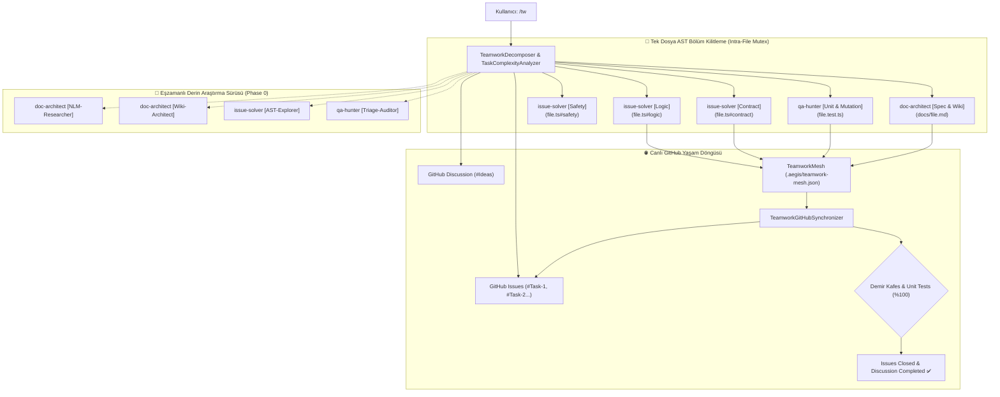

# 🏛️ RFC-045: Intra-File AST Section Mutex Sharding, Hyper-Scale Research Swarms, and Real-Time Autonomous GitHub Lifecycle Synchronization
### Aegis Autonomous Architecture Blueprint

- **RFC ID:** RFC-045 | **Durum:** Proposed | **Tarih:** 2026-11-07
- **Yazar:** frkntlr & Aegis Core Team
- **Modüller:** `@aegis/orchestrator`, `@aegis/github-live`, `@aegis/cli`

---

## 🔍 1. Fikir ve Problem Tanımı

### 1.1 Mevcut Sınırlamalar
1. **Tek Dosya Kilit Darboğazı (Single-File Whole Mutex Bottleneck):**
   Mevcut `WorktreeLockManager` ve `TeamworkSharder` mimarisi dosya bazlı kilit (`lock:path/file.ts`) kullanmaktadır. Hedef kapsamı tek bir kritik dosya olduğunda (`src/service.ts`), yarış durumunu önlemek için yalnızca tek bir `issue-solver` atanabilmekte; diğer ajanlar boşta beklemek zorunda kalmaktadır. Oysa tek bir dosya bile olsa mantık (logic), tip/arayüz sözleşmesi (contract), hata güvenliği (safety), birim testler ve dokümantasyon eşzamanlı olarak farklı uzmanlarca işlenebilir.
2. **Azami 4 Ajan Algısı ve Yapay Eşzamanlılık Sınırı:**
   Geliştirici çok karmaşık veya büyük ölçekli bir görev verdiğinde, sistem 4 ana rolün ötesinde 8-16 paralel alt ajanı dinamik olarak ayağa kaldırabilmeli; alt sistem ve mikro-uzmanlık düzeyinde tam paralel eşzamanlılık (hyper-scale concurrency) sağlayabilmelidir.
3. **Derin Araştırma & Grounding Eksikliği (Research Swarms):**
   Uygulama koduna geçmeden önce mimariyi araştıran, NotebookLM'e danışan, AST çağrıcı grafiğini çıkaran ve hata triyajı yapan eşzamanlı bir "Araştırma ve İnceleme Sürüsü" (Phase 0) ihtiyacı bulunmaktadır.
4. **GitHub Discussion & Issue Canlı Eşzamanlı Takip Eksikliği:**
   Otonom görevlerin gerçek zamanlı olarak GitHub Discussion mimari taslağına bağlanması, alt görevlerin takipçi GitHub Issue'larına bölünmesi ve alt ajanlar ilerledikçe bu issue'ların canlı yorumlarla senkronize edilip bitişte otomatik kapatılması gerekmektedir.

### 1.2 Hedef Mimarisi
- **AST Bölüm Mutex Kilitleri (Intra-File AST Section Mutex):** `dosya.ts#logic`, `dosya.ts#contract`, `dosya.ts#safety` gibi alt-bölüm kilitleri sayesinde birden fazla uzman ajan aynı dosya üzerinde sıfır çakışma ile eşzamanlı çalışır.
- **Tek Dosyada Çoklu Ajan Ayrıştırma (Single-File Fine-Grained Sharding):** Tek bir dosya hedef gösterilse dahi sistem 4-8 uzman alt ajanı paralel olarak görevlendirir.
- **Otonom Derin Araştırma Sürüsü (Deep Research Swarm):** Phase 0 kapsamında NotebookLM, AST Keşfi, Wiki ve Triyaj uzmanları eşzamanlı devreye girer.
- **Canlı GitHub Yaşam Döngüsü Senkronizasyonu (Real-Time GitHub Lifecycle Engine):** Discussion ve Issue'lar otonom oluşturulur, Teamwork Mesh olayları anlık olarak GitHub Issue'larına yorum olarak akar ve kalite kapısı geçildiğinde otomatik kapatılır.

---

## 🏗️ 2. Düğüm & Bileşen Mimarisi (Component Breakdown)

---

## 🔒 3. Demir Kafes Standartları
- Azami 300 satır/dosya, azami 40 satır/fonksiyon, kesinlikle 0 `any`.
- Tüm kilit ve ayrıştırma operasyonlarında tam determinizm.
- %100 birim test ve mutasyon testi doğrulaması.

---

## 🎯 4. Kabul Kriterleri (Acceptance Criteria)
- [ ] `WorktreeLockManager` dosya içi alt-bölüm (`file#section`) kilitlerini desteklemeli, farklı bölümlerin aynı dosyada çakışmadan kilitlenmesine izin vermeli.
- [ ] `TeamworkSharder` ve `TeamworkDecomposer` tek dosya verildiğinde dahi mantık, sözleşme, güvenlik, test ve dokümantasyon alt ajanlarını ayağa kaldırabilmeli.
- [ ] `TaskComplexityAnalyzer` ve `TeamworkDecomposer` 8-16 ajanlık hiper-ölçekli eşzamanlılığı sorunsuz desteklemeli.
- [ ] `TeamworkResearchSwarm` Phase 0 derin araştırma modülünü hayata geçirmeli.
- [ ] `TeamworkGitHubSynchronizer` Discussion oluşturma, Issue bölme, canlı durum senkronizasyonu ve kapatma döngüsünü sağlamalı.
- [ ] Monorepo testleri (%100) ve Demir Kafes denetimi eksiksiz geçmeli.
