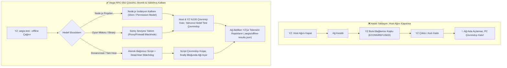
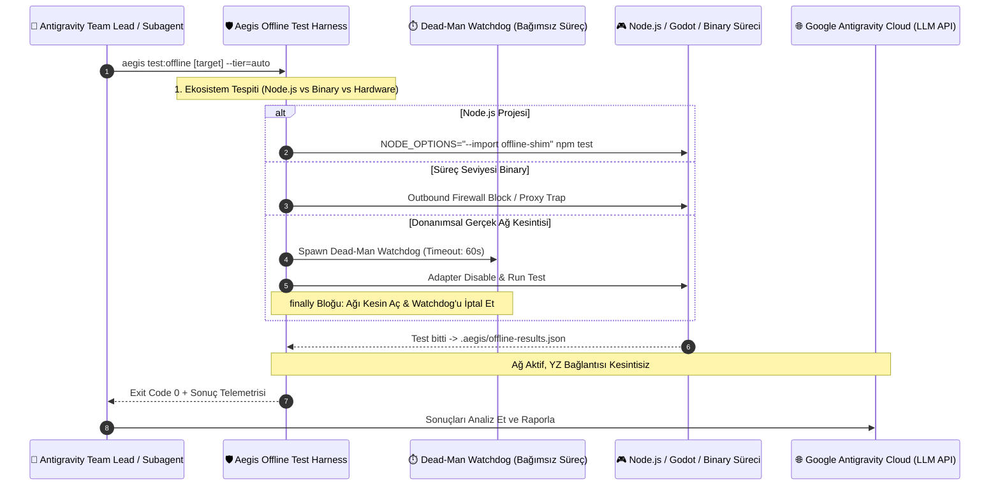

# 🏛️ RFC-050: Autonomous Fail-Safe Offline Test Shield and Self-Restoring Network Harness
### Aegis Autonomous Architecture Blueprint

- **RFC ID:** RFC-050 | **Durum:** Proposed | **Tarih:** 2026-11-08
- **GitHub Discussion:** [#530 (Ideas)](https://github.com/frkntlr/aegis/discussions/530)
- **GitHub Issue:** [#531](https://github.com/frkntlr/aegis/issues/531)
- **Tasarımcı:** Aegis Autonomous Fleet & Antigravity Pair Lead

---

## 🔍 1. Fikir ve Problem Tanımı (The Core Paradox)

### 1.1 Bulut Tabanlı YZ ve Çevrimdışı Test Paradoksu
Otonom kodlama asistanları (Google Antigravity, Gemini, Claude, GPT), düşünme ve akıl yürütme döngülerini bulut tabanlı API uç noktaları (`generativelanguage.googleapis.com` vb.) üzerinden sürdürür. 

Bir uygulamanın (Godot oyunu, Node.js backend/servis, mobil istemci, senkronizasyon motoru) **çevrimdışı davranışını** (offline fallback, cache integrity, ağ kopması toleransı, yeniden bağlanma mantığı) test etmek gerektiğinde şu kritik mantık hatası ortaya çıkar:

1. **Ölümcül Ağ Kesintisi (Deadlock)**: Eğer yapay zekâ veya test betiği çevrimdışı testi simüle etmek amacıyla ana bilgisayarın (host PC) ağını keserse (`Disable-NetAdapter`, firewall drop, global network sever), YZ modelinin bulutla olan iletişim bağı anında kopar.
2. **Kopuk Düşünce Döngüsü**: Ağ kesildiği anda Antigravity aracı sonraki adımı modele iletemez, LLM yanıt üretemez ve tüm oturum çöker / asılı kalır.
3. **Kalıcı İnternetsiz Kalma Riski**: YZ oturumu çöktüğü için ağ bağlantısını tekrar açacak olan temizleme (`cleanup / restore`) adımı **asla çalıştırılamaz**. Geliştiricinin bilgisayarı internetsiz kalır.
4. **Çok Turlu (Multi-Turn) İmkânsızlık**: YZ ajanı "1. Tur: İnterneti kapat -> 2. Tur: Testi yap -> 3. Tur: İnterneti aç" şeklinde ardışık komut çalıştıramaz; çünkü 1. turun sonunda internet gittiğinde 2. tura geçebilecek bilişsel kapasite fiziksel olarak yok olur.



---

## 🟩 2. Node.js Projeleri İçin Özel Çevrimdışı Çözüm Mimarisi

Kullanıcı geri bildirimi doğrultusunda, bir **Node.js projesi** (API servisleri, CLI araçları, mikroservisler, web uygulamaları) geliştirilirken veya test edilirken host internetine dokunmadan çevrimdışı senaryoları %100 deterministik kılacak 4 katmanlı Node.js çözümü tanımlanmıştır:

### 2.1 Node.js Yerleşik Yetkilendirme Modeli (`--experimental-permission`)
Modern Node.js (v20+), V8 ve libuv seviyesinde yetkilendirme bayraklarını yerleşik olarak destekler:
- Test veya uygulama süreci başlatılırken:
  ```bash
  node --experimental-permission --allow-fs-read=* --allow-fs-write=* (omit --allow-net) test-runner.js
  ```
- `--allow-net` bayrağı verilmediğinde, Node.js C++ çekirdeği herhangi bir TCP, UDP veya DNS soketi açma girişimini engeller ve doğrudan `ERR_ACCESS_DENIED` istisnası fırlatır.
- **Sıfır Host Etkisi**: İşletim sistemi güvenlik duvarına, adaptörüne veya harici ayarlara ihtiyaç duymadan, yalnızca o Node.js süreci izole edilir. YZ ve Antigravity kesintisiz çalışır.

### 2.2 Sıfır Kod Değişikliği: Çalışma Zamanı Preload Shim (`offline-shim.mjs`)
Uygulama veya test kodunda (Vitest, Jest, Mocha, `node:test`) hiçbir satır değiştirmeden, `NODE_OPTIONS` ortam değişkeni ile enjekte edilen evrensel çevrimdışı ara katman (shim):
```bash
NODE_OPTIONS="--import @aegis/watchdog/offline-shim" npm test
```
Bu shim, Node.js çekirdek ağ modüllerini çalışma zamanında cerrahi olarak sarmalar:
1. **`globalThis.fetch` & `undici`**: Doğrudan `TypeError: fetch failed (cause: Error: connect ECONNREFUSED 127.0.0.1:0)` fırlatır.
2. **`node:dns`**: `dns.lookup` ve `dns.resolve*` çağrılarını anında `ENOTFOUND` / `EAI_AGAIN` hata kodu ile reddeder.
3. **`node:net`**: `net.Socket.prototype.connect` çağrısında gerçek soket açılışını durdurup `ECONNREFUSED` emit eder.
4. **`node:http` & `node:https`**: `http.request` çağrılarını ağa çıkmadan anında hata durumuna yönlendirir.

### 2.3 Undici / Fetch Çekirdeği İzolasyonu (`MockAgent.disableNetConnect`)
Node 18+ içinde gömülü gelen `fetch` motoru için `MockAgent` aktivasyonu:
```typescript
import { setGlobalDispatcher, MockAgent } from 'undici';
const agent = new MockAgent();
agent.disableNetConnect(); // Tüm harici ağ çıkışları anında engellenir
setGlobalDispatcher(agent);
```

### 2.4 Loopback Proxy Trap (Env-Based Blackhole)
Axios, Got, Superagent veya harici HTTP istemcisi kullanan Node.js kütüphaneleri için:
```bash
HTTP_PROXY="http://127.0.0.1:9" HTTPS_PROXY="http://127.0.0.1:9" ALL_PROXY="http://127.0.0.1:9" NO_PROXY="" npm test
```
Port 9 (Discard Protocol) üzerinde hiçbir servis dinlemediği için tüm giden istekler anında `ECONNREFUSED` alır. YZ ve ana sistem interneti ise ortam değişkenleri izole alt sürece verildiği için etkilenmez.

---

## 🏗️ 3. Genel Çok Katmanlı Güvenlik Mimarisi (Multi-Tier Shield)



### Katman 1: Süreç Seviyesi Yalıtım (Process-Level Surgical Blackhole)
Host makinenin genel internetini kesmek yerine **yalnızca test edilen uygulamanın/oyunun süreç ağacını** ağdan izole eder:
- **Proxy Loopback Blackhole**: Test süreci `HTTP_PROXY=http://127.0.0.1:9`, `HTTPS_PROXY=http://127.0.0.1:9`, `NO_PROXY=""` ortam değişkenleriyle çalıştırılır.
- **Hedef Odaklı Güvenlik Duvarı (Targeted Windows Firewall Rule)**: Test edilecek binary için geçici giden bağlantı engelleme kuralı tanımlanır:
  `netsh advfirewall firewall add rule name="AegisOfflineApp" dir=out action=block program="<path_to_binary>"`. Node.js ve Antigravity hiçbir şekilde etkilenmez.

### Katman 2: Atomik Kendi Kendini Onaran Betik (Self-Restoring Atomic Harness)
Gerçek donanımsal ağ adaptörünün veya tam host çevrimdışılığının zorunlu olduğu senaryolarda:
1. **Tekil Atomik Görev**: YZ çoklu adım çalıştırmaz; tüm süreci sarmalayan tek bir PowerShell/Bash betiği tetikler.
2. **Deterministik `try / finally` Koruması**: Betik ne olursa olsun (hata, çökme, istisna) `finally` bloğunda ağ adaptörünü yeniden devreye alır.
3. **Dead-Man Watchdog (Ölü Adam Anahtarı)**: Betik başlamadan önce bağımsız, gizli bir arka plan bekçi süreci (`powershell -WindowStyle Hidden`) başlatır. Eğer ana test betiği çöker veya kilitlenirse, 60 saniye sonra bu bekçi süreç ağı **zorla** tekrar açar ve kuralları temizler.
4. **Diske Kalıcı Telemetri**: Çevrimdışı dönemde üretilen tüm loglar, ekran görüntüleri ve test sonuçları `.aegis/offline-results.json` dosyasına kaydedilir.
5. **Ağ Açıldıktan Sonra Bilişsel Uyanış**: Betik sonlanıp ağ geri geldiğinde Antigravity aracı sonucu buluta iletir; YZ uyanarak raporu okur ve akıl yürütür.

---

## 💻 4. Bileşen ve Modül Mimarisi

```text
packages/core/watchdog/
 └── src/
      ├── offline-test-harness.ts        # Ana çevrimdışı test yürütücü ve katman seçici
      ├── nodejs-offline-shim.ts         # Node.js fetch/dns/net/http çalışma zamanı ön-yükleyicisi
      ├── process-network-isolator.ts    # Süreç bazlı firewall ve proxy blackhole yöneticisi
      ├── dead-man-watchdog.ts           # Bağımsız arka plan ağ restorasyon bekçisi
      └── offline-telemetry-store.ts     # Diske yazılan çevrimdışı sonuç/log kasası

packages/cli/
 └── src/
      └── commands/
           └── test-offline-command.ts   # aegis test:offline CLI komutu ve parametreleri
```

---

## 🔒 5. Demir Kafes ve Güvenlik Standartları

1. **Host Emniyet Garantisi**: Hiçbir çevrimdışı test, bağımsız `dead-man-watchdog` koruması olmadan fiziksel ağ üzerinde çalıştırılamaz.
2. **Node.js Yalıtım Önceliği**: Node.js projelerinde varsayılan olarak her zaman Katman 2.2 (`offline-shim`) veya Katman 2.1 (`--experimental-permission`) kullanılır; ana makinenin internetine dokunulmaz.
3. **Demir Kafes Kuralı**: Tüm yeni modüller < 300 satır/dosya, < 40 satır/fonksiyon, kesinlikle 0 `any` standardına uyacaktır.
4. **Temiz Kapanış (Zero Leak)**: Oluşturulan tüm geçici güvenlik duvarı kuralları ve ortam değişkenleri test tamamlandığında %100 temizlenmek zorundadır.

---

## 🎯 6. Kabul Kriterleri (Acceptance Criteria)

- [ ] Node.js çevrimdışı ön-yükleyici shim (`nodejs-offline-shim.ts` / `offline-shim.mjs`) tasarlandı ve doğrulandı.
- [ ] `OfflineTestHarness` ve `ProcessNetworkIsolator` çekirdek mimarisi tamamlandı.
- [ ] Windows Firewall ve Proxy Blackhole tabanlı süreç seviyesi izolasyon birim testleri hazırlandı.
- [ ] Bağımsız `DeadManWatchdog` PowerShell/OS entegrasyonu yazıldı ve test edildi.
- [ ] `aegis test:offline` ve `aegis test --offline` CLI komutları kaydedildi.
- [ ] Demir Kafes (<300L/dosya, <40L/fn, 0 any) denetimi %100 geçti.
- [ ] Birim testler ve mutasyon testi onaylandı (%100 Kill Score).
