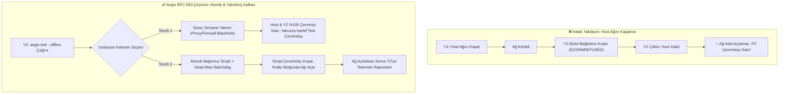
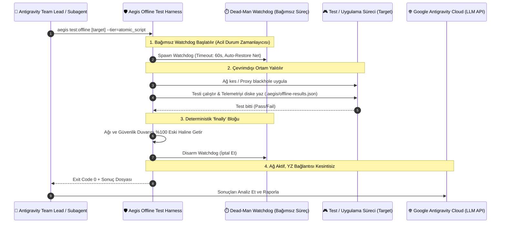

# 🏛️ RFC-050: Autonomous Fail-Safe Offline Test Shield and Self-Restoring Network Harness
### Aegis Autonomous Architecture Blueprint

- **RFC ID:** RFC-050 | **Durum:** Proposed | **Tarih:** 2026-11-08
- **GitHub Discussion:** [#530 (Ideas)](https://github.com/frkntlr/aegis/discussions/530)
- **Tasarımcı:** Aegis Autonomous Fleet & Antigravity Pair Lead

---

## 🔍 1. Fikir ve Problem Tanımı (The Core Paradox)

### 1.1 Bulut Tabanlı YZ ve Çevrimdışı Test Paradoksu
Otonom kodlama asistanları (Google Antigravity, Gemini, Claude, GPT), düşünme ve akıl yürütme döngülerini bulut tabanlı API uç noktaları (`generativelanguage.googleapis.com` vb.) üzerinden sürdürür. 

Bir uygulamanın (ör. Godot oyunu, mobil istemci, senkronizasyon motoru) **çevrimdışı davranışını** (offline fallback, cache integrity, ağ kopması toleransı, yeniden bağlanma mantığı) test etmek gerektiğinde şu kritik mantık hatası ortaya çıkar:

1. **Ölümcül Ağ Kesintisi (Deadlock)**: Eğer yapay zekâ veya test betiği çevrimdışı testi simüle etmek amacıyla ana bilgisayarın (host PC) ağını keserse (`Disable-NetAdapter`, firewall drop, global network sever), YZ modelinin bulutla olan iletişim bağı anında kopar.
2. **Kopuk Düşünce Döngüsü**: Ağ kesildiği anda Antigravity aracı sonraki adımı modele iletemez, LLM yanıt üretemez ve tüm oturum çöker / asılı kalır.
3. **Kalıcı İnternetsiz Kalma Riski**: YZ oturumu çöktüğü için ağ bağlantısını tekrar açacak olan temizleme (`cleanup / restore`) adımı **asla çalıştırılamaz**. Geliştiricinin bilgisayarı internetsiz kalır.
4. **Çok Turlu (Multi-Turn) İmkânsızlık**: YZ ajanı "1. Tur: İnterneti kapat -> 2. Tur: Testi yap -> 3. Tur: İnterneti aç" şeklinde ardışık komut çalıştıramaz; çünkü 1. turun sonunda internet gittiğinde 2. tura geçebilecek bilişsel kapasite fiziksel olarak yok olur.



---

## 🏗️ 2. Çok Katmanlı Güvenlik Mimarisi (Multi-Tier Shield)

Aegis, çevrimdışı testleri güvenli kılmak için 3 katmanlı deterministik bir kalkan uygular:



### Katman 1: Süreç Seviyesi Yalıtım (Process-Level Surgical Blackhole) - *Önerilen*
Host makinenin genel internetini kesmek yerine **yalnızca test edilen uygulamanın/oyunun süreç ağacını** ağdan izole eder:
- **Proxy Loopback Blackhole**: Test süreci `HTTP_PROXY=http://127.0.0.1:9`, `HTTPS_PROXY=http://127.0.0.1:9`, `NO_PROXY=""` ortam değişkenleriyle çalıştırılır. Uygulamanın tüm HTTP/WebSocket çağrıları anında `ECONNREFUSED` alır; host ve YZ ise internete bağlı kalmaya devam eder.
- **Hedef Odaklı Güvenlik Duvarı (Targeted Windows Firewall Rule)**: Test edilecek binary için geçici giden bağlantı engelleme kuralı tanımlanır:
  `netsh advfirewall firewall add rule name="AegisOfflineApp" dir=out action=block program="<path_to_binary>"`. Node.js ve Antigravity hiçbir şekilde etkilenmez.

### Katman 2: Atomik Kendi Kendini Onaran Betik (Self-Restoring Atomic Harness)
Gerçek donanımsal ağ adaptörünün veya tam host çevrimdışılığının zorunlu olduğu senaryolarda:
1. **Tekil Atomik Görev**: YZ çoklu adım çalıştırmaz; tüm süreci sarmalayan tek bir PowerShell/Bash betiği tetikler.
2. **Deterministik `try / finally` Koruması**: Betik ne olursa olsun (hata, çökme, istisna) `finally` bloğunda ağ adaptörünü yeniden devreye alır.
3. **Dead-Man Watchdog (Ölü Adam Anahtarı)**: Betik başlamadan önce bağımsız, gizli bir arka plan bekçi süreci (`powershell -WindowStyle Hidden`) başlatır. Eğer ana test betiği çöker veya kilitlenirse, 60 saniye sonra bu bekçi süreç ağı **zorla** tekrar açar ve kuralları temizler.
4. **Diske Kalıcı Telemetri**: Çevrimdışı dönemde üretilen tüm loglar, ekran görüntüleri ve test sonuçları `.aegis/offline-results.json` dosyasına kaydedilir.
5. **Ağ Açıldıktan Sonra Bilişsel Uyanış**: Betik sonlanıp ağ geri geldiğinde Antigravity aracı sonucu buluta iletir; YZ uyanarak raporu okur ve akıl yürütür.

### Katman 3: Yazılımsal / Motor İçi Simülasyon (In-Engine Offline Stubbing)
Godot, Node.js veya tarayıcı uygulamaları için:
- `AEGIS_OFFLINE=1` veya `NetworkManager.set_offline_mode(true)` simülasyon parametresiyle fiziksel ağa dokunmadan %100 gerçekçi bağlantı kopması senaryoları simüle edilir.

---

## 💻 3. Bileşen ve Modül Mimarisi

```text
packages/core/watchdog/
 └── src/
      ├── offline-test-harness.ts        # Ana çevrimdışı test yürütücü ve katman seçici
      ├── process-network-isolator.ts    # Süreç bazlı firewall ve proxy blackhole yöneticisi
      ├── dead-man-watchdog.ts           # Bağımsız arka plan ağ restorasyon bekçisi
      └── offline-telemetry-store.ts     # Diske yazılan çevrimdışı sonuç/log kasası

packages/cli/
 └── src/
      └── commands/
           └── test-offline-command.ts   # aegis test:offline CLI komutu ve parametreleri
```

---

## 🔒 4. Demir Kafes ve Güvenlik Standartları

1. **Host Emniyet Garantisi**: Hiçbir çevrimdışı test, bağımsız `dead-man-watchdog` koruması olmadan çalıştırılamaz.
2. **Demir Kafes Kuralı**: Tüm yeni modüller < 300 satır/dosya, < 40 satır/fonksiyon, kesinlikle 0 `any` standardına uyacaktır.
3. **Temiz Kapanış (Zero Leak)**: Oluşturulan tüm geçici güvenlik duvarı kuralları test tamamlandığında silinmek zorundadır.

---

## 🎯 5. Kabul Kriterleri (Acceptance Criteria)

- [ ] `OfflineTestHarness` ve `ProcessNetworkIsolator` çekirdek mimarisi tamamlandı.
- [ ] Windows Firewall ve Proxy Blackhole tabanlı süreç seviyesi izolasyon birim testleri hazırlandı.
- [ ] Bağımsız `DeadManWatchdog` PowerShell/OS entegrasyonu yazıldı ve test edildi.
- [ ] `aegis test:offline` ve `aegis test --offline` CLI komutları kaydedildi.
- [ ] Demir Kafes (<300L/dosya, <40L/fn, 0 any) denetimi %100 geçti.
- [ ] Birim testler ve mutasyon testi onaylandı (%100 Kill Score).
