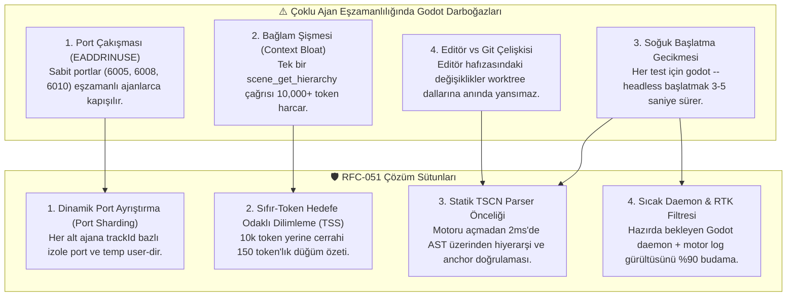
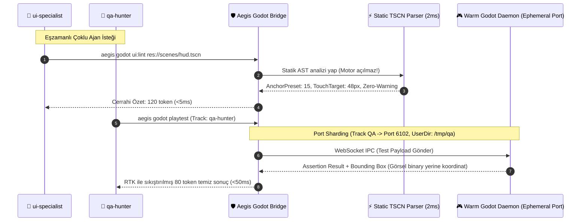

# 🏛️ RFC-051: High-Performance Multi-Agent Godot Toolchain, Ephemeral Port Sharding, and Zero-Token Scene Slicing
### Aegis Autonomous Architecture Blueprint

- **RFC ID:** RFC-051 | **Durum:** Proposed | **Tarih:** 2026-11-08
- **GitHub Discussion:** [#532 (Ideas)](https://github.com/frkntlr/aegis/discussions/532)
- **Tasarımcı:** Aegis Autonomous Fleet & Antigravity Pair Lead

---

## 🔍 1. Mevcut Durum Analizi: Çoklu Ajan Senkron Teamwork'te Godot Darboğazları

Godot oyun motoru mimari olarak tek bir editör ve tek bir çalışma zamanı (runtime) sürecine göre tasarlanmıştır. Aegis `/aegis tw` (Teamwork) protokolünde ise birden fazla alt ajan (`ui-specialist`, `issue-solver`, `qa-hunter`) **aynı anda eşzamanlı (Wave 1 / Wave 2)** olarak çalıştırılır.

Mevcut Godot MCP ve runtime araçları (`godot-ai`, `godot-runtime`, `godot-tools`, `@aegis/godot-bridge`) bu eşzamanlı yapıda şu 4 temel darboğaza yol açmaktadır:



### 1.1 Tekil Port ve Süreç Çakışması (Port Collision)
- Godot WebSocket / Debug köprüleri varsayılan olarak sabit portlara (`6005`, `6006`, `6008`) bağlanır.
- İki alt ajan (ör. `qa-hunter` playtest yaparken `ui-specialist` sahne denetimi yaparsa) aynı porta erişmeye çalışır; biri diğerini ezer ya da `EADDRINUSE` hatasıyla kilitlenir.

### 1.2 Bağlam Şişmesi ve Aşırı Token İsrafı (Context Drift)
- `scene_get_hierarchy` veya `game_get_scene_tree` gibi araçlar tüm düğüm ağacını, transformları, collision vektörlerini devasa JSON olarak (50.000+ karakter, ~10.000 token) ajanın bağlamına döker.
- 2-3 araç çağrısından sonra ajanın bağlam penceresi dolar, akıl yürütme hızı 30-40 saniyeye fırlar ve halüsinasyon riski başlar.
- Base64 ekran görüntüleri (screenshot) iletildiğinde ise model aşırı gecikmeye (`Model unavailable`) girer.

### 1.3 Soğuk Başlatma (Cold-Start) Maliyeti
- Her küçük doğrulama için `godot --headless` motorunu sıfırdan başlatmak shader derlemesi, kaynak taraması ve sunucu ilklendirmesi nedeniyle 2 ila 5 saniye sürer.

---

## 🏗️ 2. Çözüm Mimarisi: 4 Temel Sütun



### Sütun 1: Dinamik Port Ayrıştırma (Ephemeral Port Sharding)
Her alt ajan kendi benzersiz deterministik port havuzunda çalışır:
- Base Port: `6100` (WebSocket) / `6200` (Remote Debug)
- Agent Offset: `Port = BasePort + (Hash(trackId) % 50)`
- İzole Çalışma Dizini: `godot --headless --user-data-dir <tmp_dir_per_track>`
- **Fayda**: İki subagent aynı anda Godot çalıştırsa dahi birbiriyle sıfır çakışma yaşar.

### Sütun 2: Sıfır-Token Hedefe Odaklı Sahne Dilimleme (Targeted Scene Slicing - TSS)
Tüm sahneyi devasa JSON olarak dönmek yerine cerrahi dilimleme uygulanır:
- `aegis godot tree --focus=%StartButton --depth=2`
- Çıktı:
  ```text
  MarginContainer (Preset: 15, Size: 1920x1080)
    └── VBoxContainer
          └── Button#StartButton (MinSize: 44x44, Text: "Başla", Script: "res://ui.gd")
  ```
- **Fayda**: 10.000 token'lık sahne dökümü yerine **120 token**. Token tasarrufu: **%98.8**. Bağlam şişmesi ve yavaşlama tamamen önlenir.

### Sütun 3: Statik TSCN Parser Önceliği (Static Parser First)
Godot motorunu çalıştırmaya gerek kalmadan TypeScript tabanlı `GodotUIParser`:
- `.tscn` dosyasını 2ms içinde doğrudan okur.
- Konteyner hiyerarşisini, responsive anchor kurallarını (`anchors_preset = 15`), minimum dokunma boyutlarını (`>=44px`) doğrular.
- **Fayda**: Motorun 3-5 saniyelik açılış süresi yerine **2 milisaniyede** anında doğrulama!

### Sütun 4: Sıcak Daemon & RTK Log Filtresi (Warm Daemon & Noise Filter)
- Headless Godot tek bir arka plan servisi (daemon) olarak sıcak tutulur.
- Testler WebSocket RPC üzerinden sub-50ms hızla koşturulur.
- Godot'nun Vulkan/Audio/Font gürültüsü `@aegis/watchdog` `RTKTokenKiller` üzerinden süzülerek yalnızca hata stack trace'leri aktarılır.
- Ekran görüntüleri yerine **sayısal sınır kutusu farkları** (`Bounding Box Drift: +12px overflow on Right`) raporlanır.

### Sütun 5: Rol Bazlı Akıllı Araç Sınırları (Role Allowlisting)
Ajanların kafasının karışmasını önlemek için araçlar rollere göre filtrelenir:
- `ui-specialist`: Yalnızca `ui:lint`, `ui:scaffold`, `godot tree` (Statik AST araçları).
- `issue-solver`: Yalnızca GDScript AST, `find_symbol`, `trace_relational`.
- `qa-hunter`: Yalnızca `playtest`, `godot inspect` (Çalışma zamanı ve telemetri).

---

## 💻 3. Modül & Mimari Haritası

```text
packages/plugins/godot-bridge/src/
 ├── godot-port-router.ts        # Ephemeral port havuzu ve hash tabanlı sharding
 ├── ui/
 │    ├── godot-ui-parser.ts     # Statik TSCN AST ayrıştırıcı (<2ms)
 │    ├── godot-scene-slicer.ts  # Zero-token targeted scene slicer (TSS)
 │    └── godot-ui-linter.ts     # Demir Kafes UI kuralları
 ├── rpc/
 │    ├── ws-bridge-server.ts    # Hızlı IPC WebSocket köprüsü
 │    └── warm-daemon-pool.ts    # Sıcak Godot headless havuzu
 └── godot-mcp-provider.ts       # Role göre filtrelenmiş cerrahi MCP araçları
```

---

## 🔒 4. Demir Kafes ve Performans Kriterleri

1. **Gecikme (Latency)**: Statik sahne denetimi < 10ms, sıcak playtest < 100ms.
2. **Bağlam Bütçesi (Token Headroom)**: Hiçbir Godot aracı tek seferde 250 token'dan fazla bağlam tüketemez.
3. **Eşzamanlılık (Zero EADDRINUSE)**: 8 subagent aynı anda çalıştığında sıfır port çakışması garantisi.
4. **Demir Kafes**: Tüm yeni modüller < 300L/dosya, < 40L/fonksiyon, 0 `any`.

---

## 🎯 5. Kabul Kriterleri (Acceptance Criteria)

- [ ] `GodotPortRouter` eşzamanlı `trackId` tabanlı dinamik port dağıtımı tamamlandı.
- [ ] `GodotSceneSlicer` (Targeted Scene Slicing) cerrahi ağaç budama aracı yazıldı.
- [ ] Statik `GodotUIParser` öncelikli kontrol pipeline'ı `@aegis/godot-bridge` içine entegre edildi.
- [ ] Godot test ve playtest çıktıları `RTKTokenKiller` ile gürültüden arındırıldı.
- [ ] Çoklu ajan eşzamanlı test senaryoları birim testleri ile kanıtlandı.
