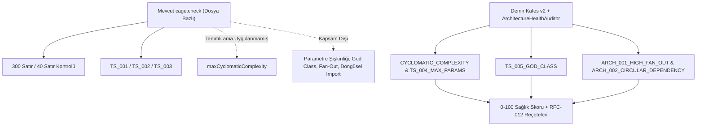
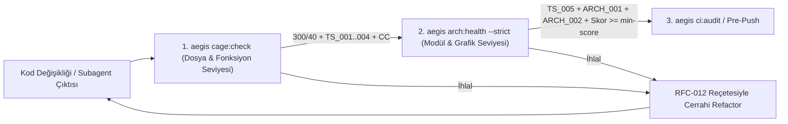

# 🏛️ RFC-053: Anti-Spaghetti and Monolithic Bloat Architecture Health Engine
### Aegis Autonomous Architecture Blueprint

- **RFC ID:** RFC-053 | **Durum:** Proposed | **Tarih:** 2026-11-26
- **İlişkili RFC'ler:** [RFC-012: Demir Kafes Autonomous Architectural Decomposition](./RFC-012-demir-kafes-autonomous-architectural-decomposition-anti-degradation-engine.md)
- **Tasarımcı:** Aegis Autonomous Architecture & Doc Architect

---

## 🔍 1. Problem Tanımı ve Kök Neden Analizi

Aegis'in mevcut statik güvenlik kapısı (`aegis cage:check` / `IronCageValidator`), ajanların dosya ve fonksiyon boyutunu aşmasını (`MAX_FILE_LINES <= 300`, `MAX_FUNCTION_LINES <= 40`) ve temel TypeScript anti-kalıplarını (`TS_001_NO_ANY`, `TS_002_EMPTY_CATCH`, `TS_003_NESTING_DEPTH`) başarıyla engellemektedir. Ancak `packages/` altındaki **382 üretim `.ts` dosyası** üzerinde yürütülen kapsamlı AST denetimi, mevcut kapıların **yapısal şişkinliği (monolithic bloat)** ve **spaghetti mimariyi** göremediğini ortaya koymuştur.

### 1.1 `cage:check` Neden Yapısal Şişkinliği Kaçırdı?

1. **Uygulanmamış Karmaşıklık Kuralı (`maxCyclomaticComplexity`):**
   - `CageValidatorOptions` (`packages/core/iron-cage/src/cage-validator.ts`) içinde `maxCyclomaticComplexity?: number` alanı ve `CageRuleType` (`packages/shared/src/iron-cage.ts`) içinde `'CYCLOMATIC_COMPLEXITY'` kural tipi tanımlanmış olmasına rağmen, `IronCageValidator` ve `CleanArchitectureValidator` içerisinde dallanma/karar karmaşıklığını sayan gerçek bir AST denetimi bulunmuyordu.
2. **Eksik Parametre ve Sınıf Kohezyon Denetimleri:**
   - Fonksiyon imzalarındaki aşırı parametre birikimini (**parameter bloat**) veya 300 satır sınırının hemen altında kalarak onlarca metot barındıran sınıfları (**god classes**) tespit eden kural yoktu.
3. **Dosya İçi Sınırların Modüller Arası Bağımlılığı Görememesi:**
   - `IronCageValidator.validateFileContent()` dosyaları birbirinden bağımsız tekil birimler olarak inceler. Bu nedenle aşırı dışa bağımlılık (**high fan-out**) ve modüller arası **döngüsel bağımlılıklar (circular dependencies)** denetim dışı kalmıştır.



---

## 📊 2. Temel AST Denetim Bulguları (382 Üretim `.ts` Dosyası)

Aegis monoreposundaki `packages/` dizininde yer alan **382 üretim `.ts` dosyası** üzerinde gerçekleştirilen zemin denetiminde aşağıdaki somut yapısal kusurlar saptanmıştır:

### 2.1 Döngüsel Bağımlılıklar (Circular Dependencies)

| Tür | Adet | Tespit Edilen Düğümler / Özet | Risk |
| --- | ---: | --- | --- |
| **Runtime Döngüsel Bağımlılık** | **2** | `packages/cli/src/commands/task-commands.ts` <-> `packages/cli/src/commands/task-mcp-adapters.ts`<br>`packages/cli/src/commands/nlm-auth-helper.ts` <-> `packages/cli/src/commands/nlm-switch-helper.ts` | Modül yükleme sırasına bağlı TDZ / `undefined` referans hatası ve sıkı çift yönlü bağımlılık |
| **Type-Only Döngüsel Bağımlılık** | **23** | `packages/` genelinde 23 adet `import type` çevrimi | Çalışma zamanında silinse de arayüz katmanında çift yönlü mimari kilitlenme |

### 2.2 Siklomatik Karmaşıklık Sıcak Noktaları (Cyclomatic Complexity Hotspots)

| Sembol | Dosya | Ölçülen CC |
| --- | --- | ---: |
| `validateStoredTask` | `packages/core/orchestrator/src/codex-orchestra-validation.ts` | **31** |
| `isTypeDeclarationLine` | `packages/plugins/telemetry-tester/src/mutation-gate.ts` | **31** |
| `matchesTaskRole` | `packages/cli/src/commands/task-inbox-matching.ts` | **30** |
| `classify` | Aegis sınıflandırıcı sıcak noktası (`classify`) | **29** |
| `parsePlanArgs` | `packages/cli/src/commands/teamwork-plan-helpers.ts` | **27** |
| `classifyRawItemHelper` | `packages/core/orchestrator/src/teamwork-objective-parser.ts` | **26** |

### 2.3 Parametre Şişkinliği (Parameter Bloat)

| Sembol | Dosya | Parametre Sayısı |
| --- | --- | ---: |
| `buildTrack` | `packages/core/orchestrator/src/teamwork-track-builder.ts` | **10 parametre** |
| `compileTrackPrompt` | `packages/core/orchestrator/src/teamwork-prompts.ts` | **8 parametre** |
| `compileCompactTrackPrompt` | `packages/core/orchestrator/src/teamwork-prompts.ts` | **8 parametre** |
| `compileUltraLeanPrompt` | `packages/core/orchestrator/src/teamwork-prompts.ts` | **8 parametre** |

### 2.4 God Class Odakları (God Classes)

| Sınıf | Dosya | Metot Sayısı | Import (Fan-Out) |
| --- | --- | ---: | ---: |
| `TeamworkCoordinator` | `packages/core/orchestrator/src/teamwork-coordinator.ts` | **29 metot** | **22 import** |
| `WorktreeLockManager` | `packages/core/orchestrator/src/worktree-lock-manager.ts` | **19 metot** | — |
| `TeamworkMeshStore` | `packages/core/orchestrator/src/teamwork-mesh-store.ts` | **18 metot** | — |
| `CodebaseMemoryEngine` | `packages/core/ast-skeleton/src/codebase-memory.ts` | **17 metot** | **16 import** |

---

## 🛡️ 3. Demir Kafes v2 Anti-Spaghetti Kuralları

Mevcut kurallara ek olarak, hem tekil dosya AST denetimini hem de modül grafiği analizini kapsayan **Demir Kafes v2 Anti-Spaghetti Kuralları** tanımlanmıştır:

| Kural ID | Kapsam | Tespit Mekanizması | Hedef Mimari Düzeltme |
| --- | --- | --- | --- |
| `CYCLOMATIC_COMPLEXITY` | Fonksiyon / Metot | Önceden `CageRuleType` ve `CageValidatorOptions` içinde yalnızca tanımlı olan kural aktifleştirilir; `if`, `else if`, `for`, `for..of`, `for..in`, `while`, `do..while`, `case`, `catch`, `?:`, `&&`, `||`, `??` dallanma noktalarını sayar. | Guard clause, lookup tablosu / strateji haritası, saf yardımcı fonksiyon çıkarma |
| `TS_004_MAX_PARAMS` | Fonksiyon / Metot / Yapıcı | Pozisyonel parametre sayısı eşiği aştığında (ör. `buildTrack` 10 param, `compile*Prompt` 8 param) ihlal üretir. | Parametre Nesnesi (*Options / Context Object*) sözleşmesine dönüştürme |
| `TS_005_GOD_CLASS` | Sınıf (Class) | Bir sınıfın metot sayısı ve sorumluluk yoğunluğu kohezyon sınırını aştığında (ör. `TeamworkCoordinator` 29 metot) ihlal üretir. | RFC-012 **Facade + Delegasyon** ve Tek Sorumluluk (SRP) ayrıştırması |
| `ARCH_001_HIGH_FAN_OUT` | Modül / Dosya Grafiği | Bir modülün dışa doğru yaptığı bağımlılık (`import`) sayısı eşiği aştığında (ör. 22 ve 16 import) yüksek bağımlılık uyarısı/hatası üretir. | Protokol Odaklı Programlama (POP), ara yüz/adaptör soyutlaması |
| `ARCH_002_CIRCULAR_DEPENDENCY` | Proje İthalat Grafiği | TypeScript import grafiğinde Güçlü Bağlı Bileşenler (SCC) / döngüleri tespit eder; çalışma zamanı (`runtime`) ve yalnızca tip (`type-only`) döngülerini ayrıştırır. | Ortak tip/sözleşme modülü çıkarma (`*-types.ts` / `@aegis/shared`) veya tersine bağımlılık (DIP) |

---

## 🏗️ 4. `ArchitectureHealthAuditor` Tasarımı

`ArchitectureHealthAuditor`, dosya içi AST metriklerini proje geneli bağımlılık grafiğiyle birleştirerek deterministik bir mimari sağlık raporu üretir.

### 4.1 0–100 Mimari Sağlık Skoru
Denetçi, taranan tüm üretim dosyaları ve bağımlılık grafiği üzerinden **0 ile 100 arasında normalize edilmiş bir sağlık skoru** hesaplar:
- **Çalışma Zamanı Döngüleri (`runtime` cycles):** En yüksek ceza ağırlığına sahiptir; modül yükleme determinizmini bozduğu için kritik önceliklidir.
- **Type-Only Döngüler (`type-only` cycles):** Derleme sonrası silindiği için daha düşük ağırlıkla izlenir ancak mimari sınır sızıntısı olarak raporlanır.
- **Karmaşıklık, Parametre Şişkinliği, God Class ve High Fan-Out İhlalleri:** Ağırlıklı yoğunluk ve ihlal şiddetine göre skordan düşülür.

### 4.2 Runtime vs. Type-Only Döngü Ayrımı
`ArchitectureHealthAuditor`, AST üzerinde her `ImportDeclaration` ve `ExportDeclaration` düğümünü inceler:
- **`runtime` kenarı:** Değer ithalatları (`import { foo } from './bar'`), yan etkili importlar ve dinamik `import(...)` çağrıları.
- **`type-only` kenarı:** `import type { Foo } from './bar'` veya yalnızca `type` belirteci içeren adlandırılmış importlar (`import { type Foo } from './bar'`).
Bu ayrım sayesinde `task-commands.ts <-> task-mcp-adapters.ts` ve `nlm-auth-helper.ts <-> nlm-switch-helper.ts` gibi gerçek çalışma zamanı döngüleri, `import type` döngüleriyle karıştırılmadan doğrudan önceliklendirilir.

### 4.3 RFC-012 Ayrıştırma Reçeteleri (Decomposition Prescriptions)
Her bulgu, soyut bir uyarı yerine [RFC-012](./RFC-012-demir-kafes-autonomous-architectural-decomposition-anti-degradation-engine.md) kalıplarına bağlı somut bir aksiyon reçetesiyle eşleştirilir:
- **Runtime Cycle (`ARCH_002_CIRCULAR_DEPENDENCY`):** Paylaşılan sözleşmeleri veya saf yardımcıları üçüncü bir yaprak modüle (`*-types.ts` / `*-shared.ts`) taşı ya da bağımlılığı tersine çevir.
- **CC Hotspot (`CYCLOMATIC_COMPLEXITY`):** Erken çıkış (*guard clause*), kural tablosu (*declarative rule table*) veya tek sorumluluklu yardımcı fonksiyonlara böl.
- **Parameter Bloat (`TS_004_MAX_PARAMS`):** İlgili parametreleri tiplenmiş bir `*Options` / `*Input` arayüzünde topla.
- **God Class (`TS_005_GOD_CLASS`) & High Fan-Out (`ARCH_001_HIGH_FAN_OUT`):** Ana sınıfı ince bir `Facade` olarak koruyup alt sorumlulukları bağımsız delege sınıflara aktar.

---

## 💻 5. CLI Arayüzü: `aegis arch:health`

Yeni mimari sağlık denetimi `aegis arch:health` (takma adı: `aegis arch:audit`) komutu üzerinden çalıştırılır:

```bash
# Varsayılan mimari sağlık denetimi (0-100 skor + sıcak noktalar + döngüler)
aegis arch:health

# Belirli bir dizini JSON çıktısıyla denetle
aegis arch:health packages --json

# Katı CI/Pre-push kapısı: sıfır döngü ve minimum sağlık skoru barajı
aegis arch:health --strict --max-cycles=0 --min-score=85
```

### Desteklenen CLI Bayrakları

| Bayrak | Açıklama |
| --- | --- |
| `--json` | Denetim sonucunu (sağlık skoru, çalışma zamanı/tip döngüleri, CC sıcak noktaları, parametre şişkinliği, god class listesi, fan-out metrikleri ve RFC-012 reçeteleri) makine tarafından okunabilir JSON olarak basar. |
| `--strict` | Katı kapı modunu etkinleştirir; tespit edilen anti-spaghetti kural ihlallerinde sürecin hata koduyla (`exit code 1`) sonlanmasını sağlar. |
| `--max-cycles=<n>` | İzin verilen azami döngüsel bağımlılık sayısını belirler; eşik aşıldığında kapıyı başarısız sayar. |
| `--min-score=<n>` | Kabul edilebilir en düşük `0-100` mimari sağlık skorunu belirler; skor bu değerin altına düşerse kapı reddedilir. |

---

## 🔄 6. Sürekli Önleme İş Akışı (`cage:check` + `arch:health`)



1. **Geliştirme Anı / Hızlı Kontrol:** `aegis cage:check` dosya sınırlarını (300/40), yasaklı kalıpları (`TS_001`–`TS_004`) ve `CYCLOMATIC_COMPLEXITY` sınırını milisaniyeler içinde denetler.
2. **Mimari ve Grafik Denetimi:** `aegis arch:health --strict --max-cycles=0 --min-score=<hedef>` proje genelinde `TS_005_GOD_CLASS`, `ARCH_001_HIGH_FAN_OUT` ve `ARCH_002_CIRCULAR_DEPENDENCY` gerilemelerini (regression) yakalar.
3. **CI / Merge Pipeline:** Hem `cage:check` hem `arch:health` kapıları geçilmeden yeni god class, runtime döngüsel bağımlılık veya yüksek karmaşıklık sıcak noktası ana dala birleştirilmez.

---

## 🎯 7. Kabul Kriterleri (Acceptance Criteria)

- [ ] `IronCageValidator` içinde `CYCLOMATIC_COMPLEXITY` (`maxCyclomaticComplexity`), `TS_004_MAX_PARAMS` ve `TS_005_GOD_CLASS` kuralları aktif olarak uygulanır.
- [ ] `ArchitectureHealthAuditor`, `ARCH_001_HIGH_FAN_OUT` ve `ARCH_002_CIRCULAR_DEPENDENCY` kurallarıyla runtime ve type-only döngüleri ayrıştırır, `0-100` sağlık skoru ve RFC-012 reçeteleri üretir.
- [ ] `aegis arch:health` (`aegis arch:audit`) komutu `--json`, `--strict`, `--max-cycles` ve `--min-score` bayraklarıyla çalışır.
- [ ] Temel denetimde tespit edilen 2 runtime döngüsü (`task-commands.ts <-> task-mcp-adapters.ts`, `nlm-auth-helper.ts <-> nlm-switch-helper.ts`) ve en yüksek CC / parametre / god class sıcak noktaları RFC-012 reçeteleriyle kademeli olarak azaltılır.
