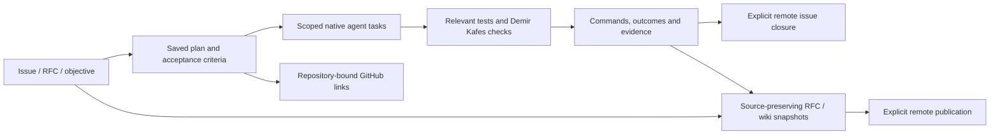

# Teamwork, GitHub and documentation evidence flow

Validated 2026-11-12. Run `2c4a9354-6e91-44d6-a9dc-2f5407956eb5` used two
native Codex workers in parallel, with root integration and documentation fixes.
No live GitHub issues, discussions or wiki publications were created during this
validation. Remote behavior was exercised with injected adapters and failures.

## Intended lifecycle



The key distinctions are source status, execution status, verification evidence
and publication status. Creating a plan or document does not prove code was
implemented, checks passed, a remote object exists or a wiki was published.

## Implemented contracts

`aegis tw:gh --plan=<saved-plan-id>` links an existing saved plan to GitHub.
The objective route still creates and saves a plan. Both clients share this
integration; native Codex and Antigravity agent invocation schemas remain separate.

Real discussion and track issue links are stored atomically under
`.aegis/teamwork-github/<plan-id>.json`. This record includes repository identity,
successful entries and per-track failures. It never replaces local numeric inbox
IDs with remote issue numbers. Retrying the same saved plan reuses recorded
successes. Three workers bound issue-creation concurrency, and a per-plan lock
rejects simultaneous duplicate sync attempts instead of blocking the event loop.
Repository mismatch and malformed saved links stop retry before remote calls.

Offline configuration, API errors and incomplete responses now fail explicitly.
There are no fabricated fallback issue IDs or URLs. A canonical URL derived by
the lower adapter from a confirmed real issue ID is distinct from those removed
fallbacks. Returned raw `state: closed` confirms closure; a `status:done` label
on an open issue is insufficient.

Close an issue with supplied evidence:

```text
aegis tw:gh:close <full-commit-hash> "<summary>" <remote-issue-number> <proof.json>
```

```json
{
  "checks": [
    {
      "command": "aegis verify:task src/feature.ts",
      "outcome": "passed",
      "evidence": "Reference the actual quality-gate output here"
    }
  ]
}
```

Only commands actually executed and their actual outcomes belong in this file.
The closure API validates supplied evidence fields; it does not execute those
commands, authenticate logs or establish that the given commit contains the
tested changes. Its remote comment describes coordinator-supplied evidence,
not an independently attested quality certificate. Local `task:release done`
no longer bypasses this flow by automatically closing a remote issue.

## Documentation behavior

RFC-to-wiki conversion preserves the original text, incomplete criteria and
declared status. Missing status remains `Unspecified`; approval does not imply
implementation or successful Demir Kafes/test execution. Counts reflect source
files, not the largest RFC identifier. README sync no longer invents fixed MCP
or wiki page counts.

Local pages say they are cached locally. Remote availability failures report
unavailable, and page persistence failures cannot become in-memory successes.
Unchanged page content causes no rewrite or Git commit; explicitly requested
pushes still execute. Partial RFC cache failures are reported and prevent bulk
remote publication of the incomplete suite.

## Validation and remaining limits

- Build and typecheck passed; `npm test` reports 1,115 passing tests, zero
  failures. Unchanged Turbo tasks reused cached results.
- Eighteen affected TypeScript files passed `verify:task`; the final store/test
  changes were checked again. `git diff --check` passed.
- Focused regressions exercise bounded concurrency, retry after partial failure,
  local/remote ID separation, repository mismatch, corrupt links, proof refusal,
  raw closure state, RFC status preservation and unchanged wiki writes.
- If GitHub creates an object but local persistence subsequently fails, manual
  reconciliation is required before retry; this is not a distributed exactly-once
  transaction. An interrupted lock also requires reconciliation.
- Direct calls to the legacy `GitHubClient.completeIssue` API still have their
  old semantics; the teamwork task-release path no longer uses that API.
- Live GitHub permissions, network failures and Antigravity execution require
  their own environment checks; mock success does not establish live access.

The next architectural improvement is a machine-generated verification artifact
bound to source hashes and the tested commit. That would make the proof chain
stronger than the current coordinator-supplied evidence, without treating
generated prose as a test result.
